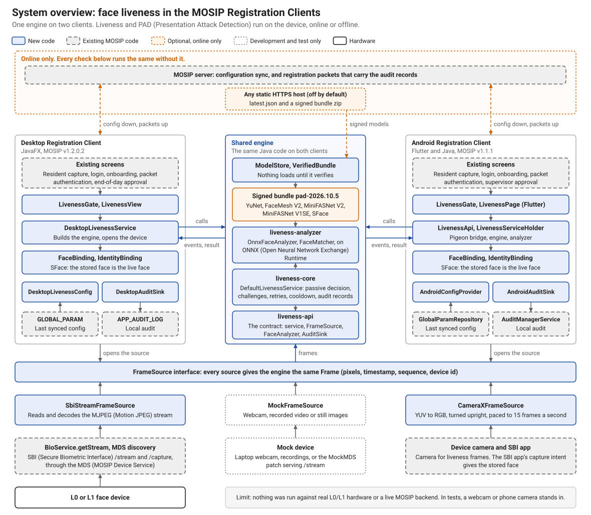

# Face liveness and presentation attack detection for the MOSIP Registration Clients

Our solution to **MOSIP Decode 2026, problem statement 04: Face Liveness Detection and Presentation Attack Detection for
Registration and Biometric Authentication.**

Before a MOSIP Registration Client accepts a face, this project checks that the face belongs to a live person in front of
the camera, and not a printed photo, a photo on a screen or a replayed video. It works in both clients, Desktop (Java) and
Android (Flutter), through one shared engine, and it runs entirely on the device, so it behaves the same with or without a
network.

- **Passive check first.** The person just looks at the camera. AI models on the device score the face from the normal
  frame stream, and in our tests most people passed in a few seconds with nothing to do.
- **Active check when needed.** If the score is not high enough, the client asks for random actions (blink, smile, turn
  left, turn right). The person cannot choose them or predict them.
- **Presentation Attack Detection (PAD) runs the whole time,** including during challenges. A suspected attack gets only a
  generic message, and the details go to the audit log.
- **All three workflows are covered:** resident capture, operator authentication and supervisor authentication, each with
  its own configurable policy.
- **Face binding.** The live face must also be the person whose face is captured, so the check cannot be passed by one
  person and the capture done by another.
- **Device independent.** Frames arrive through one common interface, with adapters for MOSIP's Secure Biometric Interface
  (SBI), a mock device, a webcam and the Android camera.
- **Signed models.** The models load only from a bundle whose signature and hashes verify. A tampered bundle is refused,
  with no fallback.

## Try it

You do not need a MOSIP server or a biometric device.

| Route | What you need | Time |
|---|---|---|
| Android app on a phone | The APK from the submission pack, an arm64 Android 9+ phone | 5 minutes |
| Desktop demo on a webcam | The demo folder from the submission pack, Windows, Java 11+ | 3 minutes |
| Build the engine and run its tests | JDK 11, Maven, Git | About 10 minutes |
| Build the real Desktop client | As above, plus MOSIP's `registration-client` v1.2.0.2 | About 20 minutes |
| Build the Android client | Flutter 3.10.4, JDK 21, Android SDK 34 | About 20 minutes |

Step-by-step instructions for each route are in **[docs/usage-and-installation.md](docs/usage-and-installation.md)**.

## How it works



A device or camera delivers frames through `FrameSource`. The analyzer finds the face, checks its quality, fits landmarks,
estimates head pose and scores liveness with ONNX Runtime models. The engine turns those per-frame results into a decision.
At a score of 0.85 or above the face passes; below 0.30 the attempt fails as an attack; in between, a challenge starts. All
of these values can be configured, per workflow, through MOSIP's normal configuration.

More diagrams are in [docs/architecture-diagrams.md](docs/architecture-diagrams.md).

## Results

Evaluated with the metrics of ISO/IEC 30107-3, on 178 recorded presentations: 47 bona fide takes from four people, and 131
attacks using prints, photos on screens and replayed videos.

| Measure | Result |
|---|---|
| Attacks accepted by the passive check | 0 of 131. For the headline attack type, 0 of 10 responding takes (95% upper bound 25.9%) |
| Bona fide takes rejected as attacks | 0 of 36 responding takes (95% upper bound 8.0%) |
| Bona fide takes passed with no action | 32 of 36 responding takes (88.9%). The other 4 went to a challenge |
| Bona fide takes with no decision | 11 of 47 (23.4%), mostly a face too far away in a fixed recording. Live, the screen says "move closer" |
| Automated tests | 1,267, none failing across ten modules, all passing on a clean build. See the [test report](docs/test-cases-and-results.md) |
| Requirements traced | 229 from the problem statement: 213 done, 16 partial, 0 not started. See the [traceability matrix](docs/requirements-traceability.md) |
| Android speed | About 42 to 57 ms per analysed frame on a Samsung Galaxy S23 FE, and about 140 ms on a 2019 Redmi Note 7 |

**Please read these results with their limits.** They come from one webcam, two test phones and four people, so they are
provisional and do not estimate error rates in the field. Nothing has been run on real L0/L1 biometric hardware: the phone
camera, a webcam and MOSIP's MockMDS stood in for the device. Neither client has been run from end to end against a MOSIP
server. The identity check is the weakest result. It compares a live face with a stored face, and it refused the right person
in 27.1% of pairs when the stored face was a single old photo from another camera, against 2.3% with a same-session template.
At the same threshold it accepted a different person in 3.5% of same-room webcam pairs. The
[test report](docs/test-cases-and-results.md) has the full figures.

## Submission documents

| Deliverable | Where |
|---|---|
| Usage and installation instructions | [docs/usage-and-installation.md](docs/usage-and-installation.md) |
| API documentation | [docs/api-documentation.md](docs/api-documentation.md) |
| Architecture diagrams | [docs/architecture-diagrams.md](docs/architecture-diagrams.md) |
| Design mockups and wireframes | [docs/design-mockups-and-wireframes.md](docs/design-mockups-and-wireframes.md) |
| Test data | [docs/test-data.md](docs/test-data.md) |
| Test cases and results | [docs/test-cases-and-results.md](docs/test-cases-and-results.md) |
| Requirements traceability | [docs/requirements-traceability.md](docs/requirements-traceability.md) |
| ISO/IEC 30107-3 evaluation | [docs/part2-iso30107-evaluation.md](docs/part2-iso30107-evaluation.md) |

## Repository map

This repository is an overlay on MOSIP's code, not a fork. Its Java modules go on top of the `registration/` folder of
MOSIP's `registration-client`, and its Android changes are patches against `android-registration-client`.

| Path | What it is |
|---|---|
| `liveness-api/` | The shared contract: `Frame`, `FrameSource`, `FaceAnalyzer`, `LivenessService`, error codes, configuration |
| `liveness-core/` | The engine: session state machine, passive decision, random challenges, action detectors, retries, policy, audit |
| `liveness-analyzer/` | The ONNX analyzer, PAD, face binding, signed-bundle checks and model updates |
| `liveness-fake/` | A scripted engine, so that each screen can be shown on demand |
| `liveness-tools/`, `liveness-eval/` | Developer tools: traces, tuning, benchmark, dataset recording, ISO/IEC 30107-3 evaluation |
| `models/` | The five signed ONNX models, their licences and the Python reference pipeline |
| `registration-services/`, `registration-client/` | The Desktop integration, added to MOSIP's own modules |
| `android-integration/` | 68 patches against the Android client v1.1.1, with build scripts |
| `android-liveness-frame-source/` | The Android camera source (CameraX) |
| `mock-mds-patch/` | The patch that lets MOSIP's MockMDS stream real face frames |
| `docs/` | Design, evaluation and submission documents |

## Team

Team OFF GAurd, IIIT Bangalore. Work was split into five parts, and all of it went through
[24 pull requests](https://github.com/ChadDadChag/Mosip26/pulls?q=is%3Apr+is%3Amerged).

| Part | Scope | Members |
|---|---|---|
| 1 | Device and frame pipeline, mock device, MockMDS patch | Nikhil Pennam |
| 2 | Passive liveness, PAD, signed models, ISO/IEC 30107-3 evaluation | Varun E |
| 3 | Challenges and the liveness engine | Tejas Kollipara |
| 4 | Desktop Registration Client integration | Saketh Kumar Reddy (commit author `saket`) |
| 5 | Android Registration Client integration | Varun E and Shashank Peddi |

How to read the Git history:
- Parts 1 and 4 reached this repository as large uploads, so they show few commits: Part 1 in two "Add files via upload"
  commits, and Part 4 in one commit.
- Varun and Shashank worked on Part 5 together on Varun's laptop, so those commits are under Varun's account
  (`Varun-iiitb`, also shown as `Varun E`).

## Licence

This project is under the [Mozilla Public License 2.0](LICENSE), the licence of MOSIP's own Registration Client. The AI models are third-party work under their own licences, listed in [models/LICENSES.md](models/LICENSES.md).

---

The rest of this file holds the detailed notes for each part, in the order the parts were delivered.

# Part 1: Device and frame pipeline

Part 1 gets face frames from a biometric device (or a stand-in) into one common
shape, so the liveness code (Parts 2/3) never depends on SBI, MDS or camera APIs.

    device / camera / file  ->  FrameSource  ->  Frame  ->  FrameSource.Listener.onFrame()

`Frame` (from `liveness-api`) carries pixels plus their format (RGB888, or GRAY8 for
mono/NIR cameras), width, height, timestamp, sequence number and device ID.
`FrameSource` has `start(listener)`, `stop()`, `isRunning()` and `info()`. `info()`
includes `DeviceCapabilities`: the formats, resolutions and frame rates the device supports.

The Part 2 reference analyzer that used to live here (`liveness/engine`) has moved to
the `liveness-analyzer` module (package `io.mosip.registration.liveness.analyzer.heuristic`).
It is not part of Part 1 and is documented separately in its own delivery notes.

## Part 1 checklist

| Item | Where |
|---|---|
| Study of the existing integration (MDS discovery, `/capture`, `/stream`) | `docs/part1-frame-streaming-architecture.md` §1 |
| `Frame`: pixels, timestamp, format, device ID, sequence | `liveness-api/.../Frame.java` |
| `FrameSource` common device abstraction | `liveness-api/.../FrameSource.java`, interface table in docs §2 |
| SBI adapter: MJPEG `/stream`, decode, continuous or every Nth frame | `SbiStreamFrameSource`, `SbiStreamFrameSourceFactory` |
| Mock L0/L1 device: webcam relay, recorded video, static images | `MockFrameSource` (+ `asCertificationLevel`), `WebcamGrabbers` (`OpenCvWebcamFrameGrabber` by default, `SarxosWebcamFrameGrabber`), `MjpegRecorder` |
| Device errors: unavailable, connection failure, disconnect/reconnect, corrupt/incomplete frames | `SbiStreamFrameSource`, `MjpegFrameReader`; table in docs §6 |
| Capability discovery (formats, resolutions, frame rates) | `DeviceCapabilities`, `CapabilityProbe`, per-source table in docs §7 |
| Android frame source (CameraX; SBI-intent decision explained) | `android-liveness-frame-source/`, docs §5 |
| Deliverables: interface, architecture diagram, mock device | docs §2–§5, `MockFrameSource` |
| MockMDS streams real frames, and its `serialNo` bug is fixed | `mock-mds-patch/` |
| Liveness debug window and headless runner (preview, face box, score, prompts, Retry) | `LivenessHarness`, `PreviewFrameSource` |
| Interoperability and end-to-end tests (device path to engine, unplug and replug, recorded clips) | `DevicePathInteropTest`, `UnplugReplugIntegrationTest`, `RecordedVideoE2ETest`, `SbiStreamProbe` |
| Test data protocol and QA checklist | `docs/part1-test-data-protocol.md`, `docs/part1-qa-checklist.md`, `scripts/record-liveness-clip.*` |

## What is in here

| Path | What it is |
|---|---|
| `registration/liveness-api/` | The shared contracts (`Frame`, `FrameSource`, `DeviceCapabilities`, `ErrorCode`, ...). New Maven module. |
| `registration/registration-services/.../liveness/device/sbi/` | `SbiStreamFrameSource` + `SbiStreamFrameSourceFactory`: reads the existing SBI `/stream` MJPEG through `BioService.getStream()`. |
| `.../liveness/device/util/` | `MjpegFrameReader` (MJPEG parsing), `JpegToRgb888Converter` (JPEG to RGB888), `CapabilityProbe`, `PreviewFrameSource` (sends every frame to a preview as well as to the engine). |
| `.../liveness/device/mock/` | `MockFrameSource` (3 modes), `WebcamGrabbers`, `OpenCvWebcamFrameGrabber`, `SarxosWebcamFrameGrabber`, `MjpegRecorder`. |
| `.../liveness/device/demo/` | `FramePipelineDemo` (frames only), `LivenessHarness` (the whole pipeline with the real engine), `SbiStreamProbe` (checks any MDS `/stream` the way the client calls it). |
| `android-liveness-frame-source/` | `CameraXFrameSource` for Android. Not part of the Maven build. |
| `mock-mds-patch/` | The patch for MOSIP's MockMDS: the `serialNo` fix plus real face frames (images, video, webcam). See its README. |
| `scripts/record-liveness-clip.sh`, `.ps1` | Record a labelled test clip from the webcam. |
| `docs/part1-frame-streaming-architecture.md` | Existing-integration analysis, interface, architecture and sequence diagrams, error and capability tables. |
| `docs/part1-test-data-protocol.md`, `docs/part1-qa-checklist.md` | What to film and how to keep it private; the problem-statement checklist for Part 1. |
| `registration/pom.xml`, `registration/registration-services/pom.xml` | Small edits: the liveness modules, the `liveness-api` and `liveness-core` dependencies (the harness and end-to-end tests run the real engine), and `webcam-capture` 0.3.12. |

No existing Registration Client class (Streamer, controllers, SBI provider, BioServiceImpl,
`/capture`) is modified.

## How to install

Requirements: **JDK 11** (the upstream build uses Lombok 1.18.16, which does not run on newer
JDKs), **Maven 3.6+**, **Git**, and internet access for the first build.

1. Get the Registration Client at the version the patch is built against:

       git clone --depth 1 --branch v1.2.0.2 https://github.com/mosip/registration-client.git

2. Copy the contents of this repository over `registration-client/registration/`.
   The two `pom.xml` files are the v1.2.0.2 originals plus only the liveness additions, and
   `.gitignore` keeps all of MOSIP's entries.

## Build and test

PowerShell, from `registration-client\registration` (adjust the JDK/Maven paths to yours):

    $env:JAVA_HOME = "C:\path\to\jdk-11"
    $mvn = "C:\path\to\apache-maven\bin\mvn.cmd"

    # build + Part 1 tests only (fast)
    & $mvn -pl liveness-api,liveness-core,registration-services -am test "-Dtest=**/liveness/**/*Test,FrameTest" "-Dsurefire.failIfNoSpecifiedTests=false" "-Dgpg.skip"

    # build without tests
    & $mvn -pl liveness-api,liveness-core,registration-services -am install "-DskipTests" "-Dgpg.skip"

The first build downloads all MOSIP dependencies and takes a while; later builds are offline-fast.

## Run the demo (see the pipeline working)

`FramePipelineDemo` opens a source and shows a live preview with sequence number,
resolution, delivered FPS and any device errors. After the `install` above:

    cd registration-services
    & $mvn -q exec:java "-Dexec.mainClass=io.mosip.registration.liveness.device.demo.FramePipelineDemo" "-Dexec.args=webcam 15"
    & $mvn -q exec:java "-Dexec.mainClass=io.mosip.registration.liveness.device.demo.FramePipelineDemo" "-Dexec.args=images C:\path\to\photos 10"
    & $mvn -q exec:java "-Dexec.mainClass=io.mosip.registration.liveness.device.demo.FramePipelineDemo" "-Dexec.args=video C:\path\to\clip.mjpeg 15 2"

Arguments: `webcam [fps] [stride]`, `images <fileOrDir> [fps] [stride]`, `video <file.mjpeg> [fps] [stride]`.
Close the window to stop. To make a `.mjpeg` recording from your webcam or a folder of images:

    & $mvn -q exec:java "-Dexec.mainClass=io.mosip.registration.liveness.device.mock.MjpegRecorder" "-Dexec.args=webcam 150 15 C:\path\to\clip.mjpeg"
    & $mvn -q exec:java "-Dexec.mainClass=io.mosip.registration.liveness.device.mock.MjpegRecorder" "-Dexec.args=images C:\path\to\photos C:\path\to\clip.mjpeg"

## Run the liveness harness (the whole pipeline)

`LivenessHarness` connects a frame source, Part 2's ONNX analyzer (the signed model bundle; `--analyzer heuristic`
or `-Dliveness.analyzer=heuristic` selects the earlier stand-in, `HeuristicFaceAnalyzer`) and the real
Part 3 engine. The window shows:
- the live preview, with the detected face box and the liveness score
- the current status, the challenge prompt and its progress, and positioning guidance, using the problem-statement texts
- the result, with Start, Retry and Cancel buttons

    & $mvn -q exec:java "-Dexec.mainClass=io.mosip.registration.liveness.device.demo.LivenessHarness" "-Dexec.args=webcam"
    & $mvn -q exec:java "-Dexec.mainClass=io.mosip.registration.liveness.device.demo.LivenessHarness" "-Dexec.args=video C:\path\to\clip.mjpeg 15 --workflow operator --diagnostic"

Arguments: `webcam [fps]`, `video <file.mjpeg> [fps]`, `images <fileOrDir> [fps]`, plus `--workflow resident|operator|supervisor`,
`--analyzer onnx|heuristic` (default onnx),
`--diagnostic` (prints the audit, `diag.*` per-attempt score statistics and the metrics) and `--headless` (no window).
Headless mode presses Retry automatically and exits with 0 (PASSED), 1 (FAILED) or 2 (cancelled or timed out).

The heuristic stand-in is not a real PAD model: it can pass a photo. Use the default ONNX analyzer for PAD results.

The SBI path (`SbiStreamFrameSource`) needs a running MDS (a real device or the patched MockMDS) and is used
from inside the Registration Client (see "How to use it" below). To check an MDS stream on its own, use `SbiStreamProbe`
(see `mock-mds-patch/README.md`).

## How to use it

Real SBI device (uses the existing MDS discovery and `/stream`):

    SbiStreamFrameSourceFactory factory = new SbiStreamFrameSourceFactory(
            deviceSpecificationFactory, bioService,
            15_000L,  // frameTimeoutMs: no bytes for this long = stalled
            2,        // frameStride: process every 2nd frame (1 = every frame)
            3,        // maxReconnectAttempts after a mid-stream drop (0 = off)
            500L);    // reconnectBackoffMs
    FrameSource source = factory.create("FACE_FULLFACE");   // fails fast if the device is unavailable
    source.start(new FrameSource.Listener() {
        public void onFrame(Frame f) { /* RGB888 in f.rgb() */ }
        public void onError(ErrorCode code, String detail, boolean recoverable) { }
    });
    ...
    source.stop();

With `frameStride = 3` you receive sequence numbers 0, 3, 6, ...: the sequence is the
raw frame index, so skipped frames show up as gaps. `stop()` followed by `start()` (a
retry) is safe even while the previous connection is still unwinding.

Capability discovery:

    source.info().capabilities;                                     // MJPEG declared; resolution/fps fill in while streaming
    factory.probeCapabilities("FACE_FULLFACE", 20, 5_000L);         // open briefly and measure
    CapabilityProbe.probe(anyFrameSource, 20, 5_000L);              // same, for any source

Mock device, no hardware or MDS needed:

    MockFrameSource.ofVideoFile(Path.of("clip.mjpeg"), 15.0, true);   // replay a recorded MJPEG file
    new MockFrameSource(Path.of("images/"), 10.0);                    // cycle static images (attack tests)
    MockFrameSource.ofWebcam(WebcamGrabbers.create(), 15.0);   // real webcam: OpenCV, or -Dliveness.capture=sarxos
    new MockFrameSource(Path.of("images/"), 10.0).asCertificationLevel("L1");   // pose as an L1 device

Making recordings for `ofVideoFile` (same framing as SBI `/stream`):

    MjpegRecorder.record(sbiOrWebcamSource, Path.of("clip.mjpeg"), 150, 20_000L);
    MjpegRecorder.fromImages(Path.of("frames/"), Path.of("clip.mjpeg"));

    java -cp <classpath> io.mosip.registration.liveness.device.mock.MjpegRecorder images frames/ clip.mjpeg
    java -cp <classpath> io.mosip.registration.liveness.device.mock.MjpegRecorder webcam 150 15 clip.mjpeg

## Trying it against the MockMDS service

Unpatched MockMDS does not stream to the Registration Client. The client's `StreamSbiRequestDTO`
sends `serialNo`, but MockMDS looks the device up by `deviceId`, finds nothing, and answers with
error 605. This also breaks the client's existing face preview.

An alias from `serialNo` to `deviceId` is not enough. The face device's serial number (`2345678901`)
is not its `deviceId` (`3`).

`mock-mds-patch/` fixes the lookup: MockMDS accepts either `deviceId` or the DigitalId serial number. The
patch also makes the face stream send images, a recorded video or the webcam. Apply it, then start MockMDS
with the run command in `mock-mds-patch/README.md` and run the Registration Client's device discovery as usual.

Checked live: unpatched MockMDS returned 605. Patched, it streamed 45 of 45 frames of a recording, in
order and byte-identical through `MjpegFrameReader`.

## Behaviours worth knowing

- The existing SBI provider reads one frame as a sanity check before returning the stream,
  so the first frame you receive is the device's second.
- A frame whose framing is fine but whose JPEG is corrupt is reported as `INVALID_FRAME`
  (recoverable) and skipped. A dropped connection or unparseable framing triggers reconnect.
  A `Content-Length` over 16 MiB, or 64 KiB of header without one, counts as unparseable framing,
  so a corrupt stream cannot exhaust memory or spin. Garbage containing no `0xFF` byte can desync
  the framing; this was tested and is a property of the existing wire format.
- MDS device info has no resolution/FPS, so for SBI devices those capabilities are OBSERVED
  from the stream (`DeviceInfo.maxWidth` etc. are 0 until the first frame).
- Android frames are rotated upright using CameraX's rotation and are not mirrored.
- How the engine handles errors from a frame source:
  - A device error (unavailable, connection failure, disconnect, camera unavailable) shows "Device error" with
    Retry, and is never counted as a liveness attempt.
  - Retry is offered for the first 3 device errors in a session. A 4th device error ends the session with that
    device code.
  - `INVALID_FRAME` from the source counts as a corrupt frame: 3 of them fail the attempt as `INVALID_FRAME`.

## Test status (be aware)

- **Real build.** The suite runs inside the real Registration Client v1.2.0.2 build (JDK 11, the upstream MOSIP
  classes, no stubs), with the "Build and test" command above. At Part 1's delivery the Part 1 liveness tests totalled
  96, all passing: the original 83, plus 13 new. 72 of them run in `registration-services`; F13b added 9
  (`WebcamGrabbersTest`), so 81 as of 2026-10-28. The other 24 test the Part 2 heuristic analyzer and moved with it
  to `liveness-analyzer`, where they are counted in its 258.
- **New tests:**
  - preview tee
  - harness model and headless run
  - `SbiStreamProbe`
  - device-path interoperability
  - unplug and replug through the real engine
  - recorded-clip end-to-end
- **Bugs found and fixed.** The unplug and replug test found an engine bug, now fixed in Part 3: a frame left over
  from before the unplug could resume the attempt and swallow the user's Retry.
- **MockMDS.** The patched MockMDS was run as a process. `SbiStreamProbe` and the client's own request got 45 of
  45 frames from a recording. The patch's own `FaceStreamProviderTest` passes (7).
- **Not run with hardware:**
  - The MockMDS webcam mode compiles against the real `webcam-capture` 0.3.12 jar, but has not been run with a
    camera here.
  - `SarxosWebcamFrameGrabber` ran with the laptop webcam in Part 4's screen demo on 2026-10-27. Its shutdown hook
    hung the demo's exit once, which is F13b. Since F13b the development tools default to `OpenCvWebcamFrameGrabber`
    (the openpnp OpenCV that the evaluation tools already use, F13) and release the camera before they exit, with a
    watchdog against a hung shutdown (`WebcamGrabbers.exit`). On 2026-10-28 two live screen-demo runs with the webcam
    exited cleanly, but which grabber ran (OpenCV, or the sarxos fallback) was not captured. If OpenCV cannot open the
    camera once (for example, another program holds it), that frame source
    stays on sarxos, and its shutdown hook, until the tool restarts: close the other program and restart the tool.
  - `CameraXFrameSource` type-checks against stubs of the CameraX/Android types it uses. Its YUV→RGB conversion,
    rotation (0/90/180/270) and stride were run on synthetic frames. It has not been built with the Android SDK or
    run on a device.
  - Nothing has been run against real SBI hardware.
- **Manual checks.** The checks that need hardware or people are listed in `docs/part1-qa-checklist.md`.

---

# Part 3: Active challenges, orchestrator and config

Part 3 is the liveness engine. It takes frames from any `FrameSource` (Part 1) and per-frame results from any `FaceAnalyzer` (Part 2), and decides PASSED or FAILED for the resident, operator and supervisor workflows. It is pure Java with no runtime dependencies beyond `liveness-api`, so the same jars run in the Desktop client and in the Android native layer.

| Module | What | Ships in the apps |
|---|---|---|
| `liveness-core/` | `DefaultLivenessService`: the session state machine, passive decision, random challenges, blink/smile/turn/look detectors, retries, timeouts, cooldown, policy and audit | yes |
| `liveness-fake/` | `FakeLivenessService`: scripted scenarios with real timing, retry and cancel, so the UIs can be built before the real engine runs (see `liveness-fake/README.md`) | dev builds |
| `liveness-tools/` | Trace recorder, replayer and threshold-tuning report (see `liveness-tools/README.md`) | no |

## Build and test (Part 3)

Use the same setup as above (JDK 11, Registration Client v1.2.0.2 checkout, patch copied over `registration/`), and also copy `liveness-core`, `liveness-fake` and `liveness-tools`. Then, from `registration-client/registration`:

    mvn -pl liveness-api,liveness-core,liveness-fake,liveness-tools -am verify "-Dgpg.skip"

As of 2026-10-28 this runs 289 tests (api 5, core 228, fake 44, tools 12), enforces 85% line coverage on `liveness-core`, and checks API use against the Java 8 and Android API 21 signatures.

## Use (Parts 4 and 5)

```java
LivenessService liveness = DefaultLivenessService.builder()     // or: new FakeLivenessService(configProvider)
        .config(configProvider)          // host config; missing keys use liveness-default.properties
        .analyzerFactory(analyzerFactory) // Part 2: one FaceAnalyzer per session
        .auditSink(auditSink)
        .build();
LivenessSession session = liveness.newSession(WorkflowType.RESIDENT); // null = liveness disabled
session.start(frameSource, listener);  // callbacks arrive on a background thread: marshal to the UI thread
// Retry button -> session.retry();  leaving the screen -> session.cancel();
// accept the face only if result.passed(); use result.bestFrame
```

**Documentation:**
- [docs/person3-design.md](docs/person3-design.md): architecture, decision flow, challenges, config, errors, security, ISO/IEC 30107
- [PART3_STATUS.md](PART3_STATUS.md): requirement-by-requirement status
- [docs/contract-change-proposals.md](docs/contract-change-proposals.md): contract changes, both accepted and proposed

---

# Part 2: Passive liveness and PAD

Part 2 is the face analyzer behind Part 3's engine. For each frame it detects the face, measures quality, fits 478 landmarks, estimates head pose, and scores passive liveness (presentation attack detection). It returns one `FrameAnalysis` per frame. It runs pre-trained models on ONNX Runtime with the same `ai.onnxruntime` API on Desktop and Android, and it loads models only from a signed, verified bundle. It also provides face binding (`FaceMatcher`): after liveness passed, the live face and the captured face must be the same person.

| Module | What | Ships in the apps |
|---|---|---|
| `liveness-analyzer/` | `OnnxFaceAnalyzerFactory` / `OnnxFaceAnalyzer`. YuNet detection, FaceMesh V2 landmarks (tracked between frames) and pose, quality checks (including relative motion blur), MiniFASNet V2 + V1SE passive PAD, and the session moiré cap. `FaceMatcher`: SFace face binding. Also signed-bundle verification (`VerifiedBundle`, `TrustedKeys`) and offline updates (`ModelStore`). Java 8 / Android API 21 clean. | yes |
| `models/` | The five ONNX models (17.7 MiB: the four liveness models and the int8 SFace for face binding), the signed `manifest.json` / `manifest.sig` (`pad-2026.10.5`), provenance and licences. `models/tools/` holds the Python reference pipeline (the executable spec), the conversion scripts and the golden-fixture scripts. | bundled into the analyzer jar |
| `liveness-eval/` | Dev tools: `ModelBundleTool` (keygen, sign, verify, install, rollback), the live webcam demo, `AnalyzerBenchmark`, `DatasetRecorder`, `PadEvaluation` (ISO/IEC 30107-3 metrics), `BindingEvaluation` (face binding similarity and error rates) | no |

## Build and test (Part 2)

This builds standalone from this repository with JDK 11. PowerShell, from the repository root:

    mvn -N install "-Dgpg.skip"
    mvn -f liveness-api/pom.xml install "-Dgpg.skip"
    mvn -f liveness-core/pom.xml install "-Dgpg.skip"
    mvn -f liveness-fake/pom.xml install "-Dgpg.skip"
    mvn -f liveness-tools/pom.xml install "-Dgpg.skip"
    mvn -f liveness-analyzer/pom.xml install "-Dgpg.skip"
    mvn -f liveness-eval/pom.xml verify "-Dgpg.skip"

As of 2026-10-28 (`main` at 57b4c95), `liveness-analyzer` runs 258 tests and `liveness-eval` 70. The analyzer tests include:
- Java vs Python parity on public-domain golden images, stage by stage.
- Bundle tampering cases.
- The session moiré cap.
- A Part 3 integration test.

It enforces 80% coverage and the Java 8 and Android API 21 signatures.

## Use (Parts 4 and 5)

```java
OnnxFaceAnalyzerFactory analyzers = new OnnxFaceAnalyzerFactory(
        new ClasspathBundleSource(), modelStoreOrNull, TrustedKeys.builtIn(),
        AnalyzerConfig.fromConfig(configProvider));   // optional mosip.registration.liveness.face.analyzer.* keys
analyzers.preload();                                   // at start-up: verifies the bundle, builds the sessions
LivenessService liveness = DefaultLivenessService.builder()
        .config(configProvider).analyzerFactory(analyzers).auditSink(auditSink).build();
```

- **Desktop:** add `com.microsoft.onnxruntime:onnxruntime:1.31.0` to the app; the analyzer declares it `provided`.
- **Android:** use `onnxruntime-android:1.31.0` and a `BundleSource` over the app's assets.

A tampered or unsigned bundle fails with `MODEL_INTEGRITY_FAILED`; there is no fallback to unverified models.

## Model bundle: verify and sign

    mvn -f liveness-eval/pom.xml dependency:build-classpath "-Dmdep.outputFile=liveness-eval/target/eval-cp.txt"
    $cp = "liveness-eval\target\classes;" + (Get-Content liveness-eval\target\eval-cp.txt -Raw).Trim()
    java -cp $cp io.mosip.registration.liveness.eval.ModelBundleTool verify --dir models
    # after changing a model (the private key never lives inside a git tree; the tool refuses that):
    java -cp $cp io.mosip.registration.liveness.eval.ModelBundleTool manifest --dir models --version pad-YYYY.MM.N --key-id <id> --param pitchBiasDeg=-9.5
    java -cp $cp io.mosip.registration.liveness.eval.ModelBundleTool sign --dir models --key <path-to.p8> --key-id <id>

The built-in key is a **development key**. Replace it before release; the steps are in [docs/part2-pad-architecture.md](docs/part2-pad-architecture.md) §8.

## Demo, benchmark and evaluation (with the `$cp` above)

    java -cp $cp io.mosip.registration.liveness.eval.LiveAnalyzerDemo --mode analyze     # live overlay: box, landmarks, pose, scores
    java -cp $cp io.mosip.registration.liveness.eval.LiveAnalyzerDemo --mode session     # a full Part 3 session on the webcam
    java -cp $cp io.mosip.registration.liveness.eval.AnalyzerBenchmark                   # latency report -> liveness-eval/reports/
    java -cp $cp io.mosip.registration.liveness.eval.LiveAnalyzerDemo --mode dataset --consent --subject s01   # PAD dataset takes
    java -cp $cp io.mosip.registration.liveness.eval.PadEvaluation --data eval-data      # ISO/IEC 30107-3 report

Recordings of people go only to `eval-data/`, which is gitignored, and only with the person's consent. See [docs/part2-dataset-protocol.md](docs/part2-dataset-protocol.md).

**Documentation:**
- [docs/part2-model-selection.md](docs/part2-model-selection.md): candidates, evidence and the choice for each model; why ONNX Runtime; rejected options
- [docs/part2-pad-architecture.md](docs/part2-pad-architecture.md): pipeline, Part 3 integration, conventions, padDetails, the model bundle and keys, config keys, performance, Android notes, limitations
- [docs/part2-iso30107-evaluation.md](docs/part2-iso30107-evaluation.md): ISO/IEC 30107-3 method and results (four bona fide subjects since F9, provisional), thresholds, next steps
- [docs/part2-findings-for-other-parts.md](docs/part2-findings-for-other-parts.md): changes made in Part 3 and recommendations for Parts 1, 4 and 5
- [models/README.md](models/README.md): model provenance, conversion checks and the reference pipeline

---

# Part 5: Android integration

Part 5 puts Parts 1 to 3 into the MOSIP Android Registration Client (Flutter, v1.1.1). A face liveness check now runs before each face check of the client:
- the resident face capture (before the SBI capture);
- operator login (after the password);
- operator onboarding;
- packet authentication;
- supervisor approval.

The engine is the same Java code as on the Desktop. It runs on the phone's camera through CameraX, with the signed models on ONNX Runtime for Android, and needs no network.

| Path | What | Ships in the app |
|---|---|---|
| `android-integration/patches/` | 68 patches against the client's `v1.1.1` tag: the native `android/liveness` module, the Pigeon bridge, `LivenessPage`, `LivenessGate` and the five hooks, face binding of the SBI face capture (F1), the liveness texts in all six languages (five machine-translated, then reviewed and corrected by native speakers on 2026-10-28; Arabic right to left), the online model update (`ModelUpdateWorker`, off by default), audit events REG-EVT-009..020, config reload after sync, persisted metrics, a diagnostics page (debug and profile builds only), per-ABI APKs, tests | yes |
| `android-integration/person5-liveness.diff` | the same changes as one diff | yes |
| `android-integration/scripts/` | `sync-engine.ps1` (engine jars, signed models and the camera source into the client), `apply-integration.ps1` (clone, apply, sync, build), `export-patches.ps1` (regenerate the patches) | no |
| `android-liveness-frame-source/` | Part 1's `CameraXFrameSource`, copied into the client by the sync | yes |

## Apply and build (Part 5)

The patches leave out the engine jars, the model bundle and `CameraXFrameSource.java`; `sync-engine.ps1` copies those from this repository. From the repository root, in PowerShell with Flutter, the Android SDK and JDK 21 on PATH:

    .\android-integration\scripts\apply-integration.ps1 -Target C:\dev\arc-liveness -BuildApk

That runs these steps:
1. Clones `v1.1.1`.
2. Applies the 68 patches with `git am`.
3. Builds and syncs the engine.
4. Generates the Pigeon code.
5. Builds an arm64 debug APK.

The step-by-step version, verification and phone setup are in [android-integration/README.md](android-integration/README.md). A fresh clone with the patches applied and the engine synced gives a tree identical to the integration branch. Its tests pass: 123 liveness module tests and 339 Flutter tests (`test/liveness`), measured on the client state the
68 patches reproduce (clone 4d5e6b9).

**Documentation:**
- [docs/part5-android-integration.md](docs/part5-android-integration.md): architecture, sequence diagrams for the five hooks, failures, permission, config reload and model update; configuration keys; audit events; metrics; security and privacy; testing; limitations
- [docs/part5-android-benchmark.md](docs/part5-android-benchmark.md): on-device benchmark and the chosen analyzer defaults, real-session timings and memory, INT8, exposure assist in the dark, model update and airplane-mode checks, APK size
- [docs/ui-liveness-spec.md](docs/ui-liveness-spec.md): the screen and message texts shared with the Desktop (Part 4)

---

# Part 4: Desktop Registration Client integration

Part 4 puts Parts 1 to 3 into the Desktop Registration Client (JavaFX, v1.2.0.2). A face liveness check runs before every face the client accepts or uses for authentication:
- resident face capture (before the SBI capture);
- operator login with face, and after a successful password (like Android; `mosip.registration.liveness.face.desktop.operator.gatePasswordLogin`);
- operator onboarding (the operator's own face);
- packet authentication with face (operator), and the biometric-exception reviewer (supervisor);
- supervisor end-of-day approval with face.

The face is accepted, or the authentication completes, only when the session returns PASSED and the captured face is the person who passed (face binding). The screen and texts are the ones shared with Android ([docs/ui-liveness-spec.md](docs/ui-liveness-spec.md)).

| Path | What |
|---|---|
| `registration-client/.../controller/liveness/` | `LivenessGate` (the one call each flow makes), `LivenessScreenModel` (spec state table), `LivenessView` + `fxml/LivenessCheck.fxml` + `liveness.css` (the screen), `LivenessMessages`; in the test sources, `LivenessScreenDemo` (screens as PNG, interactive demo; not in the client jar) |
| `registration-services/.../liveness/desktop/` | `DesktopLivenessService` (engine, device, preload, config reload, metrics), `FaceBinding`, `DesktopLivenessConfig` (synced global config), `DesktopAuditSink` (audit module, `REG-LIV-001..013`) |
| hooks | `GenericBiometricsController`, `BiometricsController`, `LoginController`, `AuthenticationController`, `EODAuthenticationController`, `BaseController.captureAndValidateFace`, `SessionContext.validateFace`, `ClientApplication` (preload) |
| `docs/part4-registration-default.properties` | the liveness block for the server's `registration-default.properties` |
| `docs/images/part4/` | the Desktop UI screens |

Build and test (JDK 11, from `registration-client/registration`):

    mvn -pl liveness-api,liveness-core,liveness-fake,liveness-analyzer,registration-services,registration-client -am install "-DskipTests" "-Dgpg.skip"
    mvn -pl registration-services,registration-client test "-Dtest=**/liveness/**/*Test,AuditFactoryTest,LoginServiceTest,GlobalParamServiceTest" "-Dsurefire.failIfNoSpecifiedTests=false" "-DfailIfNoTests=false" "-Dgpg.skip"

Result measured on `main` at 57b4c95 (2026-10-28), all passing: registration-services 137 liveness tests (Part 1's 81, Part 4's 52, the four F16 clips) and registration-client 43. The command also runs the existing audit (`AuditFactoryTest`, 4), login (`LoginServiceTest`, 26) and config sync (`GlobalParamServiceTest`, 12) suites, which pass too. Outside a git checkout add `-Dmaven.gitcommitid.skip=true`.

**Documentation:**
- [docs/part4-desktop-integration.md](docs/part4-desktop-integration.md): architecture, the hooks, face binding, sequence diagrams (resident, operator login, packet authentication, supervisor approval, failure, device, config sync), UI screens, configuration, audit and diagnostic logging, metrics, online/offline, security and privacy, testing, limitations
