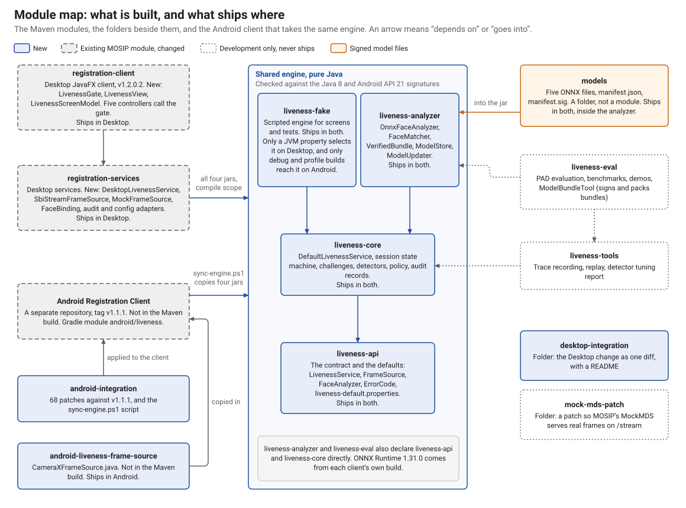
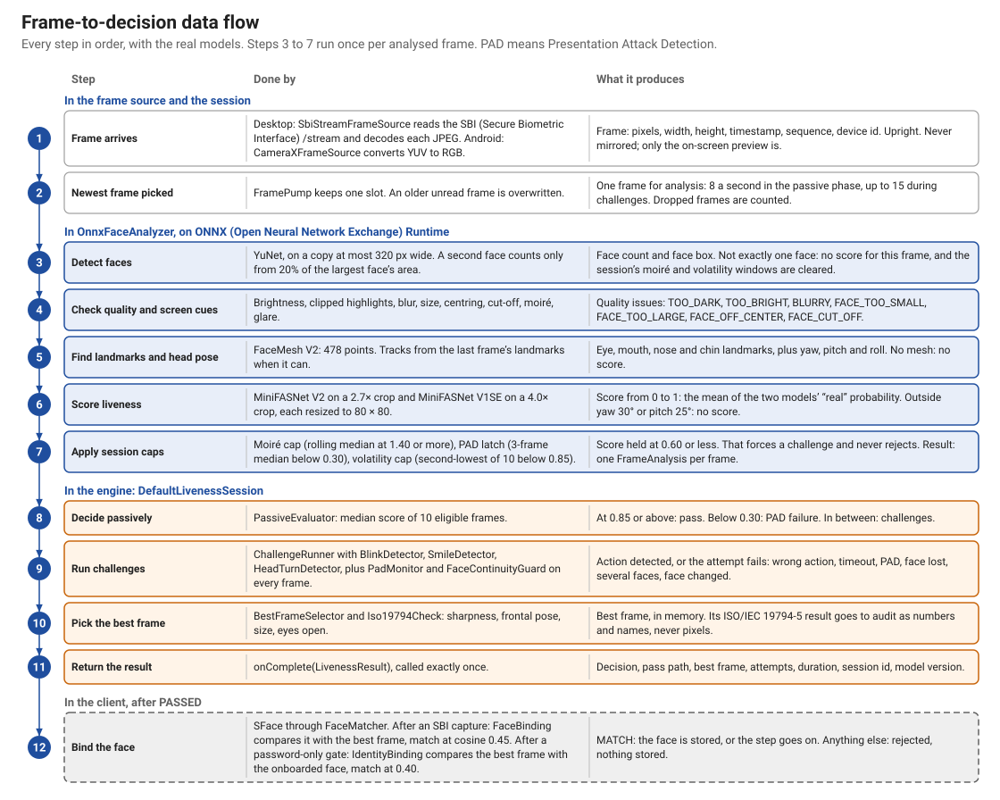
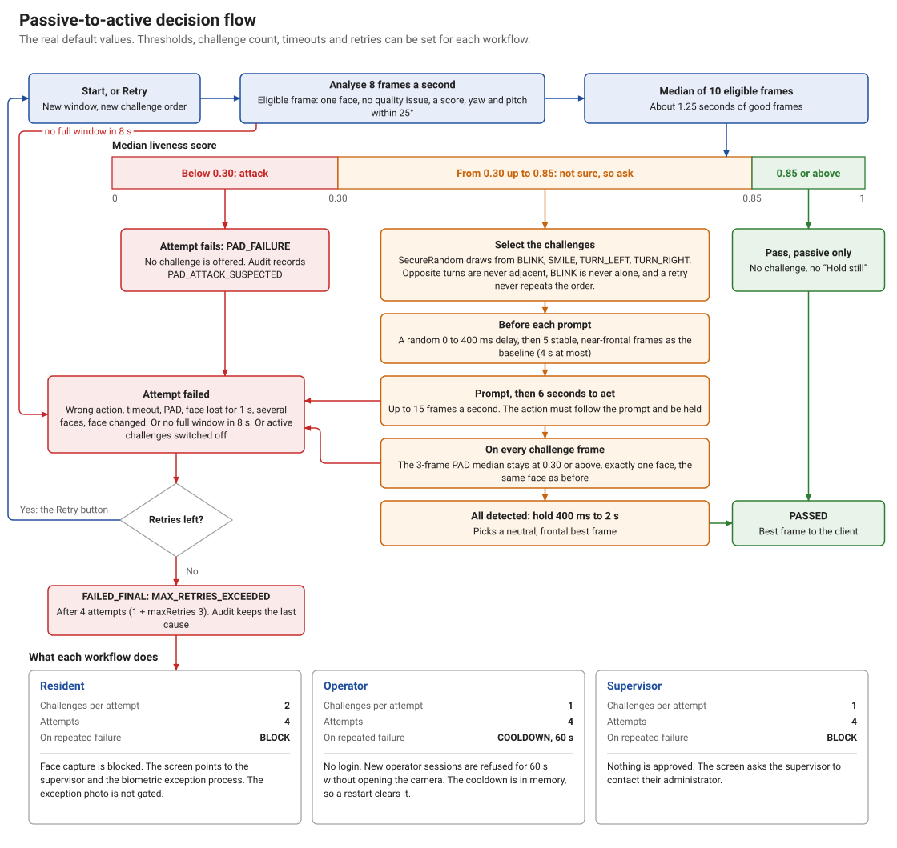
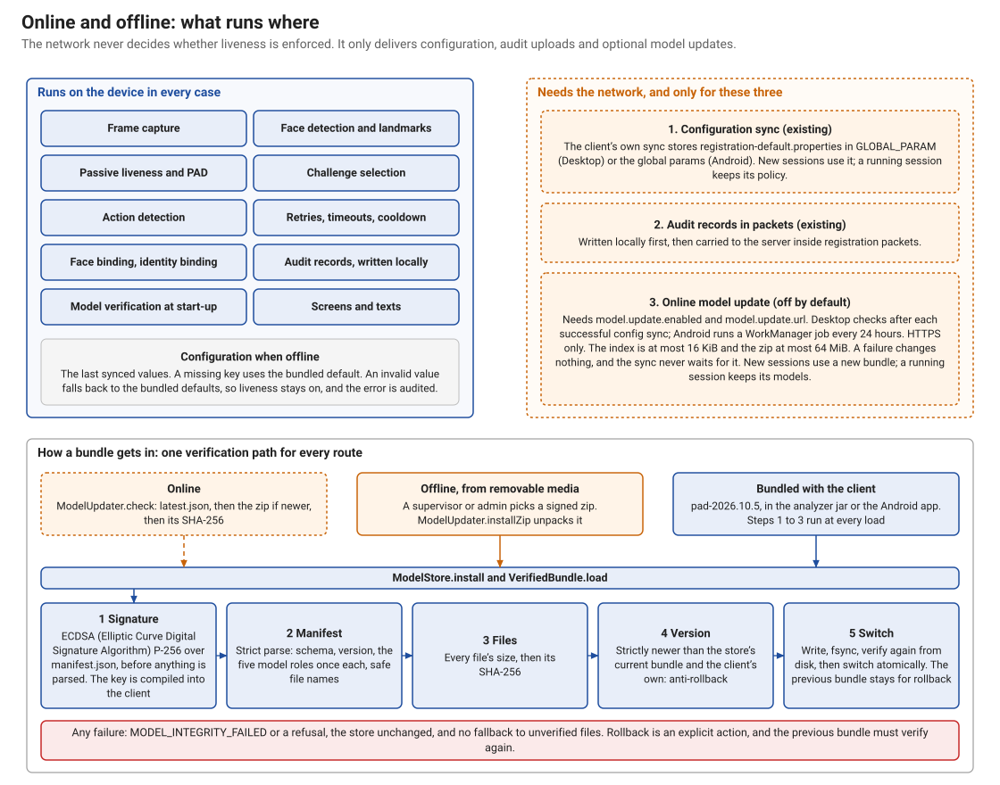
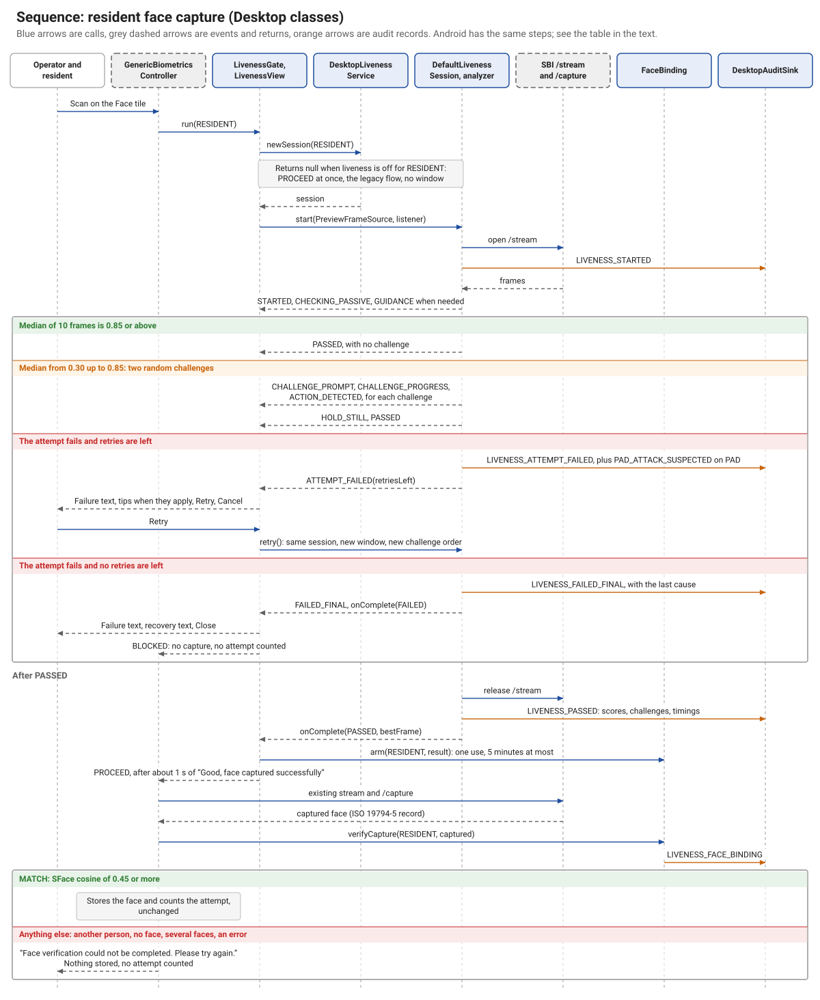
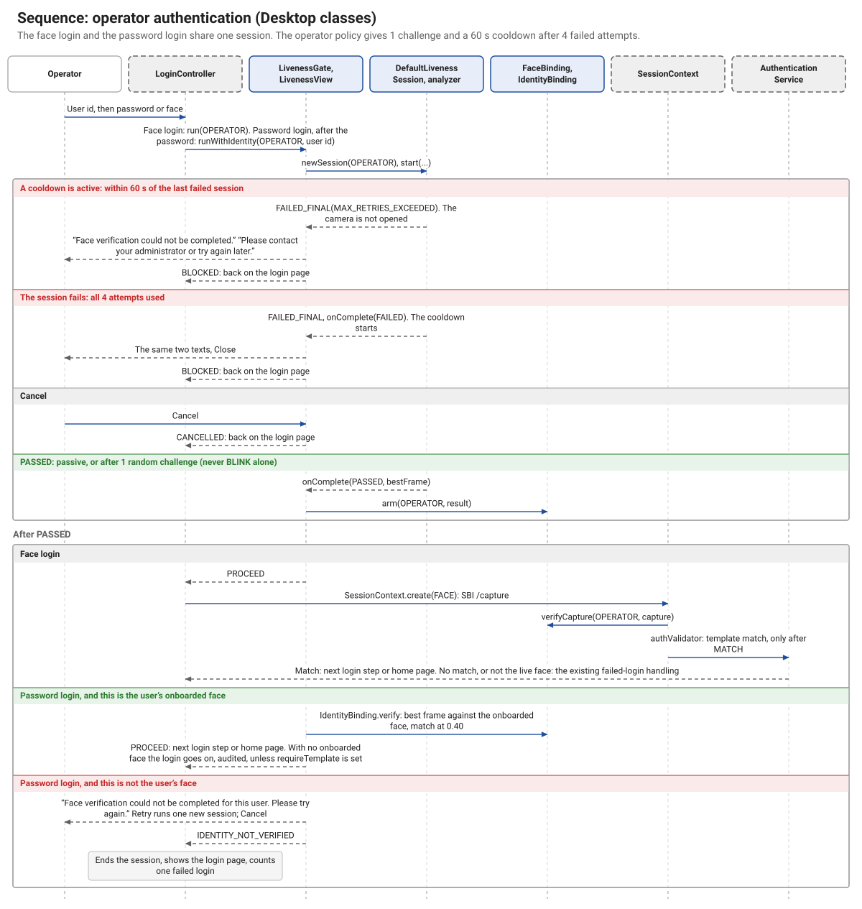
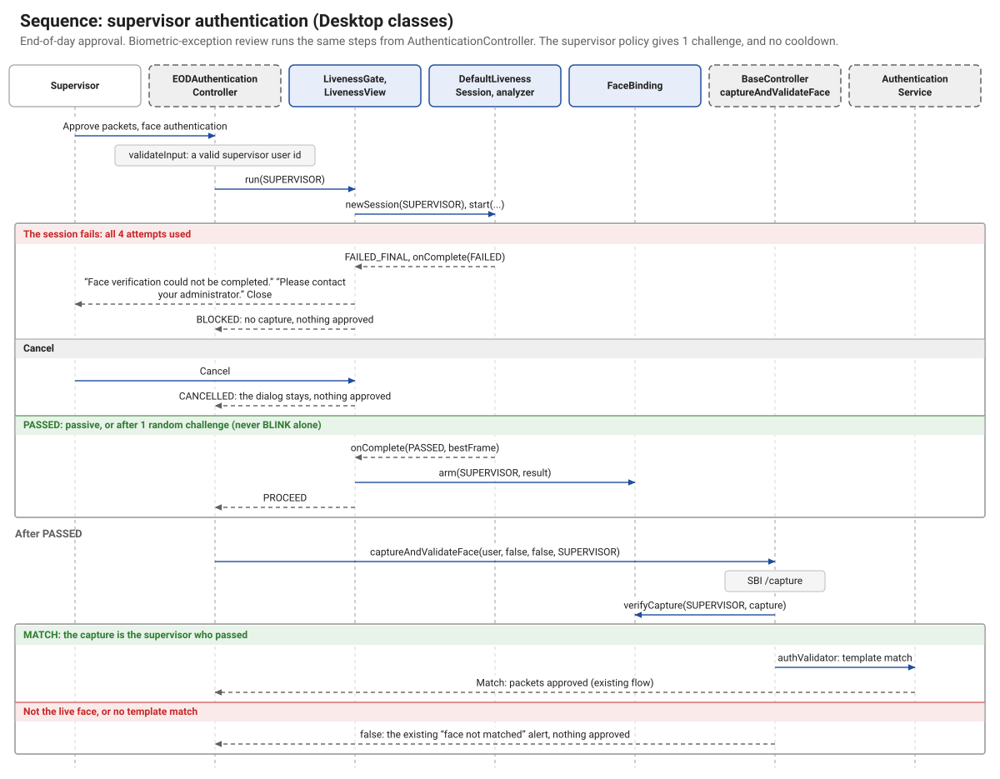
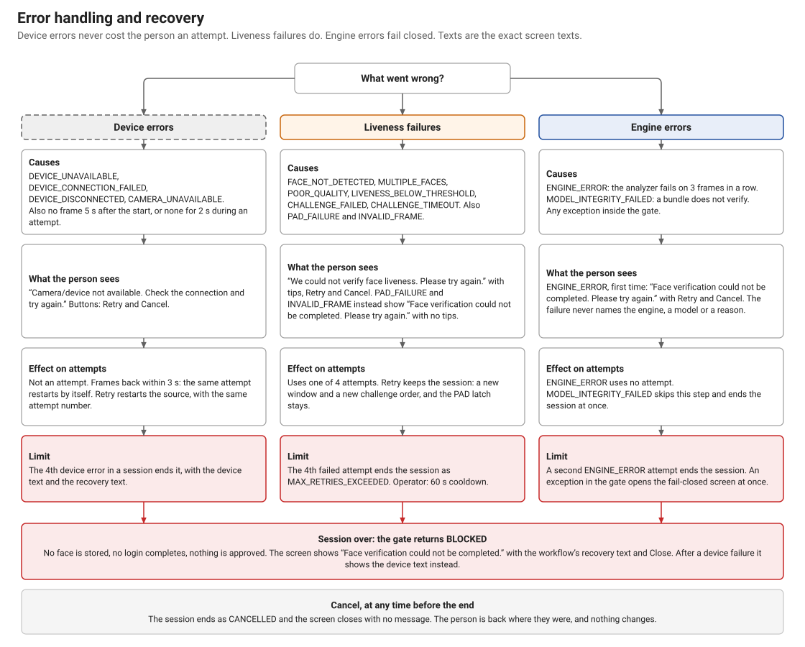
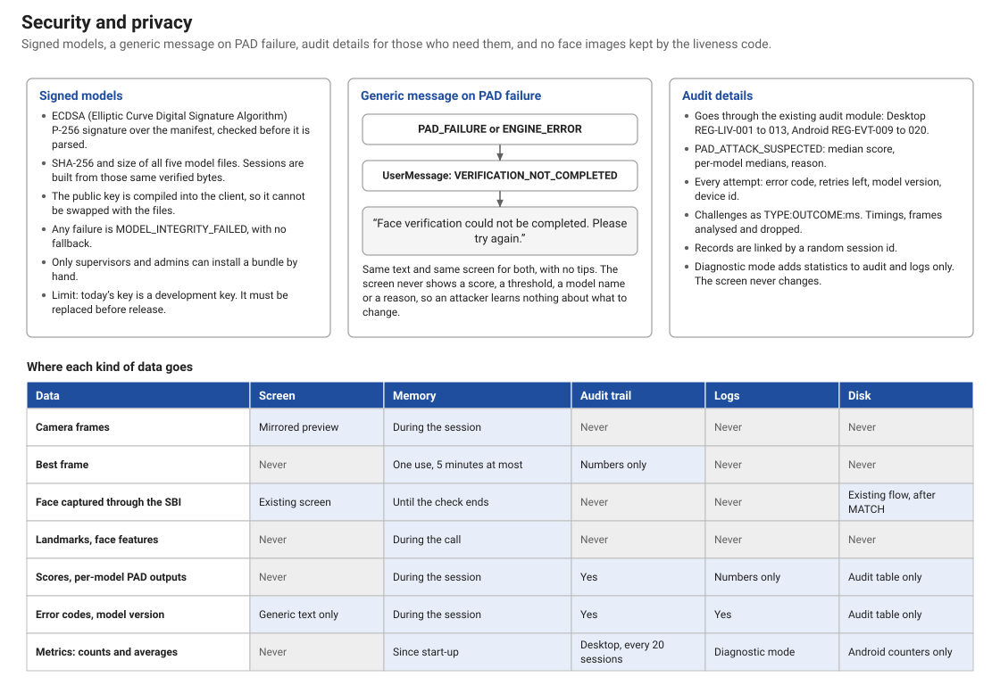

# Architecture diagrams: face liveness for the MOSIP Registration Clients

This document shows how face liveness works in the Desktop and Android Registration Clients of MOSIP (Modular Open
Source Identity Platform). It covers the system design, the data flow, the decision logic, the sequences, and how
errors, security and privacy are handled. You do not need any other document to read it.

Every diagram was drawn from the code in this repository. Values such as thresholds are the real defaults.

## Terms

| Term | Meaning |
|---|---|
| Face liveness | A check that the face in front of the camera belongs to a live person who is present. |
| PAD | Presentation Attack Detection: finding a printed photo, a screen or a replayed video held up to the camera. |
| Passive check | A check that asks the person to do nothing. It looks at a few frames and gives a score. |
| Active challenge | A prompted action, such as "Please blink", used when the passive check is not sure. |
| SBI | Secure Biometric Interface: MOSIP's standard for talking to biometric devices. |
| MDS | MOSIP Device Service: the local service that exposes a biometric device through the SBI. |
| L0, L1 | The device certification levels in MOSIP's SBI specification. |
| ONNX | Open Neural Network Exchange: a file format for machine learning models. ONNX Runtime runs those files. |
| MJPEG | Motion JPEG (Joint Photographic Experts Group): a video stream made of separate JPEG images. |
| RGB, YUV | Two ways of storing the colours of a pixel. RGB stands for red, green and blue. |
| ISO/IEC 19794-5 | The international standard for face images, from the International Organization for Standardization and the International Electrotechnical Commission. |
| HTTPS | Hypertext Transfer Protocol Secure: encrypted web transfer. |
| Workflow | One of the three uses of liveness: resident capture, operator authentication, supervisor authentication. |
| Best frame | The sharpest, most frontal frame of a passed check, kept in memory for the next step. |
| Face binding | A comparison that proves the stored face is the same person who passed liveness. |

## What was and was not proven

These limits apply to every diagram below.

- **No real device, no live backend.** Nothing was run against real L0/L1 hardware or a live MOSIP backend. In tests a
  laptop webcam or a phone camera stands in for the device. MOSIP's MockMDS, patched to serve real frames, tested the
  SBI stream path on one laptop.
- **Android uses the device camera for liveness.** The SBI version targeted here has no stream on Android. Liveness
  frames come from the camera through CameraX. The face that is stored still comes from the SBI app.
- **Desktop hooks were not run end to end.** The Desktop client needs a registered machine and a server for its first
  sync. Its hooks were checked by compiling them, code review and unit tests. The services and the screen were tested
  directly.
- **Evidence is provisional.** PAD results come from one laptop webcam, four real-face subjects, one phone and a small
  set of attacks.
- **The signing key is a development key.** It must be replaced before release.

## A. System overview

Read this diagram from the top down. Both clients keep their existing screens (grey, dashed). Each face step in those
screens now calls one new gate, which opens the check screen and runs one session of the shared engine (blue). The
engine is the same Java code on both clients, and it holds every decision: the passive score, the challenges, retries
and cooldown. Models load only from a signed bundle (orange box). Frames reach the engine through one interface,
`FrameSource`, so the engine never depends on a device. On Desktop, `SbiStreamFrameSource` reads the SBI `/stream`
through the client's own MDS discovery and `BioService.getStream`. On Android, `CameraXFrameSource` reads the device
camera. The mock device (dotted) replaces either one in development and tests. The band at the top is optional: the
clients sync configuration and upload audit records through their existing sync, and a signed model update can come
from any static HTTPS host. That update is off by default.

## B. Module map

Four engine jars ship in both clients: `liveness-api`, `liveness-core`, `liveness-analyzer` and `liveness-fake`. They
contain pure Java, checked against the Java 8 and Android API (Application Programming Interface) level 21 signatures,
which is how one jar can serve both platforms. On Desktop, `registration-services` depends on them directly. For Android, `sync-engine.ps1` copies the
four jars, the signed models and `CameraXFrameSource.java` into the Android client, and `android-integration` holds 68
patches against the client's v1.1.1 tag. `liveness-fake` is a scripted engine: it ships in both, but only a Java
Virtual Machine (JVM) property selects it on Desktop, and only debug and profile builds reach it on Android. Synced
configuration can never turn it on. `liveness-tools` and `liveness-eval` are for development and never ship. `models`
is a folder, not a module: its signed files are copied into the `liveness-analyzer` jar byte for byte.

## C. Frame-to-decision data flow

This table follows one frame from the device to the final decision. The source delivers frames all the time, but the
engine keeps only the newest one, so a slow step never builds up a queue. The analyzer (steps 3 to 7) runs five
stages on each frame: YuNet finds the face, the quality checks look for problems, FaceMesh V2 gives landmarks and head
pose, and two MiniFASNet models score the face. Then session caps hold the score down if signs of a screen or a print
appear. The analyzer never decides pass or fail; it only reports. The engine (steps 8 to 11) makes the decision from
those reports. After a pass, the client runs one more model, SFace, because the stored face and the liveness frames
come from separate paths. Without step 12, a live person could pass liveness while a photo was captured.

## D. Passive-to-active decision flow

The passive check takes the median score of 10 good frames, about 1.25 seconds at 8 frames a second. A median means one
odd frame cannot decide the result. At 0.85 or above, the check passes with no action from the person. Below 0.30, the
attempt fails as a PAD failure, and no challenge is offered. Between the two, the engine picks challenges at random, and
the person never chooses one. A resident gets two challenges; an operator or supervisor gets one. BLINK is never the
only challenge, because natural blinking in a replayed video could satisfy it. While a challenge runs, PAD keeps
running: a 3-frame median below 0.30 fails the attempt, so performing the action cannot make up for an attack. Retry
stays in the same session, so the session caps carry over. Each workflow has four attempts by default. After the last
one, a resident is blocked and pointed to the biometric exception process, an operator also gets a 60-second cooldown,
and a supervisor is blocked. The cooldown is held in memory, so restarting the client clears it.

## E. Online and offline

Everything that decides liveness runs on the device, so the network never affects enforcement. The `liveness-core`
module has no network code, and on Android the ONNX Runtime telemetry component is removed. Only three things need the network:
configuration sync, the upload of registration packets (which carry the audit records) and the optional model update. A model bundle can arrive in three ways: online, from
removable media (for a supervisor or admin), or bundled with the client. All of them pass the same checks. The
signature is checked first, over the exact manifest bytes, before anything is parsed. Then every file's size and
SHA-256 (Secure Hash Algorithm) hash are checked. The signature is the real trust anchor, so a compromised download
host can at worst hold back updates. It cannot install a model. Any failure leaves the store unchanged.

## F. Sequence diagrams

These three diagrams use the real Desktop classes and include the failure branches. The table after them gives the
Android equivalents.

### Resident face capture

The gate runs before the existing SBI capture, so a face that fails liveness is never captured. After a pass, the
existing capture runs unchanged. `FaceBinding` then compares the captured face with the best frame. Only a match is
stored. Anything else stores nothing, counts no attempt, and the next Scan runs liveness again. Liveness itself runs on
the device's stream, and the stream is released before the existing flow opens the device again.

### Operator authentication

Liveness is an extra control on top of the existing login. In a face login, the capture is bound to the live face and
then matched against the operator's template as before. In a password login no capture follows, so `IdentityBinding`
compares the best frame with the face onboarded on this machine, and a match needs a cosine of 0.40 or more. That value
is provisional. If the machine has no readable onboarded face, the login goes on, and the audit records it, unless
`requireTemplate` is set. A rejected identity check offers one retry. A second rejection logs the user out and counts
as one failed login, just like a wrong password.

### Supervisor authentication

The supervisor uses the same engine and the same screen, so the person must be present and live before anything is
approved. The policy differs in one way from the operator's: there is no cooldown. The gate runs before the capture, and
a capture that does not match the live face is rejected before the existing template match. On a failure, nothing is
approved.

### Android equivalents

| Desktop | Android |
|---|---|
| `GenericBiometricsController` | `biometric_capture_scan_block_portrait.dart`, `biometric_scan_middle_block.dart` |
| `LoginController` | `login_page.dart` |
| `AuthenticationController` | `generic_process.dart` |
| `EODAuthenticationController` | `authenticate_dialogbox.dart` |
| `LivenessGate`, `LivenessView` | `LivenessGate`, `LivenessPage`, `LivenessController` (Dart) |
| `DesktopLivenessService` | `LivenessApi`, `LivenessServiceHolder` (Java, through a Pigeon bridge) |
| `SbiStreamFrameSource` | `CameraXFrameSource` |
| `FaceBinding`, `IdentityBinding` | `FaceBinding`, `IdentityBinding` (Java), with `face_binding.dart` and `identity_binding.dart` |
| `DesktopAuditSink` | `AndroidAuditSink` |

On Android, the operator's login, the operator's packet authentication and the supervisor's approval all run after a
password. No SBI capture follows them, so all three use identity binding. Resident capture and operator onboarding use
face binding, as on Desktop.

## G. Error handling and recovery

The engine treats three kinds of problem differently, because they have different causes. A device problem is not the
person's fault, so it never uses an attempt: the screen stays open, and Retry opens the device again. If frames return
within 3 seconds, the same attempt restarts by itself. The fourth device problem in one session ends it. A liveness
failure uses one of the four attempts. Most failures show actionable tips. A PAD failure shows a generic text with no
tips. An engine error uses no attempt, because the person did nothing wrong, but a second one ends the session. A model
that fails verification ends the session at once. Every path that ends in failure blocks the flow: no face is stored,
no login completes and nothing is approved. Any error inside the gate itself also blocks. This is called failing
closed.

## H. Security and privacy

The three cards show the main controls. Models are signed, and the public key is compiled into the client, so an
attacker cannot swap the key together with the files. A PAD failure shows the same generic text as an engine error, so
an attacker learns nothing from the screen. The detail goes to the audit trail instead, through each client's existing
audit module. The table shows where each kind of data goes. Face images stay in memory: frames for the session, and the
best frame for one use and 5 minutes at most. The liveness code never writes a frame, a best frame or a captured face to
a log, the audit trail or disk. Only the existing capture flow stores an accepted face, as it did before. The audit
trail holds codes, scores, timings, the model version and the device id, linked by a random session id. Metrics hold
counts and averages only.
