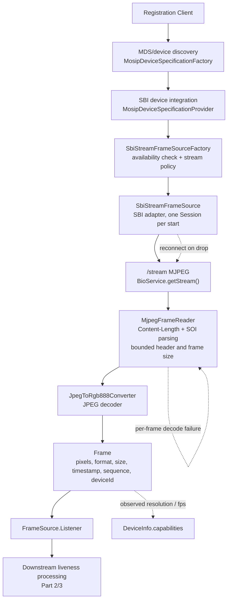
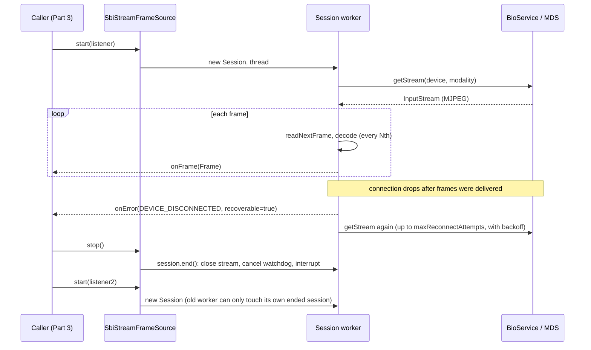
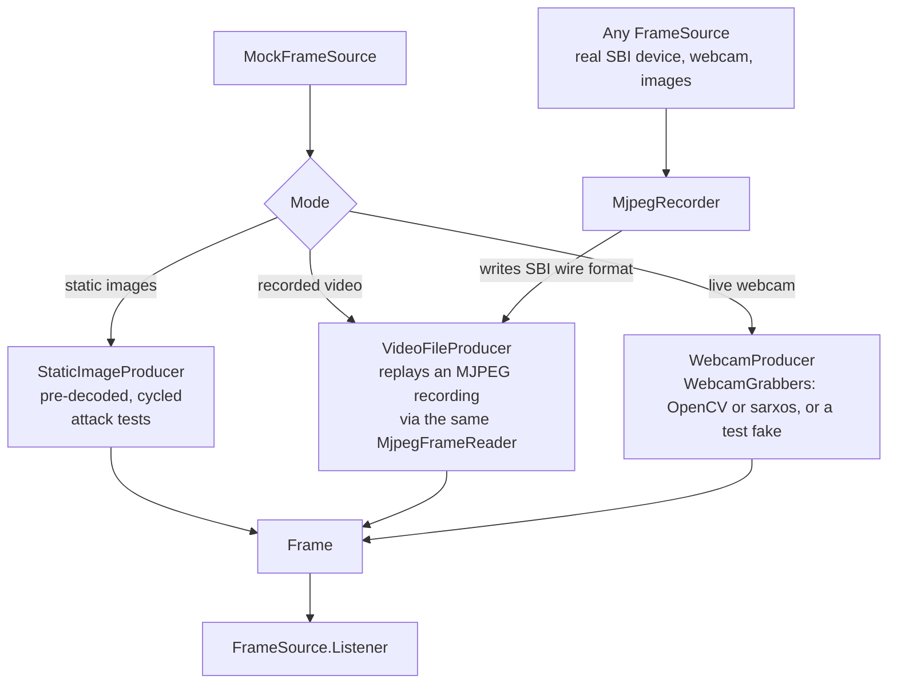
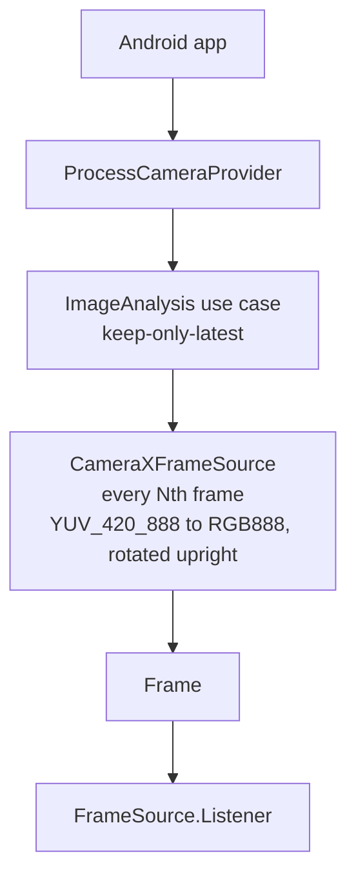

# Part 1: Device & Frame Pipeline — Architecture

Part 1 gets face frames from a biometric device (or a stand-in) into one common shape,
so liveness code (Parts 2/3) never depends on SBI, MDS or camera APIs.

    device / camera / file  ->  FrameSource  ->  Frame  ->  FrameSource.Listener.onFrame()

## 1. Existing Registration Client device integration (analysis)

How the Desktop client already talks to an SBI device. Part 1 reuses this path and does
not modify any of it. Class names are from the Registration Client 1.2.0.x source the
patch was written against. Check the port and property names against your own checkout.

**Discovery (MDS).** `MosipDeviceSpecificationFactory` scans a port range on the MDS host
(`mosip.registration.mdm.host`, ports `mosip.registration.mdm.portRangeFrom`..`portRangeTo`,
4501–4600 by default). It sends SBI `MOSIPDINFO` requests to `/info` on each port. Every
device found is wrapped as an `MdmBioDevice` (deviceId, serialNo, make, model, specVersion,
certification, deviceSubId, port) and registered against a modality. The matching
`MosipDeviceSpecificationProvider` is chosen by the device's `specVersion`. Later calls
resolve devices with `getDeviceInfoByModality(modality)` and re-check them with
`isDeviceAvailable(device)`.

**Capture (`/capture`, SBI `RCAPTURE`/`CAPTURE`).** `BioService.captureModality()` (registration)
and `captureModalityForAuth()` (operator/supervisor login) build an SBI request: purpose,
env, timeout, transactionId, and `bio[]` with type, count, bioSubType, exceptions,
requestedScore and deviceSubId. The provider POSTs it to the device port. The response
carries one signed (JWT) biometric per item, with the ISO 19794-5 face in `bioValue`, plus
quality score, hash and error. A single capture returns one still image. It is not a frame stream.

**Stream (`/stream`, SBI `STREAM`).** `BioService.getStream(device, modality)` sends
`StreamSbiRequestDTO` (serialNo, deviceSubId, timeout) and returns the HTTP body as an
`InputStream`: an MJPEG stream of `Content-Length`-delimited JPEGs. The existing JavaFX
`Streamer` parses it the same way, by looking for `Content-Length:`, then the JPEG SOI byte,
then reading N bytes. The provider reads one frame as a sanity check before returning the
stream, so consumers see the device's second frame first.

**What Part 1 takes from this:** liveness frames come from `/stream`, the only continuous
source. `/capture` stays the source of the signed biometric the packet stores. Part 3
must bind the two, for example by matching the captured face against the liveness frames.
Otherwise one person could pass liveness while a different face is captured.

## 2. Device integration interface (`liveness-api`)

| Type | Contract |
|---|---|
| `Frame` | `pixels()` + `format()` (`RGB888` or `GRAY8`), `width`, `height`, `timestampMs` (monotonic), `sequence` (raw frame index per session; gaps = skipped/dropped), `deviceId`. `rgb()` always returns RGB888, expanding GRAY8 once on demand. Buffers are packed, row-major, no padding. Frames are upright and not mirrored. |
| `FrameSource` | `info()`, `start(Listener)` (non-blocking, never throws), `stop()` (idempotent), `isRunning()`. Each `start()` is a fresh session; a stopped session never delivers again. |
| `FrameSource.Listener` | `onFrame(Frame)` on the source's thread, must return quickly. `onError(ErrorCode, detailForAuditOnly, recoverable)`: `recoverable=true` means the source is retrying itself or skipping one frame; `false` means the session is over. |
| `FrameSource.DeviceInfo` | identity (deviceId, vendor, model, sbiVersion, certificationLevel `L0`/`L1`/`NONE`), `maxWidth/maxHeight/maxFps` (0 = unknown), `capabilities`. |
| `DeviceCapabilities` | `streamFormats` (e.g. `MJPEG`, `JPEG`, `PNG`, `YUV_420_888`), `resolutions`, `frameRates`, `origin` = `DECLARED` / `OBSERVED` / `UNKNOWN`. Empty list = unknown. |
| `ErrorCode` | One code per error case. `userMessage()` maps codes to UI message keys and hides PAD detail behind the generic text. |

Implementations: `SbiStreamFrameSource` (Desktop SBI), `MockFrameSource` (webcam relay,
recorded video, static images), `CameraXFrameSource` (Android).

## 3. Real SBI device path

### Session lifecycle, reconnect and restart

## 4. Mock device path (no HTTP/MDS involved)

- `asCertificationLevel("L0"|"L1")` makes the mock report itself as an L0/L1 device.
- `MjpegRecorder` makes recordings from any `FrameSource`, from an image folder, or from the
  command line (`images` / `webcam` subcommands). The output has the same framing as SBI `/stream`.

## 5. Android path

**Why CameraX, not an SBI app over intents.** The SBI spec gives Android intents for discovery
(`io.sbi.device`), device info and capture. As far as the spec version targeted here goes,
it has no equivalent of `/stream`. Each intent capture is a one-shot activity round trip
that returns a signed ISO 19794-5 face, which is often JPEG 2000 and not decodable by
Android's built-in codecs. That cannot feed active challenges at frame rate. CameraX
supplies the liveness frames, and the SBI intent capture remains the source of the stored
biometric, bound as described in section 1. If a deployment's Android SBI app does offer
streaming, it plugs in as another `FrameSource`; nothing downstream changes.

## 6. Device error handling

| Situation | Where detected | ErrorCode | recoverable | Behaviour |
|---|---|---|---|---|
| Device not discovered / gone since discovery | `SbiStreamFrameSourceFactory.create()` (`isDeviceAvailable`) | (throws `REG-MDS` `MDS_BIODEVICE_NOT_FOUND`) | — | fail fast before any stream |
| Device unavailable when opening the stream | `getStream()` throws `MDS_BIODEVICE_NOT_FOUND` | `DEVICE_UNAVAILABLE` | false | session ends |
| Connection failure on first connect | `getStream()` throws / returns null | `DEVICE_CONNECTION_FAILED` | per MDS error (`STREAM_ERROR`/`TIMEOUT` = true) | not auto-retried; caller decides |
| Stalled stream (no bytes for `frameTimeoutMs`) | watchdog closes the stream | `DEVICE_CONNECTION_FAILED` | false | session ends |
| Disconnect mid-capture (EOF, socket error, truncated frame) | `MjpegFrameReader` | `DEVICE_DISCONNECTED` | true while reconnects remain, then false | auto-reconnect, sequence continues |
| Corrupt framing (bad/oversized `Content-Length`, no header within 64 KiB) | `MjpegFrameReader` | `DEVICE_DISCONNECTED` | as above | treated as a stream fault → reconnect |
| Corrupt frame body (framing intact) | `JpegToRgb888Converter` / `Frame` validation | `INVALID_FRAME` | true | frame skipped, stream continues |
| Webcam / camera unavailable or unplugged | grabber / CameraX | `CAMERA_UNAVAILABLE` | false | session ends |
| Exception thrown by the listener | source | none | — | logged, the stream continues; engine bugs are never reported as device errors |

"Session ends" here means the source stops. The liveness session does not end: the engine offers Retry, which
restarts the source (§9).

## 7. Capability discovery

| Source | Formats | Resolutions | Frame rate | Origin |
|---|---|---|---|---|
| SBI device | `MJPEG` (declared) | observed from decoded frames | measured over the first 15 raw frames | DECLARED, then OBSERVED |
| `CapabilityProbe.probe(source, n, timeout)` / `SbiStreamFrameSourceFactory.probeCapabilities()` | from `info()` | from the sampled frames | from raw sequence/timestamps (stride-correct) | OBSERVED |
| Mock images / video | `JPEG`/`PNG` or `MJPEG` | every distinct image size | configured fps | DECLARED |
| Mock webcam (`WebcamGrabbers`: `OpenCvWebcamFrameGrabber` by default, `SarxosWebcamFrameGrabber` with `-Dliveness.capture=sarxos`) | — | sarxos: the driver's view sizes; OpenCV: unknown | configured fps | DECLARED |
| Android CameraX | `YUV_420_888` | requested, then the size CameraX chose | — | DECLARED, then OBSERVED |

MDS device info has no resolution or FPS fields, so for SBI devices these values can only be observed.

## 8. Key points

- Error handling has **two layers** in `SbiStreamFrameSource`. A per-frame decode failure
  (framing still in sync) is reported and skipped without reconnecting. A stream-level
  failure triggers automatic reconnect up to a configurable attempt limit.
- **Every-Nth-frame** (`frameStride`) is supported by all three sources. Unselected frames
  are still read off the wire (to stay in sync) but are not decoded. `Frame.sequence()` is
  the raw index, so skips show up as gaps.
- **Restart safety.** All per-run state belongs to one session. A worker still blocked in a
  device call after `stop()` cannot deliver into, stop, or release resources of the next session.

## 9. What the liveness engine does with device errors (Part 3)

The engine (`liveness-core`) turns source errors into user-facing behaviour. The same rules apply to every source.

| Source reports | Engine behaviour |
|---|---|
| `DEVICE_*` or `CAMERA_UNAVAILABLE`, recoverable | Shows `DEVICE_ERROR` with Retry. When frames resume within `deviceGraceMs` (the source reconnected by itself), the attempt continues. |
| `DEVICE_*` or `CAMERA_UNAVAILABLE`, not recoverable | Shows `DEVICE_ERROR` with Retry. Retry stops and restarts the source. It never auto-resumes, even if a stale frame is still queued. |
| Any device error, the 4th in one session | `DEVICE_ERROR(recoverable=false)`, then the session ends as FAILED with that device code. |
| `INVALID_FRAME` | Counted with the engine's own frame checks: 3 bad frames fail the attempt as `INVALID_FRAME` (the attempt can be retried). |

- A device problem is never counted as a liveness attempt or retry. An unplugged camera cannot use up the user's
  attempts.
- A stale frame cannot resume an attempt. When a device error arrives, the engine throws away any frame still waiting
  for analysis.
- Both rules are covered by `UnplugReplugIntegrationTest`. Its unplug, Retry, replug, PASSED path found the
  stale-frame bug, which is now fixed.

## 10. Live preview (`PreviewFrameSource`)

The engine analyses only a few frames per second (`analyzeFps`) and always takes the newest one. A preview has to show
every frame, so `PreviewFrameSource` wraps any `FrameSource` as a tee:

    device ──► PreviewFrameSource ──► engine (LivenessSession)
                       └──────────► PreviewListener.onPreviewFrame(frame)   (UI preview, every frame)

- Errors go to the engine only, which decides what the user sees.
- A preview listener that throws is skipped for that frame. It cannot stop delivery to the engine.
- This closes contract proposal N1 (preview) for the Desktop without any change to `liveness-api`.
- `LivenessHarness` uses the tee to draw the preview with the face box from the analyzer.

## 11. MockMDS with real frames (`mock-mds-patch/`)

The patch for MOSIP's MockMDS lets the real SBI path run without a device:

- **The `/stream` lookup fix.** The client sends `serialNo`, which is not the `deviceId`. Without the fix the
  client gets error 605 and no stream.
- **Face stream modes.** The full-face stream can send `images` (one image = a printed-photo attack), a `video`
  recording (the same files `MjpegRecorder` and `SbiStreamProbe --save` write) or the `webcam`.

The full path then runs on one laptop:

    MjpegRecorder / webcam ─► MockMDS /stream ─► SbiStreamFrameSource ─► engine

Setup and the run command are in `mock-mds-patch/README.md`.

## 12. Interoperability and end-to-end tests

| Test | What it proves |
|---|---|
| `DevicePathInteropTest` | The mock device and the SBI adapter (fed the same recording over the SBI wire format) deliver identical frames in the same order, and reach the same liveness decision. |
| `UnplugReplugIntegrationTest` | Unplug, then Retry, then replug: PASSED, with one result and no attempt used up by the device. A camera that never comes back ends cleanly at the device limit. |
| `RecordedVideoE2ETest` | Each `*__expect-<DECISION>[-<CODE>].mjpeg` clip goes through the device path, the analyzer and the engine, and the result matches the name. Team clips are passed in with `-Dliveness.videos.dir` and are kept out of git (`docs/part1-test-data-protocol.md`). |
| `SbiStreamProbe` (tool and test) | Any MDS answers the client's exact `/stream` request with a decodable stream. |

