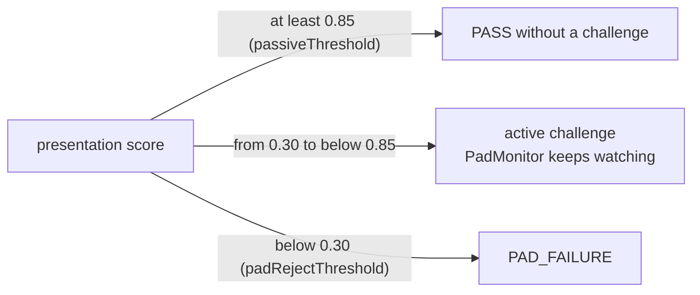

# Part 2: ISO/IEC 30107-3 evaluation of the passive PAD

> **Every result here is PROVISIONAL; the bona fide side is a single subject (s01).** The attacks show s01, a NASA
> portrait and, since F3, photos of 14 and 13 other consented people (section 4.4), all through one laptop webcam,
> one room, one phone and one printer. It shows tendencies and failure modes; it does not estimate field error
> rates. The raw recordings and per-take results stay on the recording laptop under the gitignored `eval-data/`,
> as the participants asked. Only aggregates appear here.

## 1. Scope and terms

We evaluate the **presentation attack detection (PAD) subsystem** of the face liveness check: the Part 2 analyzer,
together with Part 3's passive decision exactly as it runs in production. The terms follow ISO/IEC 30107-1 and
ISO/IEC 30107-3:2023.

| Term | Meaning here |
|---|---|
| Presentation | one 6-second take (60 frames at 10 fps) shown to the camera; for the many-identity species, one photo's run in a continuous recording (12–163 frames at 10 fps, section 4.4) |
| Bona fide presentation | the live subject's own face |
| PAI species | one kind of attack instrument, such as a phone showing a photo held close (`screen_photo_close`) |
| APCER (per species) | attack presentations of that species classified as bona fide ÷ responding attack presentations of that species |
| max APCER | the highest APCER over the evaluated species (the headline security figure) |
| BPCER | bona fide presentations classified as attacks ÷ responding bona fide presentations |
| APNRR / BPNRR | attack / bona fide presentations that produced **no decision** (non-response). Reported separately; a non-response is never counted as an acceptance. |
| ACER | (max APCER + BPCER) / 2. It is **non-normative in the 2023 edition** and shown only for continuity. |
| EER | the error rate at the threshold where max APCER and BPCER are closest |

For every 0/N result we give the one-sided 95% Clopper-Pearson upper bound in brackets. For example, 0/10 is
[≤ 25.9%]: with 10 samples we can only say the true rate is probably below about 26%. With N this small, read every
figure through its bound.

## 2. How a presentation is decided (mirrors production)

- Each take is analysed by a **fresh** analyzer, as each session is. Its frames are fed in order, with timestamps
  1000/fps apart.
- **Presentation score.** The median of the **first full window** of Part 3's `PassiveEvaluator`: 10 eligible frames,
  each with one face, no quality issue, a score, and |yaw| and |pitch| of 25° or less. Production decides on exactly
  this value.
- **No full window in the take** is a non-response. In production that is a timeout with a positioning hint, never
  an acceptance.

The engine then uses three zones:



- An attack that passes passively is a **security failure**.
- An attack sent to a challenge must still beat the challenge and Part 3's `PadMonitor`, which fails the attempt as
  soon as a 3-frame rolling median drops below 0.30.
- A bona fide take that is PAD-rejected is a **usability failure**. One sent to a challenge costs a few seconds.

## 3. Dataset (protocol: [part2-dataset-protocol.md](part2-dataset-protocol.md))

Webcam `webcam:0` (HP True Vision FHD Camera, 640 × 480). JPEG quality 95 with 4:4:4 chroma. 134 takes, 6,458 frames
(round 1: 35 takes, 2,100 frames; F3 added the last four rows; F5 the four tablet replays).

| Class | Takes | How |
|---|---|---|
| bona fide | 11 | normal ×3, close ×2 (leaned in too far: face cut off), far ×2, moving head ×2, close with the whole face visible ×2; the dim take was skipped |
| `screen_photo` | 6 | phone photo at normal distance with its edges visible: the subject's selfie ×3, a public-domain NASA portrait ×3 |
| `screen_photo_close` | 12 | phone held close as the subject judged it ×6 (face only about 4% of the picture), then about 10 cm away with a live face-size readout ×6 (face 20–31% of the picture) |
| `screen_replay` | 6 | the subject's selfie video playing on the phone |
| `screen_replay_monitor` | 4 | F5: the subject's own 2-minute selfie video (blinks, smiles, head turns and nods) on a **tablet (Galaxy Tab, about 11 in)** at maximum brightness, 40–60 cm from the webcam, the subject's own face out of view. There is no desktop monitor yet (section 4.6) |
| `print_flat` | 6 | colour A4 prints held flat: the subject's selfie ×2 and close ×1, the NASA portrait ×2 and close ×1 |
| `print_curved` | 6 | the same prints, bent |
| `screen_photo_multi` | 38 | a phone slideshow of 42 labelled photos of 15 consented people, at normal distance; one take per photo found, 14 of the 15 people (s01 among them), 14–56 frames each |
| `print_multi` | 45 | printed cut-outs of 13 people (12 from source photos, 1 unknown), 6 to an A4 page, held about 20 cm away: flat ×21, curved ×24, 12–163 frames each |

## 4. Results

### 4.1 Candidate scorers (round 1: 35 takes, single subject s01, provisional)

The thresholds are today's defaults: passive 0.85, reject 0.30. Production as shipped is candidate 1. Candidates 1a
to 7 recompute the score from the stored model outputs and go through the same window logic.

**With all 130 takes and the analyzer before F18** (bundle `pad-2026.10.5`, after F6 and F7), the order of the
candidates does not change.
- Candidate 1 keeps max APCER 0 at 0.85. The widest bound is still `screen_photo_close`, 0/10 [≤ 25.9%], and
  `print_multi` is 0/28 [≤ 10.1%].
- BPCER is 1/8, EER 0.0%, APNRR 55/119 and BPNRR 3/11.
- **With the F18 print guards** (section 4.5), max APCER stays 0 at 0.85 and BPCER becomes 2/8. The EER moves to
  12.5% at τ 0.60, because capped frames sit at exactly 0.60.

The table below is round 1.

| # | Candidate | max APCER @ 0.85 | BPCER @ 0.85 | ACER (non-norm.) | EER | BPCER @ APCER ≤ 5% | APNRR | BPNRR |
|---|---|---|---|---|---|---|---|---|
| **1** | **MEAN + session moiré cap (shipped)** | **0/10 [≤ 25.9%]** | 1/9 | 5.6% | **0.0%** | 0.0% | 8/24 | 2/11 |
| 1a | MEAN, no cap (before Phase 6b) | 4/10 (40%) | 1/9 | 25.6% | 21.1% | 33.3% | 8/24 | 2/11 |
| 2 | V2 only | 6/10 (60%) | 1/9 | 35.6% | 31.7% | 66.7% | 8/24 | 2/11 |
| 3 | V1SE only | 4/10 (40%) | 1/9 | 25.6% | 21.1% | 22.2% | 8/24 | 2/11 |
| 4 | MIN(V2, V1SE) | 4/10 (40%) | 1/9 | 25.6% | 21.1% | 33.3% | 8/24 | 2/11 |
| 5 | MEAN, per-frame moiré veto ≥ 1.4 | 0/10 [≤ 25.9%] | 1/9 | 5.6% | 0.0% | 0.0% | 8/24 | 2/11 |
| 5 | MEAN, per-frame moiré veto ≥ 1.3 / 1.5 / ≥ 1.6 | 0/10 / 1/10 / 4/10 | 2/9 / 1/9 / 1/9 | | | | | |
| 6 | MEAN, face-size gate > 0.20 | 1/5 (20%) | 1/7 | 17.1% | 17.1% | 42.9% | 13/24 | 4/11 |
| 6 | MEAN, face-size gate > 0.25 / 0.35 / 0.60 | 4/9 / 4/10 / 4/10 | 1/7 / 1/9 / 1/9 | | | | | |
| 7 | MIN + veto 1.4 (± gate 0.20) | 0/10 (0/5 with the gate) | 1/9 (1/7) | | 0.0% | | | 4/11 with the gate |
| 8 | HeuristicFaceAnalyzer (no ML) | 0/3 | 4/4 | 50.0% | 70.8% | 100% | 21/24 | 7/11 |

The worst species is `screen_photo_close` in every row. The responding counts are: `screen_photo` 0 (all 6 takes had
a face too small to decide, FACE_TOO_SMALL), `screen_photo_close` 10 and `screen_replay` 6.

What the table says:
- **Every model variant fails the same attack.** A phone photo held about 10 cm away passes in 4 of the 6 readout
  takes, at 0.89–0.95.
- **The face-size gate costs too much.** It turns bona fide close-ups into non-responses (BPNRR 2/11 → 4/11).
- **The per-frame veto at 1.4 is perfect on paper.** In a session, though, it would drive Part 3's PadMonitor below
  0.30 in 3 of 11 bona fide takes, which is a mid-challenge failure for a real person.
- **The shipped cap gets the same 0/10** without any rejection risk. It caps at 0.60 instead of zeroing, and it acts
  on a 10-frame rolling median, not on single frames.

### 4.2 Three zones with today's thresholds: before and after the moiré cap

| Class | N | Passive pass (before → after) | Challenge | PAD reject | Non-response | PadMonitor < 0.30 at some point |
|---|---|---|---|---|---|---|
| bona fide | 11 | 7 → 7 | 1 → 1 | **0 → 0** [≤ 23.8%] | 3 → 3 | 0 → 0 |
| `screen_photo` | 6 | 0 → 0 [≤ 39.3%] | 0 → 0 | 0 → 0 | 6 → 6 | 6 → 6 |
| `screen_photo_close` | 12 | **4 → 0** [≤ 22.1%] | 2 → 6 | 4 → 4 | 2 → 2 | 6 → 6 |
| `screen_replay` | 6 | 0 → 0 [≤ 39.3%] | 0 → 0 | 6 → 6 | 0 → 0 | 6 → 6 |
| `print_flat` | 6 | 0 → 0 [≤ 39.3%] | 1 → 1 | 5 → 5 | 0 → 0 | 6 → 6 |
| `print_curved` | 6 | 0 → 0 [≤ 39.3%] | 0 → 0 | 6 → 6 | 0 → 0 | 6 → 6 |
| `screen_photo_multi` | 38 | 0 → 0 [≤ 7.6%] | 0 → 0 | 8 → 8 | 30 → 30 | 29 → 29 |
| `print_multi` | 45 | 0 → 0 [≤ 6.4%] | 9 → 9 | 19 → 19 | 17 → 17 | 34 → 34 |

All 130 takes, the analyzer before F18 (`pad-2026.10.5`). The bounds are over all N presentations. Section 4.4 has
the APCER over the responding ones. The F18 print guards change one bona fide take, from a passive pass to a
challenge, and no attack take (section 4.5).

- **Bona fide: 7 passive passes, not 8 as in round 1.** The cause is F6's relative blur check. It marks 34 of the
  60 frames of one moving-head take BLURRY. That take now has 2 eligible frames instead of 20, so no full window: it
  went from a passive pass to a non-response.
  - The PAD scores did not change.
  - F7's tracked landmarks moved the pose estimates by up to about 5°. That changed the eligible counts of two more
    takes (far: 40 → 45; moving: 28 → 26), but not their zones.
  - The 3 bona fide non-responses: the two `close` takes, where the face is cut off (FACE_CUT_OFF in 56 and 58 of
    60 frames), and that moving-head take (BLURRY in 34 frames; 20 of its 22 clean frames past the 25° pose limit).
- **Effect of the cap.** 0 of the 8 responding bona fide takes left the passive zone, and none was newly rejected.
  All 4 passing close-up attacks moved to a challenge. The cap changed no print or many-identity take.
- **How often it fired** (round 1). 12 of 656 bona fide frames were ever capped (11 with a moving head, 1 far away). The
  6 readout close-up attacks were capped in 339 of their 360 frames.
- **Live check** (same subject, the shipped analyzer, real sessions): the real face passed passively (0.9987 and
  0.9994). In two separate runs, the phone photo held about 10 cm away was held at exactly 0.600, sent to a
  challenge, and failed there (PAD_FAILURE, then MAX_RETRIES_EXCEEDED).

### 4.3 Close-up analysis (why the models were fooled)

Medians over single-face frames, with the 10th–90th percentile in brackets.

| Class | Face area (share of picture) | Moiré | MEAN score (no cap) |
|---|---|---|---|
| bona fide, normal | 0.086 | 1.20 [1.15–1.26] | 0.98 |
| bona fide, close, whole face | 0.313 [0.30–0.33] | 1.02 [1.00–1.08] | 1.00 |
| bona fide, moving head | 0.077 | 1.27 [1.18–1.45] | 0.94 |
| phone close-up, selfie | 0.258 [0.20–0.31] | 1.46 [1.39–1.53] | 0.88 |
| phone close-up, NASA portrait | 0.253 [0.23–0.27] | 1.59 [1.56–1.61] | 0.87 |

- Per take, the window-median moiré was **1.00–1.37 for bona fide** and **1.435–1.593 for the close-up attacks**. The
  margin is real but thin (0.065).
- Face size cannot separate the two groups: the bona fide close-ups are the larger faces.

### 4.4 Prints and many identities (F3)

APCER at 0.85 over the responding presentations, the analyzer before F18. The F18 guards change none of these.

| Species | Takes | Identities | Responding | APCER @ 0.85 | Challenge | PAD reject | Non-response | Highest window median |
|---|---|---|---|---|---|---|---|---|
| `print_flat` | 6 | s01's selfie, NASA portrait | 6 | 0/6 [≤ 39.3%] | 1 | 5 | 0 | 0.36 |
| `print_curved` | 6 | the same | 6 | 0/6 [≤ 39.3%] | 0 | 6 | 0 | 0.09 |
| `screen_photo_multi` | 38 | 14 | 8 | 0/8 [≤ 31.2%] | 0 | 8 | 30 | 0.00 |
| `print_multi` | 45 | 13 | 28 | 0/28 [≤ 10.1%] | 9 | 19 | 17 | 0.82 |

- **`print_multi` by condition.**
  - Flat (21): 5 challenges, 12 rejects, 4 non-responses.
  - Curved (24): 4 challenges, 7 rejects, 13 non-responses.
- **The margin is thin for the cut-outs.** Before F18, `print_multi` APCER was 1/28 at τ 0.80 and 2/28 at τ 0.65–0.70.
  - The highest window median, 0.82, is 0.03 below the passive threshold.
  - Two more takes were held at exactly 0.60 by the moiré cap: the print's halftone gave window moiré medians of 1.43
    and 1.49.
  - With the F18 guards, `print_multi` APCER is 0/28 at τ 0.80 too.
- **Why so many non-responses: the faces were too small.** In production a non-response is a timeout with a "move
  closer" hint, never an acceptance.
  - `screen_photo_multi`: in 29 of its 30 non-responses most single-face frames were FACE_TOO_SMALL. The slideshow
    faces had a median face area of 2.2% of the picture. The 30th had other quality or pose issues.
  - `print_multi`: 14 of 17 non-responses were FACE_TOO_SMALL (median face area 9.7% flat, 3.6% curved). Two had
    other quality or pose issues, and one take was too short (fewer than 20 frames).
  - An attacker who brings the print closer turns a non-response into a responding presentation. Section 4.5 tested
    exactly that, live.

### 4.5 Live retests and the F18 print guards

Real-engine sessions on the webcam (`SessionDemo`, RESIDENT). All use the default policy except four, which forced
challenges for the rotate and tilt tricks. The presenter's face was out of view in every attack session. The logs
keep numbers only and stay in `eval-data/`.

**A single printed cut-out passed twice.**
- **The first pass** was a discarded multi-face run, where only one cut-out was probably in view. It passed at
  0.9998.
- **The targeted retest** reproduced it. Run 1, cut-out 1 held at about 20 cm, passed on attempt 4 (PASSIVE_ONLY,
  0.944), after these attempts:
  1. PAD_FAILURE, while the moiré cap held the scores at 0.60;
  2. PAD_FAILURE;
  3. a SMILE challenge that was not detected.
- **What the cut-out looked like to the analyzer.** The face was 162–179 px wide (area 12–15% of the picture), the
  size of a real face. In that attempt V2 scored it 0.86–0.99 and V1SE 0.72–1.00. Over the 20 s its per-frame score
  ranged from 0.06 to 0.99.
- **Compared with the 45 recorded `print_multi` takes:**
  - its score median was above 42 of them;
  - its face area was above 36 of them;
  - its moiré was in the middle (rank 25).
- **Diagnosis.** At real-face size the models often score a print live. Every retry restarts Part 3's passive
  window, so one session gave the print four tries. During the fourth attempt the session's moiré median was
  1.36–1.40, just under the cap's 1.40.

**The fix: two session guards in the analyzer** (`docs/part2-pad-architecture.md`, section 3.2). Both cap the score
at 0.60, which forces a challenge and never causes a rejection.
- **The PAD latch:** once a 3-frame median falls below 0.30, the cap holds for the rest of the session.
- **The volatility cap:** the cap applies while the second-lowest of the last 10 model scores is below 0.85.

Replayed offline, the passing attempt goes to a challenge at 0.600, with both guards or with either one alone.

**Recorded takes, before and after the guards** (130 takes, production defaults):

| Class | Passive pass | Challenge | PAD reject | Non-response |
|---|---|---|---|---|
| bona fide (11) | 7 → **6** | 1 → 2 | **0 → 0** [≤ 23.8%] | 3 → 3 |
| every attack class (119) | 0 → 0 | unchanged | unchanged | unchanged |

- The bona fide take that moved is a `far` take (face area 4.2%). Two of its first frames scored 0.796 and 0.805.
- The latch fired in 0 of 11 bona fide takes and in 99 of 119 attack takes.

**Combined live retest with the guards** (29 attack sessions, 10 real-face sessions):

| Presentation | Sessions | Result |
|---|---|---|
| cut-outs 1–6 still, NASA A4, cut-outs with hand motion | 25 | all FAILED; none passed |
| cut-outs with forced challenges, rotated to fake a turn or tilted to fake a blink or smile | 4 | all FAILED. Every attempt ended in PAD_FAILURE, except one POOR_QUALITY, before any challenge appeared, so the trick was never needed |
| real face: normal ×3, close ×2, far ×2, approaching ×2, moving ×1 | 10 | 6 passive passes, 3 passed a challenge, 1 timed out (FACE_TOO_SMALL at about 1 m); **0 PAD rejections**; the latch never fired |

- **Face size decided which attacks were judged.** Held at about 20 or 30 cm, most cut-out faces were 25–60 px,
  below the 80 px minimum, and timed out. 17 of the 29 attack sessions were judged (face 80 px or more).
- **The guards blocked one pass.** Of 63 attempts that reached a passive window, 1 would have passed without the
  guards: the same cut-out, again on attempt 4, at 0.923.
- **The cost on real faces.** The guards moved 1 of 7 real-face passive passes to a challenge (the moving head).

**Guard settings replayed through the spec** (the live logs and the recorded takes):

| Setting | Live real-face passive passes | Live attack sessions with a passive pass | Recorded bona fide passive | Recorded attacks passing |
|---|---|---|---|---|
| no guards | 7/10 | 2 | 7/8 | 0/64 |
| latch only | 7/10 | 0 | 7/8 | 0/64 |
| **latch + volatility 0.85 (default)** | 6/10 | 0 | 6/8 | 0/64 |
| latch + volatility 0.80 | 6/10 | 0 | 7/8 | 0/64 |
| latch + volatility 0.75 | 7/10 | 0 | 7/8 | 0/64 |
| volatility 0.85 alone | 6/10 | 0 | 6/8 | 0/64 |
| volatility 0.80 alone | 6/10 | 1 | 7/8 | 0/64 |

- The live attack column counts 30 sessions: the 29 above and the run that passed.
- The recorded columns count the takes that reached a passive window.

**Decision: volatility 0.85.**
- The window that passed live had a second-lowest score of 0.822. At 0.85, the same pattern is capped even on a
  first attempt, before any latch. At 0.75 only the latch would stop it.
- The cost is a challenge, never a rejection.
- Re-check per subject on the multi-subject data (F9) with `models/tools/session_guard_replay.py`. If more than 25%
  of real-face passive passes become challenges across subjects, evaluate 0.80.

### 4.6 Second-screen replay on a tablet (F5)

One subject (s01), one tablet (Galaxy Tab, about 11 in, maximum brightness), the subject's own 2-minute selfie video
with blinks, smiles, head turns and nods, 40–60 cm from the webcam. Recorded on 2026-10-27: 4 dataset takes (60
frames each) and 6 live sessions with the real engine (`SessionDemo`, RESIDENT; 3 with the default policy, 3 with
forced challenges). Production settings, with the F18 guards.

**Recorded takes** (`PadEvaluation`, 134 takes):

| Species | Takes | Responding | Passive pass | Challenge | PAD reject | Non-response | PadMonitor below 0.30 |
|---|---|---|---|---|---|---|---|
| `screen_replay_monitor` (tablet) | 4 | 0 | 0/4 [≤ 52.7%] | 0 | 0 | 4 | 4/4 |

- **Every take was a non-response: the face was too small.** At 40–60 cm the face covered 3.4% of the picture
  (median; at most 4.2%). 221 of the 223 single-face frames were FACE_TOO_SMALL, so no take filled a passive window.
  In production that is a timeout with a "move closer" hint, never an acceptance.
- **The models scored the replay low anyway.** Of the 181 scored single-face frames, the median score was 0.044 and
  the highest 0.505. None reached 0.85, and 2 reached 0.30. The PAD monitor stayed below 0.30 in all 4 takes.
- Adding the four takes changes no other row of sections 4.1 to 4.5.

**Live sessions** (the session log: `eval-data/sessions/f5-tablet-20261027/`):

| Sessions | Policy | Result | Challenges shown | Highest first-window median |
|---|---|---|---|---|
| 3 | default (passive first) | 3 FAILED, MAX_RETRIES_EXCEEDED | 1 session: BLINK, TURN_LEFT, SMILE | 0.48 |
| 3 | forced challenges | 3 FAILED, MAX_RETRIES_EXCEEDED | 1 session: SMILE | 0.54 |

- **0 of 6 passed.** All 18 attempts that reported a code ended in PAD_FAILURE, and each session's fourth attempt
  ended it with MAX_RETRIES_EXCEEDED. The replay never completed a challenge.
- **What decided it.** Replayed offline through the guards' spec (`models/tools/session_guard_replay.py`), the first
  passive window of the 24 attempts was ATTACK (below 0.30) in 17 and CHALLENGE in 7, with medians 0.009–0.544. No
  attempt would have passed, with or without the guards: the scores before and after the guards are the same. The
  PAD latch fired in all 6 sessions, 1.7–4.6 s in.
- **Two sessions reached challenges.** No challenge was completed: PAD ended those attempts (PAD_FAILURE) while the
  challenge ran.

**What this does not show.**
- One subject, one tablet, one 2-minute video, one webcam and one room: 4 takes and 6 sessions. 0/4 is "at most
  about 53%".
- No desktop monitor, so the species' name promises more than was tested: larger screens, other pixel pitches and
  other panel types are not covered.
- The recorded takes are all non-responses, so the PAD decision on recordings at a responding size is untested. The
  live sessions, which the engine did judge, are the stronger evidence.
- The tablet was not brought close enough to fill the frame, the case that fooled the models with a phone
  (section 4.3).

## 5. Thresholds: recommendation, and why the defaults stay

The rule (provisional, on the grid 0.05 … 0.95, 0.99, 0.999):
- **passiveThreshold** = the smallest τ with APCER = 0 for every species, + 0.02, capped at 0.99.
- **padRejectThreshold** = the largest τ with no bona fide score below it, − 0.05, kept below passiveThreshold.

| Scorer | Rule output: passive / reject | Note |
|---|---|---|
| MEAN without the cap | 0.97 / 0.75 | Fixes the close-up miss by brute force, but only 5 of 9 responding bona fide takes would then pass without a challenge |
| MEAN + cap (shipped) | 0.67 / 0.62 | Round 1. Degenerate: the cap pins the close-up attacks at exactly 0.60, so the rule hugs it |
| MEAN + cap, all 130 takes, before F18 | 0.87 / 0.75 | One `print_multi` take reached a window median of 0.816, the highest attack score below 0.85; the rule adds its margin above that. The reject value still comes from one bona fide subject |
| MEAN + cap + F18 guards (shipped), all 130 takes | 0.67 / 0.55 | Degenerate again: the guards pin the attacks that used to score high at exactly 0.60 |

**Decision: keep 0.85 / 0.30.** With one bona fide subject, moving a security threshold would be fitting noise.
- The moiré cap and the F18 guards remove the observed passive failures without any bona fide rejection.
- The prints are now in. Revisit when there are at least 10 bona fide subjects.

## 6. Limitations

- One subject, one camera, one phone, one session of lighting. No children, older subjects, glasses or different skin
  tones yet.
- Second-screen replays: one tablet only (section 4.6), at a distance where the recorded face was too small to
  judge. There is no desktop monitor yet. The prints come from one printer and one paper; the cut-outs were held by
  the subject, who knew the system.
- The many-identity species are recorded at distances where most faces are small, so many takes are non-responses
  (section 4.4). Their APCER covers only the responding takes.
- The F18 guards were tuned on the cut-out that passed and checked on one bona fide subject. Their bona fide cost,
  about 1 in 7 passive passes becoming a challenge, needs the multi-subject data (F9).
- The rotate and tilt tricks against challenges were not exercised. PAD stopped those cut-outs before any challenge
  appeared.
- The PAD latch lasts one session. A new session after a final failure starts clean; the operator workflow's
  cooldown limits that.
- The moiré cap's threshold comes from one phone's pixel pitch and one webcam's optics. Other screens may sit below
  1.40, and other cameras may push bona fide frames above it.
- Attack takes were made by the subject, who knew the system, holding the phone by hand. That is a low-effort attack
  potential.
- Challenges are not part of the APCER above. Phase 5 saw a tilted phone photo pass BLINK and SMILE once. Part 3
  now ignores frames that drift more than 12° from the baseline during BLINK and SMILE (see the findings doc).

## 7. Next steps (with commands)

PowerShell, from the repository root, after the standalone install (README, Part 2):

```powershell
mvn -f liveness-eval/pom.xml dependency:build-classpath "-Dmdep.outputFile=liveness-eval/target/eval-cp.txt"
$cp = "liveness-eval\target\classes;" + (Get-Content liveness-eval\target\eval-cp.txt -Raw).Trim()

# 1. Prints (done for s01; the same for a new subject): print the selfie and the NASA portrait in colour, then
#    record 6 + 6 guided takes (consent first)
java -cp $cp io.mosip.registration.liveness.eval.LiveAnalyzerDemo --mode dataset --consent --subject s01 --only print_flat,print_curved
#    or one take at a time:
java -cp $cp io.mosip.registration.liveness.eval.DatasetRecorder --consent --label print_flat --subject s01 --take 1 --condition selfie

# 2. More subjects (each with their own consent and code): the whole plan, resumable
java -cp $cp io.mosip.registration.liveness.eval.LiveAnalyzerDemo --mode dataset --consent --subject s02

# 3. Re-run the evaluation (output stays under eval-data/reports/)
java -cp $cp io.mosip.registration.liveness.eval.PadEvaluation --data eval-data
```

Then:
- Add more phones, tablets and monitors as `screen_*` takes, and a second camera.
- Re-validate the moiré cap on that data (the per-condition moiré table in `report.md`) before enabling the hard veto.
- Re-check the thresholds with the section 5 rule once there are at least 10 subjects.
- Re-check the F18 volatility cap per subject (section 4.5). Record each subject's real-face sessions with
  `scripts\session-series.ps1 -LogDir eval-data\sessions`, then run `models/tools/session_guard_replay.py` on the
  logs. If more than 25% of real-face passive passes become challenges across subjects, evaluate 0.80.

## 8. ISO/IEC 30107-3 alignment checklist

| Item | Status |
|---|---|
| Vocabulary: PAI species, APCER per species, max APCER, BPCER, non-responses | covered |
| ACER marked non-normative (2023 edition) | covered |
| Decision measured at the system's real decision point (production window and thresholds), not the raw model | covered |
| Bona fide and attack conditions documented; protocol, consent and data handling written down | covered (`part2-dataset-protocol.md`) |
| Confidence for small samples | covered (Clopper-Pearson upper bounds) |
| Subjects and PAIs per species in the numbers the standard expects for a conformance claim | **not covered** (1 bona fide subject; 4–45 takes per species, at most 14 attack identities) |
| PAI species catalogue completeness (prints, masks, 3D, partial attacks, deepfake replays) | **partly covered** (screens and prints; no masks, 3D, partial attacks or deepfake replays) |
| Attack potential rating (expertise, equipment, time) | **not covered** (low-effort, self-made attacks only) |
| Digital injection attacks (virtual cameras, stream tampering) | **out of scope** for PAD; the frame source and audit chain are Part 1 and Part 3 |
| IAPAR (needs a biometric comparison subsystem) | not applicable here |
| Independent, accredited laboratory test (iBeta or similar, level 1 / 2) | **not covered**; required before claiming conformance |
