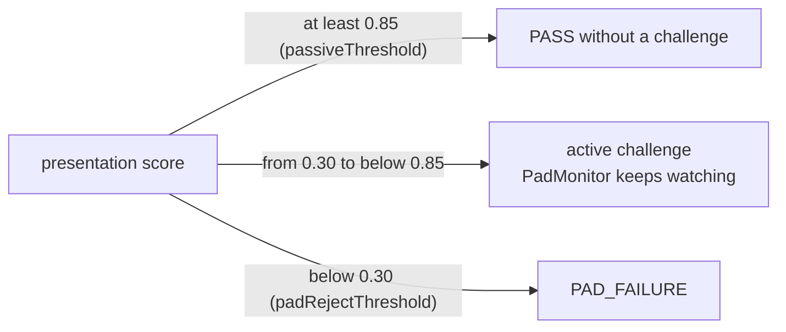

# Part 2: ISO/IEC 30107-3 evaluation of the passive PAD

> **Every result here is SINGLE SUBJECT s01, PROVISIONAL.** It comes from one person, one laptop webcam, one room
> and one phone as the attack instrument. It shows tendencies and failure modes; it does not estimate field error
> rates. The raw recordings and per-take results stay on the recording laptop under the gitignored `eval-data/`,
> as the participant asked. Only aggregates appear here.

## 1. Scope and terms

We evaluate the **presentation attack detection (PAD) subsystem** of the face liveness check: the Part 2 analyzer,
together with Part 3's passive decision exactly as it runs in production. The terms follow ISO/IEC 30107-1 and
ISO/IEC 30107-3:2023.

| Term | Meaning here |
|---|---|
| Presentation | one 6-second take (60 frames at 10 fps) shown to the camera |
| Bona fide presentation | the live subject's own face |
| PAI species | one kind of attack instrument, such as a phone showing a photo held close (`screen_photo_close`) |
| APCER (per species) | attack presentations of that species classified as bona fide ÷ responding attack presentations of that species |
| max APCER | the highest APCER over the evaluated species (the headline security figure) |
| BPCER | bona fide presentations classified as attacks ÷ responding bona fide presentations |
| APNRR / BPNRR | attack / bona fide presentations that produced **no decision** (non-response). Reported separately; a non-response is never counted as an acceptance. |
| ACER | (max APCER + BPCER) / 2. It is **non-normative in the 2023 edition** and shown only for continuity. |
| EER | the error rate at the threshold where max APCER and BPCER are closest |

For every 0/N result we give the one-sided 95% Clopper-Pearson upper bound in brackets. For example, 0/10 is
[≤ 25.9%]: with 10 samples we can only say the true rate is probably below about 26%. With N this small, read every
figure through its bound.

## 2. How a presentation is decided (mirrors production)

- Each take is analysed by a **fresh** analyzer, as each session is. Its frames are fed in order, with timestamps
  1000/fps apart.
- **Presentation score.** The median of the **first full window** of Part 3's `PassiveEvaluator`: 10 eligible frames,
  each with one face, no quality issue, a score, and |yaw| and |pitch| of 25° or less. Production decides on exactly
  this value.
- **No full window in the take** is a non-response. In production that is a timeout with a positioning hint, never
  an acceptance.

The engine then uses three zones:



- An attack that passes passively is a **security failure**.
- An attack sent to a challenge must still beat the challenge and Part 3's `PadMonitor`, which fails the attempt as
  soon as a 3-frame rolling median drops below 0.30.
- A bona fide take that is PAD-rejected is a **usability failure**. One sent to a challenge costs a few seconds.

## 3. Dataset (protocol: [part2-dataset-protocol.md](part2-dataset-protocol.md))

Webcam `webcam:0` (HP True Vision FHD Camera, 640 × 480). JPEG quality 95 with 4:4:4 chroma. 35 takes, 2,100 frames.

| Class | Takes | How |
|---|---|---|
| bona fide | 11 | normal ×3, close ×2 (leaned in too far: face cut off), far ×2, moving head ×2, close with the whole face visible ×2; the dim take was skipped |
| `screen_photo` | 6 | phone photo at normal distance with its edges visible: the subject's selfie ×3, a public-domain NASA portrait ×3 |
| `screen_photo_close` | 12 | phone held close as the subject judged it ×6 (face only about 4% of the picture), then about 10 cm away with a live face-size readout ×6 (face 20–31% of the picture) |
| `screen_replay` | 6 | the subject's selfie video playing on the phone |
| `screen_replay_monitor` | 0 | **not yet evaluated** (no second screen) |
| `print_flat`, `print_curved` | 0 | **NOT YET EVALUATED** (the prints will be added later; see section 7) |

## 4. Results

### 4.1 Candidate scorers (single subject s01, provisional)

The thresholds are today's defaults: passive 0.85, reject 0.30. Production as shipped is candidate 1. Candidates 1a
to 7 recompute the score from the stored model outputs and go through the same window logic.

| # | Candidate | max APCER @ 0.85 | BPCER @ 0.85 | ACER (non-norm.) | EER | BPCER @ APCER ≤ 5% | APNRR | BPNRR |
|---|---|---|---|---|---|---|---|---|
| **1** | **MEAN + session moiré cap (shipped)** | **0/10 [≤ 25.9%]** | 1/9 | 5.6% | **0.0%** | 0.0% | 8/24 | 2/11 |
| 1a | MEAN, no cap (before Phase 6b) | 4/10 (40%) | 1/9 | 25.6% | 21.1% | 33.3% | 8/24 | 2/11 |
| 2 | V2 only | 6/10 (60%) | 1/9 | 35.6% | 31.7% | 66.7% | 8/24 | 2/11 |
| 3 | V1SE only | 4/10 (40%) | 1/9 | 25.6% | 21.1% | 22.2% | 8/24 | 2/11 |
| 4 | MIN(V2, V1SE) | 4/10 (40%) | 1/9 | 25.6% | 21.1% | 33.3% | 8/24 | 2/11 |
| 5 | MEAN, per-frame moiré veto ≥ 1.4 | 0/10 [≤ 25.9%] | 1/9 | 5.6% | 0.0% | 0.0% | 8/24 | 2/11 |
| 5 | MEAN, per-frame moiré veto ≥ 1.3 / 1.5 / ≥ 1.6 | 0/10 / 1/10 / 4/10 | 2/9 / 1/9 / 1/9 | | | | | |
| 6 | MEAN, face-size gate > 0.20 | 1/5 (20%) | 1/7 | 17.1% | 17.1% | 42.9% | 13/24 | 4/11 |
| 6 | MEAN, face-size gate > 0.25 / 0.35 / 0.60 | 4/9 / 4/10 / 4/10 | 1/7 / 1/9 / 1/9 | | | | | |
| 7 | MIN + veto 1.4 (± gate 0.20) | 0/10 (0/5 with the gate) | 1/9 (1/7) | | 0.0% | | | 4/11 with the gate |
| 8 | HeuristicFaceAnalyzer (no ML) | 0/3 | 4/4 | 50.0% | 70.8% | 100% | 21/24 | 7/11 |

The worst species is `screen_photo_close` in every row. The responding counts are: `screen_photo` 0 (all 6 takes had
a face too small to decide, FACE_TOO_SMALL), `screen_photo_close` 10 and `screen_replay` 6.

What the table says:
- **Every model variant fails the same attack.** A phone photo held about 10 cm away passes in 4 of the 6 readout
  takes, at 0.89–0.95.
- **The face-size gate costs too much.** It turns bona fide close-ups into non-responses (BPNRR 2/11 → 4/11).
- **The per-frame veto at 1.4 is perfect on paper.** In a session, though, it would drive Part 3's PadMonitor below
  0.30 in 3 of 11 bona fide takes, which is a mid-challenge failure for a real person.
- **The shipped cap gets the same 0/10** without any rejection risk. It caps at 0.60 instead of zeroing, and it acts
  on a 10-frame rolling median, not on single frames.

### 4.2 Three zones with today's thresholds: before and after the moiré cap

| Class | N | Passive pass (before → after) | Challenge | PAD reject | Non-response | PadMonitor < 0.30 at some point |
|---|---|---|---|---|---|---|
| bona fide | 11 | 8 → 8 | 1 → 1 | **0 → 0** [≤ 23.8%] | 2 → 2 | 0 → 0 |
| `screen_photo` | 6 | 0 → 0 [≤ 39.3%] | 0 → 0 | 0 → 0 | 6 → 6 | 6 → 6 |
| `screen_photo_close` | 12 | **4 → 0** [≤ 22.1%] | 2 → 6 | 4 → 4 | 2 → 2 | 6 → 6 |
| `screen_replay` | 6 | 0 → 0 [≤ 39.3%] | 0 → 0 | 6 → 6 | 0 → 0 | 6 → 6 |

- **Effect of the cap.** 0 of the 9 responding bona fide takes left the passive zone, and none was newly rejected.
  All 4 passing close-up attacks moved to a challenge.
- **How often it fired.** 12 of 656 bona fide frames were ever capped (11 with a moving head, 1 far away). The
  6 readout close-up attacks were capped in 339 of their 360 frames.
- **Live check** (same subject, the shipped analyzer, real sessions): the real face passed passively (0.9987 and
  0.9994). In two separate runs, the phone photo held about 10 cm away was held at exactly 0.600, sent to a
  challenge, and failed there (PAD_FAILURE, then MAX_RETRIES_EXCEEDED).

### 4.3 Close-up analysis (why the models were fooled)

Medians over single-face frames, with the 10th–90th percentile in brackets.

| Class | Face area (share of picture) | Moiré | MEAN score (no cap) |
|---|---|---|---|
| bona fide, normal | 0.086 | 1.20 [1.15–1.26] | 0.98 |
| bona fide, close, whole face | 0.313 [0.30–0.33] | 1.02 [1.00–1.08] | 1.00 |
| bona fide, moving head | 0.077 | 1.27 [1.18–1.45] | 0.94 |
| phone close-up, selfie | 0.258 [0.20–0.31] | 1.46 [1.39–1.53] | 0.88 |
| phone close-up, NASA portrait | 0.253 [0.23–0.27] | 1.59 [1.56–1.61] | 0.87 |

- Per take, the window-median moiré was **1.00–1.37 for bona fide** and **1.435–1.593 for the close-up attacks**. The
  margin is real but thin (0.065).
- Face size cannot separate the two groups: the bona fide close-ups are the larger faces.

## 5. Thresholds: recommendation, and why the defaults stay

The rule (provisional, on the grid 0.05 … 0.95, 0.99, 0.999):
- **passiveThreshold** = the smallest τ with APCER = 0 for every species, + 0.02, capped at 0.99.
- **padRejectThreshold** = the largest τ with no bona fide score below it, − 0.05, kept below passiveThreshold.

| Scorer | Rule output: passive / reject | Note |
|---|---|---|
| MEAN without the cap | 0.97 / 0.75 | Fixes the close-up miss by brute force, but only 5 of 9 responding bona fide takes would then pass without a challenge |
| MEAN + cap (shipped) | 0.67 / 0.62 | Degenerate: the cap pins the close-up attacks at exactly 0.60, so the rule hugs it |

**Decision: keep 0.85 / 0.30.** With one subject, moving a security threshold would be fitting noise. The cap already
removes the observed passive failure without touching bona fide outcomes. Revisit when there are at least 10 subjects
and the print species are in.

## 6. Limitations

- One subject, one camera, one phone, one session of lighting. No children, older subjects, glasses or different skin
  tones yet.
- Prints and second-screen replays are not yet evaluated.
- The moiré cap's threshold comes from one phone's pixel pitch and one webcam's optics. Other screens may sit below
  1.40, and other cameras may push bona fide frames above it.
- Attack takes were made by the subject, who knew the system, holding the phone by hand. That is a low-effort attack
  potential.
- Challenges are not part of the APCER above. Phase 5 saw a tilted phone photo pass BLINK and SMILE once. Part 3
  now ignores frames that drift more than 12° from the baseline during BLINK and SMILE (see the findings doc).

## 7. Next steps (with commands)

PowerShell, from the repository root, after the standalone install (README, Part 2):

```powershell
mvn -f liveness-eval/pom.xml dependency:build-classpath "-Dmdep.outputFile=liveness-eval/target/eval-cp.txt"
$cp = "liveness-eval\target\classes;" + (Get-Content liveness-eval\target\eval-cp.txt -Raw).Trim()

# 1. Prints: print the selfie and the NASA portrait in colour, then record 6 + 6 guided takes (consent first)
java -cp $cp io.mosip.registration.liveness.eval.LiveAnalyzerDemo --mode dataset --consent --subject s01 --only print_flat,print_curved
#    or one take at a time:
java -cp $cp io.mosip.registration.liveness.eval.DatasetRecorder --consent --label print_flat --subject s01 --take 1 --condition selfie

# 2. More subjects (each with their own consent and code): the whole plan, resumable
java -cp $cp io.mosip.registration.liveness.eval.LiveAnalyzerDemo --mode dataset --consent --subject s02

# 3. Re-run the evaluation (output stays under eval-data/reports/)
java -cp $cp io.mosip.registration.liveness.eval.PadEvaluation --data eval-data
```

Then:
- Add more phones, tablets and monitors as `screen_*` takes, and a second camera.
- Re-validate the moiré cap on that data (the per-condition moiré table in `report.md`) before enabling the hard veto.
- Re-check the thresholds with the section 5 rule once there are at least 10 subjects.

## 8. ISO/IEC 30107-3 alignment checklist

| Item | Status |
|---|---|
| Vocabulary: PAI species, APCER per species, max APCER, BPCER, non-responses | covered |
| ACER marked non-normative (2023 edition) | covered |
| Decision measured at the system's real decision point (production window and thresholds), not the raw model | covered |
| Bona fide and attack conditions documented; protocol, consent and data handling written down | covered (`part2-dataset-protocol.md`) |
| Confidence for small samples | covered (Clopper-Pearson upper bounds) |
| Subjects and PAIs per species in the numbers the standard expects for a conformance claim | **not covered** (1 subject, 6–12 takes per species) |
| PAI species catalogue completeness (prints, masks, 3D, partial attacks, deepfake replays) | **not covered** (screens only so far) |
| Attack potential rating (expertise, equipment, time) | **not covered** (low-effort, self-made attacks only) |
| Digital injection attacks (virtual cameras, stream tampering) | **out of scope** for PAD; the frame source and audit chain are Part 1 and Part 3 |
| IAPAR (needs a biometric comparison subsystem) | not applicable here |
| Independent, accredited laboratory test (iBeta or similar, level 1 / 2) | **not covered**; required before claiming conformance |
