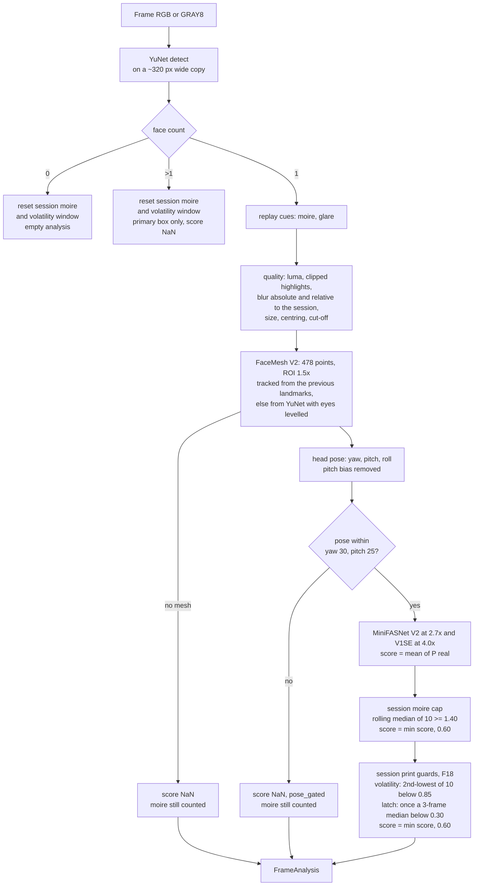
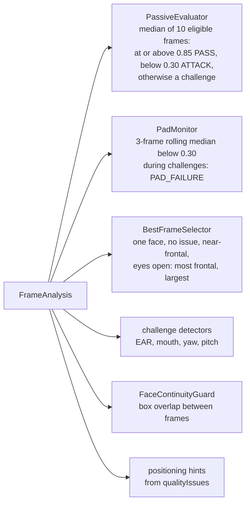
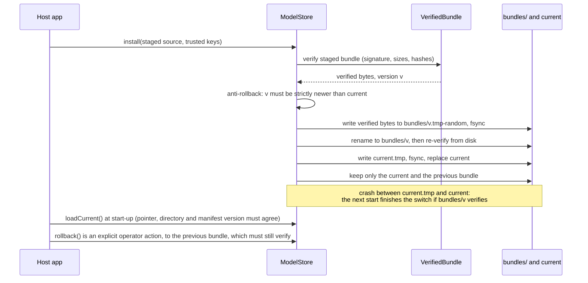
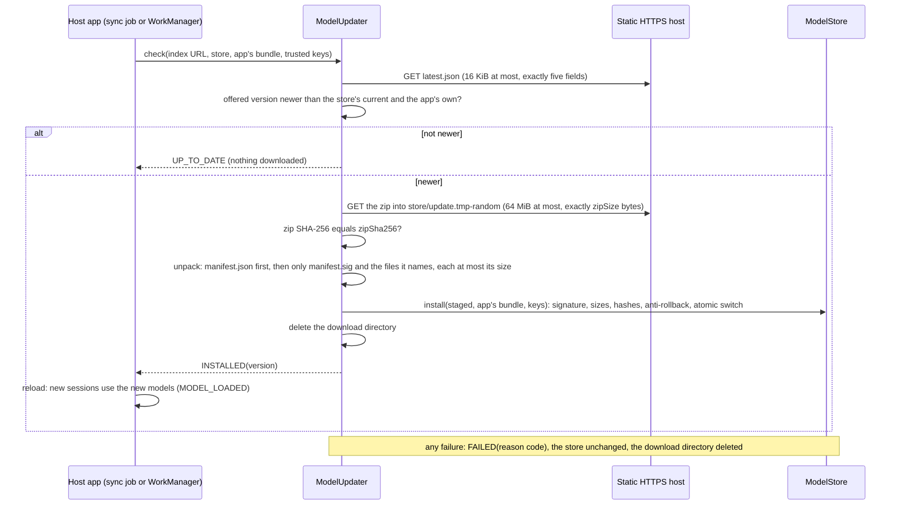

# Part 2: passive liveness and PAD architecture

`liveness-analyzer` implements the contract's `FaceAnalyzer`. For every camera frame it returns one `FrameAnalysis`
with face count, box, landmarks, head pose, quality issues and a passive liveness score. Part 3's engine turns those
per-frame results into a session decision. Part 2 never decides PASS or FAIL itself.

The code is pure Java 8 / Android API 21 (checked by animal-sniffer) plus ONNX Runtime. The executable
specification is [models/tools/reference_pipeline.py](../models/tools/reference_pipeline.py): every formula is in a
docstring, and Java parity tests compare against its golden outputs.

## 1. Per-frame pipeline



| Stage | Output in `FrameAnalysis` |
|---|---|
| detect + count | `faceCount`, `faceBox` (primary face, pixels) |
| replay cues + quality | `qualityIssues`: TOO_DARK, TOO_BRIGHT (mean luma, or more than 30% clipped pixels), BLURRY (Laplacian variance below 15, or below 0.45 × the session's rolling median: F6), FACE_TOO_SMALL, FACE_TOO_LARGE, FACE_OFF_CENTER, FACE_CUT_OFF |
| mesh | `landmarks`: eyes (6 points each, the contract's EAR order), irises, mouth, nose, chin, forehead. The ROI follows the previous frame's landmarks while the face box overlaps (F7) |
| pose | `yawDeg`, `pitchDeg`, `rollDeg` |
| PAD, moiré cap, print guards | `livenessScore` in [0, 1], NaN when not computed |
| audit | `padDetails` (section 4), `processingMs` |

## 2. How Part 3 uses a FrameAnalysis



- A frame is *eligible* for the passive window when it has exactly one face, no quality issue, a score, and |yaw| and
  |pitch| of 25° or less.
- The moiré cap and the print guards (section 3) are tuned to these two consumers. A capped score of 0.60 can never
  reach PassiveEvaluator's 0.85, and it can never trip PadMonitor's 0.30.

## 3. Session caps

Both caps below live in the analyzer, which serves exactly one session, retries included (Part 3 creates it when the
session starts). Part 3 needs no change for either. A new session gets a new analyzer and starts clean.

### 3.1 The moiré cap

**The problem.** A phone photo held about 10 cm from the camera fools both MiniFASNet models. In round 1, 4 of 6
such takes passed passively, at 0.89–0.95. At that distance the models' crops contain only screen content.

**What still gives the screen away.** The pixel grid adds periodic peaks to the face crop's spectrum. The moiré value
is `log10(max / median)` of the Hann-windowed 64 × 64 DFT magnitude over radii 8–31.

**The rule.** One analyzer serves one session, so it can keep state:
- Every frame with exactly one face adds its moiré to a rolling buffer of the last 10 values. This includes
  pose-gated frames and frames without a mesh, because a screen is a screen at any angle.
- Any other face count clears the buffer, because a different face may have been presented.
- Once the buffer holds at least 3 values and its median is 1.40 or more, the score becomes `min(score, 0.60)`.
  That forces a challenge, and it never causes a rejection.
- A hard veto (score 0 at or above a second threshold) is implemented but **off**. It needs data from more devices.

**Round-1 evidence** (single subject s01, provisional):

| | Before the cap | After the cap |
|---|---|---|
| phone close-up attacks that pass passively | 4/12 | **0/12** |
| bona fide takes rejected | 0/11 | 0/11 |
| bona fide takes moved from passive pass to a challenge | – | 0/9 responding |
| bona fide frames ever capped | – | 12 of 656 (moving head, far) |

Full numbers are in [part2-iso30107-evaluation.md](part2-iso30107-evaluation.md).

### 3.2 The print guards (F18)

**The problem.** In live sessions a printed cut-out passed twice: once at 0.9998 (a discarded run), then at 0.944. The
second time, the cut-out was held about 20 cm from the camera, so its face was 162–179 px wide, the size of a real face.
- Both models often scored it live, but over 20 s its per-frame score swung between 0.06 and 0.99.
- It failed attempt 1 and attempt 2 with PAD_FAILURE and attempt 3 with CHALLENGE_FAILED. It then passed on attempt 4,
  because every retry restarts Part 3's passive window: the session had four tries.
- The moiré cap held attempt 1 (print halftone, moiré median 1.43–1.56). During attempt 4 the median was 1.36–1.40,
  just under the cap.

**The rules.** Both caps lower the score to at most 0.60. That forces a challenge and never causes a rejection.

| Guard | Fires when | Then | Lifts |
|---|---|---|---|
| PAD latch (A) | the median of the last 3 scores (after the moiré cap, the scores Part 3's PadMonitor sees) is below `padLatchThreshold` 0.30 | every later score of the session is at most `padLatchCapScore` 0.60 | never within the session; a new session has a new analyzer |
| Volatility cap (C) | at least 5 of the last 10 scored single-face frames are known and the second-lowest of their model scores is below `volatilityMinScore` 0.85 | this frame's score is at most `volatilityCapScore` 0.60 | by itself, once the low frames leave the window |

Details:
- **Which frames count.** Frames without a score are skipped. The latch's history is never cleared, as in PadMonitor.
  The volatility window holds model scores, (V2 live + V1SE live) / 2 before any cap. Any face count other than 1
  clears it, as it clears the moiré buffer.
- **Why the volatility cap cannot get stuck.** A capped score never enters its window.
- **Logging.** When the latch fires, the analyzer logs one line with numbers only (`java.util.logging`, INFO).
- **The specification.** `reference_pipeline.session_guards`, checked by `GUARDS_SELF_TEST` (`--guards`) and
  replayed by the Java `PadGuardsTest`. On all 130 recorded takes, the Java scores equal the spec's within 2.4e-8
  (5,833 scored frames).

**Why 0.85 for the volatility cap** (fix round F18, decided by the planner):
- The window that passed live had a second-lowest score of 0.822. At 0.85, the same pattern is capped even on a first
  attempt, before any latch.
- At 0.75 only the latch would stop it.
- The cost is a challenge, never a rejection: about 1 in 7 real-face passive passes become challenges (below).
- To re-check on multi-subject data (F9), use `models/tools/session_guard_replay.py` per subject. If more than 25% of
  real-face passive passes become challenges across subjects, 0.80 is the next value to evaluate.
- **Re-checked on F9 (2026-10-28, four bona fide subjects, rule R2):** 2 of 34 real-face passive passes (5.9%) become
  challenges at 0.85, so **0.85 stays**.

  | Subject | Takes | Passes without the guards | Turned into a challenge at 0.85 | At 0.80 |
  |---|---|---|---|---|
  | s01 | 11 | 7 | 1 | 0 |
  | s02 | 12 | 9 | 1 | 0 |
  | s03 | 12 | 8 | 0 | 0 |
  | s04 | 12 | 10 | 0 | 0 |
  | all | 47 | 34 | 2 (5.9%) | 0 |

  - No bona fide take was PAD-rejected at either value.
  - Replaying 295 attack attempts (every recorded attack take, and every attack attempt of the live logs) at 0.85 and
    at 0.80 changed no verdict. None passed.
  - Full numbers: [part2-iso30107-evaluation.md](part2-iso30107-evaluation.md) section 4.7.

**Evidence before F9.** Single-subject bona fide (s01), provisional.

Recorded takes (`PadEvaluation`, production defaults):

| | Guards off | Guards on |
|---|---|---|
| attack takes that pass passively | 0/119 | 0/119 |
| attack zones (challenge, reject, non-response) | unchanged | unchanged |
| bona fide PAD rejections | 0/11 | **0/11** |
| bona fide passive passes | 7/11 | 6/11 (1 "far" take goes to a challenge) |
| takes where the latch ever fired | – | bona fide 0/11, attacks 99/119 |

Live sessions (`SessionDemo`, eval-data logs):

| | Result |
|---|---|
| attack sessions, cut-outs and the NASA print | 29, **none passed**. 17 were judged (face at least 80 px); the others timed out as FACE_TOO_SMALL |
| attempts that would have passed without the guards | 1 of 63 decided attempts: the cut-out that passed before, again on attempt 4 (0.923). With the guards it went to a challenge and failed it. Either guard alone blocks it |
| real-face sessions | 10: 6 passive passes, 3 passed after a challenge, 1 timed out (FACE_TOO_SMALL at about 1 m); **0 PAD rejections**; the latch never fired |
| real-face passive passes moved to a challenge by the guards | 1 of 7 (moving head) |

The same live logs and recorded takes, replayed through the spec with other settings:

| Setting | Live real-face passive passes | Live attack sessions with a passive pass | Recorded bona fide passive | Recorded attacks passing |
|---|---|---|---|---|
| no guards | 7/10 | 2 | 7/8 | 0/64 |
| latch only | 7/10 | 0 | 7/8 | 0/64 |
| **latch + volatility 0.85 (default)** | 6/10 | 0 | 6/8 | 0/64 |
| latch + volatility 0.80 | 6/10 | 0 | 7/8 | 0/64 |
| latch + volatility 0.75 | 7/10 | 0 | 7/8 | 0/64 |
| volatility 0.85 alone | 6/10 | 0 | 6/8 | 0/64 |
| volatility 0.80 alone | 6/10 | 1 | 7/8 | 0/64 |

- The live columns cover 30 attack sessions (the 29 above and the earlier run that passed) and the 10 real-face
  sessions.
- The recorded counts are over the takes that reached a passive window.

**What it does not cover.** The latch lives as long as the session. A new session starts clean.
- The UIs retry with `session.retry()`, which keeps the latch.
- An operator who starts a new session after a final failure gets a fresh analyzer. The operator workflow's cooldown
  limits that.

## 4. `padDetails`: audit keys

`padDetails` is for the audit trail only and is never shown in the UI. It has at most 8 keys, so an audit record
stays small and fixed in shape.

| Frame kind | Keys, in order |
|---|---|
| scored | `minifas_v2_live`, `minifas_v1se_live`, `minifas_v2_c0`, `moire`, `moire_med` (session rolling median), `moire_cap` (1 when the cap or veto applied, else 0), `volatility_cap` (1 when the volatility cap applied, else 0), `pad_latch` (1 while the session is latched, else 0) |
| pose-gated | `pose_gated` (1), `moire`, `moire_med` |
| no mesh | `moire`, `moire_med` |
| no face / several faces | empty |

- **Privacy.** Every value is a model probability or a scalar statistic. There are no pixels, landmarks or
  embeddings, and nothing that could rebuild a face.
- Part 3's `PassiveEvaluator.padDetailMedians()` aggregates these keys over the passive window for the audit record.
- Glare is still computed but is not in `padDetails`. Tools read it through `OnnxFaceAnalyzer.lastReplayCues()`.
- **F18 changed two keys.** `volatility_cap` and `pad_latch` replaced `minifas_v2_c2` and `minifas_v1se_spoof`. The
  softmax makes the old keys redundant, so they can still be derived:
  - V2 c2 = 1 − `minifas_v2_live` − `minifas_v2_c0`;
  - V1SE spoof = 1 − `minifas_v1se_live`.
  Nothing read the two old keys.

## 5. Conventions (contract)

| Quantity | Convention |
|---|---|
| yaw | **+ = the subject turned to THEIR left** |
| pitch | **+ = the subject looks UP** (this confirms Part 3's proposal P2). The mesh's neutral-face bias (−9.5°, a signed bundle parameter) is removed. |
| roll | + = the subject's left eye is higher |
| landmarks | named from the subject's point of view (`leftEye` is the subject's left eye) |
| frames | never mirrored. Mirroring a preview is display only; the engine always sees the camera's frame. |

## 6. Threading and lifecycle

- `OnnxFaceAnalyzerFactory` loads and verifies the bundle once, on the first `create()` or on `preload()`, and builds
  one ONNX session per model. These sessions are **shared** by every analyzer and are thread-safe.
- `create()` returns a **new analyzer per session**. Each analyzer owns its scratch buffers and its session state
  (moiré cap, relative blur, print guards), and is not thread-safe. Part 3 already uses one analyzer per session, and
  its retries keep it.
- Closing an analyzer releases nothing shared. Closing the factory closes the sessions.
- Call `factory.preload()` at application start-up. That moves the verification and session build (about 0.2 s warm,
  about 1 s in a fresh JVM) out of the first session.

## 7. The model bundle

**Contents.** `manifest.json`, `manifest.sig` and the five ONNX files: the four liveness models and SFace for face
binding (section 12). They are packaged in the jar under `liveness/models/` (`ClasspathBundleSource`), or kept in a
`ModelStore` directory. The current bundle is `pad-2026.10.5` (the int8 SFace; `pad-2026.10.4` had the fp32 one).

```json
{ "schema": 1, "bundleVersion": "pad-2026.10.5", "keyId": "mosip-liveness-dev-2026-10",
  "createdUtc": "2026-10-23T15:17:10Z", "params": { "pitchBiasDeg": -9.5 },
  "files": [ { "role": "DETECTOR", "name": "yunet_2026may.onnx", "size": 229738, "sha256": "ebafce4e..." }, ... ] }
```

`manifest.sig` is one line: `<keyId>:<hex DER ECDSA P-256 signature>`, computed over the exact bytes of `manifest.json`.

**Verification order** (`VerifiedBundle`). It fails closed: any problem is `MODEL_INTEGRITY_FAILED`, with no fallback.
1. Read the manifest (64 KiB at most) and the signature (1 KiB at most).
2. Look up `keyId` in `TrustedKeys`, then verify SHA256withECDSA **before parsing anything**.
3. Parse strictly: schema 1, version `pad-YYYY.MM.N`, the same keyId, each of the five roles exactly once (a
   four-model bundle from before F1 is refused), safe file names, finite parameters.
4. For each file: read it (64 MiB at most), then check its size, then its SHA-256.
5. Build the ONNX sessions from those same verified byte arrays.

**Offline updates** (`ModelStore`). The host app downloads and stages a bundle; the store accepts it only after
verifying it.



With a store, the factory verifies the bundled bundle and uses the store's current one only if its version is higher;
then that one must verify too. A tampered disk is treated as an attack: `MODEL_INTEGRITY_FAILED`, with no silent
fallback. A store bundle that is older than or equal to the bundled one is not read, since it would not be used. This
matters after an app update: a device that installed `pad-2026.10.1` (four models) keeps it in its store, and that
bundle no longer verifies against the five roles. Before this rule it blocked the app's newer five-model bundle.

Hosts install updates with `install(staged, bundledSource, keys)`, which takes the app's own bundle as well. Both are
verified before the store is touched, and the staged bundle must be newer than the bundled one. If the store is empty,
or its current version is older than the bundled one, the bundled bundle is installed first as the rollback base, and
every installed bundle older than it is removed. A later `rollback()` therefore lands on the bundled version, which
verifies, and never on a bundle an app update made unusable. Pruning happens only in install, never when loading.

**Online updates** (`ModelUpdater`, fix round 4). The problem statement asks for model updates "securely synchronized
when online". `ModelUpdater.check(indexUrl, store, bundled, keys)` is that sync, in the shared engine, for both
clients. It reads a small index, `latest.json`:

```json
{ "schema": 1, "bundleVersion": "pad-2026.11.1", "zipUrl": "pad-2026.11.1.zip",
  "zipSha256": "<64 hex digits>", "zipSize": 13427199 }
```



- **The signature is the trust anchor.** TLS is defence in depth. The zip's SHA-256 and the entry rules stop a
  wrong or malformed download early, but only `install`'s signature check makes a bundle usable. So a compromised
  host can, at worst, withhold updates; it cannot install models.
- **Transport.** HTTPS only. Plain HTTP is allowed only to 127.0.0.1 or localhost, and only with
  `allowInsecureLocalhost` (tests and debug builds). Redirects (at most 3) are followed by the updater itself under the
  same rule, because `HttpURLConnection` would follow a localhost redirect to any HTTP host.
- **Zip rules.** Flat entries only, with `manifest.json` first. Then exactly `manifest.sig` and the files the manifest
  names, each once and at most its declared size. A zip-slip path, a directory, an extra or a duplicate entry is
  refused (`ZIP_ENTRY_REFUSED`), and a zip bomb cannot grow past the declared sizes.
- **Results.** `INSTALLED(version)`, `UP_TO_DATE`, or `FAILED` with a reason code: `INSECURE_TRANSPORT`, `NETWORK`,
  `HTTP_STATUS`, `INDEX_INVALID`, `ZIP_SIZE`, `ZIP_HASH_MISMATCH`, `ZIP_INVALID`, `ZIP_ENTRY_REFUSED`,
  `BUNDLE_INVALID` (signature or hashes) or `STORAGE`. The codes carry no URL, so they can go into the audit.
- **Concurrency.** One check runs at a time per process. A download directory left by a crash is removed by the next
  check.

**Hosting the bundle.** Any static HTTPS endpoint works, because the signature carries the trust: a MOSIP web
server, an object store (S3, MinIO, Azure Blob) or a CDN. To publish a signed bundle:
1. `ModelBundleTool pack --dir <signed bundle> --out <dir> --base-url https://<host>/liveness`. It verifies the
   bundle, then writes `<version>.zip` and `latest.json`.
2. Upload the zip first, then `latest.json`, so the index never points at a missing zip.
3. Clients find it at their next check: `mosip.registration.liveness.model.update.url` points at
   `https://<host>/liveness/latest.json`.

**Desktop (Person 4).** The Registration Client's existing sync job can call
`ModelUpdater.builder().build().check(new URL(indexUrl), store, new ClasspathBundleSource(), TrustedKeys.builtIn())`
after its other syncs, then reload the factory on `INSTALLED`, as Android does
([part5-android-integration.md](part5-android-integration.md)).

## 8. Signing keys: development vs production

| | Development key (today) | Production key (before release) |
|---|---|---|
| keyId | `mosip-liveness-dev-2026-10` | for example `mosip-liveness-prod-2027-01` |
| private key | `%USERPROFILE%\.mosip-liveness\model-signing-key.p8`, on one developer machine; never in git (the tool refuses paths inside a git tree, and `*.p8` is gitignored) | in an HSM or an offline signing machine, under MOSIP's key custody policy |
| public key | compiled into `TrustedKeys.BUILT_IN` | compiled into `TrustedKeys`, or passed by the host through `new TrustedKeys(Map)` |

Public keys are compiled in on purpose. A key read from a file next to the models could be swapped together with the
models.

**Replacing or rotating the key:**
1. Create the key pair on the signing machine: `ModelBundleTool keygen --key-id <prod-id> --out <p8 outside any repo>`.
   Record the printed public key hex.
2. Add `{"<prod-id>", "<public hex>"}` to `TrustedKeys.BUILT_IN`. To rotate, keep the old entry for one release, so
   that clients holding old bundles still verify.
3. Re-sign every bundle:
   - `ModelBundleTool manifest --dir models --version pad-YYYY.MM.N --key-id <prod-id> --param pitchBiasDeg=-9.5`
   - `ModelBundleTool sign --dir models --key <p8> --key-id <prod-id>`
   - `ModelBundleTool verify --dir models`
4. Release the analyzer jar with the new `TrustedKeys`.
5. Publish the re-signed bundle for online updates (`ModelBundleTool pack`, section 7). Clients install only bundles
   signed by a key in their `TrustedKeys`, so publish it only once the new key has shipped in a release.
6. In the following release, remove the development key (and any retired key) from `BUILT_IN`.

## 9. Configuration keys

All keys are optional and read with `AnalyzerConfig.fromConfig(configProvider)`. A missing key keeps its default.
They are not in Part 3's `liveness-default.properties`. The prefix is `mosip.registration.liveness.face.analyzer.`

| Key | Default | Meaning |
|---|---|---|
| `intraOpThreads` | 2 | ONNX Runtime threads per session |
| `accelerator` | CPU | CPU, XNNPACK or NNAPI; falls back to CPU if unavailable |
| `detectorMaxWidth` | 320 | the detector runs on a copy at most this wide |
| `detectorScoreThreshold` | 0.7 | minimum detection score |
| `detectorNmsIou` | 0.3 | non-maximum suppression overlap |
| `detectorSecondFaceMinAreaRatio` | 0.2 | a second face counts if its area is at least this × the primary face's |
| `meshPresenceThreshold` | 0.5 | below this the mesh is dropped (no pose, no score) |
| `meshRoiScale` | 1.5 | mesh crop size relative to the face box |
| `meshTracking` | true | F7: the mesh ROI comes from the previous frame's landmarks while the face box overlaps (IoU at least 0.3); `false` always uses the YuNet ROI |
| `pitchBiasDeg` | −9.5 | removed from the mesh pitch; when the key is absent, the bundle's signed value wins |
| `padMaxYawDeg` / `padMaxPitchDeg` | 30 / 25 | outside this pose range the score is NaN (`pose_gated`) |
| `tooDarkLuma` / `tooBrightLuma` | 40 / 220 | mean face luma limits |
| `qualityMaxClippedFraction` | 0.30 | more than this share of the face crop with R, G and B all ≥ 250 is also TOO_BRIGHT |
| `blurLapVar` | 15 | Laplacian variance below this is BLURRY |
| `qualityRelativeBlurRatio` | 0.45 | F6: also BLURRY below this fraction of the median of the session's last 15 unflagged single-face frames (once 5 are known); `off` disables it |
| `minAreaFrac` / `minFaceWidthPx` | 0.04 / 80 | below either is FACE_TOO_SMALL |
| `maxAreaFrac` | 0.60 | above is FACE_TOO_LARGE |
| `maxCentreOffset` | 0.25 | above is FACE_OFF_CENTER |
| `moireCapThreshold` | 1.40 | session moiré cap threshold; `off` disables it |
| `moireCapScore` | 0.60 | the capped score; must be in (0, 1) |
| `moireWindow` / `moireMinFrames` | 10 / 3 | rolling-median length, and the values needed before the cap applies |
| `moireVetoThreshold` | off | a number enables the hard veto (score 0) |
| `padLatchThreshold` | 0.30 | F18 PAD latch: a 3-frame score median below this caps the rest of the session; `off` disables it |
| `padLatchCapScore` | 0.60 | the latched cap; in (0, 1) and above `padLatchThreshold` |
| `volatilityMinScore` | 0.85 | F18 volatility cap: a second-lowest model score of the last 10 below this caps the score; `off` disables it |
| `volatilityCapScore` | 0.60 | the volatility cap; in (0, 1) |

Face binding has its own key, outside the analyzer prefix: `mosip.registration.liveness.face.binding.cosineThreshold`
(default 0.45; section 12).

## 10. Performance

Development laptop: AMD Ryzen AI 7 350, JDK 11, ONNX Runtime 1.31.0 CPU, 20 warm-up + 300 timed runs. Full report:
[benchmark-20261023.md](../liveness-eval/reports/benchmark-20261023.md).

| intra-op threads | `analyze()` p50 / p95 / p99 | preload (verify + sessions) | first `analyze()` |
|---|---|---|---|
| 1 | 18.1 / 23.9 / 27.8 ms | 1065 ms (fresh JVM) | 63 ms |
| 2 (default) | 18.0 / 21.9 / 24.4 ms | 175 ms | 23 ms |
| 4 | 18.2 / 21.4 / 28.6 ms | 227 ms | 41 ms |

The breakdown at p50: detect 5 ms, mesh 7.5 ms, PAD (both models) 4.7 ms, everything else under 1 ms. At 18–22 ms
per frame, the analyzer easily covers Part 3's 8 fps passive rate and 15 fps challenge rate on one core.

These figures predate face binding. Since `pad-2026.10.4` the bundle has five files. `preload()` verifies all five and
builds the four per-frame sessions. The SFace session is built on the matcher's first call, or earlier by
`warmUpMatcher()` on a background thread (fix round 2). `pad-2026.10.5` replaced the fp32 SFace with the zoo's int8
file (section 12).

| | fp32 SFace (`pad-2026.10.4`) | int8 SFace (`pad-2026.10.5`) |
|---|---|---|
| laptop, fresh JVM: `preload()` | 2.2–2.9 s: ONNX Runtime's native library 1.6–1.9 s, reading and verifying the files 0.59–0.94 s, the four sessions 0.19–0.28 s | 1.6–2.1 s (28.8 MB less to verify) |
| laptop: SFace session (`warmUpMatcher`) | 67–98 ms | 50–52 ms |
| laptop: first comparison of two images, without / after the warm-up | 234–255 / 152–205 ms | 531–574 / 461–519 ms |
| laptop: comparison, warm / one face, warm | 64–70 / 29–34 ms | 404–422 / 204–211 ms |
| phone (S23 FE, debug build): app preload, then the matcher warm-up | 427–526 ms, then 42–61 ms (504 ms when preload built all five sessions) | see section 12 |
| phone: first comparison without / after the warm-up | 203 / 89 ms | 140 / 75 ms |
| phone: comparison, warm / one-face embedding p50 | 128 / 45.6 ms | 76 / 36.8 ms |

Laptop runs: 3 fresh JVMs each (`BindingEvaluation --speed [--warm-up]`); the breakdown of the fp32 preload from 5
more. Phone: the debug page's matcher benchmark (`MatcherBenchmark`, two live frames with one face, fresh factories).
Deferring the SFace session saves about 80 ms of preload on the laptop; the rest is the runtime and the verification
of the bytes, which preload must still do. On this laptop's x86 CPU the int8 SFace is about 6 times slower than fp32;
on the phone's ARM CPU it is faster. A match runs once per capture, not per frame. Per-frame times are unchanged,
apart from the occasional F7 fallback, which re-runs the mesh.

## 11. Android notes (Person 5)

- Use `com.microsoft.onnxruntime:onnxruntime-android:1.31.0` (minSdk 24, AGP 8 or later). It has the same
  `ai.onnxruntime` API. Exclude the desktop `onnxruntime` jar.
- **Models.** Ship the bundle as assets, and implement `BundleSource` over them (`read(name)` returns the asset bytes,
  `describe()` a label). Pass it to `new OnnxFaceAnalyzerFactory(assetSource, storeOrNull, TrustedKeys.builtIn(), config)`.
  Verification is identical to the desktop.
- **Accelerator.** Set `accelerator=XNNPACK` (usually the best on ARM CPUs) or `NNAPI`, and keep CPU as the fallback.
  `factory.activeAccelerator()` reports what is actually in use. Benchmark on the target phones before choosing.
- **Threads.** Start with `intraOpThreads=2`. Leave cores free for the camera and the UI.
- **Analysis rate.** Part 3 analyses at `analyzeFps` (8) passively and up to 15 fps during challenges, and drops the
  other frames. On slow phones, lower the rate rather than the resolution.
- Call `preload()` when the registration screen opens. Release the factory with the activity or application scope.
- If INT8 is needed, use static QDQ quantisation, then re-run the parity tests and re-sign (see the model selection
  doc).

## 12. Face binding (F1)

**The gap.** Liveness runs on camera frames, but the face that is stored comes from the SBI capture. Without a link
between the two, a live person could pass liveness while a photo, or another person, is captured. Face binding
compares `LivenessResult.bestFrame` with the captured face and accepts the capture only if both show the same person.

**Model.** SFace from OpenCV Zoo, a MobileFaceNet trained with the SFace loss: since `pad-2026.10.5` the zoo's own
int8 file `face_recognition_sface_2021dec_int8.onnx` (9.9 MB). `pad-2026.10.4` had the fp32 file (38.7 MB).
- Licence: Apache-2.0, byte-identical to upstream. The training-data provenance is in `models/LICENSES.md`.
- It is the fifth role of the signed bundle (`MATCHER`).

**Method.** This is OpenCV's `FaceRecognizerSF`, mirrored from `modules/objdetect/src/face_recognize.cpp` (OpenCV
5.0.0); line numbers are in `reference_pipeline.py`:
1. Detect with YuNet. Each image must hold exactly one face, counted as the analyzer counts faces.
2. Fit a similarity transform from the 5 YuNet keypoints to OpenCV's 112 × 112 ArcFace template (an Umeyama fit).
3. `warpAffine` to 112 × 112 (bilinear, zero border, 8-bit).
4. Feed the network the RGB values 0..255 in NCHW layout. It returns 128 values.
5. Cosine of the two L2-normalised features. The faces MATCH at 0.45 or above, else NO_MATCH. OpenCV documents
   0.363 for SFace; 0.45 was decided from the evaluation below (fix round 2).

```java
try (FaceMatcher matcher = factory.createMatcher()) {          // shares the factory's verified sessions
    MatchResult m = matcher.compare(result.bestFrame, capturedFace);
    // m.outcome: MATCH, NO_MATCH, NO_FACE_A, NO_FACE_B, MULTIPLE_FACES_A, MULTIPLE_FACES_B
    // m.similarity (NaN unless both faces were found), m.threshold
}
```

**Parity.**
- **Preprocessing vs OpenCV:** our aligned 112 × 112 crops differ from `cv2.FaceRecognizerSF.alignCrop` by at most
  1 grey level on every golden face (OpenCV quantises sub-pixel positions to 1/32 pixel).
- **Features vs OpenCV:** fp32 file 0.9999995 or more; int8 file 0.9916 to 0.9952. OpenCV's DNN and ONNX Runtime run
  the int8 operators with different kernels and rounding; the engine and its Python spec both use ONNX Runtime.
- **Java vs Python** (`SFaceEmbedderParityTest`, `golden/binding.json` regenerated for the int8 file): feature cosine
  at least 0.9999 and pairwise similarities within 1e-3, the test's bounds; the fp32 file measured 1.0000000 and
  1.3e-15.

**Evaluation** (`BindingEvaluation`; single subject s01, provisional; aggregates only). Both files on the same pairs,
with the best frames the current analyzer picks per take (F6 and F7 changed some of them since FR-1, whose fp32 s01
minimum was 0.742). Cells: min / median / max.

| set | pairs | fp32 | int8 |
|---|---|---|---|
| genuine: s01's bona fide takes, pairwise | 55 | 0.686 / 0.800 / 0.973 | 0.648 / 0.782 / 0.955 |
| genuine: the same NASA person in different photos | 12 | 0.672 / 0.797 / 0.945 | 0.646 / 0.778 / 0.926 |
| same person via a photo: s01 vs screen photos of s01's selfie | 99 | 0.295 / 0.623 / 0.806 | 0.268 / 0.585 / 0.769 |
| impostor: s01 vs 49 public portraits | 539 | -0.321 / 0.035 / 0.253 | -0.268 / 0.030 / 0.282 |
| impostor: s01 vs screen photos of NASA portraits | 99 | -0.066 / 0.037 / 0.146 | -0.076 / -0.001 / 0.154 |
| impostor: NASA vs NASA, different people | 1159 | -0.182 / 0.112 / 0.376 | -0.178 / 0.111 / 0.364 |
| impostor: crew faces vs each other and vs the portraits | 202 | -0.176 / 0.083 / 0.383 | -0.157 / 0.080 / 0.335 |

**What the numbers show.**
- **At 0.363 (OpenCV's value):** FNMR is 0 on both genuine sets for both files. Impostors that match: fp32 2 of 1,999
  (0.376 and 0.383, both between public NASA photos), int8 1 (0.364).
- **At 0.40 and above:** no impostor pair matches with either file. FNMR on the genuine sets stays 0 up to 0.60.
- **Default: 0.45** (decided in fix round 2).
  - With int8 it leaves a margin of 0.086 above the highest impostor and 0.196 below the lowest genuine pair.
  - It still matches the person's own photo on a screen (int8 median 0.585; 12 of 99 such pairs fall below 0.45).
  - The setting is `mosip.registration.liveness.face.binding.cosineThreshold`; OpenCV's 0.363 can be set there.
- **int8 adopted** (fix round 2, `pad-2026.10.5`). The criteria, all met: impostor maximum at most 0.40 (0.364),
  genuine minimum at least 0.60 (0.646), FNMR and FMR 0 at 0.45, and a one-face embedding on the phone at most
  150 ms (36.8 ms, against 45.6 ms for fp32). Every APK and the analyzer jar shrink by 28.8 MB. The cost is the laptop,
  where an x86 CPU runs it about 6 times slower than fp32 (a comparison 0.40–0.42 s, once per capture).
- **Live check on the phone** (debug page binding test, fp32 bundle, the tester's face in the gate): the tester in the
  still MATCH 0.92; a NASA portrait on the laptop screen in the still NO_MATCH 0.15; an empty wall NO_FACE_B.
- **The trade-off:**
  - A false match lets a different person's face be stored. That is the security error.
  - A false non-match only asks the operator to recapture.
  - With one subject, the genuine side is thin: a lower-quality SBI image (other lighting, older photo) would move
    genuine scores down.

**Binding is not presentation attack detection.** A photo of the same person on a screen still matches (int8 median
0.585). Binding must run after liveness passed, never instead of it.

**Limits: photo against photo** (F3; 42 photos of 15 people, labels confirmed by the photos' owner; int8;
aggregates only).
- **Same person, two photos** (62 pairs): median 0.548, minimum 0.305. FNMR is 9.7% / 24.2% / 38.7% at
  0.40 / 0.45 / 0.50.
- **Different people** (799 pairs): FMR is 2.9% / 0.6% / 0.3% at the same thresholds; the maximum is 0.503.
- **The photos against live faces:**
  - s01's photos against s01's recorded takes (11 pairs): 0.545–0.734, so no non-match at 0.45.
  - The photos against the recorded subject (451 pairs) and against the NASA portraits (2,100 pairs): none at 0.45
    or above (maxima 0.357 and 0.323).
- **Why 0.45 stays for binding.** Binding compares the live best frame with an SBI capture taken minutes later: same
  person, same day, similar light. Those genuine pairs score 0.65–0.96 (s01, 55 pairs). The photo pairs above were
  taken months apart, on other cameras, and compressed; they are a harder comparison.
- **F15 needs its own calibration.** Matching a live face against onboarded templates or older photos is the
  photo-against-photo case: at 0.45 it would reject about 1 genuine person in 4. F15 must not reuse
  `cosineThreshold` without its own genuine and impostor set.

**Cost.**
- One face (detection, alignment, SFace): laptop 204–211 ms, phone 36.8 ms (int8); a comparison of two images takes
  0.40–0.42 s on the laptop and 76 ms on the phone, once per capture.
- The bundle grows from 8.2 MiB (four models) to 17.7 MiB (45.1 MiB with the fp32 SFace).
- Preload verifies all five files but builds the SFace session only on first use or in `warmUpMatcher()`: see the
  timings in section 10.

**Integration.**
- **Desktop (Person 4):** call `compare(bestFrame, capturedFace)` before accepting the capture; see
  `part2-findings-for-other-parts.md`.
- **Android:** built in fix round 2; see `docs/ui-liveness-spec.md` section 6, "Face binding (F1)".

### 12.1 Identity binding (F15)

**Why.** Three gates have no face capture: the operator's password login, the operator's packet authentication with
a password (Android), and the supervisor's approval with a password (Android). F1 has nothing to bind there, so
liveness proves only that some live person is present. F15 compares that person with the user's onboarded face.

It is a **second factor after the password**. A false match lets in someone who has the user's password AND a face
similar enough. So the FMR below is a "password stolen and face similar" rate, not an open-door rate.

**Engine.** `FaceMatcher.identify(live, templates)`:
- the same YuNet detection and SFace alignment as `compare`, on both sides;
- the best similarity over the readable templates decides: MATCH at or above
  `mosip.registration.liveness.face.binding.identity.threshold` (`AnalyzerConfig.identityCosineThreshold`, default
  **0.40**, provisional), else NO_MATCH. The value must be in [0.30, 1.0]: lower values would let almost any face
  match, so they are refused like a malformed value;
- a null template (undecodable), or one without exactly one face, is unreadable;
- no template gives NOT_BOUND_NO_TEMPLATE, only unreadable ones NOT_BOUND_UNREADABLE (the host decides what those
  mean), and a live image without exactly one face gives NO_LIVE_FACE. A readable template without a finite
  similarity (a degenerate feature) gives NO_MATCH, never "not bound";
- `IdentityResult` holds the outcome, the similarity, the threshold and the counts. The features exist only during
  the call.

F1's `cosineThreshold` (0.45) is unchanged.

**The threshold rule**, fixed on 2026-10-27, before the F9 teammate data:
- From 0.36 to 0.50 in steps of 0.02, take the value with the lowest labelled-impostor FMR whose FNMR on the
  onboarding-like pairs is at most 5%. Ties go to the lower value.
- If no value qualifies, 0.40 stays, the FNMR is documented, and older templates should be re-onboarded.
- The rule decides only with at least 3 distinct people and 50 pairs in the onboarding-like set (guard added on
  2026-10-27). With less, the report says "not decidable: n people / m pairs", and 0.40 stays.
- One command builds the sets, the rule and the full table (aggregates only, into `eval-data/`):

      BindingEvaluation --labelled "test images/labels.csv" --labels-confirmed --identity [--subject-map s02=p05,...]

  Since 2026-10-28 it also prints a breakdown of the rule's pairs, as context only. It splits them by pair type, by the
  live take's condition, by subject and by labelled photo ("photo k of n of sNN", with the analyzer's view of the
  photo), and adds the best of a person's photos per take.

The pairs:
- **Enrollment:** each recorded subject's first "normal" bona fide take (the run sheet's take normal#1).
- **Same day:** the enrollment against the subject's other takes.
- **Onboarding-like:** a labelled person's photos (other days, other cameras) against the same person's live takes.
  The subject map says which pXX an sNN is, as codes only; a person_id equal to the subject code (s01) needs no entry.
- **Labelled impostors:** labelled photos of different people, and labelled photos against other people's live takes.
- **Enrollment impostors:** one subject's enrollment against the other subjects' takes.
- **Context only:** labelled photos of the same person, pairwise. Both sides are photos, which makes it the hardest
  genuine case.

**The first run** (2026-10-27; s01 only; 15 labelled people, 42 photos; provisional):

| threshold | FNMR onboarding-like (11) | FNMR same day (10) | FMR labelled impostors (1,250) | context: FNMR photo vs photo (62) |
|---|---|---|---|---|
| 0.36 | 0 | 0 | 46 (3.7%) | 4 (6.5%) |
| 0.38 | 0 | 0 | 36 (2.9%) | 6 (9.7%) |
| 0.40 | 0 | 0 | 23 (1.8%) | 6 (9.7%) |
| 0.42 | 0 | 0 | 13 (1.0%) | 11 (17.7%) |
| 0.44 | 0 | 0 | 7 (0.6%) | 15 (24.2%) |
| 0.46 | 0 | 0 | 5 (0.4%) | 17 (27.4%) |
| 0.48 | 0 | 0 | 5 (0.4%) | 20 (32.3%) |
| 0.50 | 0 | 0 | 2 (0.2%) | 24 (38.7%) |

There were no enrollment impostors: s01 was the only recorded subject.

How to read it:
- That night the rule was **not decidable: 1 person / 11 pairs**. Without the guard it would have picked 0.50 from one
  person, and one more false non-match moves that FNMR by 9.1 points.
- The photo-against-photo pairs lose 38.7% at 0.50. An onboarding photo taken months earlier on another camera is
  closer to that case than to a same-session take.
- The default stayed 0.40 until the rule could run on the F9 pairs (the teammates' takes, mapped to their labelled
  photos). It ran on 2026-10-28 (below).

**The F9 run** (2026-10-28, rule R4 of `scripts\f9-reeval.ps1`):
- **Who:** s01–s04, with the subject map s02=p05, s03=p06, s04=p02.
- **Photos:** 15 labelled people and 42 photos; their owner confirmed the labels before the day.
- **Status:** provisional.

| threshold | FNMR onboarding-like (155) | FNMR same day (43) | FMR labelled impostors (2,618) | FMR enrollment impostors (141) | context: FNMR photo vs photo (62) |
|---|---|---|---|---|---|
| 0.36 | 20 (12.9%) | 0 | 81 (3.1%) | 8 (5.7%) | 4 (6.5%) |
| 0.38 | 32 (20.6%) | 1 (2.3%) | 48 (1.8%) | 6 (4.3%) | 6 (9.7%) |
| **0.40 (stays)** | **42 (27.1%)** | **1 (2.3%)** | **31 (1.2%)** | **5 (3.5%)** | 6 (9.7%) |
| 0.42 | 48 (31.0%) | 1 (2.3%) | 16 (0.6%) | 5 (3.5%) | 11 (17.7%) |
| 0.44 | 56 (36.1%) | 1 (2.3%) | 8 (0.3%) | 2 (1.4%) | 15 (24.2%) |
| 0.46 | 64 (41.3%) | 1 (2.3%) | 5 (0.2%) | 0 | 17 (27.4%) |
| 0.48 | 72 (46.5%) | 2 (4.7%) | 5 (0.2%) | 0 | 20 (32.3%) |
| 0.50 | 74 (47.7%) | 2 (4.7%) | 2 (0.1%) | 0 | 24 (38.7%) |

**Result: no value meets the rule, so 0.40 stays.**
- The rule could decide: 4 people and 155 pairs, above its 3 and 50.
- But no value from 0.36 to 0.50 keeps the onboarding-like FNMR at 5% or below.
- At 0.40 the measured FNMR is **27.1%** when a single photo from another day and camera is the template.

**What the FNMR is made of** (the breakdown section of `BindingEvaluation --identity`; codes and aggregates only):
- **The 155 onboarding-like pairs are all photo templates:** a labelled photo from another day and camera, against
  the same person's live webcam takes.
  - At 0.40, FNMR is 42/155 (27.1%); at 0.36, 20/155 (12.9%). Genuine similarity: minimum 0.235, median 0.532.
  - The FNMR is 20% or more in every condition of the live take except dim (1/12), normal included (8/39, 20.5%).
    The photo side drives it, not the live take.
  - Per subject, at 0.40:

    | Subject | FNMR | Photos |
    |---|---|---|
    | s01 | 0/11 | 1 |
    | s02 | 4/24 (16.7%) | 2 |
    | s03 | 18/36 (50.0%) | 3 |
    | s04 | 20/84 (23.8%) | 7 |

- **A few poor templates cause most of the misses.** 4 of the 13 photos cause 34 of the 42 false non-matches at
  0.40. The reasons are the live analyzer's view of each photo; the photos themselves were not looked at for this.

  | Photo | False non-matches | The analyzer's view |
  |---|---|---|
  | photo 7 of 7 of s04 | 11/12 | pose: yaw 13°, pitch 18° |
  | photo 2 of 3 of s03 | 9/12 | a tight crop: FACE_TOO_LARGE and FACE_CUT_OFF |
  | photo 1 of 3 of s03 | 7/12 | dark (face luma 68) and small (157 px wide) |
  | photo 1 of 7 of s04 | 7/12 | no issue the analyzer measures |

  Six of the 13 photos had no false non-match.
- **Same-session webcam templates.** Each subject's first normal take is the template, against their other webcam
  takes. FNMR is 1/43 (2.3%) at 0.40 and 0/43 at 0.36 (minimum 0.372, median 0.767). The one miss is a far take of
  s03, at 0.372.
- **Several templates.** For each live take, the best of the person's photos counts, as `identify` takes the best
  readable template. FNMR is then 2/47 (4.3%) at 0.40 and 0/47 at 0.36.
  - **The FMR cost of best-of-N matching is not measured.** A best-of-N match raises the impostor side too.

**The impostor side, at 0.40:**
- **Labelled impostors:** 31/2,618 (1.2%), maximum similarity 0.503. They split into:
  - photos of different people: 23/799 (2.9%), maximum 0.503;
  - a photo against other people's webcam takes: 8/1,819 (0.4%), maximum 0.452.
- **Webcam enrolment against other people's webcam takes, in the same room: 5/141 (3.5%), maximum 0.447.**
  - The same camera and room raise impostor similarity.
  - This is the security-relevant number. F15 stays a second factor after the password: it is a "password stolen
    and face similar" rate.

**An observation, not a decision.**
- On the same-session webcam set alone, a threshold near 0.45 would separate this sample: 1 of 43 genuine pairs below
  it, 0 of 141 impostors above.
- It would raise the photo-template FNMR, to 38.1% at 0.45.
- The real template is the device's onboarding capture, and neither set represents it. Calibrate on real onboarding
  templates before any change.
- The rule's result stands: 0.40.

**Recommendation:**
- onboard in the device's own conditions (its camera and light);
- consider several templates per user, once their FMR cost has been measured;
- re-onboard old templates.

**Hosts.**
- Desktop: `IdentityBinding` after the password login's gate; see [part4-desktop-integration.md](part4-desktop-integration.md)
  section 2.5.
- Android: the three gates above; see [part5-android-integration.md](part5-android-integration.md).
- On both, the templates are the onboarded Face rows of `user_biometric`, decoded as F1 decodes a capture. A user
  without a readable template gets in on presence alone (audited) unless `requireTemplate=true`.

## 13. Known limitations

| Limitation | Effect | What would fix it |
|---|---|---|
| Evaluation has four bona fide subjects (s01–s04, F9), one webcam and one room; the single-species attacks one subject (s01) | Error rates are indicative only. F9: BPCER 0/36 [≤ 8.0%], 4 of 36 responding takes sent to a challenge; the moiré cap fires on 15–18% of the new subjects' frames (flagged, `docs/part2-iso30107-evaluation.md` section 4.7) | More subjects (10 to 20) and devices, using the protocol in `docs/part2-dataset-protocol.md` |
| Printed photos can score live | At real-face size a printed cut-out scored 0.06–0.99 frame to frame and passed passively on a retry, twice live. Recorded prints of s01 and 13 other people: 0 of 57 passed (`docs/part2-iso30107-evaluation.md`) | **Mitigated (F18):** the PAD latch and the volatility cap (section 3.2). Live: 29 attack sessions, none passed. Real faces: 0 rejections, about 1 in 7 passive passes become challenges (s01). Re-checked per subject on F9: 2 of 34 (5.9%) across s01–s04, so 0.85 stays |
| Moiré depends on the device | The 1.40 cap was set on one phone and one camera (margin 1.37 vs 1.435) | Re-validate on more screens and cameras before enabling the veto |
| Second screens are barely covered (F5) | One tablet (Galaxy Tab, about 11 in) replaying the subject's video: 0 of 6 live sessions passed, every attempt ended in PAD_FAILURE; the 4 recorded takes were non-responses (at 40–60 cm the face was too small). Retake at real-face size (20–35%, 2026-10-28): 0 of 2 live sessions and 0 of 7 responding takes passed; the PAD latch and the PAD monitor decided it, not the moiré cap (`docs/part2-iso30107-evaluation.md` section 4.6). No desktop monitor | More screens (monitors, other tablets and phones) on more subjects, and faces over 35% of the picture |
| A blown-out face used to pass as "usable" | Webcam auto-exposure keeps the mean luma near 110 | **Fixed (Phase 6c):** TOO_BRIGHT also fires when more than 30% of the face crop is clipped |
| Motion blur passes the absolute blur threshold | Head-motion frames can stay "usable" | **Fixed (F6):** BLURRY also below 0.45 × the session's rolling lapVar median. Moving bona fide frames: 0% → 29% BLURRY; normal frames unchanged (100% usable) |
| Near-profile poses lose the mesh, or are pose-gated | No score above 30° yaw or 25° pitch; landmarks were lost at about 62–66° | **Improved (F7):** the mesh ROI tracks the previous landmarks. Live, the largest yaw with landmarks went from +66° / −62° to +69° / −73°. Beyond that, YuNet loses the face. No score is expected there: Part 3 waits for a frontal face, and a turn challenge needs only 20° |
| A capped attack still goes to a challenge | A tilted phone photo passed BLINK and SMILE once (Phase 5) | **Mitigated (Phase 6c):** Part 3's pose-drift guard (12°) during BLINK and SMILE; PadMonitor still watches every challenge frame |
| A second face counts only from 20% of the largest face's area (`detectorSecondFaceMinAreaRatio`, section 9) | **By design.** People far behind the registrant must not fail the session, and the face analysed is the largest one, the person in front. So a small face beside the live face is ignored. Live: the participant's face plus one printed cut-out beside it PASSED on the live face (0.9991, 2.8 s) without a MULTIPLE_FACES hint; every analysed frame counted one face. Faces of comparable size do trigger problem statement section 9: two cut-outs side by side (1 session) and a group-photo print (2 sessions) each failed all 4 attempts with MULTIPLE_FACES (hint at about 1.3 s, first failure at about 2.5 s, MAX_RETRIES_EXCEEDED at about 13.1 s) | Nothing for PAD: the analysed face is the live one, and face binding (section 12) checks that the stored face is that person. Lower the ratio only if a policy requires that nobody else is visible at all, and accept failed sessions from bystanders |
