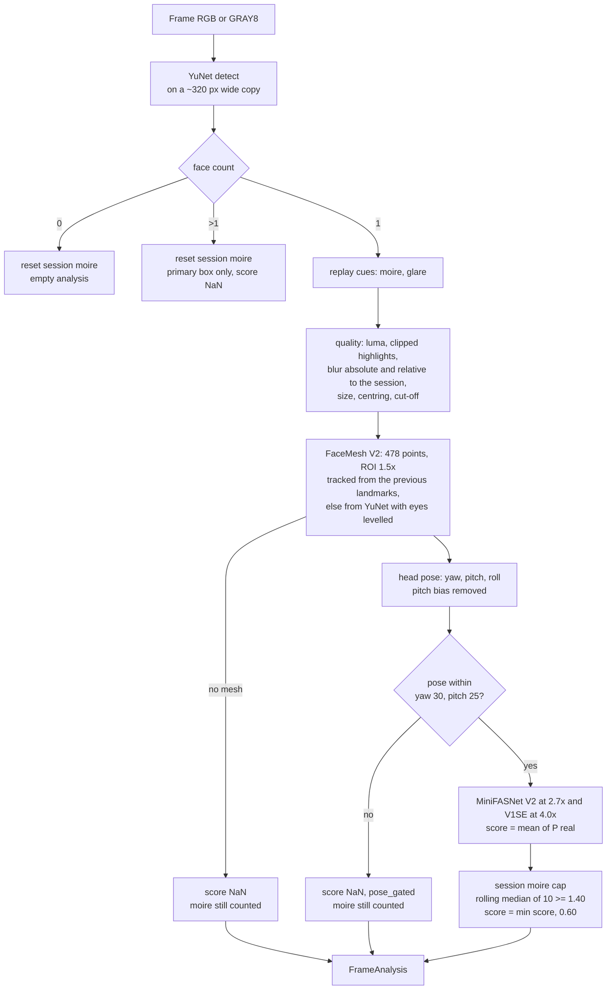
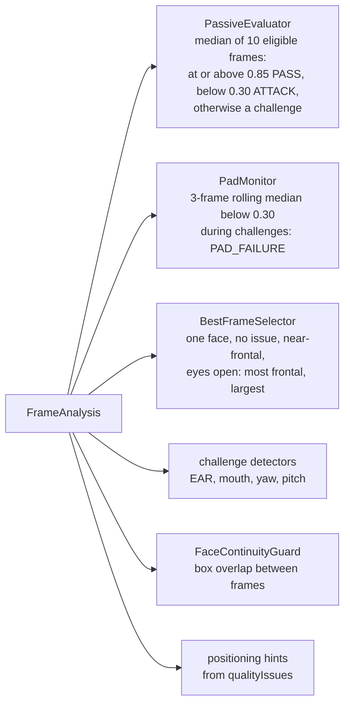
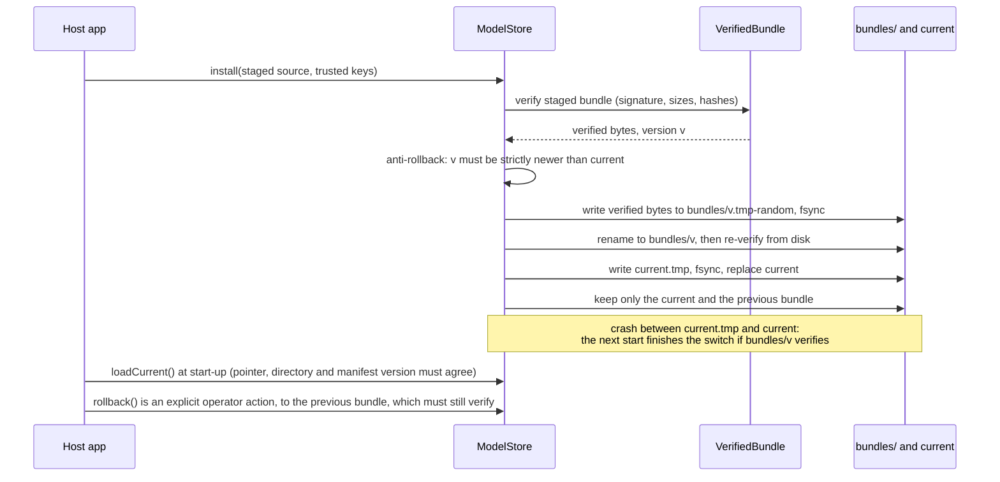

# Part 2: passive liveness and PAD architecture

`liveness-analyzer` implements the contract's `FaceAnalyzer`. For every camera frame it returns one `FrameAnalysis`
with face count, box, landmarks, head pose, quality issues and a passive liveness score. Part 3's engine turns those
per-frame results into a session decision. Part 2 never decides PASS or FAIL itself.

The code is pure Java 8 / Android API 21 (checked by animal-sniffer) plus ONNX Runtime. The executable
specification is [models/tools/reference_pipeline.py](../models/tools/reference_pipeline.py): every formula is in a
docstring, and Java parity tests compare against its golden outputs.

## 1. Per-frame pipeline



| Stage | Output in `FrameAnalysis` |
|---|---|
| detect + count | `faceCount`, `faceBox` (primary face, pixels) |
| replay cues + quality | `qualityIssues`: TOO_DARK, TOO_BRIGHT (mean luma, or more than 30% clipped pixels), BLURRY (Laplacian variance below 15, or below 0.45 × the session's rolling median: F6), FACE_TOO_SMALL, FACE_TOO_LARGE, FACE_OFF_CENTER, FACE_CUT_OFF |
| mesh | `landmarks`: eyes (6 points each, the contract's EAR order), irises, mouth, nose, chin, forehead. The ROI follows the previous frame's landmarks while the face box overlaps (F7) |
| pose | `yawDeg`, `pitchDeg`, `rollDeg` |
| PAD + cap | `livenessScore` in [0, 1], NaN when not computed |
| audit | `padDetails` (section 4), `processingMs` |

## 2. How Part 3 uses a FrameAnalysis



- A frame is *eligible* for the passive window when it has exactly one face, no quality issue, a score, and |yaw| and
  |pitch| of 25° or less.
- The moiré cap (section 3) is tuned to these two consumers. A capped score of 0.60 can never reach PassiveEvaluator's
  0.85, and it can never trip PadMonitor's 0.30.

## 3. The session moiré cap

**The problem.** A phone photo held about 10 cm from the camera fools both MiniFASNet models. In round 1, 4 of 6
such takes passed passively, at 0.89–0.95. At that distance the models' crops contain only screen content.

**What still gives the screen away.** The pixel grid adds periodic peaks to the face crop's spectrum. The moiré value
is `log10(max / median)` of the Hann-windowed 64 × 64 DFT magnitude over radii 8–31.

**The rule.** One analyzer serves one session, so it can keep state:
- Every frame with exactly one face adds its moiré to a rolling buffer of the last 10 values. This includes
  pose-gated frames and frames without a mesh, because a screen is a screen at any angle.
- Any other face count clears the buffer, because a different face may have been presented.
- Once the buffer holds at least 3 values and its median is 1.40 or more, the score becomes `min(score, 0.60)`.
  That forces a challenge, and it never causes a rejection.
- A hard veto (score 0 at or above a second threshold) is implemented but **off**. It needs data from more devices.

**Round-1 evidence** (single subject s01, provisional):

| | Before the cap | After the cap |
|---|---|---|
| phone close-up attacks that pass passively | 4/12 | **0/12** |
| bona fide takes rejected | 0/11 | 0/11 |
| bona fide takes moved from passive pass to a challenge | – | 0/9 responding |
| bona fide frames ever capped | – | 12 of 656 (moving head, far) |

Full numbers are in [part2-iso30107-evaluation.md](part2-iso30107-evaluation.md).

## 4. `padDetails`: audit keys

`padDetails` is for the audit trail only and is never shown in the UI. It has at most 8 keys, so an audit record
stays small and fixed in shape.

| Frame kind | Keys, in order |
|---|---|
| scored | `minifas_v2_live`, `minifas_v1se_live`, `minifas_v2_c0`, `minifas_v2_c2`, `minifas_v1se_spoof` (= V1SE c0 + c2), `moire`, `moire_med` (session rolling median), `moire_cap` (1 when the cap or veto applied, else 0) |
| pose-gated | `pose_gated` (1), `moire`, `moire_med` |
| no mesh | `moire`, `moire_med` |
| no face / several faces | empty |

- **Privacy.** Every value is a model probability or a scalar statistic. There are no pixels, landmarks or
  embeddings, and nothing that could rebuild a face.
- Part 3's `PassiveEvaluator.padDetailMedians()` aggregates these keys over the passive window for the audit record.
- Glare is still computed but is not in `padDetails`. Tools read it through `OnnxFaceAnalyzer.lastReplayCues()`.

## 5. Conventions (contract)

| Quantity | Convention |
|---|---|
| yaw | **+ = the subject turned to THEIR left** |
| pitch | **+ = the subject looks UP** (this confirms Part 3's proposal P2). The mesh's neutral-face bias (−9.5°, a signed bundle parameter) is removed. |
| roll | + = the subject's left eye is higher |
| landmarks | named from the subject's point of view (`leftEye` is the subject's left eye) |
| frames | never mirrored. Mirroring a preview is display only; the engine always sees the camera's frame. |

## 6. Threading and lifecycle

- `OnnxFaceAnalyzerFactory` loads and verifies the bundle once, on the first `create()` or on `preload()`, and builds
  one ONNX session per model. These sessions are **shared** by every analyzer and are thread-safe.
- `create()` returns a **new analyzer per session**. Each analyzer owns its scratch buffers and its session moiré
  state, and is not thread-safe. Part 3 already uses one analyzer per session.
- Closing an analyzer releases nothing shared. Closing the factory closes the sessions.
- Call `factory.preload()` at application start-up. That moves the verification and session build (about 0.2 s warm,
  about 1 s in a fresh JVM) out of the first session.

## 7. The model bundle

**Contents.** `manifest.json`, `manifest.sig` and the five ONNX files: the four liveness models and SFace for face
binding (section 12). They are packaged in the jar under `liveness/models/` (`ClasspathBundleSource`), or kept in a
`ModelStore` directory. The current bundle is `pad-2026.10.4`.

```json
{ "schema": 1, "bundleVersion": "pad-2026.10.4", "keyId": "mosip-liveness-dev-2026-10",
  "createdUtc": "2026-10-23T15:17:10Z", "params": { "pitchBiasDeg": -9.5 },
  "files": [ { "role": "DETECTOR", "name": "yunet_2026may.onnx", "size": 229738, "sha256": "ebafce4e..." }, ... ] }
```

`manifest.sig` is one line: `<keyId>:<hex DER ECDSA P-256 signature>`, computed over the exact bytes of `manifest.json`.

**Verification order** (`VerifiedBundle`). It fails closed: any problem is `MODEL_INTEGRITY_FAILED`, with no fallback.
1. Read the manifest (64 KiB at most) and the signature (1 KiB at most).
2. Look up `keyId` in `TrustedKeys`, then verify SHA256withECDSA **before parsing anything**.
3. Parse strictly: schema 1, version `pad-YYYY.MM.N`, the same keyId, each of the five roles exactly once (a
   four-model bundle from before F1 is refused), safe file names, finite parameters.
4. For each file: read it (64 MiB at most), then check its size, then its SHA-256.
5. Build the ONNX sessions from those same verified byte arrays.

**Offline updates** (`ModelStore`). The host app downloads and stages a bundle; the store accepts it only after
verifying it.



With a store, the factory verifies the bundled bundle and uses the store's current one only if its version is higher;
then that one must verify too. A tampered disk is treated as an attack: `MODEL_INTEGRITY_FAILED`, with no silent
fallback. A store bundle that is older than or equal to the bundled one is not read, since it would not be used. This
matters after an app update: a device that installed `pad-2026.10.1` (four models) keeps it in its store, and that
bundle no longer verifies against the five roles. Before this rule it blocked the app's newer `pad-2026.10.4`.

## 8. Signing keys: development vs production

| | Development key (today) | Production key (before release) |
|---|---|---|
| keyId | `mosip-liveness-dev-2026-10` | for example `mosip-liveness-prod-2027-01` |
| private key | `%USERPROFILE%\.mosip-liveness\model-signing-key.p8`, on one developer machine; never in git (the tool refuses paths inside a git tree, and `*.p8` is gitignored) | in an HSM or an offline signing machine, under MOSIP's key custody policy |
| public key | compiled into `TrustedKeys.BUILT_IN` | compiled into `TrustedKeys`, or passed by the host through `new TrustedKeys(Map)` |

Public keys are compiled in on purpose. A key read from a file next to the models could be swapped together with the
models.

**Replacing or rotating the key:**
1. Create the key pair on the signing machine: `ModelBundleTool keygen --key-id <prod-id> --out <p8 outside any repo>`.
   Record the printed public key hex.
2. Add `{"<prod-id>", "<public hex>"}` to `TrustedKeys.BUILT_IN`. To rotate, keep the old entry for one release, so
   that clients holding old bundles still verify.
3. Re-sign every bundle:
   - `ModelBundleTool manifest --dir models --version pad-YYYY.MM.N --key-id <prod-id> --param pitchBiasDeg=-9.5`
   - `ModelBundleTool sign --dir models --key <p8> --key-id <prod-id>`
   - `ModelBundleTool verify --dir models`
4. Release the analyzer jar with the new `TrustedKeys`.
5. In the following release, remove the development key (and any retired key) from `BUILT_IN`.

## 9. Configuration keys

All keys are optional and read with `AnalyzerConfig.fromConfig(configProvider)`. A missing key keeps its default.
They are not in Part 3's `liveness-default.properties`. The prefix is `mosip.registration.liveness.face.analyzer.`

| Key | Default | Meaning |
|---|---|---|
| `intraOpThreads` | 2 | ONNX Runtime threads per session |
| `accelerator` | CPU | CPU, XNNPACK or NNAPI; falls back to CPU if unavailable |
| `detectorMaxWidth` | 320 | the detector runs on a copy at most this wide |
| `detectorScoreThreshold` | 0.7 | minimum detection score |
| `detectorNmsIou` | 0.3 | non-maximum suppression overlap |
| `detectorSecondFaceMinAreaRatio` | 0.2 | a second face counts if its area is at least this × the primary face's |
| `meshPresenceThreshold` | 0.5 | below this the mesh is dropped (no pose, no score) |
| `meshRoiScale` | 1.5 | mesh crop size relative to the face box |
| `meshTracking` | true | F7: the mesh ROI comes from the previous frame's landmarks while the face box overlaps (IoU at least 0.3); `false` always uses the YuNet ROI |
| `pitchBiasDeg` | −9.5 | removed from the mesh pitch; when the key is absent, the bundle's signed value wins |
| `padMaxYawDeg` / `padMaxPitchDeg` | 30 / 25 | outside this pose range the score is NaN (`pose_gated`) |
| `tooDarkLuma` / `tooBrightLuma` | 40 / 220 | mean face luma limits |
| `qualityMaxClippedFraction` | 0.30 | more than this share of the face crop with R, G and B all ≥ 250 is also TOO_BRIGHT |
| `blurLapVar` | 15 | Laplacian variance below this is BLURRY |
| `qualityRelativeBlurRatio` | 0.45 | F6: also BLURRY below this fraction of the median of the session's last 15 unflagged single-face frames (once 5 are known); `off` disables it |
| `minAreaFrac` / `minFaceWidthPx` | 0.04 / 80 | below either is FACE_TOO_SMALL |
| `maxAreaFrac` | 0.60 | above is FACE_TOO_LARGE |
| `maxCentreOffset` | 0.25 | above is FACE_OFF_CENTER |
| `moireCapThreshold` | 1.40 | session moiré cap threshold; `off` disables it |
| `moireCapScore` | 0.60 | the capped score; must be in (0, 1) |
| `moireWindow` / `moireMinFrames` | 10 / 3 | rolling-median length, and the values needed before the cap applies |
| `moireVetoThreshold` | off | a number enables the hard veto (score 0) |

Face binding has its own key, outside the analyzer prefix: `mosip.registration.liveness.face.binding.cosineThreshold`
(default 0.363; section 12).

## 10. Performance

Development laptop: AMD Ryzen AI 7 350, JDK 11, ONNX Runtime 1.31.0 CPU, 20 warm-up + 300 timed runs. Full report:
[benchmark-20261023.md](../liveness-eval/reports/benchmark-20261023.md).

| intra-op threads | `analyze()` p50 / p95 / p99 | preload (verify + sessions) | first `analyze()` |
|---|---|---|---|
| 1 | 18.1 / 23.9 / 27.8 ms | 1065 ms (fresh JVM) | 63 ms |
| 2 (default) | 18.0 / 21.9 / 24.4 ms | 175 ms | 23 ms |
| 4 | 18.2 / 21.4 / 28.6 ms | 227 ms | 41 ms |

The breakdown at p50: detect 5 ms, mesh 7.5 ms, PAD (both models) 4.7 ms, everything else under 1 ms. At 18–22 ms
per frame, the analyzer easily covers Part 3's 8 fps passive rate and 15 fps challenge rate on one core.

These figures predate face binding. Since `pad-2026.10.4`, preload also builds the SFace session: 2.4 s in a fresh
JVM on the laptop. A match takes 28 ms per face and runs once per capture, not per frame. Per-frame times are
unchanged, apart from the occasional F7 fallback, which re-runs the mesh.

## 11. Android notes (Person 5)

- Use `com.microsoft.onnxruntime:onnxruntime-android:1.31.0` (minSdk 24, AGP 8 or later). It has the same
  `ai.onnxruntime` API. Exclude the desktop `onnxruntime` jar.
- **Models.** Ship the bundle as assets, and implement `BundleSource` over them (`read(name)` returns the asset bytes,
  `describe()` a label). Pass it to `new OnnxFaceAnalyzerFactory(assetSource, storeOrNull, TrustedKeys.builtIn(), config)`.
  Verification is identical to the desktop.
- **Accelerator.** Set `accelerator=XNNPACK` (usually the best on ARM CPUs) or `NNAPI`, and keep CPU as the fallback.
  `factory.activeAccelerator()` reports what is actually in use. Benchmark on the target phones before choosing.
- **Threads.** Start with `intraOpThreads=2`. Leave cores free for the camera and the UI.
- **Analysis rate.** Part 3 analyses at `analyzeFps` (8) passively and up to 15 fps during challenges, and drops the
  other frames. On slow phones, lower the rate rather than the resolution.
- Call `preload()` when the registration screen opens. Release the factory with the activity or application scope.
- If INT8 is needed, use static QDQ quantisation, then re-run the parity tests and re-sign (see the model selection
  doc).

## 12. Face binding (F1)

**The gap.** Liveness runs on camera frames, but the face that is stored comes from the SBI capture. Without a link
between the two, a live person could pass liveness while a photo, or another person, is captured. Face binding
compares `LivenessResult.bestFrame` with the captured face and accepts the capture only if both show the same person.

**Model.** SFace from OpenCV Zoo (`face_recognition_sface_2021dec.onnx`, a MobileFaceNet trained with the SFace loss).
- Licence: Apache-2.0, byte-identical to upstream (38.7 MB). The training-data provenance is in `models/LICENSES.md`.
- It is the fifth role of the signed bundle (`MATCHER`, bundle `pad-2026.10.4`).

**Method.** This is OpenCV's `FaceRecognizerSF`, mirrored from `modules/objdetect/src/face_recognize.cpp` (OpenCV
5.0.0); line numbers are in `reference_pipeline.py`:
1. Detect with YuNet. Each image must hold exactly one face, counted as the analyzer counts faces.
2. Fit a similarity transform from the 5 YuNet keypoints to OpenCV's 112 × 112 ArcFace template (an Umeyama fit).
3. `warpAffine` to 112 × 112 (bilinear, zero border, 8-bit).
4. Feed the network the RGB values 0..255 in NCHW layout. It returns 128 values.
5. Cosine of the two L2-normalised features. The faces MATCH at 0.363 or above (OpenCV's documented SFace
   threshold), else NO_MATCH.

```java
try (FaceMatcher matcher = factory.createMatcher()) {          // shares the factory's verified sessions
    MatchResult m = matcher.compare(result.bestFrame, capturedFace);
    // m.outcome: MATCH, NO_MATCH, NO_FACE_A, NO_FACE_B, MULTIPLE_FACES_A, MULTIPLE_FACES_B
    // m.similarity (NaN unless both faces were found), m.threshold
}
```

**Parity.**
- **Python vs OpenCV:** the Python spec's features have a cosine of at least 0.9999995 with `cv2.FaceRecognizerSF` on
  every golden face. The aligned crops differ by at most 1 grey level, because OpenCV quantises sub-pixel positions to
  1/32 pixel.
- **Java vs Python:** feature cosine 1.0000000, and pairwise similarities within 1e-15 (`golden/binding.json`).

**Evaluation** (`BindingEvaluation`; single subject s01, provisional; aggregates only):

| set | pairs | min | median | max |
|---|---|---|---|---|
| genuine: s01's bona fide takes, pairwise | 55 | 0.742 | 0.810 | 0.973 |
| genuine: the same NASA person in different photos | 12 | 0.672 | 0.797 | 0.945 |
| same person via a photo: s01 vs screen photos of s01's selfie | 99 | 0.295 | 0.645 | 0.806 |
| impostor: s01 vs 49 public portraits | 539 | -0.321 | 0.033 | 0.253 |
| impostor: s01 vs screen photos of NASA portraits | 99 | -0.065 | 0.025 | 0.137 |
| impostor: NASA vs NASA, different people | 1159 | -0.182 | 0.112 | 0.376 |
| impostor: crew faces vs each other and vs the portraits | 202 | -0.176 | 0.083 | 0.383 |

**What the numbers show.**
- **At 0.363:** FNMR is 0 on both genuine sets. Two of the 1,999 impostor pairs match (0.376 and 0.383, both
  between public NASA photos).
- **At 0.40 and above:** no impostor pair matches. FNMR on the genuine sets stays 0 up to 0.60.
- **Recommendation: 0.45.**
  - It leaves a margin of 0.067 above the highest impostor and 0.22 below the lowest genuine pair.
  - It still matches the person's own photo on a screen (median 0.645).
  - The default stays at OpenCV's 0.363 until it is decided; the setting is
    `mosip.registration.liveness.face.binding.cosineThreshold`.
- **The trade-off:**
  - A false match lets a different person's face be stored. That is the security error.
  - A false non-match only asks the operator to recapture.
  - With one subject, the genuine side is thin: a lower-quality SBI image (other lighting, older photo) would move
    genuine scores down.

**Binding is not presentation attack detection.** A photo of the same person on a screen still matches (median
0.645). Binding must run after liveness passed, never instead of it.

**Cost.**
- One face (detection, alignment, SFace) takes 28 ms on the laptop.
- The bundle grows from 8.2 MiB to 45.1 MiB.
- A fresh-JVM preload of the five sessions took 2.4 s on the laptop. Android effects (APK size, memory) come with the
  round-2 integration.

**Integration.**
- **Desktop (Person 4):** call `compare(bestFrame, capturedFace)` before accepting the capture; see
  `part2-findings-for-other-parts.md`.
- **Android:** fix round 2.

## 13. Known limitations

| Limitation | Effect | What would fix it |
|---|---|---|
| Evaluation has a single subject (s01), one webcam and one phone | Error rates are indicative only | More subjects and devices, using the protocol in `docs/part2-dataset-protocol.md` |
| Printed photos are not yet evaluated | Unknown APCER for print species | The user records `print_flat` and `print_curved`, then re-runs `PadEvaluation` |
| Moiré depends on the device | The 1.40 cap was set on one phone and one camera (margin 1.37 vs 1.435) | Re-validate on more screens and cameras before enabling the veto |
| A blown-out face used to pass as "usable" | Webcam auto-exposure keeps the mean luma near 110 | **Fixed (Phase 6c):** TOO_BRIGHT also fires when more than 30% of the face crop is clipped |
| Motion blur passes the absolute blur threshold | Head-motion frames can stay "usable" | **Fixed (F6):** BLURRY also below 0.45 × the session's rolling lapVar median. Moving bona fide frames: 0% → 29% BLURRY; normal frames unchanged (100% usable) |
| Near-profile poses lose the mesh, or are pose-gated | No score above 30° yaw or 25° pitch; landmarks were lost at about 62–66° | **Improved (F7):** the mesh ROI tracks the previous landmarks. Live, the largest yaw with landmarks went from +66° / −62° to +69° / −73°. Beyond that, YuNet loses the face. No score is expected there: Part 3 waits for a frontal face, and a turn challenge needs only 20° |
| A capped attack still goes to a challenge | A tilted phone photo passed BLINK and SMILE once (Phase 5) | **Mitigated (Phase 6c):** Part 3's pose-drift guard (12°) during BLINK and SMILE; PadMonitor still watches every challenge frame |
