# Part 4: face liveness in the Desktop Registration Client

Part 4 puts Parts 1 to 3 into the MOSIP Desktop Registration Client (JavaFX, v1.2.0.2). Before any face is accepted
or used for authentication, a face liveness check runs on the SBI face device's stream:

| Flow | Workflow (policy) | Where |
|---|---|---|
| Resident face capture (new registration, update, lost UIN) | RESIDENT | Scan of the **Face** modality, before the SBI `/capture` |
| Operator login with face | OPERATOR | Login screen, face mode, before the face is captured and matched |
| Operator login with password (as on Android) | OPERATOR | After a successful password, before the next login step or the home screen; skipped when a face step follows; `desktop.operator.gatePasswordLogin` |
| Operator onboarding (the operator's own face) | OPERATOR | Onboarding biometrics, Scan of the **Face** modality |
| Packet authentication with face (the officer signs the packet) | OPERATOR | Operator authentication step, face mode |
| Supervisor authentication with face: biometric-exception review, end-of-day packet approval | SUPERVISOR | Reviewer step of packet authentication; EOD approval dialog |

A face is stored, or an authentication completes, only when the session returns **PASSED** and the captured face
is the same person (face binding, §2.3). For logins and approvals liveness runs **in addition to** the existing face
match: it proves the matched face belongs to a live person who is present.

The screen, its states and every text are the ones shared with the Android client
([ui-liveness-spec.md](ui-liveness-spec.md)); the Desktop renders them, it does not redesign them.

Contents: 1 Architecture · 2 Integration · 3 Sequence diagrams · 4 UI screens · 5 Configuration · 6 Audit and
diagnostic logging · 7 Metrics · 8 Online and offline · 9 Security and privacy · 10 Build, run, test · 11 Limitations
and open points

---

## 1. Architecture

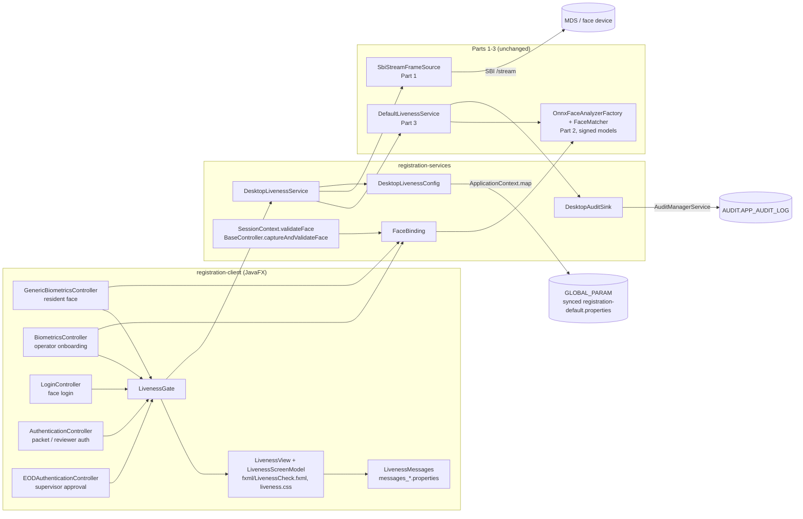

| Class | Module | Role |
|---|---|---|
| `LivenessGate` | client | The one call each flow makes: opens the liveness window (modal), runs one session, returns PROCEED, CANCELLED or BLOCKED. Never throws; fails closed. |
| `LivenessScreenModel` | client | Maps `LivenessEvent`s to message keys, oval colour + icon, progress, step, attempts, tips and buttons: the spec's state table. Pure Java, unit tested. |
| `LivenessView` | client | Renders the model (`fxml/LivenessCheck.fxml`, `liveness.css`); live preview mirrored for display only; screen-reader notifications. |
| `LivenessMessages` | client | Message lookup: app language, then English, then the built-in English catalogue (identical to the spec, checked by a test). |
| `LivenessScreenDemo` | client (test sources) | Development tool: renders every screen state to PNG, or runs the screen with the scripted or real engine outside the client. Not in the client jar (§10). |
| `DesktopLivenessService` | services | Spring bean: builds the engine (Part 3 + Part 2 signed models, or the scripted engine by JVM property), opens the face device (Part 1 SBI stream), preloads models at start-up, reloads config after a sync, checks for a newer signed model bundle after a sync (when enabled), installs a signed bundle zip from removable media or rolls back (F17, supervisors and admins), metrics. |
| `ModelBundleTexts` | client | F17: the `liveness.model.*` message key for each install or rollback outcome; the version is filled in literally (the translations contain apostrophes). |
| `FaceBinding` | services | F1: the next face capture of the workflow must match the PASSED session's best frame. |
| `DesktopLivenessConfig` | services | `ConfigProvider` over `ApplicationContext.map()` (synced global config + local preferences) with bundled Desktop defaults. |
| `DesktopAuditSink` | services | Engine audit records → the client's audit module, events `REG-LIV-001..012`. |
| `ConfigSyncedEvent`, `SwappableAnalyzerFactory` | services | Told after a successful config sync (starts the online model update); the analyzer factory that a model update replaces while running sessions keep theirs. |
| `DeferredFrameSource`, `IdleFrameSource`, `CapturedFaceDecoder` | services | Device opened on start (unplugged device = recoverable error with Retry); no-op source for the scripted engine; ISO 19794-5 → RGB frame for binding. |

**What changed in existing client code** (all additive, the legacy path stays when liveness is disabled):

| File | Change |
|---|---|
| `GenericBiometricsController`, `BiometricsController` | Face Scan: gate first, then the unchanged device search/stream/capture; the capture task verifies the binding and a rejected capture is never stored and not counted as an attempt. |
| `LoginController` | Face login: gate first, then the unchanged `SessionContext.create(FACE)`. Password login: gate after a successful password (`loadNextScreen`); cancelled or failed = session destroyed, back to the login page. |
| `SessionContext.validateFace` (services) | Binding check between the SBI capture and the template match. |
| `BaseController.captureAndValidateFace` | New overload with the liveness workflow; binding check before the template match. |
| `AuthenticationController`, `EODAuthenticationController` | Face validation: gate first (OPERATOR, or SUPERVISOR for the reviewer and EOD approval). |
| `ClientApplication` | `preloadAsync()` after device discovery at start-up. |
| `AuditEvent`, `Components`, `AuditReferenceIdTypes`, `AuditManagerService(Impl)` | New events `REG-LIV-*`, component `REG-MOD-153`, reference type `LIVENESS_SESSION_ID`, and an `audit(..., description)` overload that stores the details. |
| `GlobalParamServiceImpl` (services) | After a successful config sync, publishes a `ConfigSyncedEvent` (the online model update listens). A failing listener never reaches the sync. |
| `PacketHandlerController`, `fxml/RegistrationOfficerPacketLayout.fxml` | F17: two operational-task tiles, "Install model bundle" (a `FileChooser` for the zip) and "Roll back model bundle" (after a confirmation), shown only to supervisors and admins while `model.offlineInstall.enabled` is true. The work runs off the UI thread; the result is a generic alert (`ModelBundleTexts`). The upstream files are copied byte for byte (CRLF, `-text`), so the overlay changes only the added lines. |
| `labels_en/ar/fr.properties` | F17: the two tile titles (`installModelBundle`, `rollbackModelBundle`), appended to the upstream bytes. |
| `messages_en.properties` | The shared liveness catalogue (spec §5), English; F17's `liveness.model.*` texts (spec §4.5). |
| poms | `registration-services` → `liveness-fake` (dev engine); `registration-client` → JUnit (tests). |

## 2. Integration

### 2.1 The gate

Every hook has the same shape:

```java
livenessGate.run(WorkflowType.RESIDENT, window, outcome -> {
    if (outcome.proceed()) {
        searchDeviceAndCapture();      // the existing flow, unchanged
    } else {
        disableEnableBiometricPane(false);   // CANCELLED or BLOCKED: nothing captured, nothing counted
    }
});
```

- `newSession(workflow)` returns null when liveness is disabled for that workflow: **PROCEED** at once, no window, the
  legacy flow (`mosip.registration.liveness.face.<workflow>.enabled=false`).
- The window is modal to the calling screen, so it also works over the authentication pop-ups.
- Auto-logout is suspended while the window is open, as during a biometric scan.
- PASSED: success state, then the window closes after `desktop.autoContinueMs` (1 s) and the flow continues; the face
  binding is armed for the next capture of that workflow.
- FAILED: the final state with the workflow's recovery guidance and Close; outcome **BLOCKED**.
- Cancel, or the window's close button: `session.cancel()`; outcome **CANCELLED**; the caller returns to where it was.
- Any exception (engine cannot be created, screen cannot load): the fail-closed screen with the generic text, **BLOCKED**.

### 2.2 Device

Liveness reads the face device's SBI `/stream` through Part 1's `SbiStreamFrameSourceFactory`, i.e. the client's own
MDS discovery and `BioService.getStream()`: any compliant L0/L1 face device, no vendor SDK. The device is opened when
the session starts (and again on Retry), so an unplugged device shows "Camera/device not available" with Retry, and the
operator can plug it in without leaving the screen (problem statement §9). The engine releases the stream before it
reports the result, then the existing flow opens it again for its preview and `/capture`.

### 2.3 Face binding (F1)

Liveness runs on the stream; the face that is stored or matched comes from a separate SBI `/capture`. Without a check
a live person could pass liveness and then a photo, or another person, be captured. So:

1. A PASSED gate arms `FaceBinding` with the session's best frame (one arming, 5 minutes at most, for that workflow).
2. The next face capture of that workflow (resident capture, onboarding capture, `SessionContext.validateFace`,
   `captureAndValidateFace`) decodes the ISO 19794-5 record and compares it with the best frame (SFace, Part 2).
3. Only **MATCH** is accepted. NO_MATCH, no face, several faces, an undecodable record, a missing/expired/other-workflow
   arming or any error rejects it (fail closed): nothing is stored, no attempt is counted, the user sees the generic
   "Face verification could not be completed. Please try again.", and the next Scan runs liveness again. In login and
   authentication flows the rejection is an authentication failure.
4. Every decision is audited (`LIVENESS_FACE_BINDING`: outcome, similarity, threshold, session id). Neither image is
   logged or kept.

Binding is not PAD (a photo of the same person matches), so it never replaces liveness. `binding.enabled=false` keeps
the old behaviour (audited SKIPPED).

### 2.4 Not gated, on purpose

- **The exception photo** (biometric exception process): it is the recovery path the resident failure text points to.
- **Fingerprint, iris, password and OTP authentication**: liveness is a face control.

### 2.5 Identity binding (F15)

The password login (sequence (b2)) has no face capture, so F1 has nothing to bind. Liveness alone then proves only
that some live person is at the machine, not that it is the user. F15 binds this gate to the user's onboarded face.
It is a second factor after the password: a false match lets in someone who has the password AND a similar face.

1. `LoginController.loadNextScreen` calls `LivenessGate.runWithIdentity(OPERATOR, window, userId)` instead of `run`.
2. After PASSED, `IdentityBinding.verify` runs off the JavaFX thread. It takes the session's best frame from
   `FaceBinding` (the arming is consumed).
3. It reads the user's active Face rows of `reg.user_biometric`, which operator onboarding writes on this machine.
   - Each row's BDB comes from the CBEFF BIR in `bio_raw_image`, else from `bio_iso_image`, as
     `AuthenticationServiceImpl.authValidator` reads them.
   - F1's `CapturedFaceDecoder` decodes it.
4. Part 2's `FaceMatcher.identify` compares them:
   - the same detection and alignment as F1;
   - the best of several templates;
   - its own threshold, `binding.identity.threshold` (0.40, provisional; Part 2 section 12.1).

| Outcome | What happens |
|---|---|
| MATCH | The login goes on. |
| NO_MATCH, NO_LIVE_FACE, NO_LIVE_FRAME, NOT_ARMED, EXPIRED, ERROR | The client shows "Face verification could not be completed for this user. Please try again." with Retry and Cancel. Retry runs one new liveness session. No score is shown. |
| The same after the retry, Cancel, or a retry session that does not pass (cancelled, closed, failed) | `IDENTITY_NOT_VERIFIED`: the user is logged out, the login page is shown, and the client counts one failed login (below). |
| NOT_BOUND_NO_TEMPLATE, NOT_BOUND_UNREADABLE | No onboarded face on this machine, or none decodes to one face. The login goes on, on presence alone, audited. With `binding.identity.requireTemplate=true` the login is refused at once, because a retry cannot help. |
| Liveness off for OPERATOR, or `binding.identity.enabled=false` | The login goes on as before. The second case is audited `SKIPPED`. |

**Failed logins.**
- `IDENTITY_NOT_VERIFIED` calls the client's own `validateInvalidLogin` with the text, so it counts exactly like a wrong
  password.
- `unsuccessfulLoginCount` goes up by one. When it reaches `mosip.registration.invalid_login_count`, the account locks
  for `mosip.registration.invalid_login_time` minutes. Both values come from the server config.

Can one F15 failure alone lock the account?
- One blocked gate adds one failed login, after both liveness sessions. On a clean count, it locks the account only if
  `invalid_login_count` is 1.
- The client does not reset the count when the password is correct; only a completed login resets it. So after
  earlier wrong passwords, one F15 failure can be the one that reaches the limit, as one more wrong password would.

**When there is no template.** A face row exists only if `mosip.registration.operator.onboarding.bioattributes`
includes `face` and the user onboarded on this machine. User sync brings no biometrics.
- With MOSIP's mock bio-SDK, the stored BDB is the SBI's ISO 19794-5 record, which decodes.
- With a real bio-SDK, it may be a proprietary template that does not decode. Then the outcome is
  NOT_BOUND_UNREADABLE, and the login goes on on presence alone unless `requireTemplate` is set.

The audit makes both cases visible (REG-LIV-013, section 6).

**Not changed.** Face login, and packet authentication or end-of-day approval with face, already match the capture
against the template through the bio-SDK, with F1 binding. Password, OTP, fingerprint and iris authentication of a
packet are not gated (section 2.4).

## 3. Sequence diagrams

### (a) Resident face capture

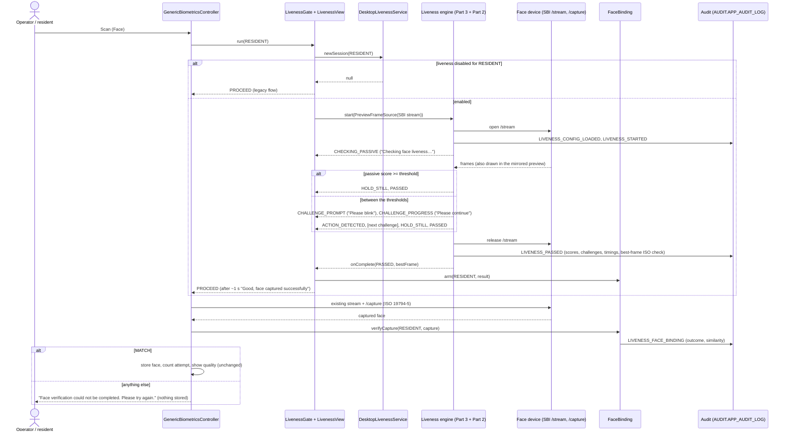

### (b) Operator login with face

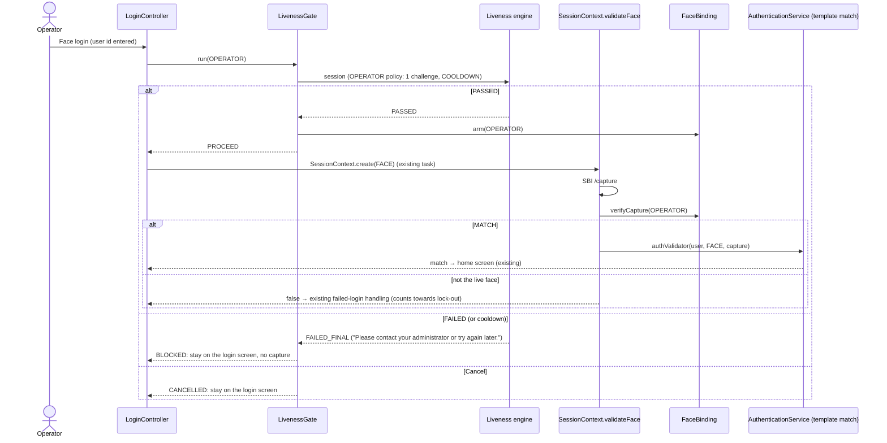

### (b2) Operator login with password

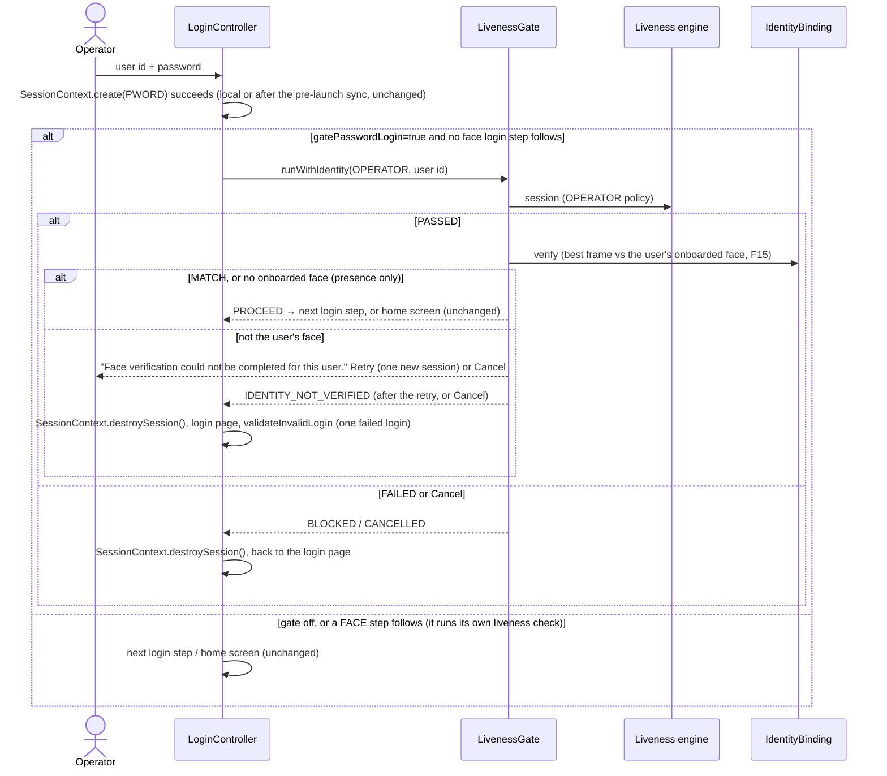

No face is captured in this flow, so F1 has nothing to bind. Liveness proves that a live person is present at the
operator's password login, as on Android, and F15 (section 2.5) checks that this person is the user. The first
(initial set-up) login is not gated: it restarts the client after the sync.

### (c) Packet authentication (operator) and biometric-exception review (supervisor)

```mermaid
sequenceDiagram
    actor U as Officer / reviewer
    participant AC as AuthenticationController
    participant G as LivenessGate
    participant BC as BaseController.captureAndValidateFace
    participant B as FaceBinding
    participant AS as AuthenticationService

    U->>AC: Scan (face authentication)
    AC->>AC: validateInput (reviewer must be another, valid user)
    AC->>G: run(isReviewer ? SUPERVISOR : OPERATOR)
    alt PROCEED
        G-->>AC: PROCEED (binding armed for that workflow)
        AC->>BC: captureAndValidateFace(user, packetAuth, isReviewer, workflow)
        BC->>BC: SBI /capture
        BC->>B: verifyCapture(workflow)
        alt MATCH
            BC->>AS: authValidator
            AS-->>AC: match → officer/supervisor biometrics added to the packet, next step (existing)
        else rejected
            BC-->>AC: false → existing "face not matched" alert, nothing added
        end
    else BLOCKED / CANCELLED
        G-->>AC: no capture; the packet is not submitted; the step stays
    end
```

### (d) Supervisor end-of-day approval

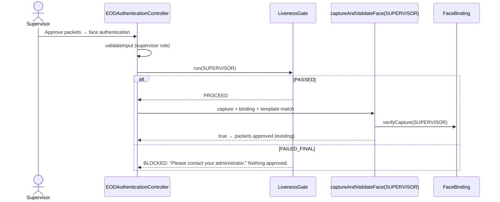

### (e) Failure path: retry, maximum attempts, recovery

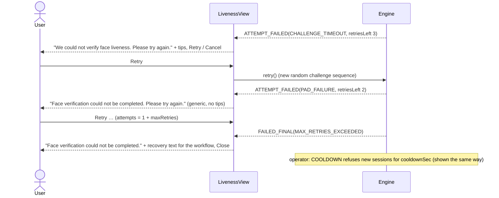

### (f) Device unplugged and plugged back

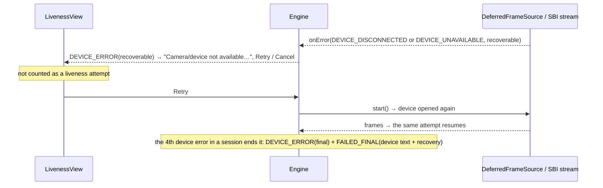

### (g) Config sync and model update

```mermaid
sequenceDiagram
    participant Sync as Config sync job (online)
    participant GP as GLOBAL_PARAM / ApplicationContext.map
    participant S as DesktopLivenessService
    participant E as Engine
    Sync->>GP: registration-default.properties (liveness keys)
    Note over S: before every session: fingerprint of all liveness keys
    S->>GP: read
    alt changed
        S->>E: reloadConfig() → LIVENESS_CONFIG_LOADED (running sessions keep their policy)
    end
    Note over S: offline: the last synced values in GLOBAL_PARAM, else the bundled defaults
    Sync-->>S: ConfigSyncedEvent (successful sync only)
    opt model.update.enabled=true and model.update.url set
        S->>S: background thread: ModelUpdater.check(url, ModelStore, bundled, keys)
        S->>S: LIVENESS_MODEL_UPDATE (outcome, version, reason, durationMs, trigger)
        alt INSTALLED
            S->>E: new sessions use the new bundle (MODEL_LOADED); running sessions keep theirs
        end
    end
    Note over S: the sync never waits for the update and never fails because of it;<br/>tampered or unsigned = refused, the current models stay
```

## 4. UI screens

One window for all three workflows; only the title and the recovery text differ. The preview is the device's live
stream, mirrored like a selfie (the frames given to the engine are never mirrored), with the face oval. The oval's
colour always comes with an icon and a text. Rendered by `LivenessScreenDemo --snapshots` from the production classes
at the window's size, 720×820 (the face is a public-domain NASA portrait used by Part 2's fixtures). The layout,
colours and type are `docs/ui-liveness-spec.md` §9, the same as on Android.

| | | |
|---|---|---|
|  **Passive check** "Checking face liveness…", blue | 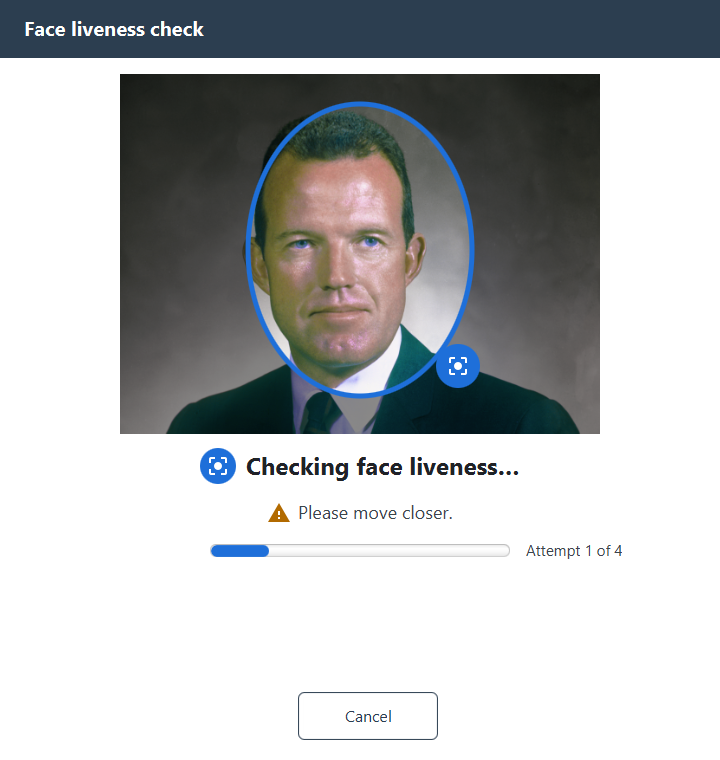 **Positioning guidance** (hint line, warning icon) | 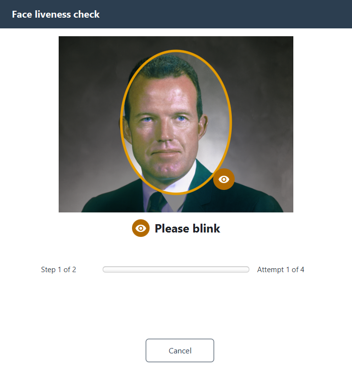 **Challenge prompt**, amber, step 1 of 2 |
| 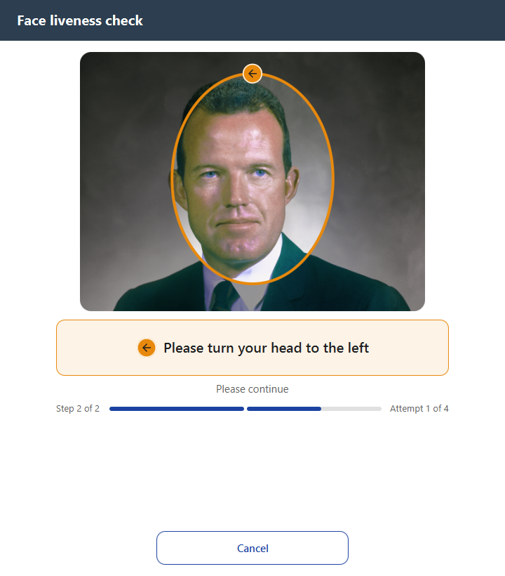 **Real-time feedback** "Please continue", progress | 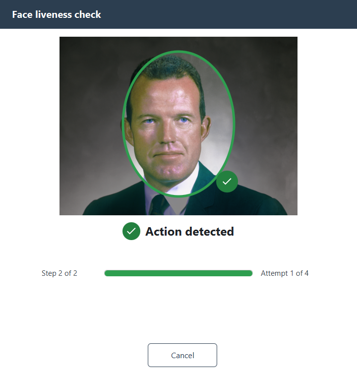 **Action detected**, green | 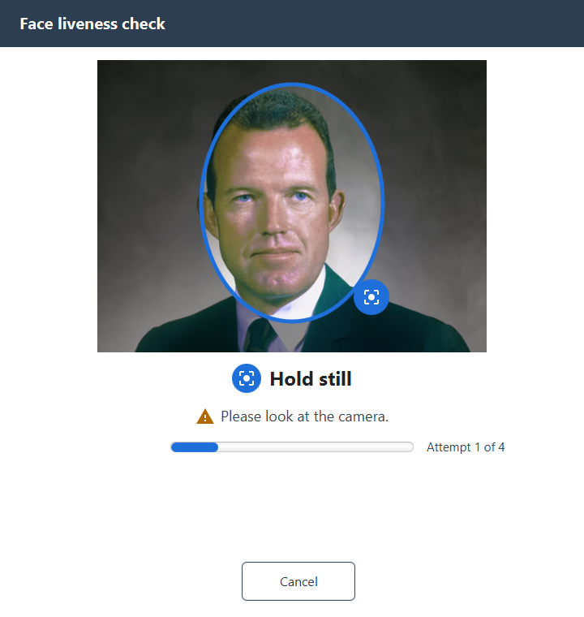 **Hold still** + "look at the camera" after a turn |
| 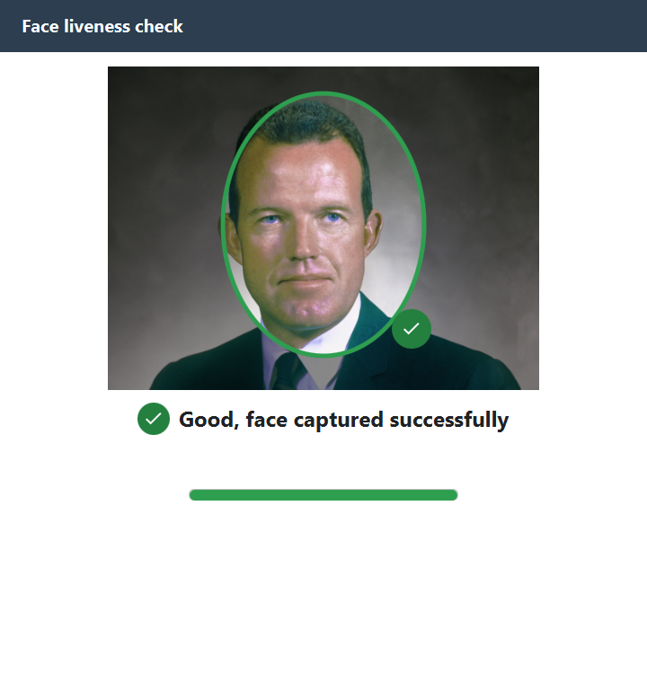 **Passed**: continues after ~1 s | 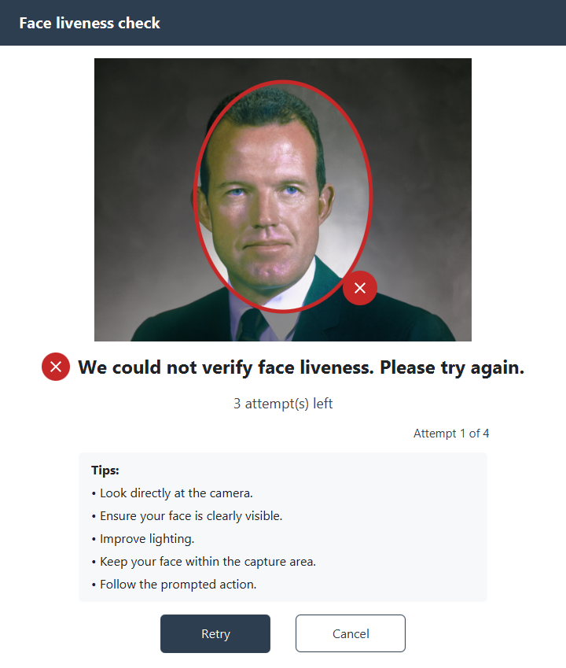 **Retry** available: attempts left, tips | 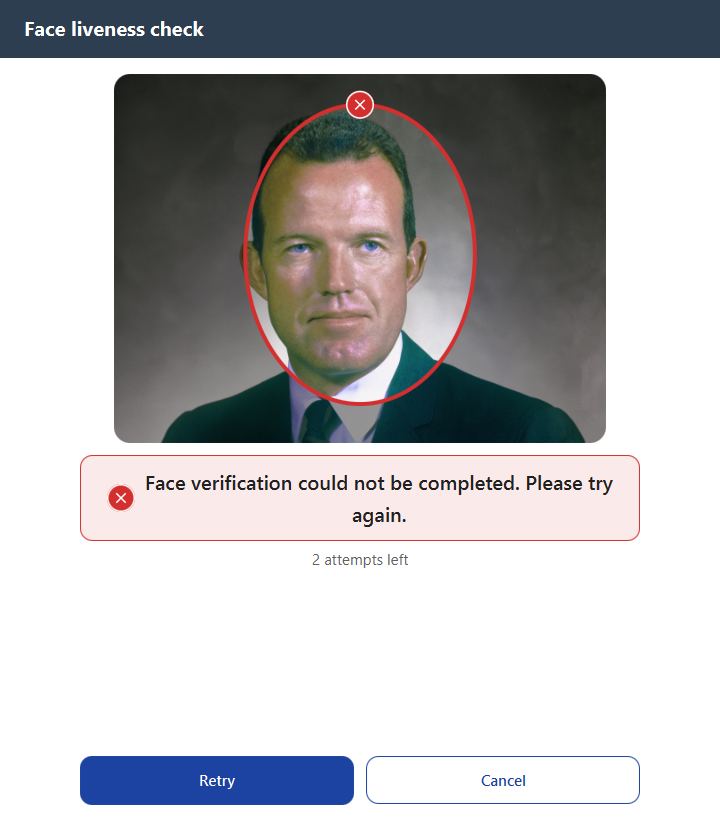 **PAD failure**: the generic text only |
| 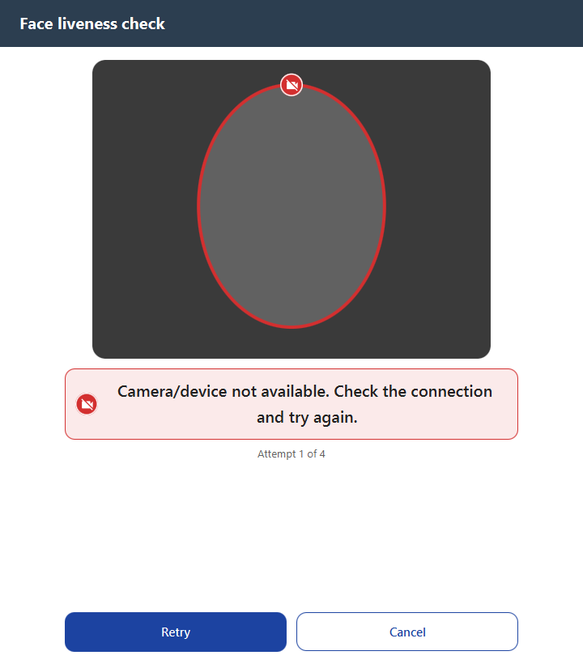 **Device error** with Retry | 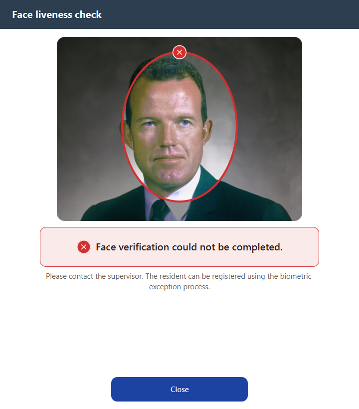 **Maximum attempts**: resident recovery (biometric exception process) | 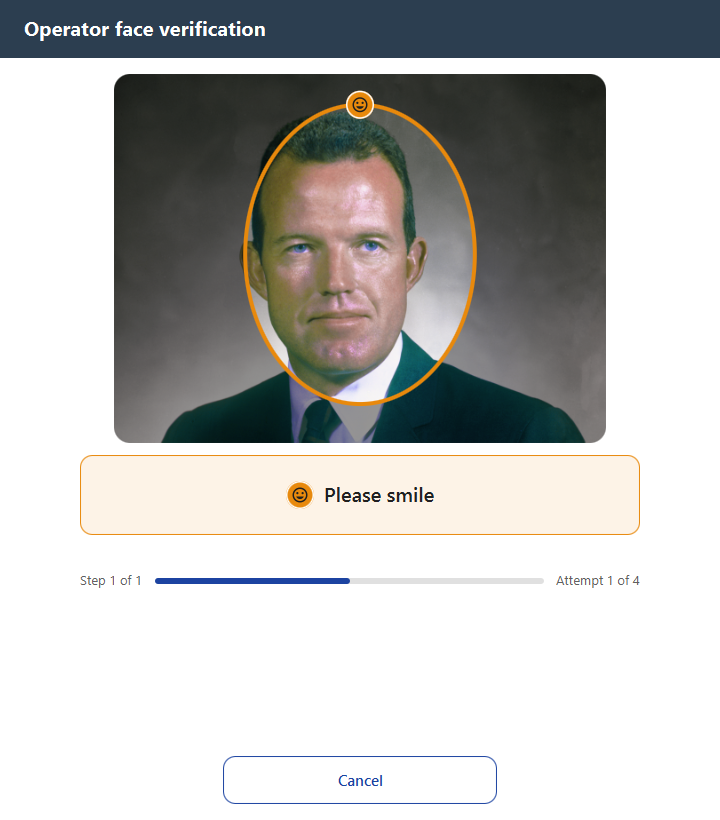 **Operator** authentication |
| 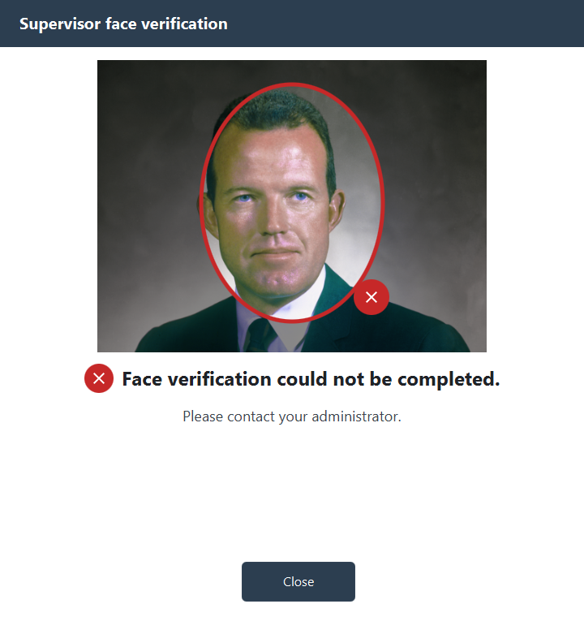 **Supervisor** failure | 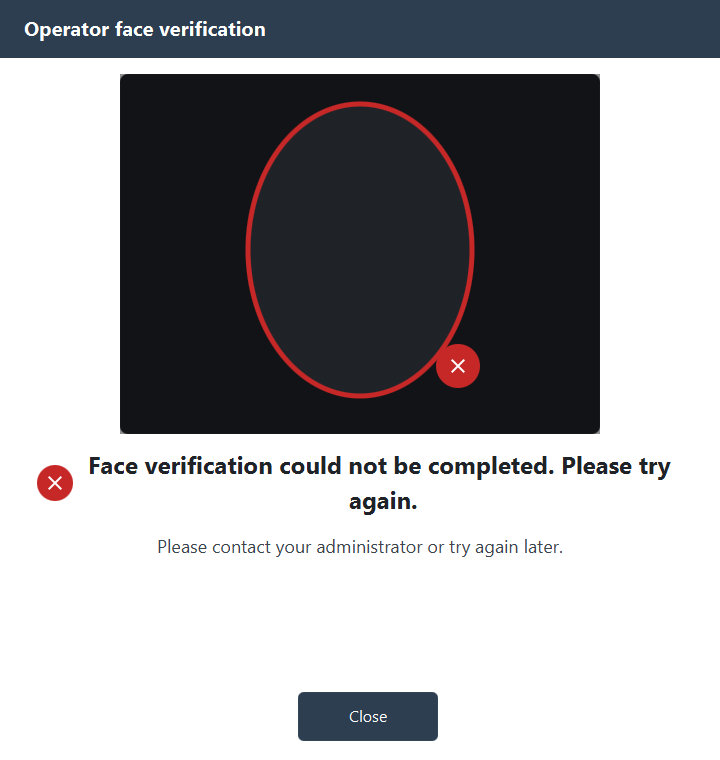 **Fail closed** (engine unavailable) | |

Behaviour (spec §2, §3, §7, §9): Retry only after a failed attempt or a recoverable device error; Cancel until the
end; Close only on the final failure; no score, threshold, model or PAD detail is ever shown; the status is 20 px
semibold (at most 2 lines) and the hint 15 px; after a failed attempt the progress row shows only the attempts left;
buttons are 48 px high, of equal width and keyboard-focusable (Retry/Close take focus, Esc = Cancel); the status
cross-fades in 200 ms unless `desktop.animations=false`; the window is mirrored for Arabic, except the camera card;
every status change updates the status label's accessible text and notifies the screen reader.

Online and offline look identical: nothing on the screen depends on the network.

## 5. Configuration

All keys are read through the client's configuration framework: the server's `registration-default.properties` (synced
into the local `GLOBAL_PARAM` table, hence available offline) and local preferences, via `ApplicationContext.map()`.
Ready-to-append block: [part4-registration-default.properties](part4-registration-default.properties). A missing key
uses the bundled default (`liveness-desktop-default.properties` for Desktop keys, the engine's
`liveness-default.properties` for policy keys). Invalid policy values are rejected by the engine and replaced by the
bundled defaults (audited in `LIVENESS_CONFIG_LOADED` as `configError`).

**Policy** (`mosip.registration.liveness.face.<default|resident|operator|supervisor>.<field>`; workflow key, then
`default.`, then the bundled default). Problem statement §8 → key:

| Requirement | Field | Default |
|---|---|---|
| Liveness enablement | `enabled` | true |
| Passive liveness threshold | `passiveThreshold` (pass), `padRejectThreshold` (attack) | 0.85, 0.30 |
| Active liveness policy | `activeEnabled` | true |
| Challenge types | `challengeTypes` | BLINK,SMILE,TURN_LEFT,TURN_RIGHT |
| Minimum challenge count | `minChallenges` | 2 (operator, supervisor: 1) |
| Challenge timeout | `challengeTimeoutMs` | 6000 |
| Maximum retry count | `maxRetries` | 3 |
| Behaviour on repeated failure | `onRepeatedFailure` (BLOCK, COOLDOWN), `cooldownSec` | BLOCK (operator: COOLDOWN), 60 |
| Workflow-specific policies | any field under `resident.`, `operator.`, `supervisor.` | |
| Diagnostic mode | `diagnosticMode` | false |
| Other | `passiveWindowFrames`, `passiveTimeoutMs`, `analyzeFps` | 10, 8000, 8 |

**Face binding and analyzer**: `binding.enabled` (true), `binding.cosineThreshold` (0.45), and Part 2's optional
`analyzer.*` keys ([part2-pad-architecture.md](part2-pad-architecture.md)).

**Identity binding (F15, section 2.5)**:
- `binding.identity.enabled` (true; only an explicit `false` switches it off);
- `binding.identity.threshold` (0.40, provisional; valid from 0.30 to 1.0);
- `binding.identity.requireTemplate` (false: a user without a readable onboarded face gets in on presence alone,
  audited).

**Desktop** (`mosip.registration.liveness.face.desktop.*`):

| Key | Default | Meaning |
|---|---|---|
| `sbi.frameTimeoutMs` | 15000 | no bytes for this long = stalled stream |
| `sbi.frameStride` | 1 | analyse every Nth device frame |
| `sbi.maxReconnectAttempts`, `sbi.reconnectBackoffMs` | 3, 500 | reconnects after a mid-stream drop |
| `autoContinueMs` | 1000 | how long the success state stays |
| `operator.gatePasswordLogin` | true | OPERATOR liveness after a successful password login (skipped when a face login step follows) |
| `animations` | true | the 200 ms status cross-fade (false = reduced motion) |
| `metricsAuditEvery` | 20 | audit a metrics snapshot every N sessions (0 = never) |
| `modelStoreDir` | `<client folder>/.liveness-models` | model store (signed bundles only); the online model update installs here |

**Online model update** (the same keys as Android, [part5-android-integration.md](part5-android-integration.md)):

| Key | Default | Meaning |
|---|---|---|
| `mosip.registration.liveness.model.update.enabled` | false | `true`: after every successful config sync, check the URL for a newer signed bundle |
| `mosip.registration.liveness.model.update.url` | none | the index, `latest.json` (Part 2 `ModelBundleTool pack`), over HTTPS |

The check is Part 2's `ModelUpdater` on the service's background thread: HTTPS only, size limits, SHA-256, then
`ModelStore.install` (signature, anti-rollback, atomic switch; the client's own bundle becomes the rollback base). On
INSTALLED, new sessions use the new bundle; a running session keeps its models. Any failure is audited and the current
models stay. Without a sync (offline) nothing is checked.

**Offline model install (F17)** (the same key as Android):

| Key | Default | Meaning |
|---|---|---|
| `mosip.registration.liveness.model.offlineInstall.enabled` | true | supervisors and admins see "Install model bundle" and "Roll back model bundle" in the home page's operational tasks; `false` hides both |

How it works:
- **Who.** Logged-in users with `REGISTRATION_SUPERVISOR` or `REGISTRATION_ADMIN`. `PacketHandlerController` shows the
  two tiles only then, and `DesktopLivenessService` checks the role and the key again before acting (fail closed).
- **Install.** A `FileChooser` picks the zip that `ModelBundleTool pack` writes, the same zip the online update
  downloads. `installOfflineBundle(File)` hands it to Part 2's `ModelUpdater.installZip`:
  - at most 64 MiB;
  - flat entries only, `manifest.json` first, then exactly `manifest.sig` and the files the manifest names (at most
    16), each at most its declared size; zip-slip and absolute paths are refused;
  - unpacked into a fresh `update.tmp-*` directory in the store, which is deleted afterwards;
  - `ModelStore.install`: signature, sizes, hashes, anti-rollback, atomic switch.
- **Results.**
  - A tampered, unsigned or malformed zip is refused as `MODEL_INTEGRITY_FAILED`, whatever version it claims: the
    signature, sizes and hashes are checked before the version, so a tamper attempt is never reported or audited as
    "not newer".
  - The same or an older version is refused once it has verified.
  - In both cases the store is unchanged.
  - On success, new sessions use the new models; a running session keeps its own.
- **Rollback.** `rollbackModelBundle()` makes the previous bundle current again, after a confirmation. It is an
  explicit operator action that bypasses anti-rollback, and the previous bundle is verified again.
- **The screens.** Every result is a generic, localised alert (`liveness.model.*`, §4.5 of the UI spec). The alerts
  never show a path, a file name or an exception.

**Development only, JVM properties** (never read from synced config, so no config push can weaken liveness):
`-Dmosip.registration.liveness.face.desktop.engine=fake` (scripted engine, `...desktop.fake.scenario=PASS_ACTIVE` etc.),
`-Dmosip.registration.liveness.face.desktop.source=webcam|video:<file.mjpeg>|images:<dir>` (mock device instead of SBI),
`-Dmosip.registration.liveness.model.update.allowInsecureLocalhost=true` (model update over plain HTTP, to localhost
only, for a local test server).

## 6. Audit and diagnostic logging

Everything goes through the existing audit module (`AuditManagerService` → `AUDIT.APP_AUDIT_LOG`), component
`REG-MOD-153` "Face liveness", reference type `LIVENESS_SESSION_ID` with the session UUID, so all records of one check
link together and to the client log. The description column holds `workflow=…; session=…; key=value; …` (at most 2048
characters; longer records are split into numbered parts).

| Event id | Name | When | Details (from the engine unless noted) |
|---|---|---|---|
| REG-LIV-001 | LIVENESS_STARTED | each attempt | attempt, modelVersion, deviceId, deviceCertification |
| REG-LIV-002 | LIVENESS_PASSED | passed | passPath, passiveScore, passiveFrames, challenges (`TYPE:OUTCOME:ms`), durations, frames analysed/dropped, avgProcessingMs, `bestFrame.*` ISO 19794-5 compliance |
| REG-LIV-003 | LIVENESS_ATTEMPT_FAILED | attempt failed, retries left | errorCode, retriesLeft, reason |
| REG-LIV-004 | LIVENESS_FAILED_FINAL | final failure, cancel, cooldown refusal | errorCode, lastCause, cooldownSec |
| REG-LIV-005 | LIVENESS_PAD_ATTACK_SUSPECTED | presentation attack suspected | errorCode PAD_FAILURE, passiveScore, reason, `pad.<model>` medians |
| REG-LIV-006 | LIVENESS_DEVICE_ERROR | device error | errorCode, recoverable, deviceDetail |
| REG-LIV-007 | LIVENESS_MODEL_LOADED | start-up preload (Desktop) and per session | modelVersion, accelerator, loadMs |
| REG-LIV-008 | LIVENESS_MODEL_INTEGRITY_FAILED | bundle did not verify | errorCode, reason, phase |
| REG-LIV-009 | LIVENESS_CONFIG_LOADED | policy resolved (start, after a sync) | policy summary, configError |
| REG-LIV-010 | LIVENESS_FACE_BINDING | Desktop: capture compared with the live face | outcome, similarity, threshold, accepted |
| REG-LIV-011 | LIVENESS_METRICS | Desktop: every `metricsAuditEvery` sessions | anonymised counters and rates (§7) |
| REG-LIV-012 | LIVENESS_MODEL_UPDATE | Desktop: an online model update check finished (§5); an offline install or a rollback (F17) | online: outcome (INSTALLED, UP_TO_DATE, FAILED), version, reason (a `ModelUpdater.Reason` code, no URL), durationMs, trigger (the sync's trigger point). Offline (`trigger=offline`) and rollback (`trigger=rollback`): outcome (INSTALLED, UP_TO_DATE, FAILED, ROLLED_BACK, REFUSED), errorCode (MODEL_INTEGRITY_FAILED for a bad bundle), reason (a `Reason` code, NOT_NEWER, NOTHING_TO_ROLL_BACK or NOT_ALLOWED), fromVersion, toVersion, durationMs, userId; never a path |
| REG-LIV-013 | LIVENESS_IDENTITY_BINDING | Desktop: the password login's live face compared with the user's onboarded face (F15, section 2.5) | outcome (MATCH, NO_MATCH, NOT_BOUND_NO_TEMPLATE, NOT_BOUND_UNREADABLE, NO_LIVE_FACE, NO_LIVE_FRAME, NOT_ARMED, EXPIRED, ERROR, SKIPPED), similarity (2 decimals), threshold, attempt (1, or 2 for the retry), gate, userId, templates, unreadable, templateAgeDays (the newest template, from the row's creation time), requireTemplate (when not bound), accepted; never an image or a template |

The names are the Android client's (REG-LIV-012 is Android's REG-EVT-019, REG-LIV-013 is REG-EVT-020); the ids differ
because the Desktop's `REG-EVT-009..018` were already taken.

**Scores, PAD reasons and challenge outcomes** are therefore in the audit trail; **raw face images never are**: the
engine passes only codes and numbers, and `DesktopAuditSink` enforces it again (keys must be short identifiers, values
are capped at 400 characters, anything that looks like encoded binary data is dropped, line breaks and separators are
neutralised). An audit write failure is logged and never breaks a capture or a login.

**Diagnostic mode** (`<workflow>.diagnosticMode=true`, or `default.`): the engine adds `diag.*` per-attempt score
statistics (quartiles, frames per issue, timings) to the audit records, and the Desktop writes a `LIVENESS-DIAG` trace
to the client log: session start, every event (type, challenge, guidance, error code; never frames), the result and the
metrics snapshot. It never changes the screen; production screens look the same with it on.

## 7. Metrics

`DesktopLivenessService.metricsSnapshot()` (from the engine's `LivenessMetrics`) gives, since start-up and without any
id or personal data: sessions, passed (passive/active), failed, cancelled, cooldown refusals, retries, device errors,
**average liveness processing time** (`avgProcessingMs`), **challenge completion time** (`avgChallengeCompletionMs`),
**retry rate**, **failure rate**, passive share and final failures by code. It is audited as `LIVENESS_METRICS` every
`metricsAuditEvery` sessions and logged after each session in diagnostic mode.

## 8. Online and offline

Liveness, PAD, challenge selection and action validation all run locally (the engine and the signed models are in the
client jars), so the network never decides whether liveness is enforced. Config comes from `GLOBAL_PARAM`, which holds
the last synced values offline; a sync while online is picked up by the next session. Model updates are installed only
as signed bundles (Part 2 `ModelStore`: verified, never older, atomic switch); without one the bundled models are used.
When enabled, a successful sync also checks for a newer bundle online (§5); offline, the installed or bundled models
keep working. Without a network at all, a supervisor or admin can install a signed bundle zip from removable media, or
roll back, from the home page (F17, §5).
The screen and texts are identical online and offline.

## 9. Security and privacy

- **Fail closed everywhere.** Engine creation failure, screen failure, unreadable policy, missing/expired binding,
  undecodable capture, matcher error: the face is not accepted and authentication does not complete.
- **Accept only on `onComplete(PASSED)`.** Events only drive the screen; the hooks branch on the gate's outcome, which
  is set from the result.
- **Face binding** closes the gap between the liveness stream and the SBI capture (§2.3), for capture and for every
  face authentication.
- **No technical detail on screen.** PAD failures show the same generic text as engine errors (spec §1); no score,
  threshold, model name or challenge timing is displayed.
- **Unpredictable challenges.** The engine chooses them with `SecureRandom`, never repeats the previous sequence on
  Retry, never asks BLINK alone; the user never selects one.
- **Signed models only.** The analyzer loads models only from the verified bundle (ECDSA-signed manifest, sizes,
  SHA-256); a tampered bundle is `MODEL_INTEGRITY_FAILED` with no fallback. The built-in key is a development key and
  must be replaced before release (Part 2 §8).
- **Development switches cannot be pushed.** The scripted engine and mock devices are selectable only by JVM
  properties on the machine, never by synced config; the scripted engine logs a warning and its sessions are audited
  with `modelVersion=fake-1.0`.
- **Repeated failures.** Retry limit per session; operator authentication cooldown (`COOLDOWN`), in memory (resets on
  restart: contract proposal P1).
- **Images stay in memory.** Frames, the best frame and the captured face are never written to disk, logs or audit by
  the liveness code; the best frame is dropped when consumed, replaced, disarmed or after 5 minutes. Only the existing
  capture flow stores the accepted face, as before.
- **Audit content** is limited to codes, scores, timings, model version and device id (§6), linked by a random session
  UUID; the metrics are aggregate counters.
- **ISO/IEC 30107** alignment, thresholds and evaluation are Part 2's ([part2-iso30107-evaluation.md](part2-iso30107-evaluation.md)).

## 10. Build, run, test

From `registration-client/registration` (JDK 11; first build online):

    mvn -pl liveness-api,liveness-core,liveness-fake,liveness-analyzer,registration-services,registration-client -am install -DskipTests -Dgpg.skip -Dmaven.gitcommitid.skip=true
    mvn -pl registration-services,registration-client test "-Dtest=**/liveness/**/*Test,AuditFactoryTest,LoginServiceTest,GlobalParamServiceTest" -Dsurefire.failIfNoSpecifiedTests=false -DfailIfNoTests=false -Dgpg.skip -Dmaven.gitcommitid.skip=true

(`-Dmaven.gitcommitid.skip=true` is needed only when building outside a git checkout.)

**Results (2026-10-26, with the follow-ups):** `registration-services` 147 tests pass: the 33 Desktop tests plus the
existing Part 1 liveness (72), audit (4), login (26) and config sync (`GlobalParamServiceTest`, 12) suites.
`registration-client` 28 tests pass. No failures, nothing skipped.

**Results with F17 (2026-10-27):** `registration-services` 158 tests pass. That is the 147 above, plus the four F16
regression clips in `RecordedVideoE2ETest` (Part 2) and the 7 `DesktopOfflineModelInstallTest` tests.
`registration-client` 31 tests pass: the 28 above plus the 3 `ModelBundleTextsTest` tests. `mvn install` of both
modules succeeds. No failures, nothing skipped.

**Results with F15 (2026-10-27):** `registration-services` 169 tests pass: the 158 above, plus the 10
`IdentityBindingTest` tests and `RealIdentityBindingTest`. `registration-client` 32 tests pass: the 31 above plus the
identity retry rule in `LivenessGateTest`. `RecordedVideoE2ETest` 5/5, and `mvn install` of both modules succeeds. No
failures, nothing skipped.

**Results with F13b and the visual design (2026-10-28):** `registration-services` 175 tests pass (F13b's
`WebcamGrabbersTest` adds 6). `registration-client` 37 tests pass: the 32 above, plus the 2 `LivenessScreenDemoTest`
tests and the 3 `LivenessViewLayoutTest` tests. `RecordedVideoE2ETest` 5/5, and `mvn install` of both modules succeeds.
No failures, nothing skipped.

| Test | What it proves |
|---|---|
| `DesktopLivenessServiceTest` | real engine + signed ONNX models + recorded clip through the deferred source → FAILED with `lastCause=FACE_NOT_DETECTED`, audited through the audit module with the session id; workflow disabled by synced config → legacy flow; config sync applies to the next session; scripted engine is development-only and skips binding |
| `RealFaceBindingTest` | ISO 19794-5 records made by MOSIP's encoder decode; same person → MATCH; group photo → MULTIPLE_FACES_B; garbage → UNDECODABLE (real SFace model) |
| `FaceBindingTest` | one arming per capture, workflow and expiry checks, every failure fails closed, disabled/skipped paths, audit content |
| `DesktopAuditSinkTest` | event mapping, description format, sanitising (image-like data dropped), splitting, audit failures contained |
| `DesktopLivenessConfigTest` | synced config over bundled defaults, workflow policies, JVM-only dev switches, change fingerprint |
| `DeferredFrameSourceTest` | unplugged device = recoverable DEVICE_UNAVAILABLE; Retry opens it again |
| `DesktopModelPreloadTest` | start-up preload: a bundle that does not verify is audited as MODEL_INTEGRITY_FAILED; a face matcher warm-up failure is only logged and the preload still succeeds (bundles signed with a throwaway key) |
| `DesktopModelUpdateTest` | online model update after a config sync, against a local HTTP server: enabled + newer bundle → INSTALLED with the bundled base kept for rollback, and the reload audits MODEL_LOADED with the new version; disabled or no URL → no request; a failure → audited as FAILED, the sync returns at once, the models stay; a running session keeps its analyzer until it ends |
| `LivenessScreenModelTest` | every row of the spec's state table, debounce, PAD = generic, cooldown, cancel, every key has a text |
| `LivenessViewLayoutTest` | the visual design (spec §9) on the 14 documented states, at 720×820 (the window) and 1280×800: buttons on screen, 48 high and of equal width; content centred and at most 560 wide; the camera card 4:3 at about 45% of the height, the badge on the oval's top centre; nothing overlaps; the status at most 2 lines; one attempts line after a failure. Arabic mirrored, except the camera card. Also at 480, 320 and 240 wide, in English and Arabic: a wrapped status keeps its badge beside its longest line, the two centred in the card, and a wrapped tip continues under its text, beside its bullet. Skipped without a JavaFX toolkit |
| `LivenessGateTest` | password login gated when the key is on and no face step follows; never twice; F15: one retry, and only when a new session can help |
| `LivenessMessagesTest` | `messages_en.properties` = built-in catalogue = the spec's block, word for word; no technical words in any text; `messages_ar` and `messages_fr` resolve every key, as in the spec's Appendix A, with the English placeholders; "attempts left" is a plural in English and French (0, 1, 3); every formatted liveness text in en, fr and ar keeps its apostrophes and leaves no placeholder |
| `DesktopOfflineModelInstallTest` | F17 on the real service with signed bundles: install and reload; tampered or unsigned zips refused as MODEL_INTEGRITY_FAILED, also when they claim an older version; same or older refused; zip-slip; rollback, then nothing earlier; the role gate and the config switch; the audit has codes, versions and the user id, never a path |
| `ModelBundleTextsTest` | F17: every outcome has its own key, a failed rollback says so; the version is filled in literally (apostrophes survive); every key in English, Arabic and French, translated, with the placeholder kept; the two tile titles in all three label bundles |
| `IdentityBindingTest` | F15: a match is audited once (similarity with 2 decimals, the template age); another person is rejected and retryable; several templates and the newest age; not bound, with and without `requireTemplate`; every failure fails closed (not armed, another workflow, expired, no live frame, a matcher or database error); liveness off and switched off; the scripted engine; the demo path; the BIR is read, else the ISO column; the UTC creation time |
| `RealIdentityBindingTest` | F15 on the service, with ISO records from MOSIP's encoder and the signed SFace model: the same portrait matches; another crew member is NO_MATCH; the best of several decides; a group photo and garbage are unreadable; no template is NOT_BOUND_NO_TEMPLATE, accepted |

**Screen demo.** `LivenessScreenDemo` is a development tool in the client's **test** sources. It writes PNG files and
can open a webcam, so it is not in the client jar. Run it on the test classpath, from `registration/` after an
`install -DskipTests` (paths are relative to `registration/`; the quotes keep PowerShell from splitting the `-D`
arguments):

    mvn -pl registration-client test-compile exec:java "-Dexec.classpathScope=test" "-Dexec.mainClass=io.mosip.registration.controller.liveness.LivenessScreenDemo" "-Dexec.args=--snapshots docs/images/part4 --face liveness-analyzer/src/test/resources/golden/portrait_frontal.png"
    mvn -pl registration-client test-compile exec:java "-Dexec.classpathScope=test" "-Dexec.mainClass=io.mosip.registration.controller.liveness.LivenessScreenDemo" "-Dexec.args=--scenario FAIL_CHALLENGE_THEN_PASS_ON_RETRY --workflow operator"
    mvn -pl registration-client test-compile exec:java "-Dexec.classpathScope=test" "-Dexec.mainClass=io.mosip.registration.controller.liveness.LivenessScreenDemo" "-Dexec.args=--live webcam"

**F15 without a backend.** The demo runs the client's `IdentityBinding` on a test template, a stand-in for an
onboarded face:
- `--live webcam --workflow operator --identity enroll`: a PASSED session's best frame becomes an ISO 19794-5 record,
  made with MOSIP's encoder, in `eval-data/f15/test-template.iso`.
  - A `--template` path outside `eval-data/` is refused, and `eval-data/` is gitignored, so the face never leaves this
    computer.
- `--live webcam --workflow operator --identity verify`: a new session, then `IdentityBinding.verifyLive` against the
  template. It prints the outcome and the similarity (the client never shows a score) and the REG-LIV-013 record.
- `--identity delete`: deletes the template.

**In the client without an SBI device:** start it with `-Dmosip.registration.liveness.face.desktop.source=webcam`
(real engine on the webcam) or `-Dmosip.registration.liveness.face.desktop.engine=fake` (scripted engine).

**The development webcam (F13b).** The demo and the client's `source=webcam` option use Part 1's `WebcamGrabbers`:
OpenCV by default, sarxos with `-Dliveness.capture=sarxos`. On 2026-10-27 the demo hung after a `--identity verify`
when its window closed: sarxos' JVM shutdown hook waited for its own processor threads. Now:
- with OpenCV, sarxos is never loaded, so it registers no hook;
- closing the window cancels the session, stops the frame source, closes the window, then exits through
  `WebcamGrabbers.exit`. That arms a watchdog first, which halts the JVM if a close or a shutdown hook still hangs
  after 5 s. It waits up to 2 s until the frame source's worker has released the camera (stopping only signals the
  worker, which finishes its current grab first), then stops sarxos' discovery if sarxos was used.

`LivenessScreenDemoTest` checks that order without a camera. The live re-check with the webcam is on 2026-10-28.

## 11. Limitations and open points

**Not verified here:**
- The full Registration Client was compiled and its liveness, audit and login tests run, but it was **not launched end
  to end** (that needs a registered machine, the local database and a server for the first sync). The hooks were
  checked by compilation and code review, the screen by rendering it, the services by the tests above.
- **The F17 offline install was not tried in the client** for the same reason: its tiles appear only to a logged-in
  supervisor or admin, and logging in needs a registered machine and a server. `DesktopOfflineModelInstallTest`
  proves it on the real `DesktopLivenessService` with signed bundles: install and reload, tampered or unsigned zips
  refused (also when they claim an older version), same or older refused, zip-slip, rollback, the role gate and the
  config switch. `ModelBundleTextsTest` proves the texts. The tiles, the file chooser and the alerts were checked by
  compilation and code review only. Android has the same limit; its debug build opens the same production page
  from the Login page instead (part 5).
- **F15 was not tried in a logged-in client either**, for the same reason: the password login needs a registered
  machine and a user synced from a server, and an onboarded face needs onboarding against the server.
  - `IdentityBindingTest` and `RealIdentityBindingTest` prove the service with real ISO records and the signed model.
  - `LivenessGateTest` proves the retry rule.
  - The screen demo runs the same `IdentityBinding` on a live webcam session against a test template (section 10).
  - The login hook, the retry dialog and the failed-login count were checked by compilation and code review only.
  - Whether a real bio-SDK's stored template decodes was not checked. If it does not, the outcome is
    NOT_BOUND_UNREADABLE (section 2.5).
- **No SBI hardware and no MockMDS run** in Part 4. The SBI path is Part 1's, tested there (unplug/replug, recorded
  clips, MockMDS 45/45 frames).
- **Screen reader:** JavaFX 11 has no live regions; status changes update the accessible text and notify, but this was
  not tried with Narrator/NVDA.
- **Translations:** the liveness keys are in `messages_en`, `messages_ar` and `messages_fr.properties`, the three
  languages Registration Client v1.2.0.2 ships.
  - Arabic and French come from `docs/ui-liveness-spec.md` Appendix A. They are machine-translated and need a native
    speaker's review.
  - The overlay copies are the upstream files with the block appended, byte for byte (`.gitattributes` `-text`). The
    block is `\u`-escaped: the French file is ISO-8859-1, and the Arabic file is all escapes too.
  - Hindi, Kannada and Tamil are not added. v1.2.0.2 has no `messages_hi`, `_kn` or `_ta` for its other screens, so
    a file with only the liveness keys would leave all the client's other keys missing in that language. Their
    blocks stay in the spec's Appendix A for when the client gets full translations.

**Behaviour to know:**
- A face-login binding rejection is handled by the existing login code as a failed face login (its "face not matched"
  alert, counts towards the account lock-out), not with the liveness screen's generic text.
- Password login is gated like Android (`desktop.operator.gatePasswordLogin`, default true). With the default config
  a face device must therefore be connected for every operator login while operator liveness is enabled; set the key
  to false (or `operator.enabled=false`) where that is not wanted. OTP-only, fingerprint and iris logins are not gated.
- The operator cooldown is in memory (Part 3, proposal P1).
- An F15 rejection after the retry is one failed login (section 2.5). On a clean count it locks the account only if
  `mosip.registration.invalid_login_count` is 1. After earlier wrong passwords it can be the failure that reaches the
  limit, because a correct password does not reset the count.

**For Person 2 / Person 5 (shared spec):**
1. **`LOOK_AT_CAMERA` text.** The handover message asks for "Look directly at the camera"; the shared spec and both
   catalogues have `liveness.guidance.look_at_camera` = "Please look at the camera." ("Look directly at the camera." is
   the tip text). Desktop follows the spec; change it in the spec and both apps together if wanted.
2. **Turn prompt.** Part 2's findings recommend "Please turn your head to the left, then look back at the camera"; the
   spec keeps the problem statement's "Please turn your head to the left". Desktop follows the spec.
3. **Audit ids.** Desktop uses `REG-LIV-001..013` with the Android event names (the Desktop's `REG-EVT-009..018` are
   taken).
