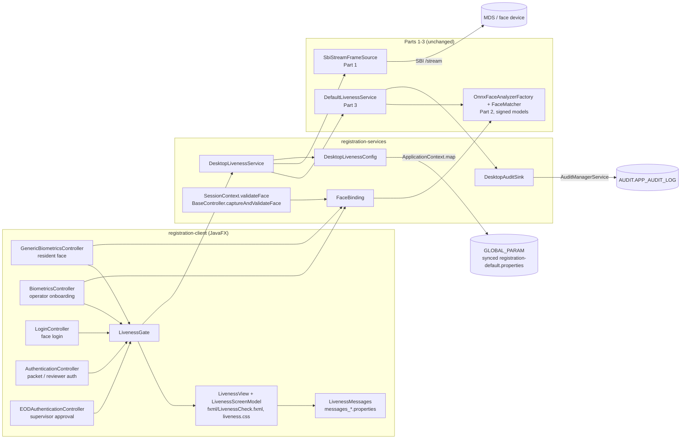
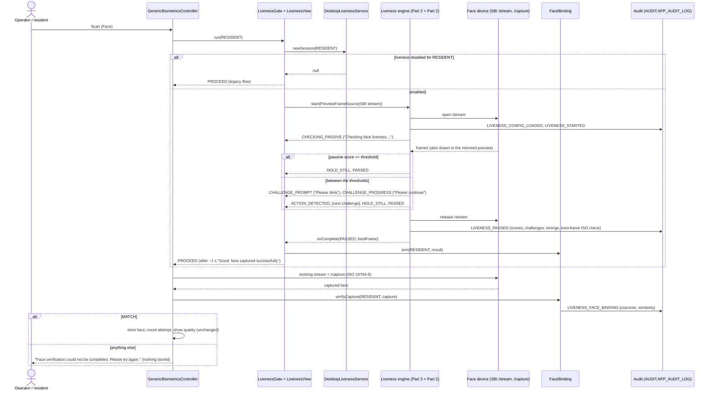
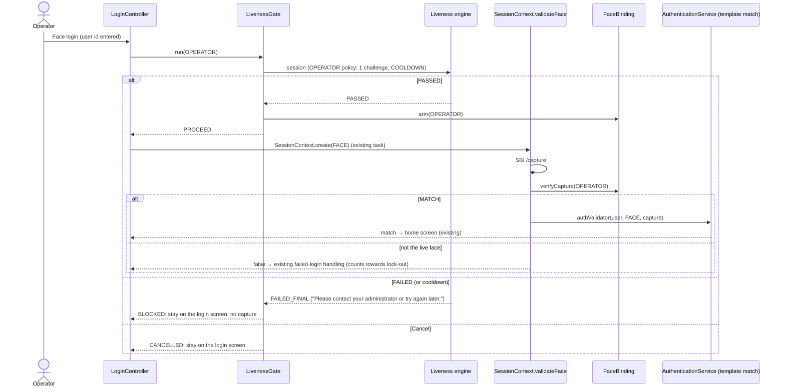
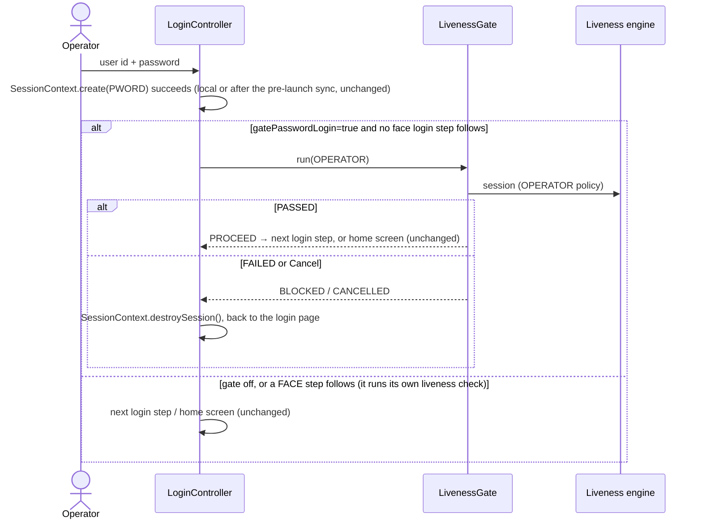
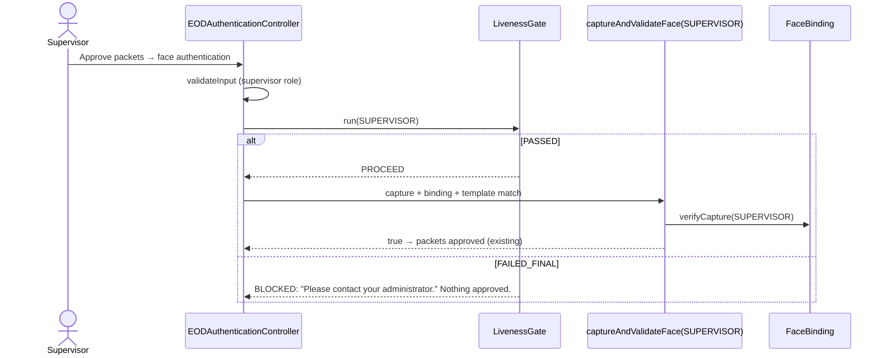
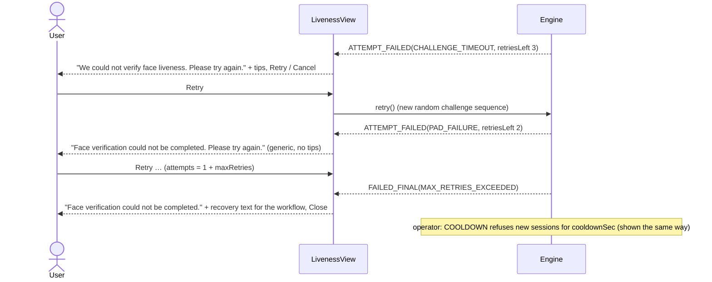
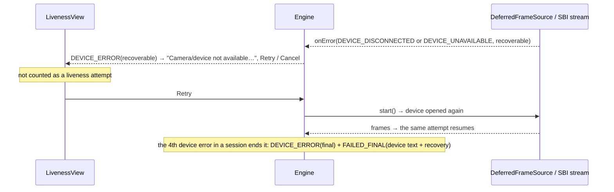

# Part 4: face liveness in the Desktop Registration Client

Part 4 puts Parts 1 to 3 into the MOSIP Desktop Registration Client (JavaFX, v1.2.0.2). Before any face is accepted
or used for authentication, a face liveness check runs on the SBI face device's stream:

| Flow | Workflow (policy) | Where |
|---|---|---|
| Resident face capture (new registration, update, lost UIN) | RESIDENT | Scan of the **Face** modality, before the SBI `/capture` |
| Operator login with face | OPERATOR | Login screen, face mode, before the face is captured and matched |
| Operator login with password (as on Android) | OPERATOR | After a successful password, before the next login step or the home screen; skipped when a face step follows; `desktop.operator.gatePasswordLogin` |
| Operator onboarding (the operator's own face) | OPERATOR | Onboarding biometrics, Scan of the **Face** modality |
| Packet authentication with face (the officer signs the packet) | OPERATOR | Operator authentication step, face mode |
| Supervisor authentication with face: biometric-exception review, end-of-day packet approval | SUPERVISOR | Reviewer step of packet authentication; EOD approval dialog |

A face is stored, or an authentication completes, only when the session returns **PASSED** and the captured face
is the same person (face binding, §2.3). For logins and approvals liveness runs **in addition to** the existing face
match: it proves the matched face belongs to a live person who is present.

The screen, its states and every text are the ones shared with the Android client
([ui-liveness-spec.md](ui-liveness-spec.md)); the Desktop renders them, it does not redesign them.

Contents: 1 Architecture · 2 Integration · 3 Sequence diagrams · 4 UI screens · 5 Configuration · 6 Audit and
diagnostic logging · 7 Metrics · 8 Online and offline · 9 Security and privacy · 10 Build, run, test · 11 Limitations
and open points

---

## 1. Architecture



| Class | Module | Role |
|---|---|---|
| `LivenessGate` | client | The one call each flow makes: opens the liveness window (modal), runs one session, returns PROCEED, CANCELLED or BLOCKED. Never throws; fails closed. |
| `LivenessScreenModel` | client | Maps `LivenessEvent`s to message keys, oval colour + icon, progress, step, attempts, tips and buttons: the spec's state table. Pure Java, unit tested. |
| `LivenessView` | client | Renders the model (`fxml/LivenessCheck.fxml`, `liveness.css`); live preview mirrored for display only; screen-reader notifications. |
| `LivenessMessages` | client | Message lookup: app language, then English, then the built-in English catalogue (identical to the spec, checked by a test). |
| `LivenessScreenDemo` | client (test sources) | Development tool: renders every screen state to PNG, or runs the screen with the scripted or real engine outside the client. Not in the client jar (§10). |
| `DesktopLivenessService` | services | Spring bean: builds the engine (Part 3 + Part 2 signed models, or the scripted engine by JVM property), opens the face device (Part 1 SBI stream), preloads models at start-up, reloads config after a sync, metrics. |
| `FaceBinding` | services | F1: the next face capture of the workflow must match the PASSED session's best frame. |
| `DesktopLivenessConfig` | services | `ConfigProvider` over `ApplicationContext.map()` (synced global config + local preferences) with bundled Desktop defaults. |
| `DesktopAuditSink` | services | Engine audit records → the client's audit module, events `REG-LIV-001..011`. |
| `DeferredFrameSource`, `IdleFrameSource`, `CapturedFaceDecoder` | services | Device opened on start (unplugged device = recoverable error with Retry); no-op source for the scripted engine; ISO 19794-5 → RGB frame for binding. |

**What changed in existing client code** (all additive, the legacy path stays when liveness is disabled):

| File | Change |
|---|---|
| `GenericBiometricsController`, `BiometricsController` | Face Scan: gate first, then the unchanged device search/stream/capture; the capture task verifies the binding and a rejected capture is never stored and not counted as an attempt. |
| `LoginController` | Face login: gate first, then the unchanged `SessionContext.create(FACE)`. Password login: gate after a successful password (`loadNextScreen`); cancelled or failed = session destroyed, back to the login page. |
| `SessionContext.validateFace` (services) | Binding check between the SBI capture and the template match. |
| `BaseController.captureAndValidateFace` | New overload with the liveness workflow; binding check before the template match. |
| `AuthenticationController`, `EODAuthenticationController` | Face validation: gate first (OPERATOR, or SUPERVISOR for the reviewer and EOD approval). |
| `ClientApplication` | `preloadAsync()` after device discovery at start-up. |
| `AuditEvent`, `Components`, `AuditReferenceIdTypes`, `AuditManagerService(Impl)` | New events `REG-LIV-*`, component `REG-MOD-153`, reference type `LIVENESS_SESSION_ID`, and an `audit(..., description)` overload that stores the details. |
| `messages_en.properties` | The shared liveness catalogue (spec §5), English. |
| poms | `registration-services` → `liveness-fake` (dev engine); `registration-client` → JUnit (tests). |

## 2. Integration

### 2.1 The gate

Every hook has the same shape:

```java
livenessGate.run(WorkflowType.RESIDENT, window, outcome -> {
    if (outcome.proceed()) {
        searchDeviceAndCapture();      // the existing flow, unchanged
    } else {
        disableEnableBiometricPane(false);   // CANCELLED or BLOCKED: nothing captured, nothing counted
    }
});
```

- `newSession(workflow)` returns null when liveness is disabled for that workflow: **PROCEED** at once, no window, the
  legacy flow (`mosip.registration.liveness.face.<workflow>.enabled=false`).
- The window is modal to the calling screen, so it also works over the authentication pop-ups.
- Auto-logout is suspended while the window is open, as during a biometric scan.
- PASSED: success state, then the window closes after `desktop.autoContinueMs` (1 s) and the flow continues; the face
  binding is armed for the next capture of that workflow.
- FAILED: the final state with the workflow's recovery guidance and Close; outcome **BLOCKED**.
- Cancel, or the window's close button: `session.cancel()`; outcome **CANCELLED**; the caller returns to where it was.
- Any exception (engine cannot be created, screen cannot load): the fail-closed screen with the generic text, **BLOCKED**.

### 2.2 Device

Liveness reads the face device's SBI `/stream` through Part 1's `SbiStreamFrameSourceFactory`, i.e. the client's own
MDS discovery and `BioService.getStream()`: any compliant L0/L1 face device, no vendor SDK. The device is opened when
the session starts (and again on Retry), so an unplugged device shows "Camera/device not available" with Retry, and the
operator can plug it in without leaving the screen (problem statement §9). The engine releases the stream before it
reports the result, then the existing flow opens it again for its preview and `/capture`.

### 2.3 Face binding (F1)

Liveness runs on the stream; the face that is stored or matched comes from a separate SBI `/capture`. Without a check
a live person could pass liveness and then a photo, or another person, be captured. So:

1. A PASSED gate arms `FaceBinding` with the session's best frame (one arming, 5 minutes at most, for that workflow).
2. The next face capture of that workflow (resident capture, onboarding capture, `SessionContext.validateFace`,
   `captureAndValidateFace`) decodes the ISO 19794-5 record and compares it with the best frame (SFace, Part 2).
3. Only **MATCH** is accepted. NO_MATCH, no face, several faces, an undecodable record, a missing/expired/other-workflow
   arming or any error rejects it (fail closed): nothing is stored, no attempt is counted, the user sees the generic
   "Face verification could not be completed. Please try again.", and the next Scan runs liveness again. In login and
   authentication flows the rejection is an authentication failure.
4. Every decision is audited (`LIVENESS_FACE_BINDING`: outcome, similarity, threshold, session id). Neither image is
   logged or kept.

Binding is not PAD (a photo of the same person matches), so it never replaces liveness. `binding.enabled=false` keeps
the old behaviour (audited SKIPPED).

### 2.4 Not gated, on purpose

- **The exception photo** (biometric exception process): it is the recovery path the resident failure text points to.
- **Fingerprint, iris, password and OTP authentication**: liveness is a face control.

## 3. Sequence diagrams

### (a) Resident face capture



### (b) Operator login with face



### (b2) Operator login with password



No face is captured or matched in this flow, so there is no binding: liveness proves a live person is present at
the operator's password login, as on Android. The first (initial set-up) login is not gated: it restarts the client
after the sync.

### (c) Packet authentication (operator) and biometric-exception review (supervisor)

```mermaid
sequenceDiagram
    actor U as Officer / reviewer
    participant AC as AuthenticationController
    participant G as LivenessGate
    participant BC as BaseController.captureAndValidateFace
    participant B as FaceBinding
    participant AS as AuthenticationService

    U->>AC: Scan (face authentication)
    AC->>AC: validateInput (reviewer must be another, valid user)
    AC->>G: run(isReviewer ? SUPERVISOR : OPERATOR)
    alt PROCEED
        G-->>AC: PROCEED (binding armed for that workflow)
        AC->>BC: captureAndValidateFace(user, packetAuth, isReviewer, workflow)
        BC->>BC: SBI /capture
        BC->>B: verifyCapture(workflow)
        alt MATCH
            BC->>AS: authValidator
            AS-->>AC: match → officer/supervisor biometrics added to the packet, next step (existing)
        else rejected
            BC-->>AC: false → existing "face not matched" alert, nothing added
        end
    else BLOCKED / CANCELLED
        G-->>AC: no capture; the packet is not submitted; the step stays
    end
```

### (d) Supervisor end-of-day approval



### (e) Failure path: retry, maximum attempts, recovery



### (f) Device unplugged and plugged back



### (g) Config sync and model update

```mermaid
sequenceDiagram
    participant Sync as Config sync job (online)
    participant GP as GLOBAL_PARAM / ApplicationContext.map
    participant S as DesktopLivenessService
    participant E as Engine
    Sync->>GP: registration-default.properties (liveness keys)
    Note over S: before every session: fingerprint of all liveness keys
    S->>GP: read
    alt changed
        S->>E: reloadConfig() → LIVENESS_CONFIG_LOADED (running sessions keep their policy)
    end
    Note over S: offline: the last synced values in GLOBAL_PARAM, else the bundled defaults
    Note over S: model update: a newer SIGNED bundle in desktop.modelStoreDir is used by the next start;<br/>tampered or unsigned = MODEL_INTEGRITY_FAILED, no fallback to unverified models
```

## 4. UI screens

One window for all three workflows; only the title and the recovery text differ. The preview is the device's live
stream, mirrored like a selfie (the frames given to the engine are never mirrored), with the face oval. The oval's
colour always comes with an icon and a text. Rendered by `LivenessScreenDemo --snapshots` from the production classes
(the face is a public-domain NASA portrait used by Part 2's fixtures).

| | | |
|---|---|---|
|  **Passive check** "Checking face liveness…", blue, indeterminate |  **Positioning guidance** (hint line, warning icon) |  **Challenge prompt**, amber, step 1 of 2 |
|  **Real-time feedback** "Please continue", progress |  **Action detected**, green |  **Hold still** + "look at the camera" after a turn |
|  **Passed**: continues after ~1 s |  **Retry** available: attempts left, tips |  **PAD failure**: the generic text only |
|  **Device error** with Retry |  **Maximum attempts**: resident recovery (biometric exception process) |  **Operator** authentication |
|  **Supervisor** failure |  **Fail closed** (engine unavailable) | |

Behaviour (spec §2, §3, §7): Retry only after a failed attempt or a recoverable device error; Cancel until the end;
Close only on the final failure; no score, threshold, model or PAD detail is ever shown; the status line is 24 px and
the hint 18 px; buttons are 48 px high and keyboard-focusable (Retry/Close take focus, Esc = Cancel); the challenge icon
pulses unless `desktop.animations=false`; every status change updates the status label's accessible text and notifies
the screen reader.

Online and offline look identical: nothing on the screen depends on the network.

## 5. Configuration

All keys are read through the client's configuration framework: the server's `registration-default.properties` (synced
into the local `GLOBAL_PARAM` table, hence available offline) and local preferences, via `ApplicationContext.map()`.
Ready-to-append block: [part4-registration-default.properties](part4-registration-default.properties). A missing key
uses the bundled default (`liveness-desktop-default.properties` for Desktop keys, the engine's
`liveness-default.properties` for policy keys). Invalid policy values are rejected by the engine and replaced by the
bundled defaults (audited in `LIVENESS_CONFIG_LOADED` as `configError`).

**Policy** (`mosip.registration.liveness.face.<default|resident|operator|supervisor>.<field>`; workflow key, then
`default.`, then the bundled default). Problem statement §8 → key:

| Requirement | Field | Default |
|---|---|---|
| Liveness enablement | `enabled` | true |
| Passive liveness threshold | `passiveThreshold` (pass), `padRejectThreshold` (attack) | 0.85, 0.30 |
| Active liveness policy | `activeEnabled` | true |
| Challenge types | `challengeTypes` | BLINK,SMILE,TURN_LEFT,TURN_RIGHT |
| Minimum challenge count | `minChallenges` | 2 (operator, supervisor: 1) |
| Challenge timeout | `challengeTimeoutMs` | 6000 |
| Maximum retry count | `maxRetries` | 3 |
| Behaviour on repeated failure | `onRepeatedFailure` (BLOCK, COOLDOWN), `cooldownSec` | BLOCK (operator: COOLDOWN), 60 |
| Workflow-specific policies | any field under `resident.`, `operator.`, `supervisor.` | |
| Diagnostic mode | `diagnosticMode` | false |
| Other | `passiveWindowFrames`, `passiveTimeoutMs`, `analyzeFps` | 10, 8000, 8 |

**Face binding and analyzer**: `binding.enabled` (true), `binding.cosineThreshold` (0.45), and Part 2's optional
`analyzer.*` keys ([part2-pad-architecture.md](part2-pad-architecture.md)).

**Desktop** (`mosip.registration.liveness.face.desktop.*`):

| Key | Default | Meaning |
|---|---|---|
| `sbi.frameTimeoutMs` | 15000 | no bytes for this long = stalled stream |
| `sbi.frameStride` | 1 | analyse every Nth device frame |
| `sbi.maxReconnectAttempts`, `sbi.reconnectBackoffMs` | 3, 500 | reconnects after a mid-stream drop |
| `autoContinueMs` | 1000 | how long the success state stays |
| `operator.gatePasswordLogin` | true | OPERATOR liveness after a successful password login (skipped when a face login step follows) |
| `animations` | true | challenge icon pulse (false = reduced motion) |
| `metricsAuditEvery` | 20 | audit a metrics snapshot every N sessions (0 = never) |
| `modelStoreDir` | `<client folder>/.liveness-models` | offline model store (signed bundles only) |

**Development only, JVM properties** (never read from synced config, so no config push can weaken liveness):
`-Dmosip.registration.liveness.face.desktop.engine=fake` (scripted engine, `...desktop.fake.scenario=PASS_ACTIVE` etc.),
`-Dmosip.registration.liveness.face.desktop.source=webcam|video:<file.mjpeg>|images:<dir>` (mock device instead of SBI).

## 6. Audit and diagnostic logging

Everything goes through the existing audit module (`AuditManagerService` → `AUDIT.APP_AUDIT_LOG`), component
`REG-MOD-153` "Face liveness", reference type `LIVENESS_SESSION_ID` with the session UUID, so all records of one check
link together and to the client log. The description column holds `workflow=…; session=…; key=value; …` (at most 2048
characters; longer records are split into numbered parts).

| Event id | Name | When | Details (from the engine unless noted) |
|---|---|---|---|
| REG-LIV-001 | LIVENESS_STARTED | each attempt | attempt, modelVersion, deviceId, deviceCertification |
| REG-LIV-002 | LIVENESS_PASSED | passed | passPath, passiveScore, passiveFrames, challenges (`TYPE:OUTCOME:ms`), durations, frames analysed/dropped, avgProcessingMs, `bestFrame.*` ISO 19794-5 compliance |
| REG-LIV-003 | LIVENESS_ATTEMPT_FAILED | attempt failed, retries left | errorCode, retriesLeft, reason |
| REG-LIV-004 | LIVENESS_FAILED_FINAL | final failure, cancel, cooldown refusal | errorCode, lastCause, cooldownSec |
| REG-LIV-005 | LIVENESS_PAD_ATTACK_SUSPECTED | presentation attack suspected | errorCode PAD_FAILURE, passiveScore, reason, `pad.<model>` medians |
| REG-LIV-006 | LIVENESS_DEVICE_ERROR | device error | errorCode, recoverable, deviceDetail |
| REG-LIV-007 | LIVENESS_MODEL_LOADED | start-up preload (Desktop) and per session | modelVersion, accelerator, loadMs |
| REG-LIV-008 | LIVENESS_MODEL_INTEGRITY_FAILED | bundle did not verify | errorCode, reason, phase |
| REG-LIV-009 | LIVENESS_CONFIG_LOADED | policy resolved (start, after a sync) | policy summary, configError |
| REG-LIV-010 | LIVENESS_FACE_BINDING | Desktop: capture compared with the live face | outcome, similarity, threshold, accepted |
| REG-LIV-011 | LIVENESS_METRICS | Desktop: every `metricsAuditEvery` sessions | anonymised counters and rates (§7) |

The names are the Android client's; the ids differ because the Desktop's `REG-EVT-009..018` were already taken.

**Scores, PAD reasons and challenge outcomes** are therefore in the audit trail; **raw face images never are**: the
engine passes only codes and numbers, and `DesktopAuditSink` enforces it again (keys must be short identifiers, values
are capped at 400 characters, anything that looks like encoded binary data is dropped, line breaks and separators are
neutralised). An audit write failure is logged and never breaks a capture or a login.

**Diagnostic mode** (`<workflow>.diagnosticMode=true`, or `default.`): the engine adds `diag.*` per-attempt score
statistics (quartiles, frames per issue, timings) to the audit records, and the Desktop writes a `LIVENESS-DIAG` trace
to the client log: session start, every event (type, challenge, guidance, error code; never frames), the result and the
metrics snapshot. It never changes the screen; production screens look the same with it on.

## 7. Metrics

`DesktopLivenessService.metricsSnapshot()` (from the engine's `LivenessMetrics`) gives, since start-up and without any
id or personal data: sessions, passed (passive/active), failed, cancelled, cooldown refusals, retries, device errors,
**average liveness processing time** (`avgProcessingMs`), **challenge completion time** (`avgChallengeCompletionMs`),
**retry rate**, **failure rate**, passive share and final failures by code. It is audited as `LIVENESS_METRICS` every
`metricsAuditEvery` sessions and logged after each session in diagnostic mode.

## 8. Online and offline

Liveness, PAD, challenge selection and action validation all run locally (the engine and the signed models are in the
client jars), so the network never decides whether liveness is enforced. Config comes from `GLOBAL_PARAM`, which holds
the last synced values offline; a sync while online is picked up by the next session. Model updates are installed only
as signed bundles (Part 2 `ModelStore`: verified, never older, atomic switch); without one the bundled models are used.
The screen and texts are identical online and offline.

## 9. Security and privacy

- **Fail closed everywhere.** Engine creation failure, screen failure, unreadable policy, missing/expired binding,
  undecodable capture, matcher error: the face is not accepted and authentication does not complete.
- **Accept only on `onComplete(PASSED)`.** Events only drive the screen; the hooks branch on the gate's outcome, which
  is set from the result.
- **Face binding** closes the gap between the liveness stream and the SBI capture (§2.3), for capture and for every
  face authentication.
- **No technical detail on screen.** PAD failures show the same generic text as engine errors (spec §1); no score,
  threshold, model name or challenge timing is displayed.
- **Unpredictable challenges.** The engine chooses them with `SecureRandom`, never repeats the previous sequence on
  Retry, never asks BLINK alone; the user never selects one.
- **Signed models only.** The analyzer loads models only from the verified bundle (ECDSA-signed manifest, sizes,
  SHA-256); a tampered bundle is `MODEL_INTEGRITY_FAILED` with no fallback. The built-in key is a development key and
  must be replaced before release (Part 2 §8).
- **Development switches cannot be pushed.** The scripted engine and mock devices are selectable only by JVM
  properties on the machine, never by synced config; the scripted engine logs a warning and its sessions are audited
  with `modelVersion=fake-1.0`.
- **Repeated failures.** Retry limit per session; operator authentication cooldown (`COOLDOWN`), in memory (resets on
  restart: contract proposal P1).
- **Images stay in memory.** Frames, the best frame and the captured face are never written to disk, logs or audit by
  the liveness code; the best frame is dropped when consumed, replaced, disarmed or after 5 minutes. Only the existing
  capture flow stores the accepted face, as before.
- **Audit content** is limited to codes, scores, timings, model version and device id (§6), linked by a random session
  UUID; the metrics are aggregate counters.
- **ISO/IEC 30107** alignment, thresholds and evaluation are Part 2's ([part2-iso30107-evaluation.md](part2-iso30107-evaluation.md)).

## 10. Build, run, test

From `registration-client/registration` (JDK 11; first build online):

    mvn -pl liveness-api,liveness-core,liveness-fake,liveness-analyzer,registration-services,registration-client -am install -DskipTests -Dgpg.skip -Dmaven.gitcommitid.skip=true
    mvn -pl registration-services,registration-client test "-Dtest=**/liveness/**/*Test,AuditFactoryTest,LoginServiceTest" -Dsurefire.failIfNoSpecifiedTests=false -DfailIfNoTests=false -Dgpg.skip -Dmaven.gitcommitid.skip=true

(`-Dmaven.gitcommitid.skip=true` is needed only when building outside a git checkout.)

**Results (2026-10-26):** `registration-services` 129 tests pass: the 27 new Desktop tests plus the existing Part 1
liveness (72), audit (4) and login (26) suites. `registration-client` 27 new tests pass. No failures, nothing skipped.

| Test | What it proves |
|---|---|
| `DesktopLivenessServiceTest` | real engine + signed ONNX models + recorded clip through the deferred source → FAILED with `lastCause=FACE_NOT_DETECTED`, audited through the audit module with the session id; workflow disabled by synced config → legacy flow; config sync applies to the next session; scripted engine is development-only and skips binding |
| `RealFaceBindingTest` | ISO 19794-5 records made by MOSIP's encoder decode; same person → MATCH; group photo → MULTIPLE_FACES_B; garbage → UNDECODABLE (real SFace model) |
| `FaceBindingTest` | one arming per capture, workflow and expiry checks, every failure fails closed, disabled/skipped paths, audit content |
| `DesktopAuditSinkTest` | event mapping, description format, sanitising (image-like data dropped), splitting, audit failures contained |
| `DesktopLivenessConfigTest` | synced config over bundled defaults, workflow policies, JVM-only dev switches, change fingerprint |
| `DeferredFrameSourceTest` | unplugged device = recoverable DEVICE_UNAVAILABLE; Retry opens it again |
| `LivenessScreenModelTest` | every row of the spec's state table, debounce, PAD = generic, cooldown, cancel, every key has a text |
| `LivenessGateTest` | password login gated when the key is on and no face step follows; never twice |
| `LivenessMessagesTest` | `messages_en.properties` = built-in catalogue = the spec's block, word for word; no technical words in any text |

**Screen demo.** `LivenessScreenDemo` is a development tool in the client's **test** sources. It writes PNG files and
can open a webcam, so it is not in the client jar. Run it on the test classpath, from `registration/` after an
`install -DskipTests`:

    mvn -pl registration-client test-compile exec:java -Dexec.classpathScope=test -Dexec.mainClass=io.mosip.registration.controller.liveness.LivenessScreenDemo "-Dexec.args=--snapshots ../docs/images/part4 --face ../liveness-analyzer/src/test/resources/golden/portrait_frontal.png"
    mvn -pl registration-client test-compile exec:java -Dexec.classpathScope=test -Dexec.mainClass=io.mosip.registration.controller.liveness.LivenessScreenDemo "-Dexec.args=--scenario FAIL_CHALLENGE_THEN_PASS_ON_RETRY --workflow operator"
    mvn -pl registration-client test-compile exec:java -Dexec.classpathScope=test -Dexec.mainClass=io.mosip.registration.controller.liveness.LivenessScreenDemo "-Dexec.args=--live webcam"

**In the client without an SBI device:** start it with `-Dmosip.registration.liveness.face.desktop.source=webcam`
(real engine on the webcam) or `-Dmosip.registration.liveness.face.desktop.engine=fake` (scripted engine).

## 11. Limitations and open points

**Not verified here:**
- The full Registration Client was compiled and its liveness, audit and login tests run, but it was **not launched end
  to end** (that needs a registered machine, the local database and a server for the first sync). The hooks were
  checked by compilation and code review, the screen by rendering it, the services by the tests above.
- **No SBI hardware and no MockMDS run** in Part 4. The SBI path is Part 1's, tested there (unplug/replug, recorded
  clips, MockMDS 45/45 frames).
- **Screen reader:** JavaFX 11 has no live regions; status changes update the accessible text and notify, but this was
  not tried with Narrator/NVDA.
- **Translations:** only English is in `messages_en.properties`. French and Arabic fall back to the built-in English
  texts until translated (`LivenessMessages`).

**Behaviour to know:**
- A face-login binding rejection is handled by the existing login code as a failed face login (its "face not matched"
  alert, counts towards the account lock-out), not with the liveness screen's generic text.
- Password login is gated like Android (`desktop.operator.gatePasswordLogin`, default true). With the default config
  a face device must therefore be connected for every operator login while operator liveness is enabled; set the key
  to false (or `operator.enabled=false`) where that is not wanted. OTP-only, fingerprint and iris logins are not gated.
- The operator cooldown is in memory (Part 3, proposal P1).

**For Person 2 / Person 5 (shared spec):**
1. **`LOOK_AT_CAMERA` text.** The handover message asks for "Look directly at the camera"; the shared spec and both
   catalogues have `liveness.guidance.look_at_camera` = "Please look at the camera." ("Look directly at the camera." is
   the tip text). Desktop follows the spec; change it in the spec and both apps together if wanted.
2. **Turn prompt.** Part 2's findings recommend "Please turn your head to the left, then look back at the camera"; the
   spec keeps the problem statement's "Please turn your head to the left". Desktop follows the spec.
3. **Audit ids.** Desktop uses `REG-LIV-001..011` with the Android event names (the Desktop's `REG-EVT-009..018` are
   taken).
