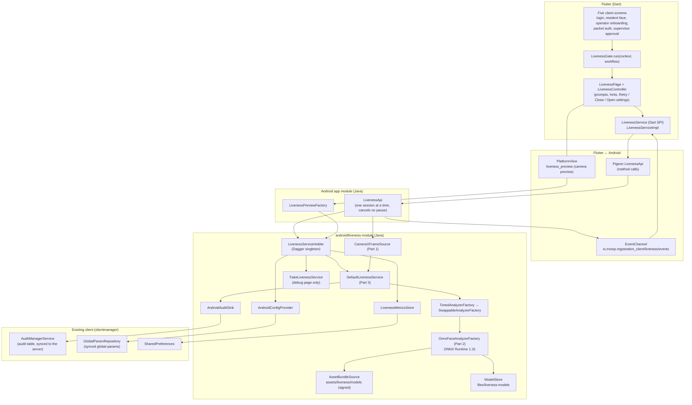
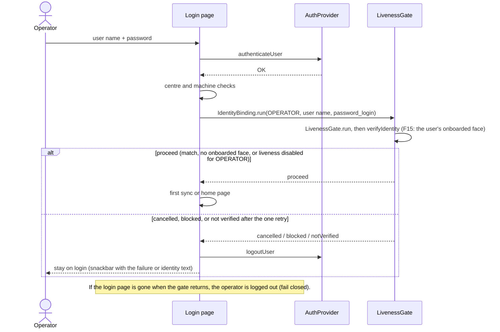
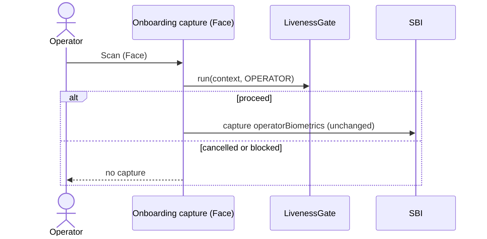
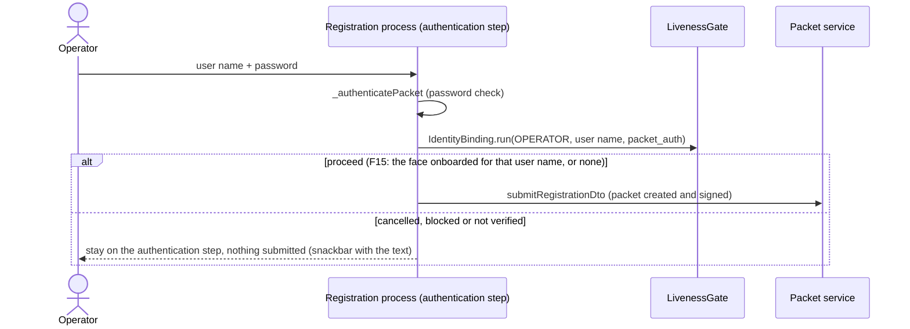
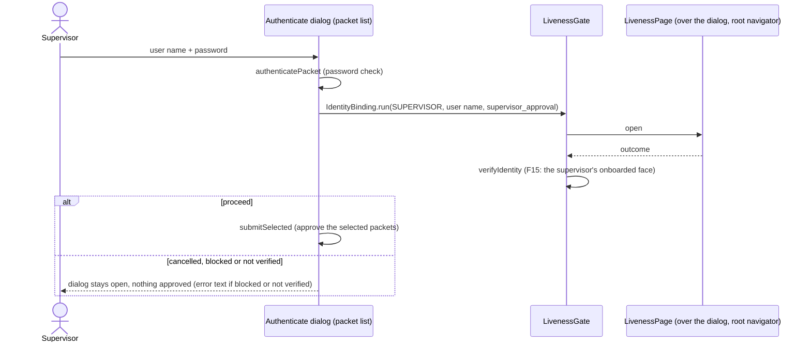
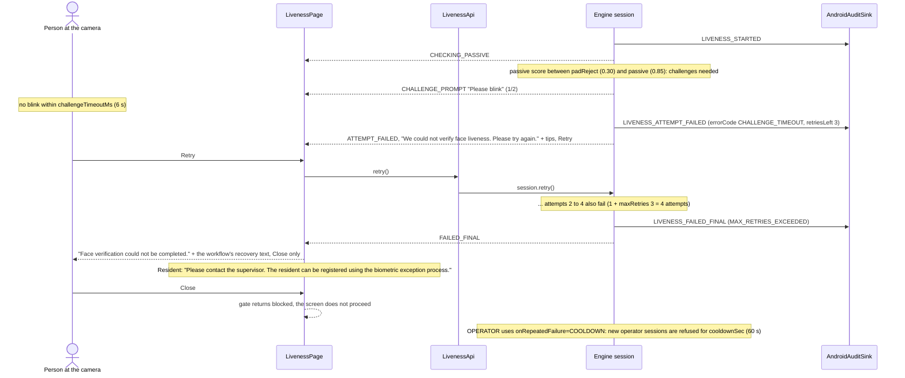
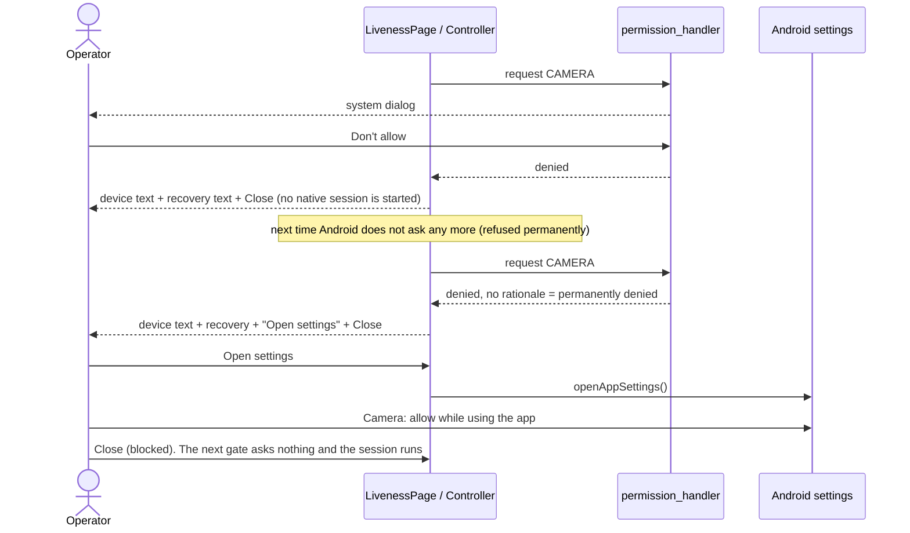
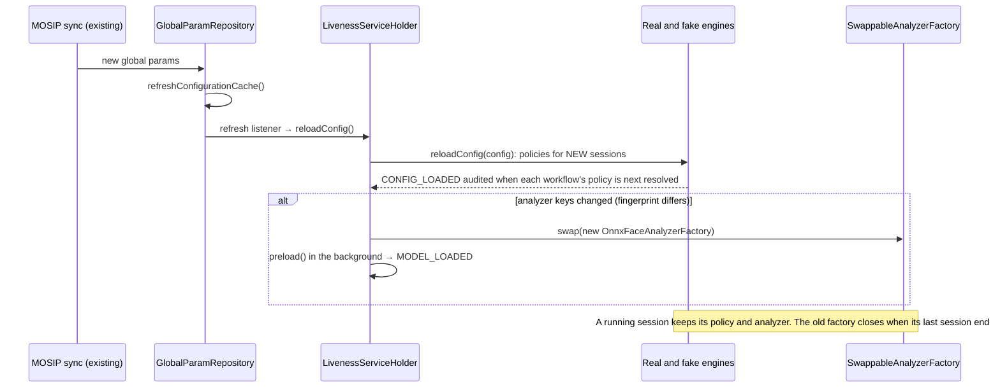
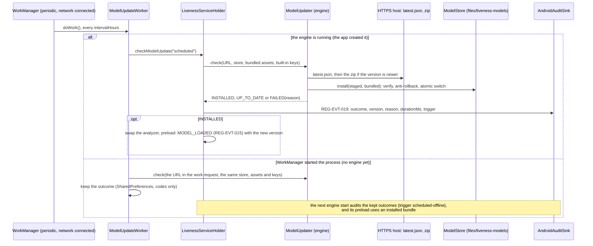

# Part 5: face liveness in the MOSIP Android Registration Client

Person 5. This document is for:
- Person 4 (the Desktop integration);
- reviewers of the MOSIP Android client;
- the judges.

It explains what was added to the Android Registration Client, how the parts talk to each other,
how it is configured, audited and secured, and how it was built and tested.

The patches and the apply steps are in [`android-integration/`](../android-integration/README.md).
The phone measurements are in [`part5-android-benchmark.md`](part5-android-benchmark.md).

## 1. Overview

Before each of the five face checks of the client, the operator's tablet or phone now runs a
**face liveness check**. A check is a short session on the device camera that decides whether a
live person is in front of it:
- **resident face capture:** before the face is captured through the SBI;
- **operator login:** after the password;
- **operator onboarding:** before the operator's face is captured;
- **packet authentication:** when the operator signs a registration packet;
- **supervisor approval:** when the supervisor approves packets.

The check is a **passive** look at a few frames. Only when that is not conclusive does it ask for
one or two **challenges** (blink, smile, turn the head).

| part of the work | where it comes from | what runs on Android |
|---|---|---|
| Part 1: frames | `android-liveness-frame-source/` (Mosip26) | `CameraXFrameSource`: CameraX analysis stream, YUV to RGB, rotation, frame pacing (15 frames/s), dim-face exposure assist |
| Part 2: per-frame analysis | `liveness-analyzer/`, `models/` (Mosip26) | `OnnxFaceAnalyzerFactory`: YuNet face detection, FaceMesh V2 landmarks and pose, quality checks, MiniFASNet presentation attack detection (PAD), on ONNX Runtime; signed model bundle |
| Part 3: the session | `liveness-core/`, `liveness-fake/` (Mosip26) | `DefaultLivenessService`: passive decision, challenges, retries, timeouts, cooldown, policy, audit; `FakeLivenessService` for testing |
| Part 5: the integration | `android-integration/` patches against the client v1.1.1 | the native module, the Flutter bridge, the screen, the gate, the five hooks, audit, config, metrics, diagnostics |

The engine is the same pure-Java code as on the Desktop, compiled into four jars
(`liveness-api`, `-core`, `-fake`, `-analyzer`). The client gets it through `sync-engine.ps1`.

## 2. Architecture



| component | file in the client | job |
|---|---|---|
| `LivenessGate` | `lib/ui/liveness/liveness_gate.dart` | the one call every screen makes. Skips the page when liveness is disabled for the workflow, opens `LivenessPage` on the root navigator (it also works from a dialog) and maps the outcome to proceed, cancelled or blocked. Fails closed on any error |
| `LivenessPage`, `LivenessController` | `lib/ui/liveness/` | the check screen of the shared UI spec (`docs/ui-liveness-spec.md`): preview, big prompt, hints, Retry, Close, Open settings. Shows only the user message texts, never scores |
| `LivenessService` | `lib/platform_spi/`, `lib/platform_android/` | Dart interface to the bridge; asks for the camera permission |
| `LivenessApi` (Java) | `android/app/.../api_services/LivenessApi.java` | Pigeon host API, event sink, camera source per session; cancels the session when the Activity pauses |
| `LivenessServiceHolder` | `android/liveness/.../LivenessServiceHolder.java` | builds the real and fake engines, the analyzer (bundled or installed models), config with debug overrides, and the reload after a sync; preloads the models at app start; model update and metrics |
| `AndroidAuditSink` | same module | engine audit events to the client's audit table (REG-EVT-009..017) |
| `AndroidConfigProvider` | same module | reads the engine's keys from the synced global params |
| `LivenessMetricsStore` | same module | anonymised counters kept across restarts |
| `CameraXFrameSource` | same module (synced from Part 1) | CameraX frames for the engine, and the preview |

**Pigeon `LivenessApi` methods:**
- **Used by the screens:**
  - `isEnabled`, `policy`, `startSession` (asynchronous), `retry`, `cancel`, `cameraFor`;
  - `modelVersion`, `reloadConfig`, `metrics`, `modelStoreStatus`.
- **Diagnostics builds only:** `setConfigOverride`, `resetMetrics`, `runBenchmark`,
  `installModelBundle`, `rollbackModelBundle`.
- **What the event channel carries:** each session's events (prompts, progress, guidance, attempt
  failures), then its result (decision, pass path, user message, attempts, duration, model
  version and, on PASSED, the best frame as JPEG bytes for the caller).

## 3. Sequences

All five hooks call the same gate, so they share one session sequence. The diagrams below show
first what each screen does around the gate (a to e), then the session itself, failures and
permissions (f, g), and the background paths (h, i).

### (a) Resident face capture: liveness before the SBI capture

```mermaid
sequenceDiagram
  actor Op as Operator (resident in front of the camera)
  participant Scr as Biometric capture screen (Face)
  participant Gate as LivenessGate
  participant Page as LivenessPage
  participant Api as LivenessApi (native)
  participant Eng as DefaultLivenessService
  participant SBI as SBI face device / app
  Op->>Scr: Scan (Face)
  Scr->>Gate: run(context, RESIDENT)
  Gate->>Api: isEnabled(RESIDENT), cameraFor(RESIDENT)
  Gate->>Page: open (full screen)
  Page->>Api: startSession(RESIDENT, camera)
  Api->>Eng: newSession + start(CameraXFrameSource)
  loop frames (about 8/s passive, up to 15/s in challenges)
    Eng-->>Page: events (checking, guidance, challenge prompt, progress)
  end
  Eng-->>Api: result PASSED (best frame)
  Api-->>Page: result
  Api->>Api: hold the best frame (FaceBinding, memory only)
  Page-->>Gate: LivenessOutcome(passed)
  Gate-->>Scr: proceed
  Scr->>Api: armBinding(sessionId) (FaceBinding.captureFace)
  Scr->>SBI: invokeDiscoverSbi / capture face
  SBI-->>Api: capture result (BiometricsDetailsApi.parseRCaptureResponse)
  Api->>Api: decode the ISO 19794-5 JPEG 2000 face, FaceMatcher.compare (binding thread)
  alt MATCH
    Api-->>Scr: stored as before, "Ok"
  else anything else
    Api-->>Scr: not stored, LIVENESS_BINDING_FAILED
    Note over Scr: generic text; no attempt counted, no scan dialog
  end
  Note over Scr: Not proceed (cancelled or blocked): return before the SBI call. No capture and no capture attempt is counted.
```

The same gate runs in the landscape layout of this screen (Scan and Rescan). Without that, a
rotated tablet would skip liveness.

**Face binding (F1, fix round 2).** Liveness runs on the camera, but the stored face comes from the
SBI. The capture handler therefore stores an armed face capture only if it is the person who
passed: an SFace comparison with the session's best frame, MATCH at a cosine of 0.45 or more. The
operator onboarding face (c) is bound the same way. The flow, the fail-closed rules and the config
are in [ui-liveness-spec.md](ui-liveness-spec.md) §6 "Face binding (F1)".

### (b) Operator login: after the password



### (c) Operator onboarding: the operator's own face



### (d) Packet authentication: the operator signs the packet



### (e) Supervisor approval



### (f) A failure path: retry, then the maximum number of attempts, then recovery



A presentation attack (PAD score below 0.30) fails the attempt with PAD_FAILURE and
PAD_ATTACK_SUSPECTED is audited. The screen shows the generic text with no tips, so nothing
tells an attacker what to improve.

### (g) Camera permission refused, then Open settings



### (h) Config reload after a sync



### (i) Model update: install, verify, reload; and rollback

A bundle reaches the store in one of three ways:
- staged with `adb push` and installed from the debug page (below; debug and profile builds only);
- downloaded by the online update (section (j));
- installed from removable media on the production "Face liveness models" page (F17, below).

All three end in the same `ModelStore.install(staged, bundled)`.

**F17: production offline install and rollback.** This path works in release builds; it is not diagnostics-gated.
- **Who sees it.** The home page's operational tasks show "Face liveness models" only to a logged-in supervisor or
  admin while `mosip.registration.liveness.model.offlineInstall.enabled` is not `false`. Roles come from
  `SessionManager`: `is_supervisor`, and since F17 `is_admin`, from the token's roles.
- **The page.** It shows the version in use, **Install model bundle** and **Roll back model bundle**. The rollback asks
  for a confirmation first.
- **Install.** A native `ACTION_OPEN_DOCUMENT` picker (Storage Access Framework, zip types) runs over a Pigeon method
  and `MainActivity.onActivityResult` (request code 17); no new Flutter plugin is needed.
  1. The picked document is copied to the cache, at most 64 MiB + 1 byte.
  2. Part 2's `ModelUpdater.installZip` unpacks it into a fresh `update.tmp-*` directory, the same as an online update:
     flat entries only, manifest-listed names (at most 16), zip-slip refused, sizes capped.
  3. `ModelStore.install` verifies the signature, sizes and hashes, and only then refuses a version that is not newer;
     the analyzer then reloads.
  4. The copy and the temporary directory are deleted.
- **Refusals.** A tampered, unsigned or malformed zip shows "This file is not a valid signed model bundle. Nothing was
  changed." (MODEL_INTEGRITY_FAILED), whatever version it claims. A verified bundle of the same or an older version is
  refused as not newer. In both cases the store is unchanged.
- **Checks and audit.** `LivenessServiceHolder` checks the role and the key again before acting (fail closed), and
  audits REG-EVT-019 with `trigger=offline` or `trigger=rollback` (section 6).
- **Without a backend (debug and profile builds).** A development phone has no MOSIP backend, so nobody can log in as a
  supervisor and the home page never shows the task. The debug page (Login page, **Liveness test**) has
  **Face liveness models (production page)**. It opens the same page with the same production Pigeon methods: the
  file picker, `installZip`, the reload and the audit.
  - While that page is open, a diagnostics-only override stands in for the supervisor role
    (`setDiagnosticModelBundleOverride`). The holder honours it only when it was built with diagnostics
    (`BuildConfig.LIVENESS_DIAGNOSTICS`), so release builds ignore it.
  - The config switch still applies, and every action it allows is audited with `roleCheck=diagnostics-override`.
  - The release build's role gate is therefore proven by the unit and widget tests and by the release build itself,
    not on a device: `LivenessOfflineModelInstallTest` checks that a release holder ignores the override.
- **Test bundle.** The F17 phone check uses `pad-2026.10.8`: the 10.5 model files re-signed with the development key
  under a new version (kept outside the repository, like the key). It runs on the debug build through the route
  above. After the check it is rolled back, so the phone returns to the bundled 10.5. The next real bundle (F2b) must
  be `pad-2026.10.9` or later. A device still on the test bundle refuses anything not newer than 10.8, and two
  different bundles must never share a version.

```mermaid
sequenceDiagram
  participant D as Debug page
  participant Api as LivenessApi
  participant H as LivenessServiceHolder
  participant VB as VerifiedBundle + TrustedKeys
  participant MS as ModelStore (files/liveness-models)
  participant AF as SwappableAnalyzerFactory
  D->>Api: installModelBundle()
  Api->>H: installModelBundle(files/bundle-staging) [background thread]
  H->>VB: load(staged): signature, sizes, SHA-256
  alt does not verify
    VB-->>D: MODEL_INTEGRITY_FAILED, store untouched
  else verified
    H->>MS: install(staged, bundled assets)
    MS->>MS: verify both; staged newer than the bundled version? (else "not newer", refused)
    opt store empty, or its current version older than the bundled one
      MS->>MS: install the bundled assets as the rollback base, remove older bundles
    end
    MS->>MS: newer than current? (else "not newer", refused)<br/>write tmp + fsync, rename, re-verify from disk, switch "current"
    H->>AF: swap(new factory)
    H->>H: preload() → verifies again, builds sessions, MODEL_LOADED
    Api-->>D: installed version, which the next session reports
  end
  D->>Api: rollbackModelBundle()
  Api->>H: rollbackModelBundle()
  H->>MS: rollback(): previous installed bundle (verified) becomes current
  H->>AF: swap + preload
```

The factory always uses the newer of the bundled and installed bundles, and verifies the one it
uses. An installed bundle that is newer but fails verification fails closed: MODEL_INTEGRITY_FAILED,
with no fallback to unverified files. An installed bundle that is not newer is not read. After the
app update to five models (F1), the phone's store still held the four-model `pad-2026.10.1` from
the P5-5 install test. Before this rule that bundle failed verification and blocked the real engine.
Since fix round 2 the next install seeds the bundled bundle (`pad-2026.10.5`) as the rollback base
and removes the older bundles, so a rollback lands on the bundled version.

### (j) Online model update (fix round 4)



- **Scheduling.**
  - The holder schedules, replaces or cancels the unique periodic job `liveness-model-update`. It does so at start
    and after every config reload (a sync or an override).
  - Updates are **off by default** (`mosip.registration.liveness.model.update.enabled`), because no update server
    exists yet.
  - The job is replaced only when the URL or the interval changes; otherwise WorkManager keeps its period.
- **One store.** The process has one `ModelStore` instance. The analyzer's loads, the debug page's install and
  rollback, and the update all go through its lock.
- **Failures.** A failed check leaves the store unchanged and waits for the next period. The job always ends as
  success.
- **Debug page.** The Model bundle card has an index URL field (default `http://127.0.0.1:8000/latest.json`).
  - **Check for model update now:** the URL and enabled=true become config overrides, so the periodic job uses them
    too. Then a check runs on the background thread, and its result shows in the card and in a snack bar.
  - **Stop model updates:** clears both overrides, which cancels the job.
- **Transport.** Release builds use HTTPS only. Debug and profile builds may use plain HTTP to 127.0.0.1 and
  localhost, for a laptop server reached through `adb reverse`:
  - the updater's `allowInsecureLocalhost` follows `BuildConfig.LIVENESS_DIAGNOSTICS`;
  - those builds' network security config permits cleartext to these two hosts only. It replaces clientmanager's
    `network_security_config.xml` there and keeps that file's rules.

### (k) Identity binding (F15): the password-only gates

Three gates have no SBI face capture after them: the operator login (b), packet authentication (d) and supervisor
approval (e). F1 has nothing to bind there, so each of them now calls `IdentityBinding.run` (Dart) instead of
`LivenessGate.run`:
1. The liveness gate, as before. Cancelled or blocked: as before.
2. Pigeon `verifyIdentity(sessionId, userId, gate, attempt)`. On the binding thread:
   - `LivenessServiceHolder.verifyIdentity` takes the PASSED session's held best frame (`FaceBinding.take`; it is
     used once);
   - it reads the user's Face rows of Room `user_biometric`. Onboarding stores each as a bare ISO 19794-5 record
     (`IdentityTemplates.fromRoom`). Each is decoded as F1 decodes an SBI face: `FaceBDIR`, then
     `BindingImages.decode`;
   - Part 2's `FaceMatcher.identify` compares them: the best of several templates, threshold 0.40;
   - the result is audited (REG-EVT-020).
3. MATCH, or no readable onboarded face (presence only, unless `requireTemplate=true`): the step goes on.
4. Otherwise a dialog shows `liveness.error.identity_not_verified` with Retry and Cancel. Retry runs one new liveness
   session. A second rejection, Cancel, or a rejection a retry cannot fix refuses the step with the same text:
   - login: logged out, back to the login page;
   - packet authentication: nothing submitted;
   - approval: nothing approved.

The similarity reaches Dart only in debug and profile builds; production screens never show a score. Android has no
failed-login counter for this, and the Room rows have no creation time, so there is no template age in the audit.

**Without a backend (debug and profile builds).** Nobody can log in or onboard on the development phone, so the
debug page's "Identity binding test (F15)" card exercises the production path:
- **F15: enroll this face as the test user.** A real Operator gate; its held best frame becomes an ISO 19794-5:2011
  record holding JPEG 2000, written with MOSIP's own encoder (`FaceEncoder.convertFaceImageToISO19794_5_2011`, with
  the values its registration path uses) to app-private `files/f15-test-template`. It never leaves the device, and
  it is never written to the Room database.
- **F15: identity check as the test user.** A new Operator gate, then the production Pigeon `verifyIdentity`. While
  it runs, a diagnostics-only override makes the holder read the test template instead of the user's rows. Release
  builds ignore the override (unit test), and the audit carries `templateSource=diagnostics-test`. The card shows the
  outcome and the similarity.
- **F15: delete test template.**

## 4. Online and offline

| function | needs the network? |
|---|---|
| liveness sessions, model loading, decisions | **no**: everything runs on the device |
| liveness config (`mosip.registration.liveness.*`) | only through the client's existing sync; the last synced values are used offline, and missing keys use the engine's bundled defaults |
| audit records | written locally; uploaded later by the client's existing audit sync |
| persisted metrics | local only; never uploaded |
| model updates | **online:** `ModelUpdateWorker` downloads and installs a newer signed bundle while the network is connected (off by default; section 3 (j)). **Offline:** a supervisor or admin installs a signed bundle zip from removable media on the "Face liveness models" page (F17, release builds included); `adb push` and the debug page remain for debug and profile builds |

**Hosting the bundles.** Any static HTTPS endpoint works, because the signature carries the trust: a MOSIP web
server, an object store or a CDN.
- `ModelBundleTool pack` writes the zip and `latest.json`.
- Upload the zip first, then the index.
- Point `mosip.registration.liveness.model.update.url` at the index.

See Mosip26 `docs/part2-pad-architecture.md`, section 7.

**Airplane mode evidence (P5-5).** With airplane mode on and Wi-Fi off:
- the app cold-started and verified and loaded the models in 259 ms;
- a real resident gate passed, and a fake gate finished as scripted;
- the liveness logs contain no network errors.

**ONNX Runtime telemetry.** The ONNX Runtime package for Android brought a telemetry component
that would start a telemetry HTTP client at app start. It is removed from the app, and the
analyzer also switches ONNX Runtime's telemetry off (section 8).

## 5. Configuration

All keys come from the client's **synced global params** through `AndroidConfigProvider`; an empty
value counts as absent.
- **Precedence:** debug overrides (diagnostics builds only, kept in memory) come first, then the
  synced value, then the engine's bundled defaults (`liveness-api/.../liveness-default.properties`),
  then the defaults in the code.
- **When changes apply:** to new sessions, after the next sync (section 3h).

### Policy keys (read by the engine, Part 3)

Full key: `mosip.registration.liveness.face.<default|resident|operator|supervisor>.<field>`.

**How a value is resolved.** The order is:
1. the synced `<workflow>` key;
2. the bundled `<workflow>` key;
3. the synced `default` key;
4. the bundled `default` key;
5. the default in the code.

A bundled per-workflow value therefore beats a synced `default` value. To change OPERATOR's
`minChallenges` or `onRepeatedFailure`, set the `operator.` key itself. An invalid policy falls
back to the bundled defaults as a whole, and the error is audited in CONFIG_LOADED (`configError`).

| field | default | per-workflow bundled value | meaning |
|---|---|---|---|
| `enabled` | true | | false: no check runs; the gate proceeds and reports "disabled" |
| `passiveThreshold` | 0.85 | | passive median at or above this passes with no challenge |
| `padRejectThreshold` | 0.30 | | median below this is a presentation attack (PAD_FAILURE), no challenge offered |
| `passiveWindowFrames` | 10 | | usable frames aggregated for the passive decision |
| `passiveTimeoutMs` | 8000 | | no usable window in this time: FACE_NOT_DETECTED or POOR_QUALITY |
| `activeEnabled` | true | | false: scores between the thresholds fail instead of challenging |
| `challengeTypes` | BLINK,SMILE,TURN_LEFT,TURN_RIGHT | | pool to draw from (also LOOK_UP, LOOK_DOWN) |
| `minChallenges` | 2 | operator 1, supervisor 1 | challenges per active attempt |
| `challengeTimeoutMs` | 6000 | | per challenge |
| `maxRetries` | 3 | | attempts = 1 + maxRetries |
| `onRepeatedFailure` | BLOCK | operator COOLDOWN | BLOCK: recovery text; COOLDOWN: also refuse new sessions for `cooldownSec` |
| `cooldownSec` | 60 | | cooldown length |
| `diagnosticMode` | false | | adds `diag.*` keys to audit records only, never to the screen |
| `analyzeFps` | 8 | | frames analysed per second in the passive phase |

### Analyzer keys (Part 2)

Prefix `mosip.registration.liveness.face.analyzer.`. They are read when a new analyzer is built:
at start-up, and after a sync that changes them.

| key | default | where the default is set |
|---|---|---|
| `intraOpThreads` | **2** | Android: `LivenessServiceHolder.ANDROID_ANALYZER_DEFAULTS` (benchmark; the analyzer's own default is also 2) |
| `accelerator` | **CPU** (or XNNPACK, NNAPI) | Android: `ANDROID_ANALYZER_DEFAULTS`; an unavailable provider falls back to CPU |
| `detectorMaxWidth`, `detectorScoreThreshold`, `detectorNmsIou`, `detectorSecondFaceMinAreaRatio` | 320, 0.7, 0.3, 0.2 | `AnalyzerConfig` |
| `meshPresenceThreshold`, `meshRoiScale`, `pitchBiasDeg` | 0.5, 1.5, from the signed bundle (−9.5) | `AnalyzerConfig`, model bundle |
| `padMaxYawDeg`, `padMaxPitchDeg` | 30, 25 | `AnalyzerConfig` |
| `tooDarkLuma`, `tooBrightLuma`, `blurLapVar`, `minAreaFrac`, `minFaceWidthPx`, `maxAreaFrac`, `maxCentreOffset`, `qualityMaxClippedFraction` | 40, 220, 15, 0.04, 80, 0.60, 0.25, 0.30 | `AnalyzerConfig` |
| `moireCapThreshold`, `moireCapScore`, `moireWindow`, `moireMinFrames`, `moireVetoThreshold` | 1.40, 0.60, 10, 3, off | `AnalyzerConfig` |
| `qualityRelativeBlurRatio`, `meshTracking` | 0.45, true | `AnalyzerConfig` (F6 relative blur, `off` disables it; F7 landmark tracking) |
| `padLatchThreshold`, `padLatchCapScore`, `volatilityMinScore`, `volatilityCapScore` | 0.30, 0.60, 0.85, 0.60 | `AnalyzerConfig` (F18 print guards; `off` disables a threshold) |

An invalid analyzer config is logged, and the Android defaults are used instead.

### Android keys (Part 5)

| key | default | meaning |
|---|---|---|
| `mosip.registration.liveness.face.android.<resident\|operator\|supervisor>.camera` | front | `back` uses the back camera for that workflow |
| `mosip.registration.liveness.face.android.exposureAssist` | true | `false` turns the dim-face exposure assist off |
| `mosip.registration.liveness.face.binding.enabled` | true | `false`: face captures are stored without face binding, each one audited SKIPPED |
| `mosip.registration.liveness.face.binding.cosineThreshold` | 0.45 | face binding MATCH at or above this cosine (read by the analyzer config) |
| `mosip.registration.liveness.face.binding.identity.enabled` | true | F15: `false` skips identity binding after the password-only gates (audited SKIPPED) |
| `mosip.registration.liveness.face.binding.identity.threshold` | 0.40 | F15: the live face is the onboarded user at or above this cosine (provisional; Part 2 section 12.1) |
| `mosip.registration.liveness.face.binding.identity.requireTemplate` | false | F15: `true` refuses a user without a readable onboarded face; `false` lets them in on presence alone, audited |
| `mosip.registration.liveness.model.update.enabled` | false | `true` schedules the online model update (needs the URL) |
| `mosip.registration.liveness.model.update.url` | none | the index, `latest.json`, over HTTPS |
| `mosip.registration.liveness.model.update.intervalHours` | 24 | hours between checks (at least 1) |
| `mosip.registration.liveness.model.offlineInstall.enabled` | true | F17: `false` hides the "Face liveness models" page (offline install and rollback by supervisors and admins) |

### Test keys (debug page only)

| key | default | meaning |
|---|---|---|
| `mosip.registration.liveness.fake.scenario` | PASS_ACTIVE | the fake engine's script (PASS_PASSIVE, PAD_ATTACK, CHALLENGE_TIMEOUT, ...) |
| `liveness.fake.timeScale` (override only) | 1 | slows the fake engine down, for screenshots |

The fake engine is reachable only from the debug page. The five screens always use the real
engine.

## 6. Audit events

`AndroidAuditSink` writes each engine event to the client's audit table through
`AuditManagerService`, on a background thread. A failure is logged and never reaches the engine.

**How a record is written.**
- **Description:** "<event description>: sessionId=…;key=value;…". A `;` or `=` inside a value is
  replaced so the text stays parseable, and the whole is cut to the server's 2048-character limit.
- **Module:** RESIDENT records go to REGISTRATION, OPERATOR to LOGIN, SUPERVISOR to
  REG_PACKET_LIST, and records without a workflow (model loading at app start) to HOME.

| id | event | type | when | details keys |
|---|---|---|---|---|
| REG-EVT-009 | LIVENESS_STARTED | user | each attempt starts | engine, attempt, modelVersion, deviceId, deviceCertification |
| REG-EVT-010 | LIVENESS_PASSED | user | session passed | the above + passiveOutcome, passiveScore, passiveFrames, passiveMs, challenges (`TYPE:OUTCOME:ms`), attemptMs, durationMs, framesAnalyzed, framesDropped, avgProcessingMs, passPath, bestFrame.iso19794_5, bestFrame.fallback, bestFrame.isoIssues, bestFrame.yawDeg/pitchDeg/rollDeg, bestFrame.eyeDistancePx |
| REG-EVT-011 | LIVENESS_ATTEMPT_FAILED | user | an attempt failed, retries left | attempt keys + errorCode, retriesLeft, reason |
| REG-EVT-012 | LIVENESS_FAILED_FINAL | user | final failure, cancel, or refused by cooldown | final keys + errorCode, lastCause, cooldownSec; cancel: errorCode CANCELLED, cancelled; cooldown: reason cooldown, cooldownRemainingMs |
| REG-EVT-013 | LIVENESS_PAD_ATTACK_SUSPECTED | system | presentation attack suspected | attempt keys + errorCode PAD_FAILURE, passiveScore, reason, up to 8 `pad.<model>` medians |
| REG-EVT-014 | LIVENESS_DEVICE_ERROR | system | camera error | attempt keys + errorCode, recoverable, deviceDetail |
| REG-EVT-015 | LIVENESS_MODEL_LOADED | system | models loaded (app start, after a sync or an update; also per session in the engine) | Android: modelVersion, loadMs, accelerator; engine: base keys |
| REG-EVT-016 | LIVENESS_MODEL_INTEGRITY_FAILED | system | the bundle did not verify, or the analyzer could not be built | errorCode, reason (engine) or phase=preload (Android) |
| REG-EVT-017 | LIVENESS_CONFIG_LOADED | system | a workflow's policy is resolved after start or reload | engine, policy (one-line summary of all policy fields), configError |
| REG-EVT-018 | LIVENESS_FACE_BINDING | system | an armed SBI face capture was compared with the liveness face (or binding is off: SKIPPED) | outcome (MATCH, NO_MATCH, NO_FACE_A/B, MULTIPLE_FACES_A/B, ERROR, SKIPPED), similarity (2 decimals), threshold |
| REG-EVT-019 | LIVENESS_MODEL_UPDATE | system | an online model update check finished, or an offline install or rollback from the production page (F17) (module HOME) | online: outcome (INSTALLED, UP_TO_DATE, FAILED), version, reason (a `ModelUpdater.Reason` code, no URL), durationMs, trigger (scheduled, manual, scheduled-offline). F17 (trigger offline or rollback): outcome (INSTALLED, UP_TO_DATE, FAILED, ROLLED_BACK, REFUSED), errorCode (MODEL_INTEGRITY_FAILED for a bad bundle), reason (a `Reason` code, NOT_NEWER, NOTHING_TO_ROLL_BACK or NOT_ALLOWED), fromVersion, toVersion, durationMs, userId, and roleCheck=diagnostics-override when a debug build's override stood in for the role; never a path |
| REG-EVT-020 | LIVENESS_IDENTITY_BINDING | system | F15: after a password-only gate (login, packet authentication, supervisor approval), the live face was compared with the user's onboarded face (or identity binding is off: SKIPPED) | outcome (MATCH, NO_MATCH, NO_LIVE_FACE, NO_LIVE_FRAME, NOT_BOUND_NO_TEMPLATE, NOT_BOUND_UNREADABLE, ERROR, SKIPPED), similarity (2 decimals), threshold, gate, attempt (1, or 2 for the retry), userId, templates, unreadable, requireTemplate (when not bound), accepted, and templateSource=diagnostics-test when the debug page's test template stood in; no template age (the Room rows have no creation time); never an image or a template |

**No images.**
- No audit record contains an image, pixels, landmarks or a face template.
- The best frame is reduced to an ISO status, issue names, rounded angles and the eye distance.
- The free-text fields (`reason`, `deviceDetail`, `configError`) are cut to 120 characters.
- The best-frame JPEG goes only back to the calling screen, in memory.

## 7. Metrics

`LivenessMetricsStore` keeps the real engine's counters in SharedPreferences
(`liveness_metrics`) across restarts. After each session it adds what changed since the last
merge.

It stores counts and totals only. It stores no session ids, timestamps, individual scores or
images. Fake-engine sessions are not counted. Pigeon `metrics()` returns the counters and the
derived values; the debug page shows them and has a Reset button.

| counter | meaning |
|---|---|
| sessions | sessions started |
| passedPassive / passedActive | passed without / after challenges |
| failedFinal | sessions that ended FAILED (not cancelled) |
| cancelled | sessions cancelled (Close, back, app paused) |
| cooldownRefusals | sessions refused by an operator cooldown |
| retries | Retry pressed |
| attemptFailures, attemptFailure.<code> | failed attempts, by error code |
| finalFailure.<code> | final failures, by error code |
| deviceErrors | camera errors |
| framesAnalyzed, processingMsTotal | for the average analysis time per frame |
| challengesDetected, challengeMsTotal, challengesFailed | for the average time to complete a challenge |

**Derived values:**
- avg processing ms = processingMsTotal / framesAnalyzed
- avg challenge completion ms = challengeMsTotal / challengesDetected
- retry rate = retries / sessions
- failure rate = failedFinal / sessions
- passive share = passedPassive / all passes

## 8. Security and privacy

- **Signed models, fail closed.**
  - The five models (four for liveness, SFace for face binding) ship as a bundle signed with
    ECDSA P-256 (`manifest.json`, `manifest.sig`).
  - At start-up and on every install, the signature is checked against a key compiled into the
    app, and so are every size and SHA-256, before anything is parsed. A failure gives
    MODEL_INTEGRITY_FAILED, and there is no fallback to unverified files.
  - Installed updates must be strictly newer (anti-rollback). Rollback is an explicit operator
    action.
  - The current key is a **development key** and must be replaced before release.
- **No images anywhere they could leak.**
  - Camera frames stay in memory and are dropped after the session.
  - Logs, audit records and metrics contain codes, scores, versions and timings only.
  - The best frame goes back to the calling screen in memory. It is never logged, and no screen
    renders it: the debug page shows only its size.
- **Diagnostics only in debug and profile builds.** `BuildConfig.LIVENESS_DIAGNOSTICS` is false in
  release. That switches off the debug page and its login-page button, config overrides,
  detailed logs, the benchmark, and model install and rollback. The native methods refuse those
  calls.
- **No telemetry.**
  - ONNX Runtime's `TelemetryInitializer` provider is removed from the merged manifest.
  - The analyzer calls `OrtEnvironment.setTelemetry(false)` once.
  - The only network connection in the liveness code is the online model update. It runs only when enabled, only
    to the configured index and the zip it names, and sends nothing but the HTTP requests.
- **Online updates install signed bundles only.**
  - The download is checked (size, SHA-256, flat zip entries), then installed with the same verification as any
    staged bundle.
  - A server or network that serves other bytes gets FAILED, never an installed bundle.
  - Release builds use HTTPS only (section 3 (j)).
- **The camera is released.**
  - A session holds the camera only while it runs. Cancel, back, the end of the session, or the
    Activity pausing stops it.
  - This was verified on the device through camera service CONNECT and DISCONNECT entries.
  - The fake engine does not open the camera at all.
- **Fails closed.**
  - The gate treats any error as blocked (ENGINE_ERROR).
  - The login page logs the operator out if the check does not proceed.
  - A refused camera permission blocks the check.
- **Presentation attacks get no hints.** A PAD failure shows the generic text, never the reason.
- **The stored face is the face that passed (F1).** An armed SBI face capture is stored only after a
  MATCH with the session's best frame. A decode error, a timeout or a dropped best frame fails
  closed. The best frame is held in memory for one comparison, at most 5 minutes, and is dropped when
  a new session starts or the app goes to the background (except during the SBI capture itself).
  Neither image is logged.

## 9. Build and run

The exact steps are in [`android-integration/README.md`](../android-integration/README.md). In
short:

| step | what |
|---|---|
| toolchain | git; JDK 11 + Maven 3.9.9 (engine); JDK 21, Android SDK 34 (build-tools 34.0.0), Flutter 3.10.4 (app) |
| apply | clone `v1.1.1`, then `git am` the 35 patches (or `git apply` the one diff) |
| sync | `android-integration/scripts/sync-engine.ps1 -Clone <client>`: engine jars, signed models, camera source, and `engine-sync.txt` with commit and SHA-256 |
| generate | `pigeon.sh` (Git Bash), then restore `ios/Runner/pigeon.h/.m` |
| build | `flutter build apk --debug` (diagnostics); `--profile --split-per-abi` (timings, one APK per ABI; not debuggable); `--release` (no diagnostics; add `--split-per-abi` to distribute) |
| or all at once | `android-integration/scripts/apply-integration.ps1 -Target <new folder> -BuildApk` |

**APK size and ABIs (F10).**
- One APK carries ONNX Runtime for four ABIs: the arm64-targeted profile APK of P5-5 was 256 MiB,
  134 MiB of it ONNX Runtime. `--target-platform` does not drop ONNX Runtime's other ABIs.
- **Distribute per ABI.** `flutter build apk --split-per-abi` builds one APK per ABI. The release
  build type's `ndk.abiFilters` now applies only without a split, because Gradle refuses both
  together. Profile build, fix round 2, with the int8 SFace:
  - arm64-v8a 158,607,245 bytes (151.3 MiB);
  - armeabi-v7a 145,315,101 bytes (138.6 MiB);
  - x86_64 167,078,781 bytes (159.3 MiB).
- An Android App Bundle (`flutter build appbundle`) gives the same per-device split through the
  store. Either is recommended over the single APK.
- Debug APK sizes are not comparable between builds: incremental packaging leaves free space in
  the file when entries are replaced.

**Phone setup (Samsung, Android 16).**
1. Turn off Auto Blocker.
2. If Play Protect warns "built for an older version of Android" (upstream targetSdk 33), tap
   More details → Install anyway.
3. USB debugging must be allowed again after changing security settings.
4. Install with `adb install -r --user 0`.

**Debug page (debug and profile builds).** Open it from the Login page: **Liveness test**, top
right. It offers:
- sessions with the real or fake engine, workflow and camera, force challenges, one challenge
  type only, and the exposure assist switch;
- the "Hook gates" buttons, which call `LivenessGate.run` exactly as the five screens do;
- Benchmark, the Metrics card, and the Model bundle card (install, rollback, and the online update: an index URL,
  "Check for model update now", "Stop model updates");
- a "UI:" language menu, which switches the app's language (`GlobalProvider.toggleLocale`). Without a backend, the
  Login page offers English only;
- the Face binding test card: a real gate, then one camera still (JPEG or JPEG 2000) compared with
  its best frame (outcome, similarity, threshold; neither image shown), and the matcher benchmark;
- a placeholder preview for documentation screenshots.

It shows scores and model versions, but never camera images other than the live preview.

## 10. Testing

### Automated

| suite | tests | covers |
|---|---|---|
| `android/liveness` module (JVM) | **112**, all passing | audit sink (11, with REG-EVT-019), config provider (4), asset bundle source (6), event and result maps (9), holder config, reload, Android defaults, exposure key, bundle install refusal, model update refusal and audit (13), swappable factory (3), timing (2), metrics store (5), benchmark bookkeeping (6), CameraX YUV conversion and rotation (4), frame pacing (5), exposure assist (7); face binding on the real matcher with the golden PNGs (10), the BitmapFactory decoder with Robolectric (4), matcher benchmark (2); model update settings, scheduling without WorkManager and the outcomes kept while the engine is down (4); F17 offline install with a bundle signed by a throwaway key: install and reload, tampered (also when it claims an older version), older, zip-slip, rollback, role gate, the debug builds' role override (ignored by release builds), config switch (10); F15 identity binding on the real matcher with the golden PNGs: a match uses the frame once, another person, the best of several with unreadable ones counted, not bound and required, every failure fails closed, skipped (6); only a debug build reads the F15 test template, audited templateSource=diagnostics-test (1) |
| Flutter `test/liveness` | **98**, all passing | controller (36), page (11), gate (9): prompts, guidance timing, errors and recovery texts, permission paths, outcome mapping, fail closed, root navigator from a dialog; face binding in the hooks (8); translations: all 45 keys in the six ARB files with the English placeholders, the machine-translation note, every key in every locale (12); the page in Arabic (right to left, arrows not mirrored), in Hindi, and every state in all six languages without a layout error (8); F17 "Face liveness models": the entry shown only when allowed, install, refusals with generic texts, rollback confirmation, translations and the 15 keys in all six languages (6); F15 `IdentityBinding.run`: a match, one retry with a new session, a second rejection, Cancel, not bound and required, errors and missing session ids, gates that never call the check, and the dialog's text and buttons without a score (8) |
| clientmanager `GlobalParamRepositoryRefreshListenerTest` | **3**, all passing | refresh listeners run after a successful refresh only |
| engine (Mosip26) | api 5, core 227, fake 44, tools 12, analyzer 257, eval 65 | Parts 1 to 3, and the online update (`ModelUpdaterTest`, 14) and `ModelBundleTool pack`; see their documents |

**Upstream test failures (not ours).** `:clientmanager:testDebugUnitTest` has **14 failing tests
in upstream v1.1.1**:
- 9 in `Biometrics095ServiceTest`;
- 2 in `RegistrationServiceImplTest` (GPS);
- 3 in `UserOnboardServiceTest`, only in the full run.

They fail identically on the baseline (v1.1.1 plus the build fix, `f591f41`) before any liveness
change.

### On a phone

Samsung Galaxy S23 FE, Android 16, single tester. These are aggregates from one subject:
provisional.

| phase | what was checked | result |
|---|---|---|
| P5-2 | fake engine, resident | passed after the blink and smile challenges, 8.6 s |
| P5-2 | real engine, resident | passed passively, score 0.9996, 2.3 s |
| P5-2 | forced challenges | passed after challenges (a missed prompt led to the big prompt banner); blink only passed first try |
| P5-2 | face photo on a laptop screen, back camera | rejected on all 4 attempts (PAD), FAILED MAX_RETRIES_EXCEEDED |
| P5-2 | operator, forced | exactly one challenge, passed |
| P5-3 | LivenessPage: real face, forced challenges | passed passively (0.895); passed after BLINK + TURN_RIGHT |
| P5-3 | screen photo attack, twice | rejected on all 4 attempts each time, final screen with recovery text |
| P5-3 | Cancel and back during challenges | CANCELLED; camera released each time (camera service log) |
| P5-4 | five hook gates, real engine | all proceed (scores 0.994 to 0.9998) |
| P5-4 | operator liveness disabled by config | proceed (disabled), no page, no session |
| P5-4 | fake engine | no camera opened |
| P5-4 | camera permission refused permanently | Open settings shown; after granting, the next gate passed (0.9944) |
| P5-5 | benchmark, profile build | CPU, 2 threads: 26.6 ms per frame p50; accelerators exact parity, slower |
| P5-5 | dark room, exposure assist off / on | off: "improve the lighting", attempt failed, cancelled; on: exposure raised in about 4 s, passed passively |
| P5-5 | model update cases a to e | install, "not newer", tampered refused, rollback, persistence: all as designed |
| P5-5 | airplane mode | cold start, real and fake gates passed, no network errors |
| P5-6 | fresh clone of v1.1.1 + patches + sync | tree identical to the integration branch; tests passing; fake and real gates passed |
| FR-1 | five-model bundle `pad-2026.10.4` | the old four-model store blocked the real engine until the factory ignored older store bundles; then fake and real gates passed |
| FR-2 | binding test, fp32 SFace | the tester's face in the gate: the tester in the still MATCH 0.92; a NASA portrait on a screen NO_MATCH 0.15; an empty wall NO_FACE_B |
| FR-2 | int8 SFace `pad-2026.10.5` | preload 222 ms, matcher session 34 ms; fake and real gates passed; binding test MATCH 0.90 |
| FR-2 | matcher benchmark, fp32 / int8 | one-face embedding p50 45.6 / 36.8 ms; warm comparison 128 / 76 ms |
| FR-4 | app language Arabic, Hindi, Tamil (debug "UI:" menu); fake gates, placeholder preview | every liveness text renders, with no missing glyphs; Arabic is right to left, and TURN_RIGHT keeps its → arrow (not mirrored); the failure, tips and Retry texts render in Tamil; the gates proceeded; no camera was opened |
| FR-4 | online update from a laptop server (`adb reverse`), local test bundle `pad-2026.10.7` | INSTALLED in 1.9 s (10.5 seeded as the rollback base; reload 220 ms); again: UP_TO_DATE in 12 ms (index only); a zip with one flipped byte: FAILED ZIP_HASH_MISMATCH; a valid zip whose manifest was edited after signing: FAILED BUNDLE_INVALID; a wrong URL: FAILED HTTP_STATUS (404); after each failure the store was unchanged, with nothing left behind; the periodic job was registered (connectivity required) and ran once at once |
| FR-4 | real gate on the downloaded models; restart; rollback | PASSED passively, 0.9974, 2.9 s, model `pad-2026.10.7`; after a restart 10.7 loaded from the store (427 ms); rollback to 10.5 (181 ms); the job was cancelled once the debug override was gone; the store emptied, so the bundled 10.5 loads (213 ms) |

## 11. Limitations and backlog

- **No MOSIP backend in this setup.** The app stops at the Login page, so the five hooks were
  verified in three ways:
  - through `LivenessGate` from the debug page's "Hook gates" buttons (the same call the screens
    make);
  - by the gate's widget tests;
  - by code review of each call site.

  They were not run end to end inside the real screens. The same holds for face binding in the
  capture handler: it is covered by unit tests (the real matcher, every outcome, exactly-once
  completion) and by the debug page's binding test, which uses the same native binding code and
  the JPEG 2000 decoder. No SBI capture was made.
- **F15 without onboarded users.** Nobody can onboard without a backend, so the Room templates
  were never read on the phone.
  - `IdentityBindingTest` covers the native check on the real matcher, and the Flutter tests cover
    the retry flow.
  - The debug page's F15 card runs the production `verifyIdentity` against a test template that it
    writes with MOSIP's ISO 19794-5 encoder. That record is decoded by the same `FaceBDIR` parser the
    Room path uses.
  - The three hooks were checked by code review and the gate's tests only.
- **One device.** Only a mid-to-high-end phone was tested. See the low-end notes in the
  benchmark document.
- **Model download.** `ModelUpdateWorker` is built but off by default: MOSIP has no update server for these bundles
  yet. It was tested against a laptop server (section 10).
- **Translations.**
  - The 45 liveness strings are in all six of the client's languages.
  - Arabic, French, Hindi, Kannada and Tamil are machine-translated and need a native speaker's review. Each file
    carries `"@@x-liveness-translation"`.
  - Arabic is laid out right to left. The turn arrows keep pointing to the user's physical left and right.
- **APK size.** Distribute per ABI (split APKs or an App Bundle; section 9). A reduced ONNX Runtime
  build with only the needed operators is in the backlog.
- **INT8 models.** For the four liveness models: evaluated and rejected, slower and less accurate
  (`models/README.md`). For SFace, OpenCV Zoo's own int8 file is used since `pad-2026.10.5`: it
  met every adoption criterion and is faster on the phone.
- **Attack coverage.** Tested so far: screen photos and replays on a laptop. Printed photos and
  masks are not tested yet.
- **Signing key.** The model bundle is signed with a development key; replace it before release.
- **Review findings (F-items) handled for Android.**
  - Done: F8 (dim faces, exposure assist) and F12 (permanently refused permission).
  - Backlog: F10 (ONNX Runtime size).
  - The other F-items are in the fix phase that follows Person 5.
