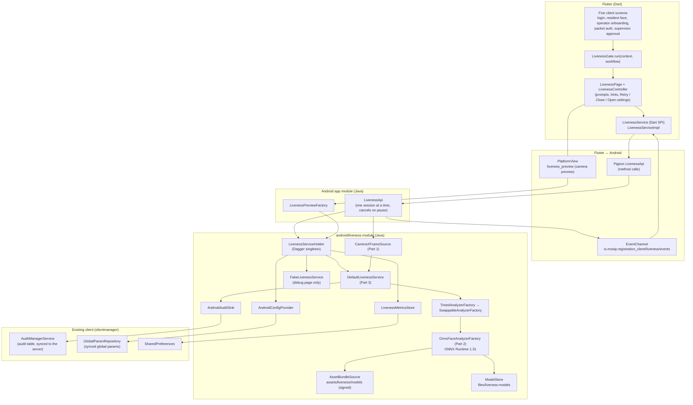
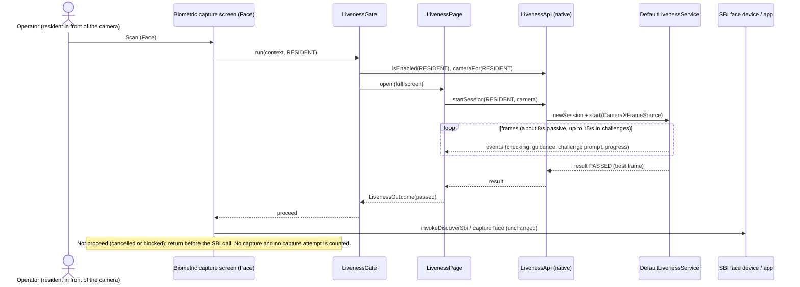
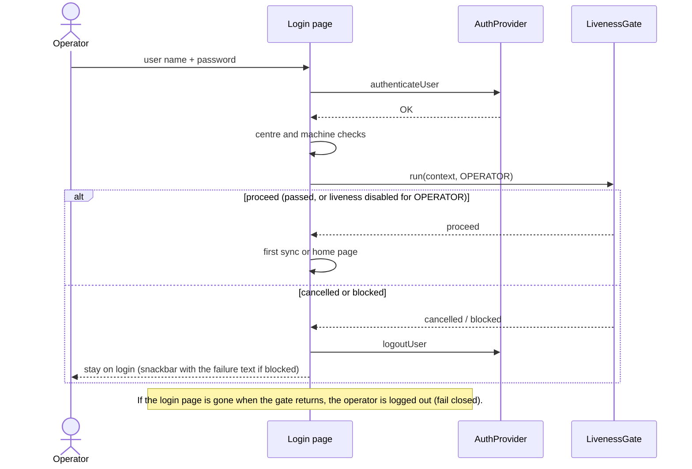
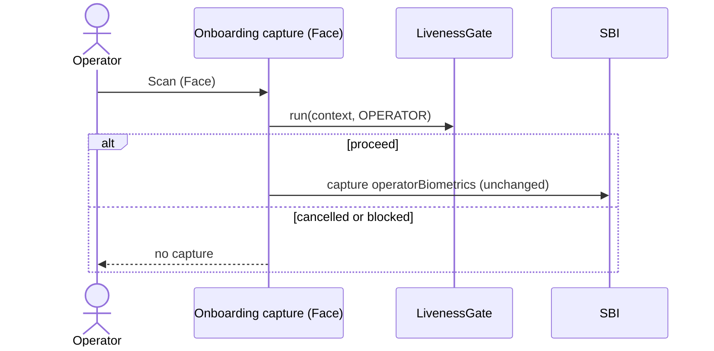
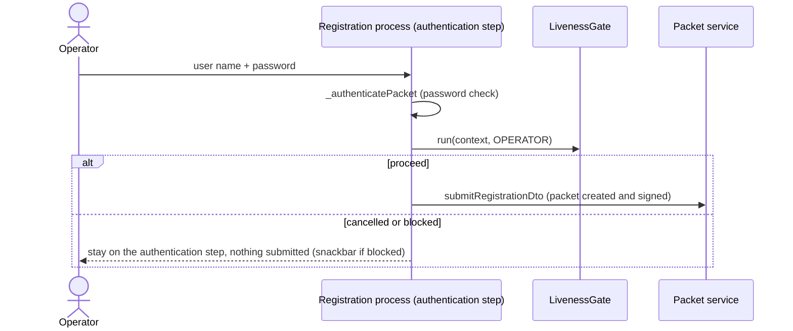
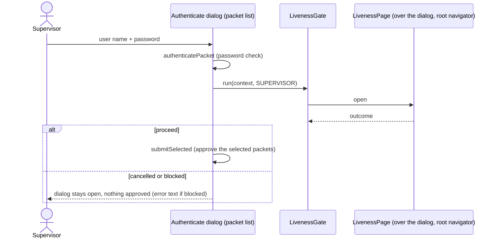
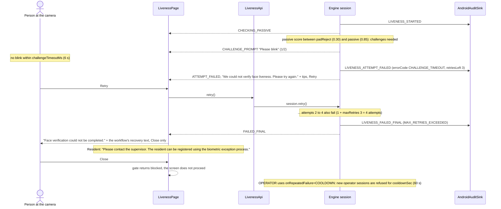
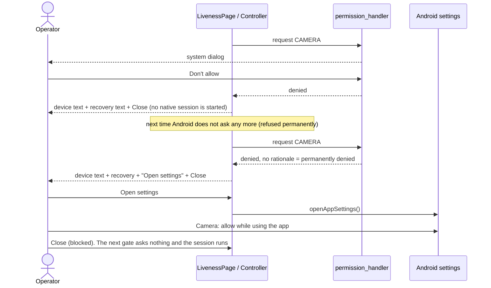
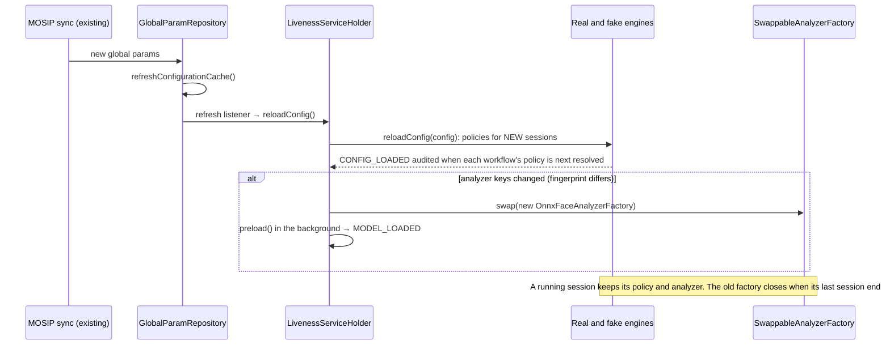

# Part 5: face liveness in the MOSIP Android Registration Client

Person 5. This document is for:
- Person 4 (the Desktop integration);
- reviewers of the MOSIP Android client;
- the judges.

It explains what was added to the Android Registration Client, how the parts talk to each other,
how it is configured, audited and secured, and how it was built and tested.

The patches and the apply steps are in [`android-integration/`](../android-integration/README.md).
The phone measurements are in [`part5-android-benchmark.md`](part5-android-benchmark.md).

## 1. Overview

Before each of the five face checks of the client, the operator's tablet or phone now runs a
**face liveness check**. A check is a short session on the device camera that decides whether a
live person is in front of it:
- **resident face capture:** before the face is captured through the SBI;
- **operator login:** after the password;
- **operator onboarding:** before the operator's face is captured;
- **packet authentication:** when the operator signs a registration packet;
- **supervisor approval:** when the supervisor approves packets.

The check is a **passive** look at a few frames. Only when that is not conclusive does it ask for
one or two **challenges** (blink, smile, turn the head).

| part of the work | where it comes from | what runs on Android |
|---|---|---|
| Part 1: frames | `android-liveness-frame-source/` (Mosip26) | `CameraXFrameSource`: CameraX analysis stream, YUV to RGB, rotation, frame pacing (15 frames/s), dim-face exposure assist |
| Part 2: per-frame analysis | `liveness-analyzer/`, `models/` (Mosip26) | `OnnxFaceAnalyzerFactory`: YuNet face detection, FaceMesh V2 landmarks and pose, quality checks, MiniFASNet presentation attack detection (PAD), on ONNX Runtime; signed model bundle |
| Part 3: the session | `liveness-core/`, `liveness-fake/` (Mosip26) | `DefaultLivenessService`: passive decision, challenges, retries, timeouts, cooldown, policy, audit; `FakeLivenessService` for testing |
| Part 5: the integration | `android-integration/` patches against the client v1.1.1 | the native module, the Flutter bridge, the screen, the gate, the five hooks, audit, config, metrics, diagnostics |

The engine is the same pure-Java code as on the Desktop, compiled into four jars
(`liveness-api`, `-core`, `-fake`, `-analyzer`). The client gets it through `sync-engine.ps1`.

## 2. Architecture



| component | file in the client | job |
|---|---|---|
| `LivenessGate` | `lib/ui/liveness/liveness_gate.dart` | the one call every screen makes. Skips the page when liveness is disabled for the workflow, opens `LivenessPage` on the root navigator (it also works from a dialog) and maps the outcome to proceed, cancelled or blocked. Fails closed on any error |
| `LivenessPage`, `LivenessController` | `lib/ui/liveness/` | the check screen of the shared UI spec (`docs/ui-liveness-spec.md`): preview, big prompt, hints, Retry, Close, Open settings. Shows only the user message texts, never scores |
| `LivenessService` | `lib/platform_spi/`, `lib/platform_android/` | Dart interface to the bridge; asks for the camera permission |
| `LivenessApi` (Java) | `android/app/.../api_services/LivenessApi.java` | Pigeon host API, event sink, camera source per session; cancels the session when the Activity pauses |
| `LivenessServiceHolder` | `android/liveness/.../LivenessServiceHolder.java` | builds the real and fake engines, the analyzer (bundled or installed models), config with debug overrides, and the reload after a sync; preloads the models at app start; model update and metrics |
| `AndroidAuditSink` | same module | engine audit events to the client's audit table (REG-EVT-009..017) |
| `AndroidConfigProvider` | same module | reads the engine's keys from the synced global params |
| `LivenessMetricsStore` | same module | anonymised counters kept across restarts |
| `CameraXFrameSource` | same module (synced from Part 1) | CameraX frames for the engine, and the preview |

**Pigeon `LivenessApi` methods:**
- **Used by the screens:**
  - `isEnabled`, `policy`, `startSession` (asynchronous), `retry`, `cancel`, `cameraFor`;
  - `modelVersion`, `reloadConfig`, `metrics`, `modelStoreStatus`.
- **Diagnostics builds only:** `setConfigOverride`, `resetMetrics`, `runBenchmark`,
  `installModelBundle`, `rollbackModelBundle`.
- **What the event channel carries:** each session's events (prompts, progress, guidance, attempt
  failures), then its result (decision, pass path, user message, attempts, duration, model
  version and, on PASSED, the best frame as JPEG bytes for the caller).

## 3. Sequences

All five hooks call the same gate, so they share one session sequence. The diagrams below show
first what each screen does around the gate (a to e), then the session itself, failures and
permissions (f, g), and the background paths (h, i).

### (a) Resident face capture: liveness before the SBI capture



The same gate runs in the landscape layout of this screen (Scan and Rescan). Without that, a
rotated tablet would skip liveness.

### (b) Operator login: after the password



### (c) Operator onboarding: the operator's own face



### (d) Packet authentication: the operator signs the packet



### (e) Supervisor approval



### (f) A failure path: retry, then the maximum number of attempts, then recovery



A presentation attack (PAD score below 0.30) fails the attempt with PAD_FAILURE and
PAD_ATTACK_SUSPECTED is audited. The screen shows the generic text with no tips, so nothing
tells an attacker what to improve.

### (g) Camera permission refused, then Open settings



### (h) Config reload after a sync



### (i) Model update: install, verify, reload; and rollback

The automatic download is a design only (section 4). Today the bundle is staged with `adb push`
and installed from the debug page. A production worker would call the same holder method.

```mermaid
sequenceDiagram
  participant D as Debug page (later: ModelUpdateWorker)
  participant Api as LivenessApi
  participant H as LivenessServiceHolder
  participant VB as VerifiedBundle + TrustedKeys
  participant MS as ModelStore (files/liveness-models)
  participant AF as SwappableAnalyzerFactory
  D->>Api: installModelBundle()
  Api->>H: installModelBundle(files/bundle-staging) [background thread]
  H->>VB: load(staged): signature, sizes, SHA-256
  alt does not verify
    VB-->>D: MODEL_INTEGRITY_FAILED, store untouched
  else verified
    H->>MS: install(staged, bundled assets)
    MS->>MS: verify both; staged newer than the bundled version? (else "not newer", refused)
    opt store empty, or its current version older than the bundled one
      MS->>MS: install the bundled assets as the rollback base, remove older bundles
    end
    MS->>MS: newer than current? (else "not newer", refused)<br/>write tmp + fsync, rename, re-verify from disk, switch "current"
    H->>AF: swap(new factory)
    H->>H: preload() → verifies again, builds sessions, MODEL_LOADED
    Api-->>D: installed version, which the next session reports
  end
  D->>Api: rollbackModelBundle()
  Api->>H: rollbackModelBundle()
  H->>MS: rollback(): previous installed bundle (verified) becomes current
  H->>AF: swap + preload
```

The factory always uses the newer of the bundled and installed bundles, and verifies the one it
uses. An installed bundle that is newer but fails verification fails closed: MODEL_INTEGRITY_FAILED,
with no fallback to unverified files. An installed bundle that is not newer is not read. After the
app update to five models (F1), the phone's store still held the four-model `pad-2026.10.1` from
the P5-5 install test. Before this rule that bundle failed verification and blocked the real engine.
Since fix round 2 the next install seeds the bundled `pad-2026.10.4` as the rollback base and removes
the older bundles, so a rollback lands on the bundled version.

## 4. Online and offline

| function | needs the network? |
|---|---|
| liveness sessions, model loading, decisions | **no**: everything runs on the device |
| liveness config (`mosip.registration.liveness.*`) | only through the client's existing sync; the last synced values are used offline, and missing keys use the engine's bundled defaults |
| audit records | written locally; uploaded later by the client's existing audit sync |
| persisted metrics | local only; never uploaded |
| model updates | today offline (`adb push`, debug builds). The automatic download is a **design only**, described below |

**ModelUpdateWorker (design, not built).**
- A WorkManager job that runs only when the network is connected. It reads the URL from
  `mosip.registration.liveness.model.update.url`.
- It downloads `manifest.json`, `manifest.sig` and the model files into a private staging
  folder, capped at the per-file size limit.
- It calls `installModelBundle` (verify, install, reload). A failure leaves the current bundle in
  place and is audited.
- It retries with backoff.

**Airplane mode evidence (P5-5).** With airplane mode on and Wi-Fi off:
- the app cold-started and verified and loaded the models in 259 ms;
- a real resident gate passed, and a fake gate finished as scripted;
- the liveness logs contain no network errors.

**ONNX Runtime telemetry.** The ONNX Runtime package for Android brought a telemetry component
that would start a telemetry HTTP client at app start. It is removed from the app, and the
analyzer also switches ONNX Runtime's telemetry off (section 8).

## 5. Configuration

All keys come from the client's **synced global params** through `AndroidConfigProvider`; an empty
value counts as absent.
- **Precedence:** debug overrides (diagnostics builds only, kept in memory) come first, then the
  synced value, then the engine's bundled defaults (`liveness-api/.../liveness-default.properties`),
  then the defaults in the code.
- **When changes apply:** to new sessions, after the next sync (section 3h).

### Policy keys (read by the engine, Part 3)

Full key: `mosip.registration.liveness.face.<default|resident|operator|supervisor>.<field>`.

**How a value is resolved.** The order is:
1. the synced `<workflow>` key;
2. the bundled `<workflow>` key;
3. the synced `default` key;
4. the bundled `default` key;
5. the default in the code.

A bundled per-workflow value therefore beats a synced `default` value. To change OPERATOR's
`minChallenges` or `onRepeatedFailure`, set the `operator.` key itself. An invalid policy falls
back to the bundled defaults as a whole, and the error is audited in CONFIG_LOADED (`configError`).

| field | default | per-workflow bundled value | meaning |
|---|---|---|---|
| `enabled` | true | | false: no check runs; the gate proceeds and reports "disabled" |
| `passiveThreshold` | 0.85 | | passive median at or above this passes with no challenge |
| `padRejectThreshold` | 0.30 | | median below this is a presentation attack (PAD_FAILURE), no challenge offered |
| `passiveWindowFrames` | 10 | | usable frames aggregated for the passive decision |
| `passiveTimeoutMs` | 8000 | | no usable window in this time: FACE_NOT_DETECTED or POOR_QUALITY |
| `activeEnabled` | true | | false: scores between the thresholds fail instead of challenging |
| `challengeTypes` | BLINK,SMILE,TURN_LEFT,TURN_RIGHT | | pool to draw from (also LOOK_UP, LOOK_DOWN) |
| `minChallenges` | 2 | operator 1, supervisor 1 | challenges per active attempt |
| `challengeTimeoutMs` | 6000 | | per challenge |
| `maxRetries` | 3 | | attempts = 1 + maxRetries |
| `onRepeatedFailure` | BLOCK | operator COOLDOWN | BLOCK: recovery text; COOLDOWN: also refuse new sessions for `cooldownSec` |
| `cooldownSec` | 60 | | cooldown length |
| `diagnosticMode` | false | | adds `diag.*` keys to audit records only, never to the screen |
| `analyzeFps` | 8 | | frames analysed per second in the passive phase |

### Analyzer keys (Part 2)

Prefix `mosip.registration.liveness.face.analyzer.`. They are read when a new analyzer is built:
at start-up, and after a sync that changes them.

| key | default | where the default is set |
|---|---|---|
| `intraOpThreads` | **2** | Android: `LivenessServiceHolder.ANDROID_ANALYZER_DEFAULTS` (benchmark; the analyzer's own default is also 2) |
| `accelerator` | **CPU** (or XNNPACK, NNAPI) | Android: `ANDROID_ANALYZER_DEFAULTS`; an unavailable provider falls back to CPU |
| `detectorMaxWidth`, `detectorScoreThreshold`, `detectorNmsIou`, `detectorSecondFaceMinAreaRatio` | 320, 0.7, 0.3, 0.2 | `AnalyzerConfig` |
| `meshPresenceThreshold`, `meshRoiScale`, `pitchBiasDeg` | 0.5, 1.5, from the signed bundle (−9.5) | `AnalyzerConfig`, model bundle |
| `padMaxYawDeg`, `padMaxPitchDeg` | 30, 25 | `AnalyzerConfig` |
| `tooDarkLuma`, `tooBrightLuma`, `blurLapVar`, `minAreaFrac`, `minFaceWidthPx`, `maxAreaFrac`, `maxCentreOffset`, `qualityMaxClippedFraction` | 40, 220, 15, 0.04, 80, 0.60, 0.25, 0.30 | `AnalyzerConfig` |
| `moireCapThreshold`, `moireCapScore`, `moireWindow`, `moireMinFrames`, `moireVetoThreshold` | 1.40, 0.60, 10, 3, off | `AnalyzerConfig` |

An invalid analyzer config is logged, and the Android defaults are used instead.

### Android keys (Part 5)

| key | default | meaning |
|---|---|---|
| `mosip.registration.liveness.face.android.<resident\|operator\|supervisor>.camera` | front | `back` uses the back camera for that workflow |
| `mosip.registration.liveness.face.android.exposureAssist` | true | `false` turns the dim-face exposure assist off |

### Test keys (debug page only)

| key | default | meaning |
|---|---|---|
| `mosip.registration.liveness.fake.scenario` | PASS_ACTIVE | the fake engine's script (PASS_PASSIVE, PAD_ATTACK, CHALLENGE_TIMEOUT, ...) |
| `liveness.fake.timeScale` (override only) | 1 | slows the fake engine down, for screenshots |

The fake engine is reachable only from the debug page. The five screens always use the real
engine.

## 6. Audit events

`AndroidAuditSink` writes each engine event to the client's audit table through
`AuditManagerService`, on a background thread. A failure is logged and never reaches the engine.

**How a record is written.**
- **Description:** "<event description>: sessionId=…;key=value;…". A `;` or `=` inside a value is
  replaced so the text stays parseable, and the whole is cut to the server's 2048-character limit.
- **Module:** RESIDENT records go to REGISTRATION, OPERATOR to LOGIN, SUPERVISOR to
  REG_PACKET_LIST, and records without a workflow (model loading at app start) to HOME.

| id | event | type | when | details keys |
|---|---|---|---|---|
| REG-EVT-009 | LIVENESS_STARTED | user | each attempt starts | engine, attempt, modelVersion, deviceId, deviceCertification |
| REG-EVT-010 | LIVENESS_PASSED | user | session passed | the above + passiveOutcome, passiveScore, passiveFrames, passiveMs, challenges (`TYPE:OUTCOME:ms`), attemptMs, durationMs, framesAnalyzed, framesDropped, avgProcessingMs, passPath, bestFrame.iso19794_5, bestFrame.fallback, bestFrame.isoIssues, bestFrame.yawDeg/pitchDeg/rollDeg, bestFrame.eyeDistancePx |
| REG-EVT-011 | LIVENESS_ATTEMPT_FAILED | user | an attempt failed, retries left | attempt keys + errorCode, retriesLeft, reason |
| REG-EVT-012 | LIVENESS_FAILED_FINAL | user | final failure, cancel, or refused by cooldown | final keys + errorCode, lastCause, cooldownSec; cancel: errorCode CANCELLED, cancelled; cooldown: reason cooldown, cooldownRemainingMs |
| REG-EVT-013 | LIVENESS_PAD_ATTACK_SUSPECTED | system | presentation attack suspected | attempt keys + errorCode PAD_FAILURE, passiveScore, reason, up to 8 `pad.<model>` medians |
| REG-EVT-014 | LIVENESS_DEVICE_ERROR | system | camera error | attempt keys + errorCode, recoverable, deviceDetail |
| REG-EVT-015 | LIVENESS_MODEL_LOADED | system | models loaded (app start, after a sync or an update; also per session in the engine) | Android: modelVersion, loadMs, accelerator; engine: base keys |
| REG-EVT-016 | LIVENESS_MODEL_INTEGRITY_FAILED | system | the bundle did not verify, or the analyzer could not be built | errorCode, reason (engine) or phase=preload (Android) |
| REG-EVT-017 | LIVENESS_CONFIG_LOADED | system | a workflow's policy is resolved after start or reload | engine, policy (one-line summary of all policy fields), configError |

**No images.**
- No audit record contains an image, pixels, landmarks or a face template.
- The best frame is reduced to an ISO status, issue names, rounded angles and the eye distance.
- The free-text fields (`reason`, `deviceDetail`, `configError`) are cut to 120 characters.
- The best-frame JPEG goes only back to the calling screen, in memory.

## 7. Metrics

`LivenessMetricsStore` keeps the real engine's counters in SharedPreferences
(`liveness_metrics`) across restarts. After each session it adds what changed since the last
merge.

It stores counts and totals only. It stores no session ids, timestamps, individual scores or
images. Fake-engine sessions are not counted. Pigeon `metrics()` returns the counters and the
derived values; the debug page shows them and has a Reset button.

| counter | meaning |
|---|---|
| sessions | sessions started |
| passedPassive / passedActive | passed without / after challenges |
| failedFinal | sessions that ended FAILED (not cancelled) |
| cancelled | sessions cancelled (Close, back, app paused) |
| cooldownRefusals | sessions refused by an operator cooldown |
| retries | Retry pressed |
| attemptFailures, attemptFailure.<code> | failed attempts, by error code |
| finalFailure.<code> | final failures, by error code |
| deviceErrors | camera errors |
| framesAnalyzed, processingMsTotal | for the average analysis time per frame |
| challengesDetected, challengeMsTotal, challengesFailed | for the average time to complete a challenge |

**Derived values:**
- avg processing ms = processingMsTotal / framesAnalyzed
- avg challenge completion ms = challengeMsTotal / challengesDetected
- retry rate = retries / sessions
- failure rate = failedFinal / sessions
- passive share = passedPassive / all passes

## 8. Security and privacy

- **Signed models, fail closed.**
  - The four models ship as a bundle signed with ECDSA P-256 (`manifest.json`, `manifest.sig`).
  - At start-up and on every install, the signature is checked against a key compiled into the
    app, and so are every size and SHA-256, before anything is parsed. A failure gives
    MODEL_INTEGRITY_FAILED, and there is no fallback to unverified files.
  - Installed updates must be strictly newer (anti-rollback). Rollback is an explicit operator
    action.
  - The current key is a **development key** and must be replaced before release.
- **No images anywhere they could leak.**
  - Camera frames stay in memory and are dropped after the session.
  - Logs, audit records and metrics contain codes, scores, versions and timings only.
  - The best frame goes back to the calling screen in memory. It is never logged, and no screen
    renders it: the debug page shows only its size.
- **Diagnostics only in debug and profile builds.** `BuildConfig.LIVENESS_DIAGNOSTICS` is false in
  release. That switches off the debug page and its login-page button, config overrides,
  detailed logs, the benchmark, and model install and rollback. The native methods refuse those
  calls.
- **No telemetry.**
  - ONNX Runtime's `TelemetryInitializer` provider is removed from the merged manifest.
  - The analyzer calls `OrtEnvironment.setTelemetry(false)` once.
  - Nothing in the liveness code opens a network connection.
- **The camera is released.**
  - A session holds the camera only while it runs. Cancel, back, the end of the session, or the
    Activity pausing stops it.
  - This was verified on the device through camera service CONNECT and DISCONNECT entries.
  - The fake engine does not open the camera at all.
- **Fails closed.**
  - The gate treats any error as blocked (ENGINE_ERROR).
  - The login page logs the operator out if the check does not proceed.
  - A refused camera permission blocks the check.
- **Presentation attacks get no hints.** A PAD failure shows the generic text, never the reason.

## 9. Build and run

The exact steps are in [`android-integration/README.md`](../android-integration/README.md). In
short:

| step | what |
|---|---|
| toolchain | git; JDK 11 + Maven 3.9.9 (engine); JDK 21, Android SDK 34 (build-tools 34.0.0), Flutter 3.10.4 (app) |
| apply | clone `v1.1.1`, then `git am` the 26 patches (or `git apply` the one diff) |
| sync | `android-integration/scripts/sync-engine.ps1 -Clone <client>`: engine jars, signed models, camera source, and `engine-sync.txt` with commit and SHA-256 |
| generate | `pigeon.sh` (Git Bash), then restore `ios/Runner/pigeon.h/.m` |
| build | `flutter build apk --debug` (diagnostics); `--profile --target-platform android-arm64` (timings; not debuggable); `--release` (no diagnostics) |
| or all at once | `android-integration/scripts/apply-integration.ps1 -Target <new folder> -BuildApk` |

**APK size and ABIs.**
- The arm64 profile APK is 256 MiB, and ONNX Runtime for four ABIs is 134 MiB of it.
- `--target-platform` does not drop ONNX Runtime's other ABIs, and the release build lists all
  four in `abiFilters`.
- Ship per ABI (an App Bundle, or APK splits): about 145 MiB for arm64.

**Phone setup (Samsung, Android 16).**
1. Turn off Auto Blocker.
2. If Play Protect warns "built for an older version of Android" (upstream targetSdk 33), tap
   More details → Install anyway.
3. USB debugging must be allowed again after changing security settings.
4. Install with `adb install -r --user 0`.

**Debug page (debug and profile builds).** Open it from the Login page: **Liveness test**, top
right. It offers:
- sessions with the real or fake engine, workflow and camera, force challenges, one challenge
  type only, and the exposure assist switch;
- the "Hook gates" buttons, which call `LivenessGate.run` exactly as the five screens do;
- Benchmark, the Metrics card, and the Model bundle card (install, rollback);
- a placeholder preview for documentation screenshots.

It shows scores and model versions, but never camera images other than the live preview.

## 10. Testing

### Automated

| suite | tests | covers |
|---|---|---|
| `android/liveness` module (JVM) | **73**, all passing | audit sink (10), config provider (4), asset bundle source (6), event and result maps (9), holder config, reload, Android defaults, exposure key, bundle install refusal (12), swappable factory (3), timing (2), metrics store (5), benchmark bookkeeping (6), CameraX YUV conversion and rotation (4), frame pacing (5), exposure assist (7) |
| Flutter `test/liveness` | **56**, all passing | controller (36), page (11), gate (9): prompts, guidance timing, errors and recovery texts, permission paths, outcome mapping, fail closed, root navigator from a dialog |
| clientmanager `GlobalParamRepositoryRefreshListenerTest` | **3**, all passing | refresh listeners run after a successful refresh only |
| engine (Mosip26) | api 5, core 227, fake 44, tools 12, analyzer 191, eval 32 | Parts 1 to 3; see their documents |

**Upstream test failures (not ours).** `:clientmanager:testDebugUnitTest` has **14 failing tests
in upstream v1.1.1**:
- 9 in `Biometrics095ServiceTest`;
- 2 in `RegistrationServiceImplTest` (GPS);
- 3 in `UserOnboardServiceTest`, only in the full run.

They fail identically on the baseline (v1.1.1 plus the build fix, `f591f41`) before any liveness
change.

### On a phone

Samsung Galaxy S23 FE, Android 16, single tester. These are aggregates from one subject:
provisional.

| phase | what was checked | result |
|---|---|---|
| P5-2 | fake engine, resident | passed after the blink and smile challenges, 8.6 s |
| P5-2 | real engine, resident | passed passively, score 0.9996, 2.3 s |
| P5-2 | forced challenges | passed after challenges (a missed prompt led to the big prompt banner); blink only passed first try |
| P5-2 | face photo on a laptop screen, back camera | rejected on all 4 attempts (PAD), FAILED MAX_RETRIES_EXCEEDED |
| P5-2 | operator, forced | exactly one challenge, passed |
| P5-3 | LivenessPage: real face, forced challenges | passed passively (0.895); passed after BLINK + TURN_RIGHT |
| P5-3 | screen photo attack, twice | rejected on all 4 attempts each time, final screen with recovery text |
| P5-3 | Cancel and back during challenges | CANCELLED; camera released each time (camera service log) |
| P5-4 | five hook gates, real engine | all proceed (scores 0.994 to 0.9998) |
| P5-4 | operator liveness disabled by config | proceed (disabled), no page, no session |
| P5-4 | fake engine | no camera opened |
| P5-4 | camera permission refused permanently | Open settings shown; after granting, the next gate passed (0.9944) |
| P5-5 | benchmark, profile build | CPU, 2 threads: 26.6 ms per frame p50; accelerators exact parity, slower |
| P5-5 | dark room, exposure assist off / on | off: "improve the lighting", attempt failed, cancelled; on: exposure raised in about 4 s, passed passively |
| P5-5 | model update cases a to e | install, "not newer", tampered refused, rollback, persistence: all as designed |
| P5-5 | airplane mode | cold start, real and fake gates passed, no network errors |
| P5-6 | fresh clone of v1.1.1 + patches + sync | tree identical to the integration branch; tests passing; fake and real gates passed |

## 11. Limitations and backlog

- **No MOSIP backend in this setup.** The app stops at the Login page, so the five hooks were
  verified in three ways:
  - through `LivenessGate` from the debug page's "Hook gates" buttons (the same call the screens
    make);
  - by the gate's widget tests;
  - by code review of each call site.

  They were not run end to end inside the real screens.
- **One device.** Only a mid-to-high-end phone was tested. See the low-end notes in the
  benchmark document.
- **Model download.** The `ModelUpdateWorker` is a design only. Updates are installed from the
  debug page.
- **Translations.** The 44 liveness strings exist in English (`app_en.arb`). The other languages
  fall back to English until translated.
- **APK size.** ONNX Runtime ships for four ABIs; distribute per ABI. A reduced ONNX Runtime build
  with only the needed operators (F10) is in the backlog.
- **INT8 models.** Evaluated and rejected: slower and less accurate (`models/README.md`).
- **Attack coverage.** Tested so far: screen photos and replays on a laptop. Printed photos and
  masks are not tested yet.
- **Signing key.** The model bundle is signed with a development key; replace it before release.
- **Review findings (F-items) handled for Android.**
  - Done: F8 (dim faces, exposure assist) and F12 (permanently refused permission).
  - Backlog: F10 (ONNX Runtime size).
  - The other F-items are in the fix phase that follows Person 5.
