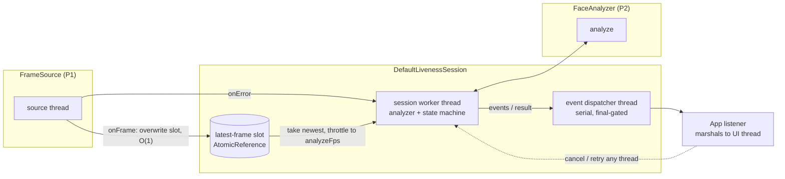
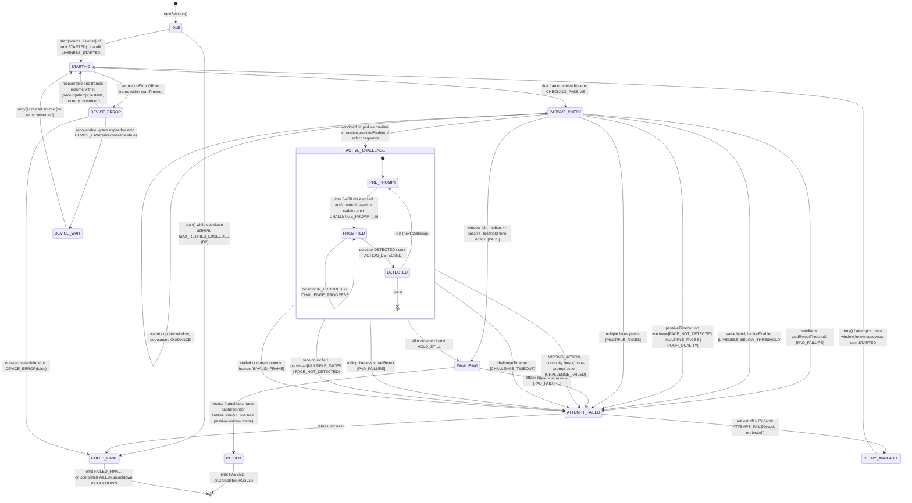

# liveness-core design (Person 3)

Status: **Phase 0 design + Phase 1 (FakeLivenessService) done.** Decisions in section 9. Covers the session engine, the passive-to-active decision, the active challenges, retries, errors and audit. Diagrams and sections marked *(Phase 9)* are finished later.

Source of truth: `liveness-api` (package `io.mosip.registration.liveness.api`) and `liveness-default.properties`. Where this doc and the contract disagree, the contract wins. Section 8 lists every place where the Person 3 brief and the contract differ.

---

## 1. Contract surface

### 1.1 Types I implement

| Type | Members I implement / honour |
|---|---|
| `LivenessService` | `LivenessSession newSession(WorkflowType)`: returns `null` when `policy.enabled == false`. `LivenessPolicy policy(WorkflowType)`. `void reloadConfig(ConfigProvider)`: running sessions keep the policy snapshot they took in `newSession`. |
| `LivenessSession` | `void start(FrameSource, LivenessListener)`, `void retry()` ("only valid after ATTEMPT_FAILED; ignored if no retries left"), `void cancel()` ("emits onComplete(CANCELLED), stops the source"), `String sessionId()` (UUID). |
| `LivenessPolicy` | **Already implemented in the contract**, including `load(ConfigProvider, WorkflowType)` and `validate()`. Core does **not** duplicate the loader. It only wraps it (see 1.3). Fields: `enabled, passiveThreshold, padRejectThreshold, passiveWindowFrames, passiveTimeoutMs, activeEnabled, challengePool, minChallenges, challengeTimeoutMs, maxRetries, onRepeatedFailure {BLOCK, COOLDOWN}, cooldownSec, diagnosticMode, analyzeFps`. |

### 1.2 Types I produce or consume

| Type | What I use |
|---|---|
| `LivenessListener` | `onEvent(LivenessEvent)`; `onComplete(LivenessResult)`: "called exactly once per session". |
| `LivenessEvent` | Factories only (the constructor is private): `of(Type, attempt)`, `guidance(Guidance, attempt)`, `prompt(ChallengeType, index, count, timeoutMs, attempt)`, `progress(ChallengeType, index, count, p, attempt)`, `failure(Type, ErrorCode, attempt, retriesLeft, recoverable)`. `Type` = `STARTED, CHECKING_PASSIVE, GUIDANCE, CHALLENGE_PROMPT, CHALLENGE_PROGRESS, ACTION_DETECTED, HOLD_STILL, ATTEMPT_FAILED, PASSED, FAILED_FINAL, DEVICE_ERROR`. `Guidance` = `NO_FACE, MULTIPLE_FACES, MOVE_CLOSER, MOVE_BACK, CENTER_FACE, IMPROVE_LIGHTING, HOLD_STEADY, LOOK_AT_CAMERA`. |
| `LivenessResult` | `new LivenessResult(Decision {PASSED, FAILED, CANCELLED}, PassPath {PASSIVE_ONLY, ACTIVE_CHALLENGE, NONE}, ErrorCode failureCode /*null when PASSED*/, Frame bestFrame, float passiveScore /*median*/, List<ChallengeType> challengesIssued, int attempts, long durationMs, String sessionId, String modelVersion)`. |
| `FrameSource` (P1) | `info()` → `FrameSource.DeviceInfo` (nested class: `deviceId, vendor, model, sbiVersion, certificationLevel, maxWidth, maxHeight, maxFps`); `start(Listener)` (non-blocking, never throws); `stop()` (idempotent); `isRunning()`. `Listener.onFrame(Frame)` runs on the source thread and must return quickly. `Listener.onError(ErrorCode, String detailForAuditOnly, boolean recoverable)`. |
| `Frame` (P1) | `timestampMs()` (monotonic), `sequence()` (strictly increasing, gaps mean drops), `deviceId()`, `width()/height()`. `rgb()` is **never** read by core except to hand the frame through as `bestFrame`. |
| `FaceAnalyzer` (P2) | `FrameAnalysis analyze(Frame) throws LivenessEngineException`, `String modelVersion()`, `close()`. **Not thread-safe, one instance per session, called only from the session worker thread.** |
| `FrameAnalysis` (P2) | `frame, faceCount, faceBox[x,y,w,h], landmarks, yawDeg, pitchDeg, rollDeg` (**+yaw = subject turned to THEIR left**), `qualityIssues` (`TOO_DARK, TOO_BRIGHT, BLURRY, FACE_TOO_SMALL, FACE_TOO_LARGE, FACE_OFF_CENTER, FACE_CUT_OFF`), `livenessScore` (0..1, **NaN if not computed**), `padDetails` (audit only), `processingMs`, `usable()` (= exactly one face and no quality issues). |
| `FaceLandmarks` (P2) | `leftEye[6][2]`, `rightEye[6][2]` (subject's left/right, EAR order p1..p6), `mouthLeft, mouthRight, mouthUpperInner, mouthLowerInner, noseTip, chin`, `leftIris, rightIris` (may be null). Pixel coordinates. **Used only inside detectors, never audited or logged.** |
| `ConfigProvider` (P4/P5) | `String get(String key)`, null when absent. |
| `AuditSink` (P4/P5) | `record(AuditSink.Event, WorkflowType, String sessionId, Map<String,String> details)`. Events: `LIVENESS_STARTED, LIVENESS_PASSED, LIVENESS_ATTEMPT_FAILED, LIVENESS_FAILED_FINAL, PAD_ATTACK_SUSPECTED, DEVICE_ERROR, MODEL_LOADED, MODEL_INTEGRITY_FAILED, CONFIG_LOADED`. |
| `ErrorCode` | 16 values plus `userMessage()` → `UserMessage {NONE, LIVENESS_NOT_VERIFIED, VERIFICATION_NOT_COMPLETED, MAX_ATTEMPTS_REACHED, DEVICE_PROBLEM}`. PAD_FAILURE already maps to the generic `VERIFICATION_NOT_COMPLETED`. |
| `LivenessEngineException` | `code()`. Thrown by the analyzer. Core catches it and never passes it to the listener. |
| `WorkflowType`, `ChallengeType` | `RESIDENT, OPERATOR, SUPERVISOR`; `BLINK, SMILE, TURN_LEFT, TURN_RIGHT, LOOK_UP, LOOK_DOWN`. |

### 1.3 Effective defaults (from `liveness-default.properties`)

| Field | default | operator | supervisor |
|---|---|---|---|
| passiveThreshold / padRejectThreshold | 0.85 / 0.30 | same | same |
| passiveWindowFrames / passiveTimeoutMs | 10 / 8000 | same | same |
| challengeTypes | BLINK, SMILE, TURN_LEFT, TURN_RIGHT | same | same |
| minChallenges | 2 | **1** | **1** |
| challengeTimeoutMs / maxRetries | 6000 / 3 (so 4 attempts) | same | same |
| onRepeatedFailure / cooldownSec | BLOCK / 60 | **COOLDOWN** / 60 | BLOCK / 60 |
| analyzeFps | 8 | same | same |

**Important:** `LivenessPolicy.load` falls back to *hard-coded* defaults, not to this file. If an app forgets to merge the file into its config, operators silently get 2 challenges and no cooldown. Core fixes this without a contract change: `PolicyResolver` wraps the host `ConfigProvider` in a `LayeredConfigProvider(host → classpath liveness-default.properties)` before calling `LivenessPolicy.load`. Because the contract loader checks the workflow key before the default key for each field, the effective order is: host workflow → bundled workflow → host default → bundled default → hard-coded. That is exactly the result of merging the file into the host config, as the file itself instructs. `PolicyResolver.validateExtra` then runs on top of `validate()` (D5).

---

## 2. Runtime architecture and threading

- **Source thread.** `onFrame` only overwrites the single latest-frame slot and counts drops. It never blocks and never queues.
- **Worker thread** (one per session, a daemon thread named `liveness-<sessionId8>`). It takes the newest frame, throttles to `analyzeFps`, calls `analyzer.analyze` exactly once per frame it takes, and feeds `SessionStateMachine`. It polls with a 50 ms timed wait, so timeouts fire even when no frames arrive. The analyzer is created, used and `close()`d only on this thread.
- **Dispatcher thread** (`EventDispatcher`: one per session, a plain thread plus a `LinkedBlockingQueue`). It delivers `onEvent` and `onComplete` in order. A slow listener therefore never stalls analysis. The first `complete()` wins a compare-and-set, and every later event or result is dropped. The thread exits after `onComplete`. It is deliberately *not* an `ExecutorService`: a `ThreadPoolExecutor` shut down while its first worker is starting can strand the queued final task, which a regression test caught. **The session enters RETRY_AVAILABLE before emitting ATTEMPT_FAILED**, so a `retry()` called from inside that callback is never lost. This gives **exactly one `onComplete` per session, with no events after it**.
- **Callback thread (documented for P4/P5):** every callback runs on the session's dispatcher thread, never on the UI thread and never on the camera thread. Apps must use `Platform.runLater` or post to the Flutter main isolate. Listeners may call `retry()` and `cancel()` from inside a callback, because both only enqueue.
- **`cancel()`** can be called from any thread and is idempotent. It enqueues onComplete(CANCELLED) through the same compare-and-set, signals the worker, and the worker then stops the source and closes the analyzer. If it is called after `onComplete`, it does nothing.
- **`SessionStateMachine`** is pure: `Transition next(State, Input)` → `(State, List<Effect>)`. It has no threads, no clock reads and no I/O. Inputs are `FrameAnalyzed`, `Tick(nowMs)`, `SourceError`, `SourceFrameResumed`, `RetryRequested`, `CancelRequested` and `AnalyzerFailed`. Effects are `Emit(event)`, `Complete(result)`, `Audit(...)`, `StopSource`, `RestartSource` and `ResetDetectors`.
- **Injected** `TimeSource` (monotonic ms) and `RandomSource` (`SecureRandom` in production, seeded in tests). No `Thread.sleep` in tests: the worker loop can be stepped by hand.

---

## 3. Session state machine

Every non-terminal state also has this transition (left out of the diagram for clarity):
- `cancel()` → **CANCELLED**: `onComplete(CANCELLED, failureCode=CANCELLED)`, stop the source and close the analyzer. There is no `CANCELLED` event type, so the result is the only signal.
- An analyzer failure (`LivenessEngineException` or `RuntimeException`) is handled as in section 4 (`ENGINE_ERROR` / `MODEL_INTEGRITY_FAILED`).

Invariants that will be tested, and fuzzed in Phase 7:
1. PASSED is reachable only through `PASSIVE_CHECK[PASS]` or `ACTIVE_CHALLENGE[all n DETECTED]`, followed by FINALISING.
2. The attack check (rolling median < `padRejectThreshold`) runs on every analysed frame in PASSIVE_CHECK, ACTIVE_CHALLENGE and FINALISING. Any hit is a transition to ATTEMPT_FAILED(PAD_FAILURE). Nothing overrides it.
3. Terminal states (PASSED, FAILED_FINAL, CANCELLED) absorb every input.

---

## 4. ErrorCode map

"Retry" means the attempt consumes one of `maxRetries`. "Final" means the session ends immediately.

| ErrorCode | Raised when | Event emitted | Retry? | UserMessage (contract) | Audit event |
|---|---|---|---|---|---|
| `DEVICE_UNAVAILABLE` | `FrameSource.onError(DEVICE_UNAVAILABLE)`; **or** no frame within `startTimeoutMs` (TUNE 5000) after `start()` | `DEVICE_ERROR(recoverable)` | No | DEVICE_PROBLEM | DEVICE_ERROR |
| `DEVICE_CONNECTION_FAILED` | passed through from `onError` | `DEVICE_ERROR(recoverable)` | No | DEVICE_PROBLEM | DEVICE_ERROR |
| `DEVICE_DISCONNECTED` | passed through from `onError` mid-stream; or a recoverable error with no frames within `deviceGraceMs` (TUNE 3000) | `DEVICE_ERROR(recoverable)` | No | DEVICE_PROBLEM | DEVICE_ERROR |
| `CAMERA_UNAVAILABLE` | passed through from `onError` (Android camera busy or permission) | `DEVICE_ERROR(recoverable)` | No | DEVICE_PROBLEM | DEVICE_ERROR |
| `FACE_NOT_DETECTED` | passive timeout where most frames had `faceCount==0`; or face lost for more than `faceLostMs` (TUNE 1000) during a challenge | `ATTEMPT_FAILED` / `FAILED_FINAL` | Yes | LIVENESS_NOT_VERIFIED | LIVENESS_ATTEMPT_FAILED |
| `MULTIPLE_FACES` | `faceCount>1` persists more than `multiFaceFailMs` (TUNE 1500) in passive; during a challenge, 2 consecutive frames (TUNE) | `GUIDANCE(MULTIPLE_FACES)` first, then `ATTEMPT_FAILED` | Yes | LIVENESS_NOT_VERIFIED | LIVENESS_ATTEMPT_FAILED |
| `POOR_QUALITY` | passive timeout where faces were present but quality issues blocked the window | `ATTEMPT_FAILED` | Yes | LIVENESS_NOT_VERIFIED | LIVENESS_ATTEMPT_FAILED |
| `LIVENESS_BELOW_THRESHOLD` | `padReject ≤ median < passive` and `activeEnabled == false` | `ATTEMPT_FAILED` | Yes | LIVENESS_NOT_VERIFIED | LIVENESS_ATTEMPT_FAILED |
| `PAD_FAILURE` | median < `padRejectThreshold` on the passive window; rolling median < `padRejectThreshold` during a challenge or finalising. **No fallback to active.** | `ATTEMPT_FAILED` | Yes | VERIFICATION_NOT_COMPLETED (generic) | PAD_ATTACK_SUSPECTED + LIVENESS_ATTEMPT_FAILED |
| `CHALLENGE_FAILED` | detector `WRONG_ACTION`; `FaceContinuityGuard` break; movement already in progress at prompt time | `ATTEMPT_FAILED` | Yes | LIVENESS_NOT_VERIFIED | LIVENESS_ATTEMPT_FAILED (`reason=wrong_action / continuity / pre_prompt`) |
| `CHALLENGE_TIMEOUT` | `challengeTimeoutMs` passed since the prompt without DETECTED | `ATTEMPT_FAILED` | Yes | LIVENESS_NOT_VERIFIED | LIVENESS_ATTEMPT_FAILED |
| `MAX_RETRIES_EXCEEDED` | an attempt fails when `retriesLeft == 0`; also used for a cooldown refusal (D2) | `FAILED_FINAL` | n/a | MAX_ATTEMPTS_REACHED | LIVENESS_FAILED_FINAL (`lastCause=<code>`) |
| `INVALID_FRAME` | frame `sequence` or `timestampMs` does not increase; the same timestamp is repeated for more than `stallMs` (TUNE 1000) while the source is running; implausible FPS (below 3 or above 120, TUNE); analyzer throws `INVALID_FRAME` | `ATTEMPT_FAILED` | Yes | VERIFICATION_NOT_COMPLETED | LIVENESS_ATTEMPT_FAILED |
| `ENGINE_ERROR` | analyzer throws `ENGINE_ERROR` or a `RuntimeException` on `engineErrorFrames` consecutive frames (TUNE 3). A single bad frame is skipped. | `ATTEMPT_FAILED` | **No** (D7) | VERIFICATION_NOT_COMPLETED | LIVENESS_ATTEMPT_FAILED |
| `MODEL_INTEGRITY_FAILED` | analyzer factory or `analyze` throws with this code | `FAILED_FINAL(recoverable=false)` | Final | VERIFICATION_NOT_COMPLETED | MODEL_INTEGRITY_FAILED + LIVENESS_FAILED_FINAL |
| `CANCELLED` | `cancel()` | none (result only) | Final | NONE | LIVENESS_FAILED_FINAL (`cancelled=true`) |

Rules:
- Once no retries are left, an attempt failure emits **`FAILED_FINAL(MAX_RETRIES_EXCEEDED)` directly**, not `ATTEMPT_FAILED(retriesLeft=0)`. `LivenessResult.failureCode` is `MAX_RETRIES_EXCEEDED`, and the underlying cause goes to audit as `lastCause`.
- A device error that is not recoverable (`recoverable=false` from the source) ends in `FAILED_FINAL(<device code>)`, and the result carries that device code.

## 5. LivenessEvent map

| Type | When fired | Fields set |
|---|---|---|
| `STARTED` | on `start()`, and on each accepted `retry()` or device restart | attemptNumber |
| `CHECKING_PASSIVE` | on entering PASSIVE_CHECK; **re-emitted when an active hint clears** (workaround for the missing "clear" signal, D4) | attemptNumber |
| `GUIDANCE` | `PositioningHintFilter` output: the hint must persist ≥300 ms, may change at most every 500 ms, and has a priority order: NO_FACE > MULTIPLE_FACES > IMPROVE_LIGHTING > MOVE_CLOSER/MOVE_BACK > CENTER_FACE > HOLD_STEADY > LOOK_AT_CAMERA | guidance |
| `CHALLENGE_PROMPT` | after the pre-prompt jitter, once a stable neutral baseline exists | challenge, index (1-based), count, timeoutMs |
| `CHALLENGE_PROGRESS` | the detector's progress rises past a 0.25 step; also a heartbeat every 1.5 s with no progress (the "Please continue" nudge) | challenge, index, count, progress |
| `ACTION_DETECTED` | detector returns DETECTED (including return-to-neutral for turns and looks) | attemptNumber |
| `HOLD_STILL` | on entering FINALISING after an active pass. Not emitted for a passive pass, because the best frame already comes from the window. | attemptNumber |
| `ATTEMPT_FAILED` | an attempt fails and retries remain | error, retriesLeft, recoverable=true |
| `PASSED` | just before `onComplete(PASSED)` | attemptNumber |
| `FAILED_FINAL` | just before `onComplete(FAILED)` | error, retriesLeft=0, recoverable=false |
| `DEVICE_ERROR` | a source error or start timeout; `recoverable` tells the UI whether to show Retry | error, recoverable |

---

## 6. Passive decision (Phase 3 detail)

- **Eligible frame:** `faceCount==1`, `!isNaN(livenessScore)`, no *blocking* quality issue (TOO_DARK, TOO_BRIGHT, BLURRY, FACE_TOO_SMALL, FACE_CUT_OFF), and `|yaw|,|pitch| < 25°` (TUNE). FACE_OFF_CENTER and FACE_TOO_LARGE only produce a hint.
- **Window:** the last `passiveWindowFrames` eligible frames (10 at 8 fps is about 1.25 s). Aggregation uses the **median** (the contract comment and `LivenessResult.passiveScore` both say median).
- **Attack:** median < `padRejectThreshold`, as the contract defines it. No extra "k of window" rule (D1).
- **Pass:** window full, median ≥ `passiveThreshold`, and no attack.
- **Otherwise:** ACTIVE_CHALLENGE if `activeEnabled`, else LIVENESS_BELOW_THRESHOLD.
- **Timeout:** if `passiveTimeoutMs` passes without a full window, the code is chosen by majority reason among the rejected frames: no face → FACE_NOT_DETECTED, >1 face → MULTIPLE_FACES, anything else → POOR_QUALITY.

## 7. Active challenges (Phases 4–5 detail)

- **Selection:** `minChallenges` distinct types from `policy.challengePool ∩ detectorsAvailable`, using `SecureRandom`. Opposite pairs (TURN_LEFT↔TURN_RIGHT, LOOK_UP↔LOOK_DOWN) are never placed next to each other. The full sequence never repeats the previous attempt's sequence, which only matters when the pool is small.
- **Baseline: a deliberate deviation from the brief.** The brief builds the baseline from the first ~5 frames *after* the prompt. At `analyzeFps=8`, 5 frames is 625 ms, and people start moving 200–500 ms after a prompt, so that baseline would contain the action. Instead, the baseline comes from the stable neutral frames **during the pre-prompt jitter/hold**. That is the tail of the passive window for challenge 1 and the neutral return of the previous challenge for later ones. The prompt is only shown once the baseline is stable. Anything moving more than 50% of the action threshold within the first 150 ms (TUNE) after the prompt counts as pre-emptive movement and fails with CHALLENGE_FAILED.
- **Detectors:**
  - BLINK uses EAR from `leftEye`/`rightEye` p1..p6.
  - SMILE uses the mouth width ÷ inter-ocular distance, plus corner lift relative to the mid-point of `mouthUpperInner`/`mouthLowerInner`.
  - TURN uses `userYaw = yawDeg`. The contract already says +yaw is the subject's left, so no mirroring flip is applied. This is pinned in `FaceGeometry.userYaw()` with a test.
  - LOOK uses `pitchDeg`. **The sign is undefined in the contract** (D3).
  - All detector timing is **time-based, not frame-count-based**, because the frame rate varies.
- **Every challenge frame also checks:** `faceCount==1`, `FaceContinuityGuard` (IoU < 0.3 or a centre jump > 0.5×box width between consecutive analysed frames, TUNE), the rolling-median PAD check, strictly increasing timestamps, and the timeout.

---

## 8. Conflicts between the brief and the contract (the contract wins)

| # | Brief says | Contract says | What I will do |
|---|---|---|---|
| C1 | 18 Java files | 17 `.java` + the properties file | Nothing needed. I just noted the count. |
| C2 | `DeviceInfo` is a top-level type | `FrameSource.DeviceInfo` is nested | Use the nested type. |
| C3 | Attack = attack signal ≥ threshold in k frames | Attack = **median livenessScore < padRejectThreshold**. There is no separate attack score; `padDetails` is audit-only. | Use the median rule (D1). |
| C4 | Build the policy loader and validator in core | `LivenessPolicy.load/validate` already exist in the contract | Don't duplicate them. Wrap the loader with a bundled-defaults layer and extra validation (1.3, D5). |
| C5 | Validation should "reject or clamp" | `validate()` throws `IllegalArgumentException`; `load` also throws `NumberFormatException` or `IllegalArgumentException` from `valueOf` | Reject, never clamp. On a bad config, core falls back to the bundled-file policy and audits `CONFIG_LOADED` with `error=...` (D5). |
| C6 | The challenge count is called `challengeCount` | The field is `minChallenges` | Issue exactly `minChallenges`. |
| C7 | Cooldown fails with "the cooldown error code" | There is no such `ErrorCode`, and `newSession` may only return null for "disabled" | Workaround: return a session whose `start()` immediately emits `FAILED_FINAL(MAX_RETRIES_EXCEEDED, recoverable=false)` (D2). |
| C8 | `FaceAnalyzer` passed to the service constructor | "One instance per session, not thread-safe" | `DefaultLivenessService` takes a core-defined `FaceAnalyzerFactory` (Java 8 has `Supplier`, but it needs Android API 24+). |
| C9 | Baseline from the first N frames after the prompt | n/a (design issue) | Use a pre-prompt baseline (section 7). |
| C10 | "a per-eye openness score, if it exists" | No such field exists | Use EAR only. |

## 9. Decisions (resolved 2026-09-23)

The owner (Part 3) asked me to settle these using the problem statement. Items that need a contract change are written up in [contract-change-proposals.md](contract-change-proposals.md). Every one has a workaround inside core, so nothing is blocked.

| # | Topic | Decision | Why (problem statement) |
|---|---|---|---|
| D1 | Attack rule | **Contract median rule** for the passive window (median < `padRejectThreshold` means PAD_FAILURE, with no fallback to active). During challenges and finalising, a **3-frame rolling median** below `padRejectThreshold` means PAD_FAILURE. No extra "k of window" rule. | §3 "prevent capture when PAD detects an attack" and §4 "re-evaluate liveness during active verification". The median keeps BPCER down, and the continuous check covers the "mask performs the action" case. |
| D2 | Cooldown | Use the workaround: FAILED_FINAL(MAX_RETRIES_EXCEEDED) at `start()`, without touching the camera. It is in memory and keyed per workflow. **Proposal P1** adds a dedicated code. | §8 "configure behaviour when liveness verification repeatedly fails". The UI already maps MAX_RETRIES_EXCEEDED to recovery guidance (§10.7). |
| D3 | Pitch sign | Assume **+pitch means the subject looks UP**. This is pinned in `FaceGeometry.userPitch()` with a test, so a single line changes if Part 2 differs. LOOK_UP/LOOK_DOWN are not in the default pool anyway. **Proposal P2** documents it in the contract. | — |
| D4 | Clearing a hint | Re-emit `CHECKING_PASSIVE` (or `CHALLENGE_PROGRESS` during a challenge) to mean "hint cleared". **Proposal P3** adds `Guidance.NONE`. | §10.1 "face positioning guidance". The UI must not show a stale hint. |
| D5 | Invalid config | Reject rather than clamp. Fall back to the **bundled defaults** (fail-safe: liveness is never switched off by a bad value) and audit `CONFIG_LOADED{error}`. Core adds the checks `validate()` lacks, including duplicate pool entries. **Proposal P4** moves them into `validate()`. | "Shall not accept a face ... when the liveness/PAD assessment fails." Security must not depend on a correct config. |
| D6 | Blink and 8 fps | `analyzeFps` applies to the passive phase. During an active challenge, core analyses every delivered frame up to `ACTIVE_MAX_FPS = 15` (TUNE). **Proposal P5** adds `activeAnalyzeFps`. | §4 "verify the requested facial action". 8 fps misses short blinks. |
| D7 | Retry accounting | ENGINE_ERROR does **not** consume a retry, but after 2 engine-error attempts the session ends. INVALID_FRAME **does** consume one. Device errors never consume one. | §9 lists these as separate cases. The user should not be penalised for engine or device faults. |
| D8 | Preview | **Not Part 3.** Part 1 owns `FrameSource` and the preview path. Core only needs to be the source's listener. Raised with Part 1 as note N1 in the proposals file. | Team split: Part 1 = device and frame pipeline. |
| D9 | Reconnect | After a recoverable `onError`, core waits `deviceGraceMs` (TUNE 3000) for frames to resume. After that it emits `DEVICE_ERROR(recoverable=true)`, and `retry()` does `stop()` + `start()` on the source. Part 1 may also reconnect internally; both work. | §1 "handle device connection/disconnection". |
| D10 | Source lifecycle | Core stops the source on every terminal state. During RETRY_AVAILABLE the source keeps running (live preview), and frames are ignored. | §10.1 "live face preview". |
| D11 | `retry()` after DEVICE_ERROR | Accepted, and does not consume a retry. **Proposal P6** fixes the javadoc. | §10.7 "clearly indicate when a retry is available". |
| D12 | Audit granularity | Challenge detail goes in the details map of the attempt-level events. No new AuditSink events. | §9 / Part 4 "log scores, PAD reasons, challenge outcomes". |
| D13 | Build | Done: `git init`, a root aggregator POM, and a build-only `liveness-api/pom.xml`. JDK 17 + Maven 3.9 via Homebrew, compiling with `--release 8`. animal-sniffer checks main code against the **Java 8 and Android API 21** signatures. | "Same jar on Desktop and Android." |
| D14 | `challengesIssued` | The **last attempt's** sequence. Every attempt's sequence is in audit. | — |
| D15 | Fake depends on core | `liveness-fake` reuses core's `EventDispatcher`, `AttemptTracker`, `PolicyResolver`, `CooldownTracker` and `ChallengeSelector`, so retry, cancel, events and policy behave **identically**. Core has no ML or native dependencies, so this costs the apps nothing. | Brief: "make retry()/cancel() behave exactly as the real engine will". |

### Config naming vs. the team split

The team split lists `timeoutSec`. The contract field is `challengeTimeoutMs` (key `...challengeTimeoutMs`), and **the contract wins**. The split's schema maps onto the contract like this:
- `enabled`, `passiveThreshold`, `activeEnabled`, `challengeTypes`, `minChallenges`, `maxRetries` and `onRepeatedFailure` are the same names.
- `timeoutSec` becomes `challengeTimeoutMs`.
- The contract adds `padRejectThreshold`, `passiveWindowFrames`, `passiveTimeoutMs`, `cooldownSec`, `diagnosticMode` and `analyzeFps`.

### Scope

Part 3 only: the orchestrator/state machine, the passive→active decision, challenge selection, action detectors, retries, timeouts, errors, audit records, config design, `FakeLivenessService`, and this design doc, which Part 3 owns and into which the other parts' sections get stitched. The following belong to other parts and are **not** built here:
- `FrameSource`, the SBI adapter and the mock device: Part 1
- `FaceAnalyzer`, models and PAD evaluation: Part 2
- the app UIs, `ConfigProvider` and `AuditSink` implementations: Parts 4 and 5
