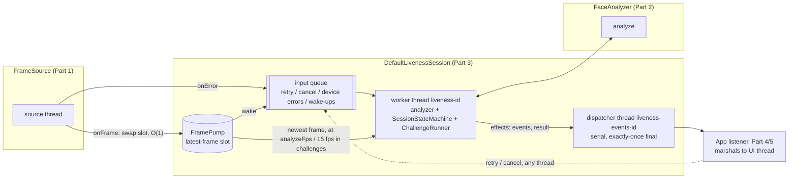
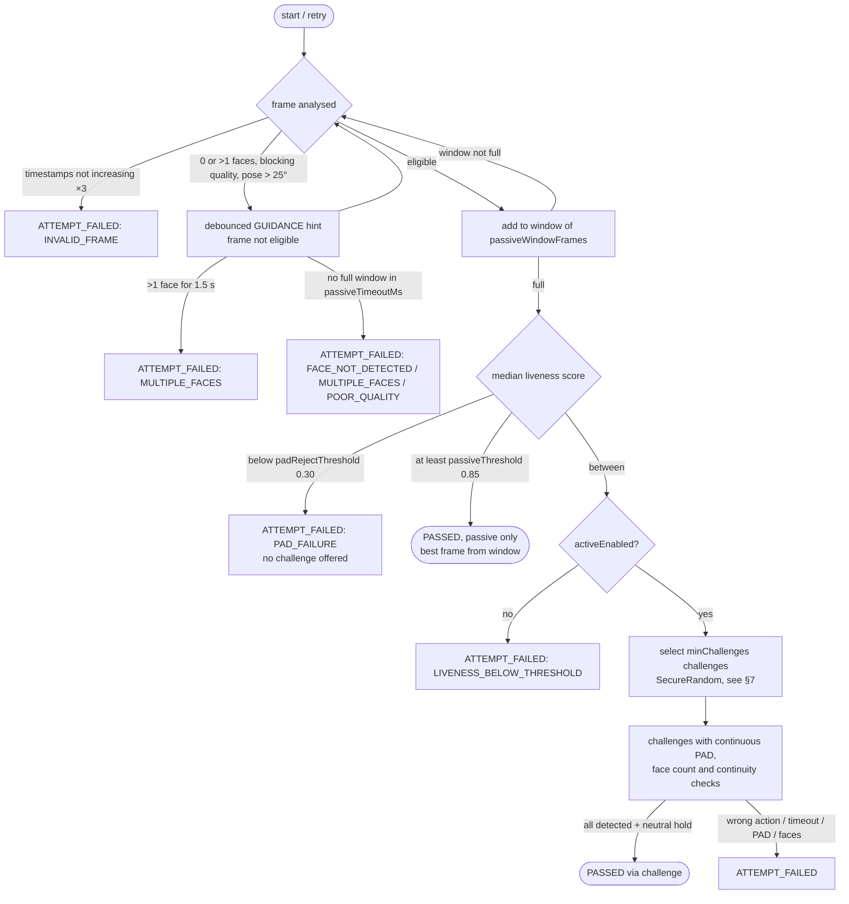
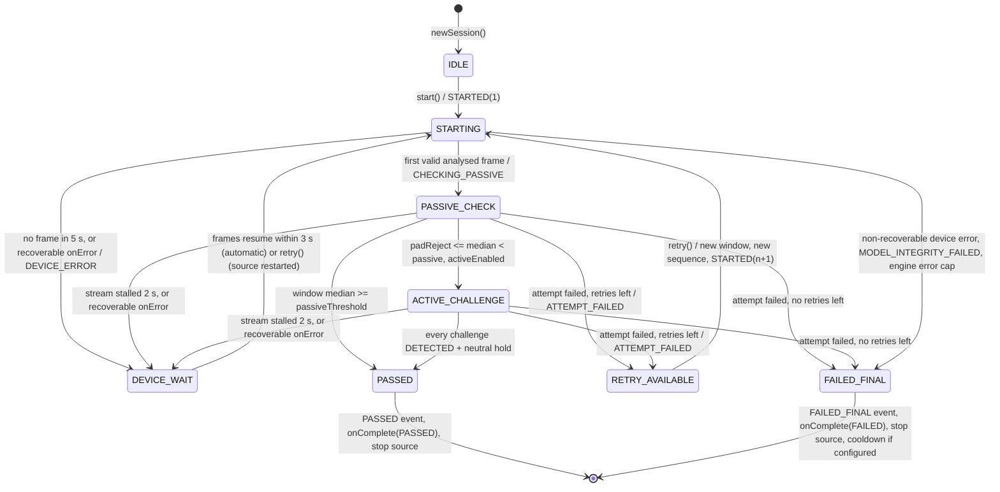
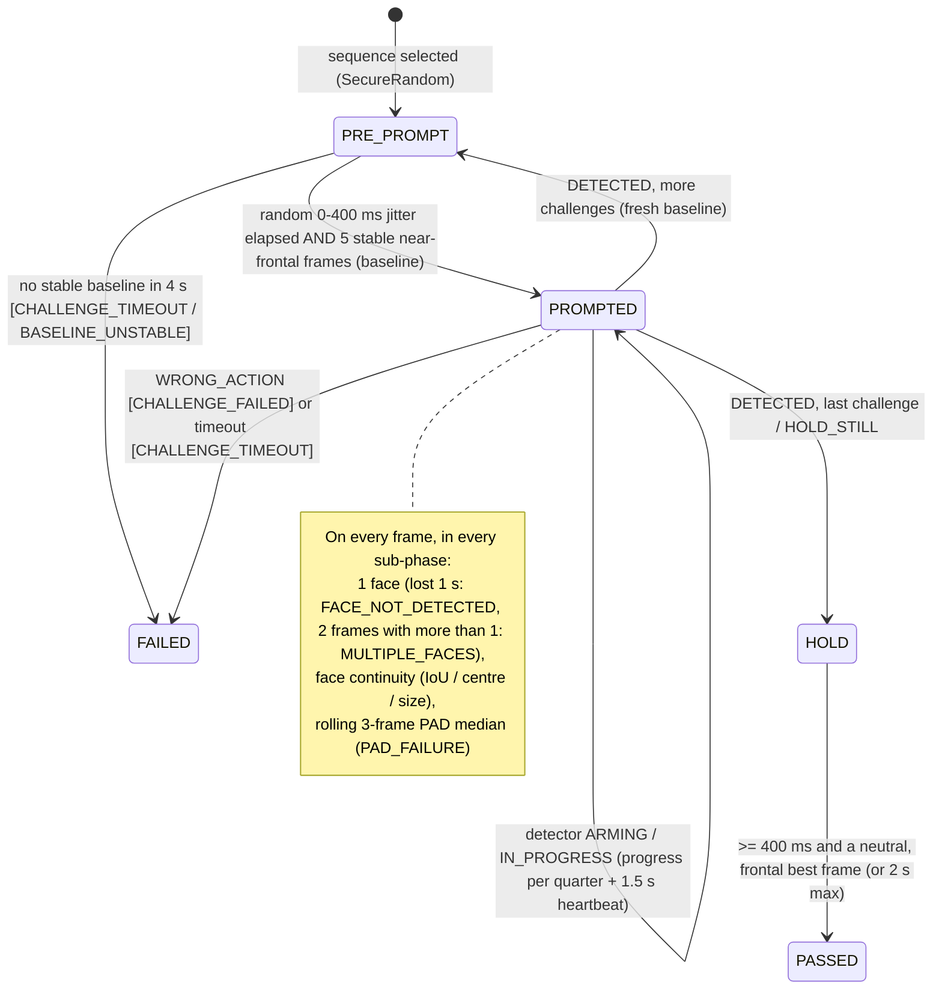
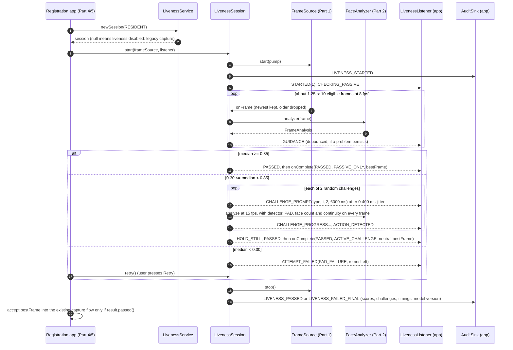
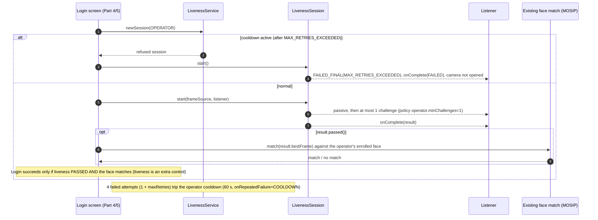
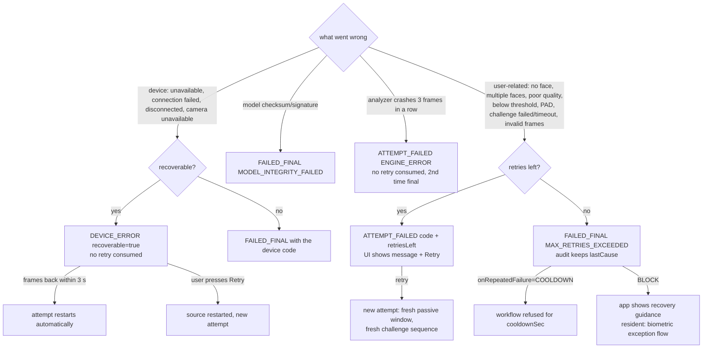

# liveness-core design (Person 3)

Status: **complete for Part 3 (Phases 0–9).** Decisions are in section 9, and sections for Parts 1, 2, 4 and 5 are to be stitched into section 15. Covers the session engine, the passive-to-active decision, the active challenges, retries, errors and audit. Diagrams and sections marked *(Phase 9)* are finished later.

Source of truth: `liveness-api` (package `io.mosip.registration.liveness.api`) and `liveness-default.properties`. Where this doc and the contract disagree, the contract wins. Section 8 lists every place where the Person 3 brief and the contract differ.

---

## 1. Contract surface

### 1.1 Types I implement

| Type | Members I implement / honour |
|---|---|
| `LivenessService` | `LivenessSession newSession(WorkflowType)`: returns `null` when `policy.enabled == false`. `LivenessPolicy policy(WorkflowType)`. `void reloadConfig(ConfigProvider)`: running sessions keep the policy snapshot they took in `newSession`. |
| `LivenessSession` | `void start(FrameSource, LivenessListener)`, `void retry()` ("only valid after ATTEMPT_FAILED; ignored if no retries left"), `void cancel()` ("emits onComplete(CANCELLED), stops the source"), `String sessionId()` (UUID). |
| `LivenessPolicy` | **Already implemented in the contract**, including `load(ConfigProvider, WorkflowType)` and `validate()`. Core does **not** duplicate the loader. It only wraps it (see 1.3). Fields: `enabled, passiveThreshold, padRejectThreshold, passiveWindowFrames, passiveTimeoutMs, activeEnabled, challengePool, minChallenges, challengeTimeoutMs, maxRetries, onRepeatedFailure {BLOCK, COOLDOWN}, cooldownSec, diagnosticMode, analyzeFps`. |

### 1.2 Types I produce or consume

| Type | What I use |
|---|---|
| `LivenessListener` | `onEvent(LivenessEvent)`; `onComplete(LivenessResult)`: "called exactly once per session". |
| `LivenessEvent` | Factories only (the constructor is private): `of(Type, attempt)`, `guidance(Guidance, attempt)`, `prompt(ChallengeType, index, count, timeoutMs, attempt)`, `progress(ChallengeType, index, count, p, attempt)`, `failure(Type, ErrorCode, attempt, retriesLeft, recoverable)`. `Type` = `STARTED, CHECKING_PASSIVE, GUIDANCE, CHALLENGE_PROMPT, CHALLENGE_PROGRESS, ACTION_DETECTED, HOLD_STILL, ATTEMPT_FAILED, PASSED, FAILED_FINAL, DEVICE_ERROR`. `Guidance` = `NO_FACE, MULTIPLE_FACES, MOVE_CLOSER, MOVE_BACK, CENTER_FACE, IMPROVE_LIGHTING, HOLD_STEADY, LOOK_AT_CAMERA`. |
| `LivenessResult` | `new LivenessResult(Decision {PASSED, FAILED, CANCELLED}, PassPath {PASSIVE_ONLY, ACTIVE_CHALLENGE, NONE}, ErrorCode failureCode /*null when PASSED*/, Frame bestFrame, float passiveScore /*median*/, List<ChallengeType> challengesIssued, int attempts, long durationMs, String sessionId, String modelVersion)`. |
| `FrameSource` (P1) | `info()` → `FrameSource.DeviceInfo` (nested class: `deviceId, vendor, model, sbiVersion, certificationLevel, maxWidth, maxHeight, maxFps`); `start(Listener)` (non-blocking, never throws); `stop()` (idempotent); `isRunning()`. `Listener.onFrame(Frame)` runs on the source thread and must return quickly. `Listener.onError(ErrorCode, String detailForAuditOnly, boolean recoverable)`. |
| `Frame` (P1) | `timestampMs()` (monotonic), `sequence()` (strictly increasing, gaps mean drops), `deviceId()`, `width()/height()`. `rgb()` is **never** read by core except to hand the frame through as `bestFrame`. |
| `FaceAnalyzer` (P2) | `FrameAnalysis analyze(Frame) throws LivenessEngineException`, `String modelVersion()`, `close()`. **Not thread-safe, one instance per session, called only from the session worker thread.** |
| `FrameAnalysis` (P2) | `frame, faceCount, faceBox[x,y,w,h], landmarks, yawDeg, pitchDeg, rollDeg` (**+yaw = subject turned to THEIR left**), `qualityIssues` (`TOO_DARK, TOO_BRIGHT, BLURRY, FACE_TOO_SMALL, FACE_TOO_LARGE, FACE_OFF_CENTER, FACE_CUT_OFF`), `livenessScore` (0..1, **NaN if not computed**), `padDetails` (audit only), `processingMs`, `usable()` (= exactly one face and no quality issues). |
| `FaceLandmarks` (P2) | `leftEye[6][2]`, `rightEye[6][2]` (subject's left/right, EAR order p1..p6), `mouthLeft, mouthRight, mouthUpperInner, mouthLowerInner, noseTip, chin`, `leftIris, rightIris` (may be null). Pixel coordinates. **Used only inside detectors, never audited or logged.** |
| `ConfigProvider` (P4/P5) | `String get(String key)`, null when absent. |
| `AuditSink` (P4/P5) | `record(AuditSink.Event, WorkflowType, String sessionId, Map<String,String> details)`. Events: `LIVENESS_STARTED, LIVENESS_PASSED, LIVENESS_ATTEMPT_FAILED, LIVENESS_FAILED_FINAL, PAD_ATTACK_SUSPECTED, DEVICE_ERROR, MODEL_LOADED, MODEL_INTEGRITY_FAILED, CONFIG_LOADED`. |
| `ErrorCode` | 16 values plus `userMessage()` → `UserMessage {NONE, LIVENESS_NOT_VERIFIED, VERIFICATION_NOT_COMPLETED, MAX_ATTEMPTS_REACHED, DEVICE_PROBLEM}`. PAD_FAILURE already maps to the generic `VERIFICATION_NOT_COMPLETED`. |
| `LivenessEngineException` | `code()`. Thrown by the analyzer. Core catches it and never passes it to the listener. |
| `WorkflowType`, `ChallengeType` | `RESIDENT, OPERATOR, SUPERVISOR`; `BLINK, SMILE, TURN_LEFT, TURN_RIGHT, LOOK_UP, LOOK_DOWN`. |

### 1.3 Effective defaults (from `liveness-default.properties`)

| Field | default | operator | supervisor |
|---|---|---|---|
| passiveThreshold / padRejectThreshold | 0.85 / 0.30 | same | same |
| passiveWindowFrames / passiveTimeoutMs | 10 / 8000 | same | same |
| challengeTypes | BLINK, SMILE, TURN_LEFT, TURN_RIGHT | same | same |
| minChallenges | 2 | **1** | **1** |
| challengeTimeoutMs / maxRetries | 6000 / 3 (so 4 attempts) | same | same |
| onRepeatedFailure / cooldownSec | BLOCK / 60 | **COOLDOWN** / 60 | BLOCK / 60 |
| analyzeFps | 8 | same | same |

**Important:** `LivenessPolicy.load` falls back to *hard-coded* defaults, not to this file. If an app forgets to merge the file into its config, operators silently get 2 challenges and no cooldown. Core fixes this without a contract change: `PolicyResolver` wraps the host `ConfigProvider` in a `LayeredConfigProvider(host → classpath liveness-default.properties)` before calling `LivenessPolicy.load`. Because the contract loader checks the workflow key before the default key for each field, the effective order is: host workflow → bundled workflow → host default → bundled default → hard-coded. That is exactly the result of merging the file into the host config, as the file itself instructs. `PolicyResolver.validateExtra` then runs on top of `validate()` (D5).

---

## 2. Runtime architecture and threading



| Thread | Does | Never does |
|---|---|---|
| Source (Part 1) | `onFrame` swaps the pump's single latest-frame slot. The older unanalysed frame is overwritten and counted as dropped. `onError` enqueues. | Blocks, queues frames, or calls the analyzer |
| Worker `liveness-<id>` | Creates, uses and closes the analyzer (one per session, contract). Analyses at most `analyzeFps` (passive) or `max(analyzeFps, 15)` (challenges). Feeds `SessionStateMachine`. Ticks at least every 50 ms so timeouts fire without frames. Executes effects. | Calls the listener directly |
| Dispatcher `liveness-events-<id>` | Delivers every callback in order. The first `complete()` wins; nothing is delivered after `onComplete`, and the thread then exits. | Runs engine logic |

- **Apps (Parts 4 and 5):** callbacks never arrive on the UI or camera thread. Use `Platform.runLater` (JavaFX) or post to the Flutter main isolate. `retry()` and `cancel()` are safe from any thread, including inside a callback.
- **`cancel()`** delivers `onComplete(CANCELLED)` immediately from the calling thread, even while the worker is inside `analyze()` (tested), and stops the source. The worker then closes the analyzer. It is idempotent, and does nothing after the final result.
- **Pure core:** `SessionStateMachine` takes each input with the current time and returns `Effect`s (`EMIT`, `COMPLETE`, `STOP_SOURCE`, `RESTART_SOURCE`, `TRIP_COOLDOWN`). It has no threads, clock reads or I/O. `ChallengeRunner` and the detectors are pure in the same way. Tests drive the real session step by step with a manual clock (`ScenarioDriver`), with no sleeps.
- **Randomness:** challenge order and the prompt jitter use `SecureRandom` in production and a seeded source in tests.
- **Safety net:** any unexpected `Throwable` on the worker still produces exactly one `FAILED(ENGINE_ERROR)`.

---

## 3. Passive-to-active decision flow



## 3a. Session state machine (as built)



Not drawn, to keep the diagram readable:
- From every non-terminal state, `cancel()` goes to **CANCELLED**: `onComplete(CANCELLED)` and the source stops. There is no CANCELLED event type.
- A non-recoverable device error or `MODEL_INTEGRITY_FAILED` goes to FAILED_FINAL from any non-terminal state.
- Device errors and ENGINE_ERROR never consume a retry. ENGINE_ERROR is capped at 2 attempts.

**Invariants** (tested, including two fuzz tests through the real session):
1. PASSED is only reachable from a full passive window with median ≥ `passiveThreshold`, or after every issued challenge of the final attempt was DETECTED.
2. An attack signal ends the attempt: the passive median below `padRejectThreshold`, or a 3-frame rolling median below it during challenges or the final hold. A constant attack score never passes, whatever motions are performed (fuzz-tested).
3. Exactly one `onComplete`, with nothing after it. Terminal states ignore every input.

---

## 4. ErrorCode map

"Retry" means the attempt consumes one of `maxRetries`. "Final" means the session ends immediately.

| ErrorCode | Raised when | Event emitted | Retry? | UserMessage (contract) | Audit event |
|---|---|---|---|---|---|
| `DEVICE_UNAVAILABLE` | `FrameSource.onError(DEVICE_UNAVAILABLE)`; **or** no frame within `startTimeoutMs` (TUNE 5000) after `start()` | `DEVICE_ERROR(recoverable)` | No | DEVICE_PROBLEM | DEVICE_ERROR |
| `DEVICE_CONNECTION_FAILED` | passed through from `onError` | `DEVICE_ERROR(recoverable)` | No | DEVICE_PROBLEM | DEVICE_ERROR |
| `DEVICE_DISCONNECTED` | passed through from `onError` mid-stream; or no frame at all for `frameStallMs` (TUNE 2000) during an attempt. Frames resuming within `deviceGraceMs` (3000) restart the attempt automatically. | `DEVICE_ERROR(recoverable)` | No | DEVICE_PROBLEM | DEVICE_ERROR |
| `CAMERA_UNAVAILABLE` | passed through from `onError` (Android camera busy or permission) | `DEVICE_ERROR(recoverable)` | No | DEVICE_PROBLEM | DEVICE_ERROR |
| `FACE_NOT_DETECTED` | passive timeout where most frames had `faceCount==0`; or face lost for more than `faceLostMs` (TUNE 1000) during a challenge | `ATTEMPT_FAILED` / `FAILED_FINAL` | Yes | LIVENESS_NOT_VERIFIED | LIVENESS_ATTEMPT_FAILED |
| `MULTIPLE_FACES` | `faceCount>1` persists more than `multiFaceFailMs` (TUNE 1500) in passive; during a challenge, 2 consecutive frames (TUNE) | `GUIDANCE(MULTIPLE_FACES)` first, then `ATTEMPT_FAILED` | Yes | LIVENESS_NOT_VERIFIED | LIVENESS_ATTEMPT_FAILED |
| `POOR_QUALITY` | passive timeout where faces were present but quality issues blocked the window | `ATTEMPT_FAILED` | Yes | LIVENESS_NOT_VERIFIED | LIVENESS_ATTEMPT_FAILED |
| `LIVENESS_BELOW_THRESHOLD` | `padReject ≤ median < passive` and `activeEnabled == false` | `ATTEMPT_FAILED` | Yes | LIVENESS_NOT_VERIFIED | LIVENESS_ATTEMPT_FAILED |
| `PAD_FAILURE` | median < `padRejectThreshold` on the passive window; rolling median < `padRejectThreshold` during a challenge or finalising. **No fallback to active.** | `ATTEMPT_FAILED` | Yes | VERIFICATION_NOT_COMPLETED (generic) | PAD_ATTACK_SUSPECTED + LIVENESS_ATTEMPT_FAILED |
| `CHALLENGE_FAILED` | detector `WRONG_ACTION` (clearly opposite movement); `FaceContinuityGuard` break (face swap or photo switch) | `ATTEMPT_FAILED` | Yes | LIVENESS_NOT_VERIFIED | LIVENESS_ATTEMPT_FAILED (`reason=WRONG_ACTION / CONTINUITY_BREAK`) |
| `CHALLENGE_TIMEOUT` | `challengeTimeoutMs` passed since the prompt without DETECTED; or no stable neutral baseline within `baselineTimeoutMs` (4 s) before a prompt | `ATTEMPT_FAILED` | Yes | LIVENESS_NOT_VERIFIED | LIVENESS_ATTEMPT_FAILED (`reason=TIMEOUT / BASELINE_UNSTABLE`) |
| `MAX_RETRIES_EXCEEDED` | an attempt fails when `retriesLeft == 0`; also used for a cooldown refusal (D2) | `FAILED_FINAL` | n/a | MAX_ATTEMPTS_REACHED | LIVENESS_FAILED_FINAL (`lastCause=<code>`) |
| `INVALID_FRAME` | analysed frames whose `sequence` or `timestampMs` does not strictly increase, or that arrive < 5 ms apart (implausible), 3 times in one attempt (TUNE); or the analyzer rejects 3 frames with `INVALID_FRAME` | `ATTEMPT_FAILED` | Yes | VERIFICATION_NOT_COMPLETED | LIVENESS_ATTEMPT_FAILED |
| `ENGINE_ERROR` | analyzer throws `ENGINE_ERROR` or a `RuntimeException` on `engineErrorFrames` consecutive frames (TUNE 3). A single bad frame is skipped. | `ATTEMPT_FAILED` | **No** (D7) | VERIFICATION_NOT_COMPLETED | LIVENESS_ATTEMPT_FAILED |
| `MODEL_INTEGRITY_FAILED` | analyzer factory or `analyze` throws with this code | `FAILED_FINAL(recoverable=false)` | Final | VERIFICATION_NOT_COMPLETED | MODEL_INTEGRITY_FAILED + LIVENESS_FAILED_FINAL |
| `CANCELLED` | `cancel()` | none (result only) | Final | NONE | LIVENESS_FAILED_FINAL (`cancelled=true`) |

Rules:
- Once no retries are left, an attempt failure emits **`FAILED_FINAL(MAX_RETRIES_EXCEEDED)` directly**, not `ATTEMPT_FAILED(retriesLeft=0)`. `LivenessResult.failureCode` is `MAX_RETRIES_EXCEEDED`, and the underlying cause goes to audit as `lastCause`.
- A device error that is not recoverable (`recoverable=false` from the source) ends in `FAILED_FINAL(<device code>)`, and the result carries that device code.

## 5. LivenessEvent map

| Type | When fired | Fields set |
|---|---|---|
| `STARTED` | on `start()`, and on each accepted `retry()` or device restart | attemptNumber |
| `CHECKING_PASSIVE` | on entering PASSIVE_CHECK; **re-emitted when an active hint clears** (workaround for the missing "clear" signal, D4) | attemptNumber |
| `GUIDANCE` | `PositioningHintFilter` output: the hint must persist ≥300 ms, may change at most every 500 ms, and has a priority order: NO_FACE > MULTIPLE_FACES > IMPROVE_LIGHTING > MOVE_CLOSER/MOVE_BACK > CENTER_FACE > HOLD_STEADY > LOOK_AT_CAMERA | guidance |
| `CHALLENGE_PROMPT` | after the pre-prompt jitter, once a stable neutral baseline exists | challenge, index (1-based), count, timeoutMs |
| `CHALLENGE_PROGRESS` | the detector's progress rises past a 0.25 step; also a heartbeat every 1.5 s with no progress (the "Please continue" nudge) | challenge, index, count, progress |
| `ACTION_DETECTED` | detector returns DETECTED (including return-to-neutral for turns and looks) | attemptNumber |
| `HOLD_STILL` | on entering FINALISING after an active pass. Not emitted for a passive pass, because the best frame already comes from the window. | attemptNumber |
| `ATTEMPT_FAILED` | an attempt fails and retries remain | error, retriesLeft, recoverable=true |
| `PASSED` | just before `onComplete(PASSED)` | attemptNumber |
| `FAILED_FINAL` | just before `onComplete(FAILED)` | error, retriesLeft=0, recoverable=false |
| `DEVICE_ERROR` | a source error or start timeout; `recoverable` tells the UI whether to show Retry | error, recoverable |

---

## 6. Passive decision (Phase 3 detail)

- **Eligible frame:** `faceCount==1`, `!isNaN(livenessScore)`, no *blocking* quality issue (TOO_DARK, TOO_BRIGHT, BLURRY, FACE_TOO_SMALL, FACE_CUT_OFF), and `|yaw|,|pitch| < 25°` (TUNE). FACE_OFF_CENTER and FACE_TOO_LARGE only produce a hint.
- **Window:** the last `passiveWindowFrames` eligible frames (10 at 8 fps is about 1.25 s). Aggregation uses the **median** (the contract comment and `LivenessResult.passiveScore` both say median).
- **Attack:** median < `padRejectThreshold`, as the contract defines it. No extra "k of window" rule (D1).
- **Pass:** window full, median ≥ `passiveThreshold`, and no attack.
- **Otherwise:** ACTIVE_CHALLENGE if `activeEnabled`, else LIVENESS_BELOW_THRESHOLD.
- **Timeout:** if `passiveTimeoutMs` passes without a full window, the code is chosen by majority reason among the rejected frames: no face → FACE_NOT_DETECTED, >1 face → MULTIPLE_FACES, anything else → POOR_QUALITY.

## 7. Active challenges (as built in Phases 4–5)

Code: `challenge.ChallengeSelector`, `challenge.ChallengeRunner` (implements `session.ActivePhase`), `detect.*`. Every threshold is a `TUNE:` field in `EngineTuning`, so the Phase 8 report can sweep it.



- **Selection:** `minChallenges` distinct types from `policy.challengePool ∩ supported`. Opposite motions are never adjacent, and a retry never repeats the previous sequence. Over 10,000 draws the 10 valid 2-of-4 sequences are equally likely. Per type, BLINK and SMILE appear about 60% of the time and each turn about 40%, because the two turns are never paired.
- **Baseline from *before* the prompt (C9):** 5 consecutive frames with |yaw| and |pitch| ≤ 15° and a spread of ≤ 6°. For challenge 1 the passive window seeds the baseline. Later challenges use fresh frames after the previous action. If none is stable after 1 s, the user gets `GUIDANCE(LOOK_AT_CAMERA)`.
- **"Armed" instead of "pre-prompt motion fails":** a detector only starts counting once ≥ 150 ms have passed since the prompt **and** the signal has been seen back near neutral (within 30% of its threshold). Motion that started before the prompt, or a spontaneous blink right at it, is ignored and never fails a genuine user. A pre-recorded action therefore has to be timed exactly, after a random jitter.
- **Detectors** (all relative to the baseline and time-based):

| Challenge | Signal | Detected when | Wrong action |
|---|---|---|---|
| BLINK | mean EAR (p1..p6) | < 0.6× baseline, then ≥ 0.85× within 400 ms (one closed frame at 15 fps is enough). Longer closures (eyes shut, closed-eye photo) restart detection. | — |
| SMILE | mouth width ÷ IOD, and corner lift ÷ IOD | +18% width, or +10% width with +0.03 corner lift, held ≥ 200 ms over ≥ 3 frames | — |
| TURN_LEFT / TURN_RIGHT | `userYaw` (+ = the user's left) | ≥ 20° in the requested direction, held ≥ 200 ms over ≥ 3 frames, then back within 10° | ≥ 20° the opposite way at any time (wiggles fail) |
| LOOK_UP / LOOK_DOWN | `userPitch` (+ = up, assumed, P2) | ≥ 13°, held, then back within 8° | ≥ 13° the opposite way |

- **Final hold and best frame:** a frame qualifies when it has one face, no quality issue, |yaw| and |pitch| ≤ 10°, eyes open, and the mouth within 8% of baseline. It is chosen from the passive window plus the post-challenge hold. Mid-action frames are never offered, and tests assert this.

## 8. Conflicts between the brief and the contract (the contract wins)

| # | Brief says | Contract says | What I will do |
|---|---|---|---|
| C1 | 18 Java files | 17 `.java` + the properties file | Nothing needed. I just noted the count. |
| C2 | `DeviceInfo` is a top-level type | `FrameSource.DeviceInfo` is nested | Use the nested type. |
| C3 | Attack = attack signal ≥ threshold in k frames | Attack = **median livenessScore < padRejectThreshold**. There is no separate attack score; `padDetails` is audit-only. | Use the median rule (D1). |
| C4 | Build the policy loader and validator in core | `LivenessPolicy.load/validate` already exist in the contract | Don't duplicate them. Wrap the loader with a bundled-defaults layer and extra validation (1.3, D5). |
| C5 | Validation should "reject or clamp" | `validate()` throws `IllegalArgumentException`; `load` also throws `NumberFormatException` or `IllegalArgumentException` from `valueOf` | Reject, never clamp. On a bad config, core falls back to the bundled-file policy and audits `CONFIG_LOADED` with `error=...` (D5). |
| C6 | The challenge count is called `challengeCount` | The field is `minChallenges` | Issue exactly `minChallenges`. |
| C7 | Cooldown fails with "the cooldown error code" | There is no such `ErrorCode`, and `newSession` may only return null for "disabled" | Workaround: return a session whose `start()` immediately emits `FAILED_FINAL(MAX_RETRIES_EXCEEDED, recoverable=false)` (D2). |
| C8 | `FaceAnalyzer` passed to the service constructor | "One instance per session, not thread-safe" | `DefaultLivenessService` takes a core-defined `FaceAnalyzerFactory` (Java 8 has `Supplier`, but it needs Android API 24+). |
| C9 | Baseline from the first N frames after the prompt | n/a (design issue) | Use a pre-prompt baseline (section 7). |
| C10 | "a per-eye openness score, if it exists" | No such field exists | Use EAR only. |

## 9. Decisions (resolved 2026-09-23)

The owner (Part 3) asked me to settle these using the problem statement. Items that need a contract change are written up in [contract-change-proposals.md](contract-change-proposals.md). Every one has a workaround inside core, so nothing is blocked.

| # | Topic | Decision | Why (problem statement) |
|---|---|---|---|
| D1 | Attack rule | **Contract median rule** for the passive window (median < `padRejectThreshold` means PAD_FAILURE, with no fallback to active). During challenges and finalising, a **3-frame rolling median** below `padRejectThreshold` means PAD_FAILURE. No extra "k of window" rule. | §3 "prevent capture when PAD detects an attack" and §4 "re-evaluate liveness during active verification". The median keeps BPCER down, and the continuous check covers the "mask performs the action" case. |
| D2 | Cooldown | Use the workaround: FAILED_FINAL(MAX_RETRIES_EXCEEDED) at `start()`, without touching the camera. It is in memory and keyed per workflow. **Proposal P1** adds a dedicated code. | §8 "configure behaviour when liveness verification repeatedly fails". The UI already maps MAX_RETRIES_EXCEEDED to recovery guidance (§10.7). |
| D3 | Pitch sign | Assume **+pitch means the subject looks UP**. This is pinned in `FaceGeometry.userPitch()` with a test, so a single line changes if Part 2 differs. LOOK_UP/LOOK_DOWN are not in the default pool anyway. **Proposal P2** documents it in the contract. | — |
| D4 | Clearing a hint | Re-emit `CHECKING_PASSIVE` (or `CHALLENGE_PROGRESS` during a challenge) to mean "hint cleared". **Proposal P3** adds `Guidance.NONE`. | §10.1 "face positioning guidance". The UI must not show a stale hint. |
| D5 | Invalid config | Reject rather than clamp. Fall back to the **bundled defaults** (fail-safe: liveness is never switched off by a bad value) and audit `CONFIG_LOADED{error}`. Core adds the checks `validate()` lacks, including duplicate pool entries. **Proposal P4** moves them into `validate()`. | "Shall not accept a face ... when the liveness/PAD assessment fails." Security must not depend on a correct config. |
| D6 | Blink and 8 fps | `analyzeFps` applies to the passive phase. During an active challenge, core analyses every delivered frame up to `ACTIVE_MAX_FPS = 15` (TUNE). **Proposal P5** adds `activeAnalyzeFps`. | §4 "verify the requested facial action". 8 fps misses short blinks. |
| D7 | Retry accounting | ENGINE_ERROR does **not** consume a retry, but after 2 engine-error attempts the session ends. INVALID_FRAME **does** consume one. Device errors never consume one. | §9 lists these as separate cases. The user should not be penalised for engine or device faults. |
| D8 | Preview | **Not Part 3.** Part 1 owns `FrameSource` and the preview path. Core only needs to be the source's listener. Raised with Part 1 as note N1 in the proposals file. | Team split: Part 1 = device and frame pipeline. |
| D9 | Reconnect | After a recoverable `onError`, core waits `deviceGraceMs` (TUNE 3000) for frames to resume. After that it emits `DEVICE_ERROR(recoverable=true)`, and `retry()` does `stop()` + `start()` on the source. Part 1 may also reconnect internally; both work. | §1 "handle device connection/disconnection". |
| D10 | Source lifecycle | Core stops the source on every terminal state. During RETRY_AVAILABLE the source keeps running (live preview), and frames are ignored. | §10.1 "live face preview". |
| D11 | `retry()` after DEVICE_ERROR | Accepted, and does not consume a retry. **Proposal P6** fixes the javadoc. | §10.7 "clearly indicate when a retry is available". |
| D12 | Audit granularity | Challenge detail goes in the details map of the attempt-level events. No new AuditSink events. | §9 / Part 4 "log scores, PAD reasons, challenge outcomes". |
| D13 | Build | Done: `git init`, a root aggregator POM, and a build-only `liveness-api/pom.xml`. JDK 17 + Maven 3.9 via Homebrew, compiling with `--release 8`. animal-sniffer checks main code against the **Java 8 and Android API 21** signatures. | "Same jar on Desktop and Android." |
| D14 | `challengesIssued` | The **last attempt's** sequence. Every attempt's sequence is in audit. | — |
| D15 | Fake depends on core | `liveness-fake` reuses core's `EventDispatcher`, `AttemptTracker`, `PolicyResolver`, `CooldownTracker` and `ChallengeSelector`, so retry, cancel, events and policy behave **identically**. Core has no ML or native dependencies, so this costs the apps nothing. | Brief: "make retry()/cancel() behave exactly as the real engine will". |

### Config naming vs. the team split

The team split lists `timeoutSec`. The contract field is `challengeTimeoutMs` (key `...challengeTimeoutMs`), and **the contract wins**. The split's schema maps onto the contract like this:
- `enabled`, `passiveThreshold`, `activeEnabled`, `challengeTypes`, `minChallenges`, `maxRetries` and `onRepeatedFailure` are the same names.
- `timeoutSec` becomes `challengeTimeoutMs`.
- The contract adds `padRejectThreshold`, `passiveWindowFrames`, `passiveTimeoutMs`, `cooldownSec`, `diagnosticMode` and `analyzeFps`.

### Scope

Part 3 only: the orchestrator/state machine, the passive→active decision, challenge selection, action detectors, retries, timeouts, errors, audit records, config design, `FakeLivenessService`, and this design doc, which Part 3 owns and into which the other parts' sections get stitched. The following belong to other parts and are **not** built here:
- `FrameSource`, the SBI adapter and the mock device: Part 1
- `FaceAnalyzer`, models and PAD evaluation: Part 2
- the app UIs, `ConfigProvider` and `AuditSink` implementations: Parts 4 and 5

---

## 10. Sequence diagrams (engine level)

These show the calls between the app, the Part 3 engine, and the Part 1 and Part 2 components. The app-internal parts (screens, the capture and authentication flows) are owned by Parts 4 and 5 and are stitched in under section 15.

### 10.1 Resident face capture (2 challenges if passive is inconclusive)



### 10.2 Operator biometric authentication (1 challenge, cooldown)



### 10.3 Supervisor biometric authentication

It is the same as 10.2 with `newSession(SUPERVISOR)`: 1 challenge, `onRepeatedFailure=BLOCK` (no cooldown), and the recovery guidance comes from the app. The supervisor must be physically present: the continuous PAD check and the face-continuity guard apply exactly as for the resident flow.

---

## 11. Error handling and recovery flow



The table of ErrorCode, trigger, user message and retry accounting is in section 4. What goes into audit (all through `AuditRecorder`, keys in `AuditRecorder.Keys`):

| Audit event | Fields |
|---|---|
| `CONFIG_LOADED` | engine, policy summary, config error (if the host config was invalid and bundled defaults were used) |
| `MODEL_LOADED` / `MODEL_INTEGRITY_FAILED` | model version, reason |
| `LIVENESS_STARTED` | attempt, model version, device id, certification level |
| `LIVENESS_ATTEMPT_FAILED` | errorCode, retriesLeft, reason, passive outcome, median score, window frames, passive ms, challenge log (`TYPE:OUTCOME:ms`), attempt ms |
| `PAD_ATTACK_SUSPECTED` | median score, per-model PAD output medians (`pad.*`, max 8), reason |
| `DEVICE_ERROR` | errorCode, recoverable, device detail (truncated to 120 chars) |
| `LIVENESS_PASSED` / `LIVENESS_FAILED_FINAL` | pass path or errorCode and lastCause, cooldownSec, total duration, frames analysed and dropped, average processing ms |

**Never in audit:** images, frame bytes, landmarks or coordinates. `AuditRecorder`'s public API cannot accept those types, and a reflection test enforces this.

---

## 12. Security considerations

| Threat | Mitigation in Part 3 |
|---|---|
| Printed photo / screen replay passes passively | Passive decision uses the **median** over a window, and median < `padRejectThreshold` fails with **no fallback to challenges**. |
| Attacker performs the requested action with a mask, photo cut-out or video | **Continuous PAD** during every challenge and the final hold: a 3-frame rolling median below `padRejectThreshold` fails immediately. The action cannot compensate (tested end to end). |
| Pre-recorded video of the actions | **Unpredictable challenges** (SecureRandom; a retry never reuses the previous sequence) and a **random 0–400 ms prompt jitter**. Only motion **after** the prompt plus 150 ms human reaction time counts, and only once the face was seen back at neutral, so motion already under way at the prompt never counts. |
| Head wiggling or random motion from a replay | Actions must be **held** (≥ 200 ms, ≥ 3 frames) and turns and looks must **return**. Moving the **opposite** way is WRONG_ACTION and fails the attempt. |
| Swapping faces or photos mid-session | **FaceContinuityGuard**: IoU, centre-jump and size-ratio checks between consecutive frames (looser across short gaps). The face lost for 1 s, or 2 frames with more than one face, fails. |
| Frame injection / frozen or replayed streams | **FrameSanity**: sequence and timestamps must strictly increase and be plausibly spaced. Three violations mean INVALID_FRAME, which consumes a retry. |
| Probing the PAD model | A PAD failure only ever shows the generic "Face verification could not be completed" (contract `userMessage()`). PAD scores go to audit only. |
| Brute-force retries at operator login | Retry limit (1 + `maxRetries`), then a per-workflow **cooldown** (operator by default). |
| Weakening liveness through a bad config | Invalid host config falls back to the **bundled defaults** (liveness stays on) and is audited. |
| Privacy | No images, landmarks or coordinates in audit, logs or tuning traces (traces keep only scale-free features). |
| Offline operation | The engine makes **no network calls** and has no runtime dependencies beyond the contract. Config comes from the host's synced config, and models are loaded by Part 2's factory from local, verified files. Behaviour is identical online and offline. |

Known limits:
- The cooldown is in memory, so it resets on app restart (proposal P1).
- Thresholds are `TUNE:` guesses until the Phase 8 report runs on real recordings.
- The analysis rate during challenges assumes the analyzer can keep up with about 15 fps (proposal P5).

---

## 13. ISO/IEC 30107 alignment notes

- **Scope of attack instruments (30107-1):** printed photos (flat and curved), photos or videos shown on a phone, tablet or monitor screen, and video replay. Masks are partly covered by the continuous passive PAD, depending on Part 2's model. Part 3 adds challenge-response on top of Part 2's passive PAD, so a static artefact cannot pass an inconclusive session.
- **Metrics (30107-3):**
  - **APCER** is the proportion of attack presentations wrongly accepted, reported per attack instrument species. The highest APCER over the species is the one to quote.
  - **BPCER** is the proportion of bona fide presentations wrongly rejected.
  - **ACER** is (max APCER + BPCER) / 2, as used in the literature (not normative in the 2023 edition).
- **How to measure with Part 2's evaluation set:**
  1. Record each bona fide and attack sample as a trace with `TraceRecorder`.
  2. Run `DetectorTuningReport`. Its passive table gives, for any threshold t, the attacks accepted without a challenge (median ≥ t) and the bona fide sessions below t.
  3. For end-to-end APCER, replay attack traces through the full engine. An attack passes only if it clears passive, or completes randomly chosen challenges while its score stays ≥ `padRejectThreshold`.
- **Threshold trade-off (policy, per workflow):**
  - Raising `passiveThreshold` lowers passive-only APCER, but sends more genuine people to a challenge (more friction, not rejection).
  - Raising `padRejectThreshold` lowers APCER further but raises BPCER, because genuine people with low scores are rejected outright.
  - The band between the two thresholds is resolved by challenges, which is where the hybrid design earns its keep. Defaults are 0.85 and 0.30. Change them only through a contract PR, backed by the report on real data.
- **Reporting:** state the evaluation population, the attack species, the capture devices (L0/L1 certification from `DeviceInfo`), and the model version (in every audit record).

---

## 14. Module map, usage and verification

| Module | Contents | Ships in apps |
|---|---|---|
| `liveness-api` | Shared contract (17 Java files + `liveness-default.properties`, team-owned; only a build file was added) | yes |
| `liveness-core` | Engine: `DefaultLivenessService`, session, state machine, passive, challenges, detectors, audit, policy | yes |
| `liveness-fake` | `FakeLivenessService`: scripted scenarios for UI work, with the same semantics as the engine | dev builds |
| `liveness-tools` | Trace recorder, replayer, tuning report, synthetic traces | no |

```java
// Swap the fake for the real engine: only construction changes.
LivenessService liveness = DefaultLivenessService.builder()
        .config(configProvider)            // Part 4/5 ConfigProvider
        .analyzerFactory(part2Factory)     // Part 2: one FaceAnalyzer per session
        .auditSink(auditSink)              // Part 4/5 AuditSink
        .build();
```

**Verification** (`mvn verify`):
- **Tests:** 211 across unit, state-machine, detector, runner, scenario, threading, fuzz and tools.
- **Coverage:** JaCoCo line coverage on `liveness-core` is about 95%, gated at 85%.
- **API gates:** animal-sniffer checks main code against the **Java 8 and Android API 21** signatures, and bytecode is Java 8 (`--release 8`).
- **Mutation spot-check:** disabling blink detection makes the scenario suite fail.

---

## 15. Other parts' sections (to be stitched in by Part 3)

- **Part 1: Device and frame pipeline.** Device integration interface, frame streaming architecture diagram, SBI adapter, mock L0/L1 device, device error handling. *(pending)*
- **Part 2: Passive liveness and PAD engine.** Model comparison and choice, `FaceAnalyzer` implementation, PAD architecture, ISO/IEC 30107-3 evaluation (APCER/BPCER/ACER per threshold), model packaging and signature verification. *(pending)*
- **Part 4: Desktop Registration Client integration.** JavaFX screens, resident/operator/supervisor Desktop sequence diagrams, config wiring, audit module adapter, diagnostic mode. *(pending)*
- **Part 5: Android Registration Client integration.** Flutter screens, platform/event channel bridge, Android sequence diagrams, performance benchmark report. *(pending)*
