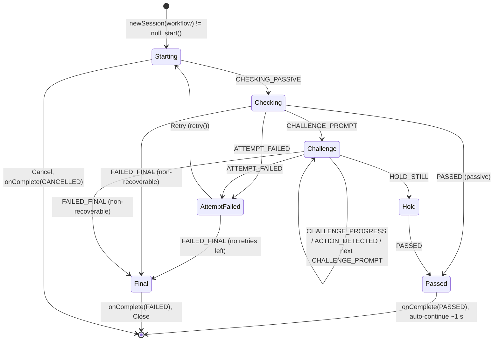

# Face liveness UI specification (Desktop and Android)

For **Person 4** (Desktop, JavaFX) and **Person 5** (Android, Flutter). Both clients render the same states with the same
texts and message keys, so a resident, operator or supervisor sees the same face-liveness experience everywhere.

The source of truth is the `liveness-api` contract: `LivenessEvent`, `LivenessResult`, `ErrorCode.UserMessage`,
`ChallengeType`, `WorkflowType` and `LivenessService.policy(workflow)`. The texts come from the problem statement
(§10, UI/UX requirements) word for word where it gives one.

## 1. Principles

1. **The UI is a renderer.** It only maps `LivenessEvent`s to the screen and acts on the final `LivenessResult`.
   - It never computes liveness itself.
   - It never shows a score, model name, PAD detail, threshold or challenge timing. Problem statement §10.1: "avoid
     exposing technical liveness model information".
2. **PAD failures look like any other verification failure.** `ErrorCode.PAD_FAILURE` maps to
   `UserMessage.VERIFICATION_NOT_COMPLETED`, the generic message. The UI must never distinguish it from an engine
   error.
3. **Online and offline behave identically.** The engine and models run on the device, and nothing on screen
   depends on connectivity.
4. **Mirror the preview, never the frames.** The front-camera preview is mirrored like a selfie. The frames given
   to the engine are never mirrored; the engine's left/right conventions are defined in the subject's frame.
5. **Events arrive on an engine thread.** Marshal them to the UI thread first: `Platform.runLater` on JavaFX; on
   Android, the native bridge posts to the main looper, then an EventChannel delivers to the main isolate.
6. **Accept or reject a face only on `onComplete(result)`.** Use `result.passed()`, and use `result.bestFrame` where
   the flow needs an image. Events are for display only.

## 2. Screen layout

```
+------------------------------------------------------------+
|  <Title per workflow>                                      |
+------------------------------------------------------------+
|              +------------------------------+              |
|              |          (badge)             |  camera card |
|              |        ( face oval )         |  oval colour |
|              |   live preview, mirrored     |  + badge     |
|              +------------------------------+              |
|   +----------------------------------------------------+   |
|   |  (icon)  STATUS (e.g. "Please blink")              |   |  status card
|   +----------------------------------------------------+   |
|         hint line (guidance, e.g. "Please move closer")    |
|   Step 1 of 2   [=====] [==---]          Attempt 1 of 4    |
|   (failure only) tips card                                 |
|                                                            |
|   [         Retry          ]   [         Cancel         ]  |
+------------------------------------------------------------+
```

The sizes, colours and type are in §9.

- **Title:** `liveness.title.<workflow>`.
- **Preview:** the full camera preview with a face-oval guide. The oval outline takes the state colour, always
  together with the state badge (an icon). Colour is never the only signal.
- **Status card:** the main message, 20 sp/px semibold, at most 2 lines. The challenge prompt goes here.
- **Hint line:** positioning guidance or feedback, 15 sp/px. It is empty when there is nothing to say. After a final
  failure it holds the recovery text.
- **Step "i of n"** and the **step bar** (one segment per challenge): only during challenges.
- **"Attempt a of m":** `a` = `event.attemptNumber`, `m` = `policy(workflow).maxRetries + 1`, while the session runs.
  After a failed attempt the progress row shows only `liveness.retry.attempts_left`, never both.
- **Buttons:**
  - **Retry** only after ATTEMPT_FAILED, or after a DEVICE_ERROR with `recoverable = true`.
  - **Cancel** always, except after PASSED and FAILED_FINAL.
  - **Close** only after FAILED_FINAL.
  - **Open settings** (Android) only when the camera permission is permanently refused (Android no longer asks):
    it opens the app's system settings. Close stays next to it.
- **On PASSED:** show the success state, then continue automatically after about **1 s**. There is no button.

## 3. State table

| Event / outcome | Status line (key) | Hint line | Oval colour + icon | Progress | Buttons |
|---|---|---|---|---|---|
| `STARTED` | `liveness.status.starting` | cleared | neutral grey + camera icon | hidden; show "Attempt a of m" | Cancel |
| `CHECKING_PASSIVE` | `liveness.status.checking` | **cleared** (means "hint no longer applies") | blue + scanning icon | indeterminate | Cancel |
| `GUIDANCE` | unchanged | `liveness.guidance.<guidance>` (500 ms debounce, see §4.3) | unchanged + warning icon beside the hint | unchanged | Cancel |
| `CHALLENGE_PROMPT` | `liveness.challenge.<challenge>` | cleared | amber + challenge icon (eye, smile, arrow) | determinate 0; show `liveness.progress.step` (i of n) | Cancel |
| `CHALLENGE_PROGRESS` | unchanged (the prompt stays) | `liveness.feedback.continue`; **clears guidance** | amber | `progress` (0..1) | Cancel |
| `ACTION_DETECTED` | `liveness.feedback.action_detected` | cleared | amber turning green briefly + check icon | 100% | Cancel |
| `HOLD_STILL` | `liveness.feedback.hold_still` | cleared, unless a GUIDANCE follows (e.g. LOOK_AT_CAMERA) | blue + scanning icon | indeterminate | Cancel |
| `ATTEMPT_FAILED` | `liveness.error.<error.userMessage()>` | `liveness.retry.attempts_left` with n = `retriesLeft` | red + cross icon | hidden | **Retry**, Cancel |
| `PASSED` | `liveness.status.passed` | cleared | green + check icon | full | none; auto-continue after about 1 s |
| `FAILED_FINAL` | `liveness.error.max_attempts_reached`, or `liveness.error.device_problem` when `error.userMessage()` is DEVICE_PROBLEM | `liveness.recovery.<workflow>` | red + cross icon | hidden | **Close** |
| `DEVICE_ERROR` | `liveness.error.device_problem` | cleared | red + camera-off icon | hidden | `recoverable = true`: **Retry**, Cancel. `recoverable = false`: Cancel, until FAILED_FINAL follows. |
| `onComplete(CANCELLED)` | none | none | none | none | close the screen and return to the previous one. No message (`UserMessage.NONE`); log only. |

**Notes on the table:**
- **Progress** is what the screen model holds; §9 says how it is drawn. "Indeterminate" draws no bar (no animation),
  only "Attempt a of m". The `liveness.retry.attempts_left` hint is drawn in the progress row.
- **Tips.** With ATTEMPT_FAILED and `userMessage() == LIVENESS_NOT_VERIFIED`, also show the tips list
  (`liveness.tips.*`, §4.2). With VERIFICATION_NOT_COMPLETED (which covers PAD failures), show no tips. With
  DEVICE_PROBLEM, show no tips.
- **Why FAILED_FINAL doesn't use the "Please try again" texts.** The flow cannot try again from that screen.
  `MAX_RETRIES_EXCEEDED`, a cooldown refusal (sent as `FAILED_FINAL(MAX_RETRIES_EXCEEDED, recoverable = false)`) and
  final engine or PAD errors therefore all get `liveness.error.max_attempts_reached` plus the workflow's recovery
  guidance. A final device failure gets the device text plus the recovery guidance.
- **LOOK_AT_CAMERA after turns and looks.** Since 2026-10-24 the engine detects TURN_* and LOOK_* when the user
  holds the pose, then sends `GUIDANCE(LOOK_AT_CAMERA)` so the user faces the camera again. Show it like any other
  hint, including during HOLD_STILL.
- **Use the event's data, not cached state.** Use `challengeIndex` / `challengeCount` (1-based) from the event. Do
  not show `timeoutMs` as a countdown in seconds; an optional subtle shrinking ring is fine.
- **When "Only one person should be in view" appears.** The analyzer counts a second face only if its area is at
  least 20% of the largest face's (`detectorSecondFaceMinAreaRatio`). People far behind the registrant, or a small
  photo beside the face, are ignored, and the largest face is the one checked. This is deliberate: bystanders must
  not fail a registrant's session. Two faces of similar size (two printed faces, a group photo) show
  `liveness.guidance.multiple_faces` at about 1.3 s; each attempt then fails with MULTIPLE_FACES at about 2.5 s, and
  after the last retry the session ends with FAILED_FINAL (measured live, 3 of 3 sessions). Do not count faces in
  the UI; show the engine's events.
- **Retries after a PAD failure always get a challenge (F18).** Once a session has shown attack evidence, the
  analyzer holds its scores at 0.60 for the rest of that session, so a retry cannot pass passively. This is the PAD
  latch (`docs/part2-pad-architecture.md`, section 3.2). It only works if Retry calls `retry()` on the same session;
  never start a new session for a retry. Unsteady scores can also lead to a challenge on a first attempt. Expect
  about 1 in 7 real faces to see a challenge where they used to pass at once. No new texts are needed: the existing
  challenge states cover it.

## 4. Texts (English)

### 4.1 From the problem statement (exact)

| Key | Text | Source |
|---|---|---|
| `liveness.status.checking` | Checking face liveness… | §10.2 |
| `liveness.challenge.blink` | Please blink | §10.3 |
| `liveness.challenge.smile` | Please smile | §10.3 |
| `liveness.challenge.turn_left` | Please turn your head to the left | §10.3 |
| `liveness.challenge.turn_right` | Please turn your head to the right | same pattern |
| `liveness.challenge.look_up` | Please look up | same pattern |
| `liveness.challenge.look_down` | Please look down | same pattern |
| `liveness.feedback.continue` | Please continue | §10.4 |
| `liveness.feedback.action_detected` | Action detected | §10.4 |
| `liveness.feedback.hold_still` | Hold still | §10.4 |
| `liveness.status.passed` | Good, face captured successfully | §10.4 |
| `liveness.error.liveness_not_verified` | We could not verify face liveness. Please try again. | §10.5 |
| `liveness.error.verification_not_completed` | Face verification could not be completed. Please try again. | §10.6 |

### 4.2 Tips (§10.5 "Additional guidance"), shown under LIVENESS_NOT_VERIFIED

| Key | Text |
|---|---|
| `liveness.tips.title` | Tips: |
| `liveness.tips.look_at_camera` | Look directly at the camera. |
| `liveness.tips.face_visible` | Ensure your face is clearly visible. |
| `liveness.tips.lighting` | Improve lighting. |
| `liveness.tips.capture_area` | Keep your face within the capture area. |
| `liveness.tips.follow_prompt` | Follow the prompted action. |

### 4.3 Guidance (one per `LivenessEvent.Guidance` value)

| Key | Text |
|---|---|
| `liveness.guidance.no_face` | No face detected. Please look at the camera. |
| `liveness.guidance.multiple_faces` | Only one person should be in view. |
| `liveness.guidance.move_closer` | Please move closer. |
| `liveness.guidance.move_back` | Please move back. |
| `liveness.guidance.center_face` | Please center your face in the oval. |
| `liveness.guidance.improve_lighting` | Please improve the lighting. |
| `liveness.guidance.hold_steady` | Please hold steady. |
| `liveness.guidance.look_at_camera` | Please look at the camera. |

**Debounce and clearing:**
- Show a new hint only if it differs from the current one and at least **500 ms** have passed since the last
  change. The engine already filters hints, so the UI debounce is a second line of defence.
- **Clear** the hint on the next `CHECKING_PASSIVE` or `CHALLENGE_PROGRESS`. This is the contract's convention for
  "hint no longer applies" (Part 3's workaround for proposal P3). Also clear it on `CHALLENGE_PROMPT`, `PASSED` and
  any failure.

### 4.4 Status, retry, errors, recovery, titles, buttons

| Key | Text | Used for |
|---|---|---|
| `liveness.status.starting` | Starting face liveness check… | STARTED |
| `liveness.status.cancelled` | Face liveness check cancelled. | logs only (not shown) |
| `liveness.progress.step` | Step {i} of {n} | challenges |
| `liveness.progress.attempt` | Attempt {a} of {m} | every attempt |
| `liveness.retry.attempts_left` | 1 attempt left / {n} attempts left (a plural) | ATTEMPT_FAILED |
| `liveness.error.max_attempts_reached` | Face verification could not be completed. | FAILED_FINAL (§10.7) |
| `liveness.error.device_problem` | Camera/device not available. Check the connection and try again. | DEVICE_ERROR, final device failure |
| `liveness.error.identity_not_verified` | Face verification could not be completed for this user. Please try again. | F15: liveness passed, but the live face is not the user's onboarded face (outside the liveness screen; section 6) |
| `liveness.recovery.resident` | Please contact the supervisor. The resident can be registered using the biometric exception process. | FAILED_FINAL, resident |
| `liveness.recovery.operator` | Please contact your administrator or try again later. | FAILED_FINAL, operator |
| `liveness.recovery.supervisor` | Please contact your administrator. | FAILED_FINAL, supervisor |
| `liveness.title.resident` | Face liveness check | title |
| `liveness.title.operator` | Operator face verification | title |
| `liveness.title.supervisor` | Supervisor face verification | title |
| `liveness.button.retry` | Retry | button |
| `liveness.button.cancel` | Cancel | button |
| `liveness.button.close` | Close | button |
| `liveness.button.open_settings` | Open settings | button: camera permission permanently refused (Android) |

**Error mapping.** Always go through `event.error.userMessage()` and never switch on the raw `ErrorCode` in the UI:
`NONE` shows nothing, and the other four values map to `liveness.error.<value in lower case>`.

### 4.5 Model bundle texts (F17: offline install and rollback, supervisors and admins)

These texts are outside the liveness screen. They are shown on the Desktop home page's operational tasks and on the
Android "Face liveness models" page. `{0}` is the bundle version; Android's ARB uses `{version}`. The version is filled
in literally, not with MessageFormat, because the translations contain apostrophes. A result never shows a path, a
file name or an exception message.

| Key | Text | Where |
|---|---|---|
| `liveness.model.title` | Face liveness models | Android page title, operational task |
| `liveness.model.current` | Models in use: {0} | Android page |
| `liveness.model.install` | Install model bundle | button, Desktop tile |
| `liveness.model.rollback` | Roll back model bundle | button, Desktop tile |
| `liveness.model.select_file` | Select a model bundle (.zip) | file picker title |
| `liveness.model.working` | Working on the model bundle… please wait. | while it runs |
| `liveness.model.installed` | Model bundle {0} installed. New liveness checks use it. | INSTALLED |
| `liveness.model.rolled_back` | Models rolled back to {0}. New liveness checks use them. | ROLLED_BACK |
| `liveness.model.not_newer` | This model bundle is not newer than the models in use. Nothing was changed. | the same or an older version |
| `liveness.model.invalid` | This file is not a valid signed model bundle. Nothing was changed. | tampered, unsigned or malformed (MODEL_INTEGRITY_FAILED) |
| `liveness.model.nothing_to_roll_back` | There is no earlier model bundle to roll back to. | rollback with nothing earlier |
| `liveness.model.failed` | The model bundle could not be installed. Nothing was changed. Please try again. | storage problem |
| `liveness.model.rollback_failed` | The models could not be rolled back. Nothing was changed. | rollback failed |
| `liveness.model.not_allowed` | Only a supervisor or an administrator can change the face liveness models. | role or feature check failed |
| `liveness.model.confirm_rollback` | Roll back to the previous face liveness models? New liveness checks will use them. | rollback confirmation |

**Translations.** The Arabic and French texts are in the Desktop `messages_ar` / `messages_fr` bundles, and all five
languages are in the Android ARB files. They are machine-translated and need native-speaker review (the second batch
of the translation review sheet).

## 5. Message keys and ready-to-paste catalogues

- **Canonical keys** are dotted lower case, as above. `liveness.challenge.<name lower>` is already fixed by the
  `ChallengeType` javadoc.
- **Desktop:** `.properties` uses Java `MessageFormat` placeholders: `{0}`, `{1}`.
- **Flutter ARB:** keys must be Dart identifiers, so dots become underscores (`liveness_challenge_blink`), matching
  the client's snake_case style. Placeholders are named.

Placeholder mapping:

| Canonical text | Desktop `.properties` | Flutter ARB |
|---|---|---|
| Step {i} of {n} | `Step {0} of {1}` | `Step {i} of {n}` |
| Attempt {a} of {m} | `Attempt {0} of {1}` | `Attempt {a} of {m}` |
| 1 attempt left / {n} attempts left | `{0,choice,0#{0} attempts left\|1#{0} attempt left\|1<{0} attempts left}` | `{n, plural, one{{n} attempt left} other{{n} attempts left}}` |

**Plurals.** "Attempts left" is the one text with a number that changes the words. Desktop writes it as a
`MessageFormat` choice (`0#`, `1#`, `1<`), Android as an ICU plural (`one`, `other`); in French "one" covers 0 and 1.
Languages without plural forms in these texts say "attempts left: {n}" (Appendix A).

**Apostrophes.** Write them as they are (French "l'"). `MessageFormat` reads a single `'` as a quote, so the Desktop
client doubles them before formatting a text with arguments. The model texts (§4.5) are filled literally. An
apostrophe inside a choice pattern would need more than that, so choice patterns have none. Android's ARB messages keep
apostrophes literally: `use-escaping` is off in `l10n.yaml`.

**Desktop, `messages_en.properties`** (Person 4):

```properties
# Face liveness (docs/ui-liveness-spec.md)
liveness.title.resident=Face liveness check
liveness.title.operator=Operator face verification
liveness.title.supervisor=Supervisor face verification
liveness.status.starting=Starting face liveness check…
liveness.status.checking=Checking face liveness…
liveness.status.passed=Good, face captured successfully
liveness.status.cancelled=Face liveness check cancelled.
liveness.challenge.blink=Please blink
liveness.challenge.smile=Please smile
liveness.challenge.turn_left=Please turn your head to the left
liveness.challenge.turn_right=Please turn your head to the right
liveness.challenge.look_up=Please look up
liveness.challenge.look_down=Please look down
liveness.feedback.continue=Please continue
liveness.feedback.action_detected=Action detected
liveness.feedback.hold_still=Hold still
liveness.guidance.no_face=No face detected. Please look at the camera.
liveness.guidance.multiple_faces=Only one person should be in view.
liveness.guidance.move_closer=Please move closer.
liveness.guidance.move_back=Please move back.
liveness.guidance.center_face=Please center your face in the oval.
liveness.guidance.improve_lighting=Please improve the lighting.
liveness.guidance.hold_steady=Please hold steady.
liveness.guidance.look_at_camera=Please look at the camera.
liveness.error.liveness_not_verified=We could not verify face liveness. Please try again.
liveness.error.verification_not_completed=Face verification could not be completed. Please try again.
liveness.error.max_attempts_reached=Face verification could not be completed.
liveness.error.device_problem=Camera/device not available. Check the connection and try again.
liveness.error.identity_not_verified=Face verification could not be completed for this user. Please try again.
liveness.tips.title=Tips:
liveness.tips.look_at_camera=Look directly at the camera.
liveness.tips.face_visible=Ensure your face is clearly visible.
liveness.tips.lighting=Improve lighting.
liveness.tips.capture_area=Keep your face within the capture area.
liveness.tips.follow_prompt=Follow the prompted action.
liveness.retry.attempts_left={0,choice,0#{0} attempts left|1#{0} attempt left|1<{0} attempts left}
liveness.progress.step=Step {0} of {1}
liveness.progress.attempt=Attempt {0} of {1}
liveness.recovery.resident=Please contact the supervisor. The resident can be registered using the biometric exception process.
liveness.recovery.operator=Please contact your administrator or try again later.
liveness.recovery.supervisor=Please contact your administrator.
liveness.button.retry=Retry
liveness.button.cancel=Cancel
liveness.button.close=Close
liveness.button.open_settings=Open settings
```

**Android, `assets/l10n/app_en.arb`** (Person 5; merge into the existing JSON object):

```json
"liveness_title_resident": "Face liveness check",
"liveness_title_operator": "Operator face verification",
"liveness_title_supervisor": "Supervisor face verification",
"liveness_status_starting": "Starting face liveness check…",
"liveness_status_checking": "Checking face liveness…",
"liveness_status_passed": "Good, face captured successfully",
"liveness_status_cancelled": "Face liveness check cancelled.",
"liveness_challenge_blink": "Please blink",
"liveness_challenge_smile": "Please smile",
"liveness_challenge_turn_left": "Please turn your head to the left",
"liveness_challenge_turn_right": "Please turn your head to the right",
"liveness_challenge_look_up": "Please look up",
"liveness_challenge_look_down": "Please look down",
"liveness_feedback_continue": "Please continue",
"liveness_feedback_action_detected": "Action detected",
"liveness_feedback_hold_still": "Hold still",
"liveness_guidance_no_face": "No face detected. Please look at the camera.",
"liveness_guidance_multiple_faces": "Only one person should be in view.",
"liveness_guidance_move_closer": "Please move closer.",
"liveness_guidance_move_back": "Please move back.",
"liveness_guidance_center_face": "Please center your face in the oval.",
"liveness_guidance_improve_lighting": "Please improve the lighting.",
"liveness_guidance_hold_steady": "Please hold steady.",
"liveness_guidance_look_at_camera": "Please look at the camera.",
"liveness_error_liveness_not_verified": "We could not verify face liveness. Please try again.",
"liveness_error_verification_not_completed": "Face verification could not be completed. Please try again.",
"liveness_error_max_attempts_reached": "Face verification could not be completed.",
"liveness_error_device_problem": "Camera/device not available. Check the connection and try again.",
"liveness_error_identity_not_verified": "Face verification could not be completed for this user. Please try again.",
"liveness_tips_title": "Tips:",
"liveness_tips_look_at_camera": "Look directly at the camera.",
"liveness_tips_face_visible": "Ensure your face is clearly visible.",
"liveness_tips_lighting": "Improve lighting.",
"liveness_tips_capture_area": "Keep your face within the capture area.",
"liveness_tips_follow_prompt": "Follow the prompted action.",
"liveness_retry_attempts_left": "{n, plural, one{{n} attempt left} other{{n} attempts left}}",
"@liveness_retry_attempts_left": {"placeholders": {"n": {"type": "int"}}},
"liveness_progress_step": "Step {i} of {n}",
"@liveness_progress_step": {"placeholders": {"i": {"type": "int"}, "n": {"type": "int"}}},
"liveness_progress_attempt": "Attempt {a} of {m}",
"@liveness_progress_attempt": {"placeholders": {"a": {"type": "int"}, "m": {"type": "int"}}},
"liveness_recovery_resident": "Please contact the supervisor. The resident can be registered using the biometric exception process.",
"liveness_recovery_operator": "Please contact your administrator or try again later.",
"liveness_recovery_supervisor": "Please contact your administrator.",
"liveness_button_retry": "Retry",
"liveness_button_cancel": "Cancel",
"liveness_button_close": "Close",
"liveness_button_open_settings": "Open settings"
```

**Other languages.**
- The Android client has these texts in Arabic, French, Hindi, Kannada and Tamil. They are machine-translated and
  need a native speaker's review. Appendix A has the same texts for the Desktop client.
- A language without them falls back to English: on the Desktop through the ResourceBundle parent, on Android
  through gen-l10n's handling of missing keys.
- Arabic is right to left. The turn arrows still point to the user's physical left and right, so they are never
  mirrored.

**Key lookup from events:**

| From | Key |
|---|---|
| `event.challenge` | `liveness.challenge.` + `name().toLowerCase()` |
| `event.guidance` | `liveness.guidance.` + `name().toLowerCase()` |
| `event.error.userMessage()` | `liveness.error.` + `name().toLowerCase()`, skipping `NONE` |
| workflow | `liveness.title.` / `liveness.recovery.` + `name().toLowerCase()` |

## 6. Flow



GUIDANCE and DEVICE_ERROR can arrive in any non-final state. A recoverable DEVICE_ERROR enables Retry, and
`retry()` restarts the source.

**Entry and exit per workflow:**

| Workflow | Where the liveness step runs | On PASSED | On FAILED_FINAL | Liveness disabled (`newSession` returns null) |
|---|---|---|---|---|
| RESIDENT | in biometric capture, **before** the existing SBI face capture | continue to the SBI face capture | block the face capture; show `liveness.recovery.resident` (biometric exception process) | the legacy flow, unchanged |
| OPERATOR | after a successful **password** at login (scope S1); on the face tile of operator biometric onboarding; at end-of-registration packet authentication | continue (home, save the onboarding face, or authenticate the packet) | stay on the screen; show `liveness.recovery.operator`; no login, save or packet approval | the legacy flow, unchanged |
| SUPERVISOR | after the **password** in the approve-packet authentication dialog | approval proceeds | the approval is not authorised; show `liveness.recovery.supervisor` | the legacy flow, unchanged |

Cancel always returns to the screen that started the step, as if the user had backed out, with no state change.
The engine's cooldown (`onRepeatedFailure = COOLDOWN`) arrives as an immediate FAILED_FINAL and is rendered the same
way as reaching the maximum attempts.

**Android hooks (as built in P5-4).** Every screen calls one function, `LivenessGate.run(context, workflow)`
(`lib/ui/liveness/liveness_gate.dart`), and branches on its result: **proceed** (passed, or liveness disabled for the
workflow, in which case no liveness screen opens), **cancelled** (Cancel or back) or **blocked** (failed; the liveness
screen already showed the recovery text). The gate opens the liveness screen full screen on the root navigator, so it
also works from a dialog. It uses the workflow's camera, `mosip.registration.liveness.face.android.<workflow>.camera`
(front or back, default front). It never throws: any error is **blocked** (fail closed) with the generic text.

| Hook (file) | Workflow | Proceed | Cancelled | Blocked |
|---|---|---|---|---|
| Resident face capture, Scan of the **Face** tile (`biometric_capture_scan_block_portrait.dart`; the landscape layout `biometric_scan_middle_block.dart`, Scan and Rescan) | RESIDENT | the SBI face capture, then face binding (below): stored only on MATCH | no capture, no capture attempt counted | the same as cancelled; the screen showed `liveness.recovery.resident` |
| Operator login, after a successful password (`login_page.dart`) | OPERATOR | sync or home as before | log out again, stay on the login page | log out again, stay on the login page, snackbar with the failure text |
| Operator onboarding, Scan of the **Face** tile (`operator_biometric_capture_scan_block_view.dart`) | OPERATOR | the SBI face capture, then face binding (below): stored only on MATCH | no capture | no capture |
| Packet authentication, between the password check and the packet submission (`generic_process.dart`) | OPERATOR: the officer signs the packet | the packet is submitted | nothing submitted, stay on the authentication step | nothing submitted, stay on the authentication step, snackbar |
| Supervisor approval, between the password check and the approval (`authenticate_dialogbox.dart`) | SUPERVISOR | the approval is submitted and the dialog closes | nothing approved, the dialog stays | nothing approved, the dialog stays with the failure text |

- **The exception photo is not gated.** It is taken in the biometric exception process, which is the recovery path
  the resident recovery text points to when liveness fails; gating it would close that path.
- **Packet authentication uses OPERATOR**: the registration officer authenticates the packet with their own password.
- **Camera permission refused** (Android): the screen shows `liveness.error.device_problem` plus the recovery text and
  Close, and the gate returns blocked. When Android will no longer ask (refused for good), `liveness.button.open_settings`
  also opens the app's settings. No session is started without the permission.
- **Config after a sync**: the client re-reads the liveness config after every global-param refresh (sync). New
  sessions use it; a running session keeps its policy and analyzer.
- **Online model update** (off by default, `mosip.registration.liveness.model.update.enabled` and `.url`): Android
  checks in a periodic background job; the Desktop checks after every successful config sync, on a background thread,
  and the sync never waits for it. A newer signed bundle is used by new sessions; a running session keeps its models.
  Nothing changes on screen; the outcome is audited (Android REG-EVT-019, Desktop REG-LIV-012).
- **Fake engine** (debug builds only): it never opens the camera; the screen shows a placeholder instead of a preview,
  and there is no best frame.

### Face binding (F1): the stored face must be the person who passed

Liveness runs on the camera, but the face that is stored comes from the SBI capture. Without a check, a live person
could pass liveness while a photo, or someone else, is captured. After a PASSED gate and the SBI face capture, the
captured face is compared with the gate's best frame (`FaceMatcher`, SFace). **Only MATCH stores the capture.**
Anything else (another person, no face, several faces, an undecodable image, an error) rejects it:
- nothing is stored and no capture attempt is counted;
- the screen shows the generic `liveness.error.verification_not_completed`;
- the next Scan runs liveness again.

Binding is not presentation attack detection (a photo of the same person matches), so it never replaces the liveness
step. Both images stay in memory; neither is logged.

| key | default | meaning |
|---|---|---|
| `mosip.registration.liveness.face.binding.enabled` | true | false: captures are stored as before, and each one is audited SKIPPED |
| `mosip.registration.liveness.face.binding.cosineThreshold` | 0.45 | MATCH at or above this cosine (read by `AnalyzerConfig.fromConfig`) |

Audit: `LIVENESS_FACE_BINDING` (REG-EVT-018) with the outcome, the similarity rounded to 2 decimals, the threshold and
the session id.

**Desktop (Person 4).** After a PASSED gate and the device `/capture`, compare before accepting the capture:

```java
// At start-up: preload() verifies all five files; the matcher session is built on first use, or here.
analyzers.preload();
background.execute(() -> {
    try { analyzers.warmUpMatcher(); } catch (LivenessEngineException e) { /* the first comparison builds it */ }
});

// result: the PASSED LivenessResult; captured: the SBI face (ISO 19794-5, usually JPEG 2000) decoded to RGB888.
boolean bound;
try (FaceMatcher matcher = analyzers.createMatcher()) {   // cheap; shares the factory's verified sessions
    MatchResult m = matcher.compare(result.bestFrame, captured);
    bound = m.matched();                                   // MATCH only
    audit("LIVENESS_FACE_BINDING", m.outcome, m.similarity, m.threshold, result.sessionId);
} catch (LivenessEngineException | RuntimeException e) {
    bound = false;                                         // fail closed
}
if (!bound) {
    // Do not store the capture; show liveness.error.verification_not_completed; the next Scan runs liveness again.
}
```

**Android (as built in fix round 2).** Each face hook calls `FaceBinding.captureFace` (`lib/ui/liveness/face_binding.dart`):
1. `LivenessGate.run`. Cancelled or blocked: stop, as before.
2. `armBinding(sessionId)`: the native side holds the PASSED session's best frame (one at most, 5 minutes at most). It
   returns ARMED, DISABLED (binding off) or REJECTED (an unknown or expired session; the hook then blocks with the
   generic text).
3. `invokeDiscoverSbi`. The native capture handler (`BiometricsDetailsApi.parseRCaptureResponse`) consumes the arming.
   An armed capture is decoded (JPEG 2000 from the ISO 19794-5 record) and compared on a background thread, and stored
   only after a MATCH. Otherwise nothing is stored, and `invokeDiscoverSbi` returns `LIVENESS_BINDING_FAILED`; the hook
   then shows the generic text and stops before counting an attempt or opening the scan dialog.

The best frame is dropped after the comparison, when a new session starts, when the app goes to the background
(unless an armed SBI capture is under way: the SBI app itself pauses the client) and after 5 minutes. An armed capture
whose best frame was dropped meanwhile fails closed.

### Identity binding (F15): the person who passed must be the user

Some gates have no face capture after them: the operator's password login (both clients), and on Android also the
operator's packet authentication and the supervisor's approval with a password. After such a gate PASSED, the
session's best frame is compared with the user's face onboarded on the device (`user_biometric`, Face rows).
Part 2's `FaceMatcher.identify` does the comparison: the best of several templates, threshold
`mosip.registration.liveness.face.binding.identity.threshold` (0.40, provisional).

| Result | Screen |
|---|---|
| MATCH | The flow goes on. |
| Not the user's face, no live face, or an error | `liveness.error.identity_not_verified` in a dialog with **Retry** and **Cancel**. Retry runs one new liveness session. |
| The same after the retry, Cancel, or a retry session that does not pass | The step is refused with `liveness.error.identity_not_verified`. Login: logged out, back to the login page; it counts as one failed login (Desktop at the end, Android at the first rejection), so cancelling the retry cannot hide it. Packet authentication and approval: nothing is submitted or approved. |
| No onboarded face, or none decodes to one face | The flow goes on, on presence alone, audited. With `binding.identity.requireTemplate=true` the step is refused at once. |
| Liveness disabled for the workflow | The legacy flow, unchanged. |

The text is generic: it never shows a score, a threshold or a reason. Audit: Desktop `REG-LIV-013`, Android
`REG-EVT-020` (outcome, similarity rounded to 2 decimals, threshold, gate, attempt, user id, template counts).

- **Desktop:** `LivenessGate.runWithIdentity` from `LoginController.loadNextScreen`.
- **Android:** `IdentityBinding.run` (`lib/ui/liveness/identity_binding.dart`) from `login_page.dart`,
  `generic_process.dart` and `authenticate_dialogbox.dart`, through Pigeon `verifyIdentity`.

## 7. Accessibility

- **Screen readers.** Announce every status-line change: the prompt, the result and the failure text. Use
  TalkBack/`SemanticsService.announce` on Android and `accessibleText` with a live-region notification on JavaFX.
  Do not announce progress ticks; announce the hint at most once per change.
- **Large text.** The status is 20 sp/px semibold and the hint 15 (§9). Respect the system font scale, and let the
  layout grow rather than truncate: at a large scale the camera card gives up height first, and only the tips
  scroll, never the buttons.
- **Never rely on colour alone.** Every oval colour is paired with an icon, and every state has a text. The
  red/green states are also distinguishable by shape (cross or check).
- **Touch targets** are at least 48 dp. Cancel stays reachable with one hand on phones.
- **Motion.** A 200 ms cross-fade when the status changes, nothing else (§9). It is off when the system "reduce
  motion" setting is on (Android) or with `desktop.animations=false` (Desktop).

## 8. Diagnostics

`policy.diagnosticMode = true` adds detail to logs and the audit trail only (scores, model version, timings). It
**never** changes what is on screen. Production screens look identical whatever the setting. Developer overlays such
as frame times or scores are allowed only on separate debug-only screens that are not reachable in release builds.

## 9. Visual design

Both clients draw the screen with the same tokens: Android in `lib/ui/liveness/liveness_style.dart`, Desktop in
`liveness.css` and `LivenessView`. This section is visual only. The states, texts and message keys are §3–§5, and the
500 ms guidance debounce (§4.3) is unchanged.

**Layout, top to bottom:**
1. the client's title bar (unchanged);
2. the camera card;
3. the status card;
4. the hint line;
5. the progress row;
6. the tips (failure only);
7. the button row, pinned to the bottom.

The content is centred and at most 560 dp/px wide. A phone at 360×640 or 412×915 dp never scrolls, in any state. At a
1.3 text scale only the tips may scroll, never the buttons.

| Element | Tokens |
|---|---|
| Camera card | 3:4 on the phone, 4:3 on Desktop; radius 16. At most 45% of the screen height; it takes what is left, so it is smaller when the tips need the room. The face oval has a 4 dp stroke in the state colour, with a 40% black scrim outside the oval |
| State badge | a 28 dp circle in the state colour, with a 1.5 dp white ring and an 18 dp icon. It sits on the oval's top centre, inside the card; the same badge starts the status card |
| Status card | the badge and one message, centred as one group: the text is only as wide as its longest line, so a wrapped status keeps the badge next to it (10 dp apart). 20 sp/px semibold (600), at most 2 lines: a long message steps down towards 16 where 20 would need a third line (the device text on a 360 dp phone). The state colour at 10% behind, a 1 dp border in the state colour, radius 12, padding 12, minimum height 80 so that it never jumps |
| Hint line | 15 sp/px regular, grey-700 (#616161), centred, with the warning icon (#B26A00) beside guidance. While guidance can still arrive (the session runs and has not failed), the line keeps 20 dp even when it is empty |
| Progress row | During challenges: "Step i of n" at the start, a segmented bar, "Attempt a of m" at the end. Captions are 13 sp/px grey-700, each at most 35% of the row. One segment per challenge, 6 dp high, 4 dp apart, grey #E0E0E0: done steps are filled with the primary colour, the current one is half filled and fills further with the challenge's progress. Otherwise "Attempt a of m" alone, centred, while the session runs. After a failed attempt only the attempts left, e.g. "3 attempts left" (15 sp/px). No bar outside challenges |
| Tips | failure only (LIVENESS_NOT_VERIFIED). A light-grey card (#F5F5F5), radius 12, 14 sp/px, bullets with a hanging indent: the bullet, 8 dp, then the text, so a wrapped tip continues under its text. On the phone at most 40% of the content height; beyond that it scrolls |
| Buttons | one row of equal widths (a single button is as wide as one of two), 48 dp/px high, radius 12, 12 apart, 15 sp/px semibold. Retry and Close are filled with the primary colour; Cancel and Open settings are outlined in it. Retry only when a retry exists (§2) |

**Colours.** The same hex on both clients:

| State | Colour | Badge icon on it | Contrast |
|---|---|---|---|
| Checking, guidance; also done steps and filled buttons | primary #1C43A1 (the Android app bar's blue) | white | 8.9:1 |
| Challenge | amber #E8890C | #1F1F1F | 6.3:1 (white would be 2.6:1) |
| Passed, action detected | green #2E7D32 | white | 5.1:1 |
| Failure, PAD, device | red #D32F2F | white | 5.0:1 |
| Starting | grey #616161 | white | 6.2:1 |

Text is #212121 (16.1:1 on white, at least 13.6:1 on every 10% status tint) or #616161 (6.2:1 on white, 5.7:1 on the
tips card). The outlined buttons' #1C43A1 on white is 8.9:1. The warning icon is 4.2:1, where non-text needs 3:1. A
colour always comes with an icon and a text (§7).

**Type.** Each client's own family: Roboto on Android; Segoe UI on Windows, with its Semibold face for 600. Status
20/600, body 15/400, tips 14/400, caption 13/400. No ALL CAPS.

**Motion.** A 200 ms cross-fade when the status changes, and nothing else; the Desktop challenge-icon pulse is gone.
It is off when the system's reduce-motion setting is on (Android) or with `desktop.animations=false` (Desktop).

**Accessibility.**
- Touch targets are at least 48 dp.
- The status card and the hint line are live regions on Android; on Desktop the status label's accessible text is
  updated (§7). The badges, the preview and the step bar are hidden from screen readers, because the texts say the
  same.
- Right-to-left languages are mirrored: on Android by Flutter's text direction, on Desktop by `NodeOrientation` for
  Arabic, Persian, Hebrew and Urdu. The camera card and the state icons are not mirrored: they show the user's
  physical left and right.

**Tests.**
- Android, `test/liveness/liveness_page_layout_test.dart`: every state at 360×640 and 412×915 dp, in English, in
  Arabic and at a 1.3 text scale, with Roboto loaded. It checks:
  - no overflow, and nothing scrolls but the tips;
  - the buttons are on screen and 48 high;
  - the camera card is 3:4 and at least 30% of the height (15% with the tips);
  - the badge is on the oval's top centre;
  - the English status takes at most 2 lines;
  - a failed attempt shows one attempts line;
  - the right-to-left order.
- Desktop, `LivenessViewLayoutTest`: the 14 documented states at 720×820 (the client's window), 720×688 (the window
  on a 1366×768 screen, as high as the screen allows) and 1280×800, and in Arabic, with the same checks where they
  apply.

**Screenshots.**
- `docs/images/android`: from `test/liveness/liveness_screenshots_test.dart`, with the fake engine's events and the
  grey placeholder instead of a camera; 540×1110 px.
- `docs/images/part4`: from `LivenessScreenDemo --snapshots`, with the public-domain NASA portrait; 720×820 px.

## Appendix A. The liveness texts in five more languages (machine-translated)

The Android client has the 45 liveness texts in all six of its languages: `assets/l10n/app_ar.arb`, `app_fr.arb`,
`app_hi.arb`, `app_kn.arb` and `app_ta.arb` (fix round 4). The same texts for the Desktop client follow, ready to
paste. **All five languages are machine-translated and need a review by a native speaker before release.** The ARB
files carry the same note, as `"@@x-liveness-translation"`.

How the translations were made:
- **Existing terms.** Each language reuses the client's existing terms where they are correct: face, operator,
  supervisor, administrator, retry, try again, left, right, exception and biometric.
  - A few existing entries are wrong and were not reused. For example, Arabic "attempts left" is محاولات اليسار
    ("attempts of the left side").
  - The fix round 4 report lists each of these.
- **Generic failures.** The failure texts stay generic, as in English. No text mentions an attack.
- **Liveness** is حيوية الوجه (Arabic), vivacité du visage (French), जीवंतता (Hindi), ಜೀವಂತಿಕೆ (Kannada) and
  உயிர்ப்பு (Tamil).
- **Plural forms.** French has them like English: "1 tentative restante" / "{n} tentatives restantes", where "one"
  covers 0 and 1 (§5).
  - In Arabic, Hindi, Kannada and Tamil, "attempts left" becomes "attempts left: {n}", with no plural.
  - In Hindi, Kannada and Tamil, "Step {i} of {n}" becomes "Step {i} / {n}".

For the Desktop client (Person 4):
- **File names.**
  - Registration Client v1.2.0.2 loads `messages_<alpha-2 code>.properties` with
    `ResourceBundle.getBundle("messages", locale)`. It maps each configured language's alpha-3 code to alpha-2 (`ara`
    to `ar`).
  - It ships `messages_ar`, `messages_en` and `messages_fr`. Part 4's overlay has the Arabic and French blocks below
    appended to the upstream files.
  - Hindi, Kannada and Tamil are **not** added to the Desktop. v1.2.0.2 has no `messages_hi`, `_kn` or `_ta` for its
    other screens, so a file with only the liveness keys would leave all the client's other keys missing in that
    language. The blocks stay here for when the client gets full translations; it also looks up `labels_<code>` for
    every configured language.
- **Encoding.** Java 11 reads a `.properties` resource bundle as UTF-8. If the file is not valid UTF-8, it reads the
  whole file as ISO-8859-1 instead.
  - `messages_ar.properties` is ASCII (`\u` escapes), so the Arabic block can be pasted as it is.
  - `messages_fr.properties` is ISO-8859-1, so the French block below uses `\u` escapes. UTF-8 lines pasted into that
    file would show garbled characters, because the file would no longer be valid UTF-8.
  - New files are UTF-8.
- **`MessageFormat`.** Only the three keys with placeholders go through `MessageFormat`, and none of their
  translations contains an apostrophe. Do not pass the other texts through `MessageFormat`: it drops a single
  apostrophe (French "l'ovale").

**Desktop, `messages_ar.properties`** (Arabic):

```properties
# Face liveness (docs/ui-liveness-spec.md). Machine-translated; needs native-speaker review.
liveness.title.resident=التحقق من حيوية الوجه
liveness.title.operator=التحقق من وجه المشغل
liveness.title.supervisor=التحقق من وجه المشرف
liveness.status.starting=جارٍ بدء التحقق من حيوية الوجه…
liveness.status.checking=جارٍ التحقق من حيوية الوجه…
liveness.status.passed=جيد، تم التقاط الوجه بنجاح
liveness.status.cancelled=تم إلغاء التحقق من حيوية الوجه.
liveness.challenge.blink=يرجى رمش عينيك
liveness.challenge.smile=يرجى الابتسام
liveness.challenge.turn_left=يرجى إدارة رأسك إلى اليسار
liveness.challenge.turn_right=يرجى إدارة رأسك إلى اليمين
liveness.challenge.look_up=يرجى النظر إلى الأعلى
liveness.challenge.look_down=يرجى النظر إلى الأسفل
liveness.feedback.continue=يرجى المتابعة
liveness.feedback.action_detected=تم اكتشاف الحركة
liveness.feedback.hold_still=لا تتحرك
liveness.guidance.no_face=لم يتم اكتشاف أي وجه. يرجى النظر إلى الكاميرا.
liveness.guidance.multiple_faces=يجب أن يظهر شخص واحد فقط.
liveness.guidance.move_closer=يرجى الاقتراب أكثر.
liveness.guidance.move_back=يرجى الابتعاد قليلًا.
liveness.guidance.center_face=يرجى وضع وجهك في وسط الشكل البيضاوي.
liveness.guidance.improve_lighting=يرجى تحسين الإضاءة.
liveness.guidance.hold_steady=يرجى الثبات.
liveness.guidance.look_at_camera=يرجى النظر إلى الكاميرا.
liveness.error.liveness_not_verified=تعذّر التحقق من حيوية الوجه. يرجى المحاولة مرة أخرى.
liveness.error.verification_not_completed=تعذّر إكمال التحقق من الوجه. يرجى المحاولة مرة أخرى.
liveness.error.max_attempts_reached=تعذّر إكمال التحقق من الوجه.
liveness.error.device_problem=الكاميرا أو الجهاز غير متاح. تحقق من الاتصال وحاول مرة أخرى.
liveness.error.identity_not_verified=تعذّر إكمال التحقق من الوجه لهذا المستخدم. يرجى المحاولة مرة أخرى.
liveness.tips.title=نصائح:
liveness.tips.look_at_camera=انظر مباشرة إلى الكاميرا.
liveness.tips.face_visible=تأكد من أن وجهك ظاهر بوضوح.
liveness.tips.lighting=حسّن الإضاءة.
liveness.tips.capture_area=أبقِ وجهك داخل منطقة الالتقاط.
liveness.tips.follow_prompt=نفّذ الحركة المطلوبة.
liveness.retry.attempts_left=المحاولات المتبقية: {0}
liveness.progress.step=الخطوة {0} من {1}
liveness.progress.attempt=المحاولة {0} من {1}
liveness.recovery.resident=يرجى الاتصال بالمشرف. يمكن تسجيل المقيم باستخدام إجراء الاستثناء البيومتري.
liveness.recovery.operator=يرجى الاتصال بالمسؤول أو المحاولة مرة أخرى لاحقًا.
liveness.recovery.supervisor=يرجى الاتصال بالمسؤول.
liveness.button.retry=إعادة المحاولة
liveness.button.cancel=إلغاء
liveness.button.close=إغلاق
liveness.button.open_settings=فتح الإعدادات
```

**Desktop, `messages_fr.properties`** (French, non-ASCII as `\u` escapes because the v1.2.0.2 file is ISO-8859-1):

```properties
# Face liveness (docs/ui-liveness-spec.md). Machine-translated; needs native-speaker review.
liveness.title.resident=Test de vivacit\u00e9 du visage
liveness.title.operator=V\u00e9rification faciale de l'op\u00e9rateur
liveness.title.supervisor=V\u00e9rification faciale du superviseur
liveness.status.starting=D\u00e9marrage du test de vivacit\u00e9 du visage\u2026
liveness.status.checking=V\u00e9rification de la vivacit\u00e9 du visage\u2026
liveness.status.passed=Parfait, visage captur\u00e9 avec succ\u00e8s
liveness.status.cancelled=Test de vivacit\u00e9 du visage annul\u00e9.
liveness.challenge.blink=Veuillez cligner des yeux
liveness.challenge.smile=Veuillez sourire
liveness.challenge.turn_left=Veuillez tourner la t\u00eate vers la gauche
liveness.challenge.turn_right=Veuillez tourner la t\u00eate vers la droite
liveness.challenge.look_up=Veuillez regarder vers le haut
liveness.challenge.look_down=Veuillez regarder vers le bas
liveness.feedback.continue=Veuillez continuer
liveness.feedback.action_detected=Action d\u00e9tect\u00e9e
liveness.feedback.hold_still=Ne bougez plus
liveness.guidance.no_face=Aucun visage d\u00e9tect\u00e9. Veuillez regarder la cam\u00e9ra.
liveness.guidance.multiple_faces=Une seule personne doit \u00eatre visible.
liveness.guidance.move_closer=Veuillez vous rapprocher.
liveness.guidance.move_back=Veuillez reculer.
liveness.guidance.center_face=Veuillez centrer votre visage dans l'ovale.
liveness.guidance.improve_lighting=Veuillez am\u00e9liorer l'\u00e9clairage.
liveness.guidance.hold_steady=Veuillez rester immobile.
liveness.guidance.look_at_camera=Veuillez regarder la cam\u00e9ra.
liveness.error.liveness_not_verified=Nous n'avons pas pu v\u00e9rifier la vivacit\u00e9 du visage. Veuillez r\u00e9essayer.
liveness.error.verification_not_completed=La v\u00e9rification faciale n'a pas pu \u00eatre effectu\u00e9e. Veuillez r\u00e9essayer.
liveness.error.max_attempts_reached=La v\u00e9rification faciale n'a pas pu \u00eatre effectu\u00e9e.
liveness.error.device_problem=Cam\u00e9ra ou appareil indisponible. V\u00e9rifiez la connexion et r\u00e9essayez.
liveness.error.identity_not_verified=La v\u00e9rification faciale n'a pas pu \u00eatre effectu\u00e9e pour cet utilisateur. Veuillez r\u00e9essayer.
liveness.tips.title=Conseils\u00a0:
liveness.tips.look_at_camera=Regardez directement la cam\u00e9ra.
liveness.tips.face_visible=Assurez-vous que votre visage est bien visible.
liveness.tips.lighting=Am\u00e9liorez l'\u00e9clairage.
liveness.tips.capture_area=Gardez votre visage dans la zone de capture.
liveness.tips.follow_prompt=Effectuez l'action demand\u00e9e.
liveness.retry.attempts_left={0,choice,0#{0} tentative restante|1<{0} tentatives restantes}
liveness.progress.step=\u00c9tape {0} sur {1}
liveness.progress.attempt=Tentative {0} sur {1}
liveness.recovery.resident=Veuillez contacter le superviseur. Le r\u00e9sident peut \u00eatre enregistr\u00e9 \u00e0 l'aide de la proc\u00e9dure d'exception biom\u00e9trique.
liveness.recovery.operator=Veuillez contacter votre administrateur ou r\u00e9essayer plus tard.
liveness.recovery.supervisor=Veuillez contacter votre administrateur.
liveness.button.retry=R\u00e9essayer
liveness.button.cancel=Annuler
liveness.button.close=Fermer
liveness.button.open_settings=Ouvrir les param\u00e8tres
```

**Desktop, `messages_hi.properties`** (Hindi):

```properties
# Face liveness (docs/ui-liveness-spec.md). Machine-translated; needs native-speaker review.
liveness.title.resident=चेहरे की जीवंतता जाँच
liveness.title.operator=ऑपरेटर का चेहरा सत्यापन
liveness.title.supervisor=पर्यवेक्षक का चेहरा सत्यापन
liveness.status.starting=चेहरे की जीवंतता जाँच शुरू हो रही है…
liveness.status.checking=चेहरे की जीवंतता जाँची जा रही है…
liveness.status.passed=बढ़िया, चेहरा सफलतापूर्वक कैप्चर हो गया
liveness.status.cancelled=चेहरे की जीवंतता जाँच रद्द कर दी गई।
liveness.challenge.blink=कृपया पलकें झपकाएँ
liveness.challenge.smile=कृपया मुस्कुराएँ
liveness.challenge.turn_left=कृपया अपना सिर बाईं ओर घुमाएँ
liveness.challenge.turn_right=कृपया अपना सिर दाईं ओर घुमाएँ
liveness.challenge.look_up=कृपया ऊपर देखें
liveness.challenge.look_down=कृपया नीचे देखें
liveness.feedback.continue=कृपया जारी रखें
liveness.feedback.action_detected=क्रिया पहचानी गई
liveness.feedback.hold_still=हिलें नहीं
liveness.guidance.no_face=कोई चेहरा नहीं पहचाना गया। कृपया कैमरे की ओर देखें।
liveness.guidance.multiple_faces=केवल एक व्यक्ति दिखाई देना चाहिए।
liveness.guidance.move_closer=कृपया थोड़ा पास आएँ।
liveness.guidance.move_back=कृपया थोड़ा पीछे हटें।
liveness.guidance.center_face=कृपया अपना चेहरा अंडाकार के बीच में रखें।
liveness.guidance.improve_lighting=कृपया रोशनी बेहतर करें।
liveness.guidance.hold_steady=कृपया स्थिर रहें।
liveness.guidance.look_at_camera=कृपया कैमरे की ओर देखें।
liveness.error.liveness_not_verified=हम चेहरे की जीवंतता सत्यापित नहीं कर सके। कृपया पुनः प्रयास करें।
liveness.error.verification_not_completed=चेहरा सत्यापन पूरा नहीं हो सका। कृपया पुनः प्रयास करें।
liveness.error.max_attempts_reached=चेहरा सत्यापन पूरा नहीं हो सका।
liveness.error.device_problem=कैमरा/डिवाइस उपलब्ध नहीं है। कनेक्शन जाँचें और पुनः प्रयास करें।
liveness.error.identity_not_verified=इस उपयोगकर्ता के लिए चेहरा सत्यापन पूरा नहीं हो सका। कृपया पुनः प्रयास करें।
liveness.tips.title=सुझाव:
liveness.tips.look_at_camera=सीधे कैमरे की ओर देखें।
liveness.tips.face_visible=सुनिश्चित करें कि आपका चेहरा साफ़ दिखाई दे रहा है।
liveness.tips.lighting=रोशनी बेहतर करें।
liveness.tips.capture_area=अपना चेहरा कैप्चर क्षेत्र के भीतर रखें।
liveness.tips.follow_prompt=बताई गई क्रिया करें।
liveness.retry.attempts_left=शेष प्रयास: {0}
liveness.progress.step=चरण {0} / {1}
liveness.progress.attempt=प्रयास {0} / {1}
liveness.recovery.resident=कृपया पर्यवेक्षक से संपर्क करें। निवासी का पंजीकरण बायोमेट्रिक अपवाद प्रक्रिया से किया जा सकता है।
liveness.recovery.operator=कृपया अपने व्यवस्थापक से संपर्क करें या बाद में पुनः प्रयास करें।
liveness.recovery.supervisor=कृपया अपने व्यवस्थापक से संपर्क करें।
liveness.button.retry=पुनः प्रयास करें
liveness.button.cancel=रद्द करें
liveness.button.close=बंद करें
liveness.button.open_settings=सेटिंग्स खोलें
```

**Desktop, `messages_kn.properties`** (Kannada):

```properties
# Face liveness (docs/ui-liveness-spec.md). Machine-translated; needs native-speaker review.
liveness.title.resident=ಮುಖದ ಜೀವಂತಿಕೆ ಪರಿಶೀಲನೆ
liveness.title.operator=ಆಪರೇಟರ್ ಮುಖ ಪರಿಶೀಲನೆ
liveness.title.supervisor=ಮೇಲ್ವಿಚಾರಕರ ಮುಖ ಪರಿಶೀಲನೆ
liveness.status.starting=ಮುಖದ ಜೀವಂತಿಕೆ ಪರಿಶೀಲನೆ ಪ್ರಾರಂಭವಾಗುತ್ತಿದೆ…
liveness.status.checking=ಮುಖದ ಜೀವಂತಿಕೆಯನ್ನು ಪರಿಶೀಲಿಸಲಾಗುತ್ತಿದೆ…
liveness.status.passed=ಒಳ್ಳೆಯದು, ಮುಖವನ್ನು ಯಶಸ್ವಿಯಾಗಿ ಸೆರೆಹಿಡಿಯಲಾಗಿದೆ
liveness.status.cancelled=ಮುಖದ ಜೀವಂತಿಕೆ ಪರಿಶೀಲನೆಯನ್ನು ರದ್ದುಗೊಳಿಸಲಾಗಿದೆ.
liveness.challenge.blink=ದಯವಿಟ್ಟು ಕಣ್ಣು ಮಿಟುಕಿಸಿ
liveness.challenge.smile=ದಯವಿಟ್ಟು ಮುಗುಳ್ನಗಿ
liveness.challenge.turn_left=ದಯವಿಟ್ಟು ನಿಮ್ಮ ತಲೆಯನ್ನು ಎಡಕ್ಕೆ ತಿರುಗಿಸಿ
liveness.challenge.turn_right=ದಯವಿಟ್ಟು ನಿಮ್ಮ ತಲೆಯನ್ನು ಬಲಕ್ಕೆ ತಿರುಗಿಸಿ
liveness.challenge.look_up=ದಯವಿಟ್ಟು ಮೇಲೆ ನೋಡಿ
liveness.challenge.look_down=ದಯವಿಟ್ಟು ಕೆಳಗೆ ನೋಡಿ
liveness.feedback.continue=ದಯವಿಟ್ಟು ಮುಂದುವರಿಸಿ
liveness.feedback.action_detected=ಕ್ರಿಯೆ ಪತ್ತೆಯಾಗಿದೆ
liveness.feedback.hold_still=ಅಲುಗಾಡಬೇಡಿ
liveness.guidance.no_face=ಯಾವುದೇ ಮುಖ ಪತ್ತೆಯಾಗಿಲ್ಲ. ದಯವಿಟ್ಟು ಕ್ಯಾಮರಾವನ್ನು ನೋಡಿ.
liveness.guidance.multiple_faces=ಒಬ್ಬ ವ್ಯಕ್ತಿ ಮಾತ್ರ ಕಾಣಿಸಬೇಕು.
liveness.guidance.move_closer=ದಯವಿಟ್ಟು ಹತ್ತಿರ ಬನ್ನಿ.
liveness.guidance.move_back=ದಯವಿಟ್ಟು ಸ್ವಲ್ಪ ಹಿಂದೆ ಸರಿಯಿರಿ.
liveness.guidance.center_face=ದಯವಿಟ್ಟು ನಿಮ್ಮ ಮುಖವನ್ನು ಅಂಡಾಕಾರದ ಮಧ್ಯದಲ್ಲಿ ಇರಿಸಿ.
liveness.guidance.improve_lighting=ದಯವಿಟ್ಟು ಬೆಳಕನ್ನು ಸುಧಾರಿಸಿ.
liveness.guidance.hold_steady=ದಯವಿಟ್ಟು ಸ್ಥಿರವಾಗಿರಿ.
liveness.guidance.look_at_camera=ದಯವಿಟ್ಟು ಕ್ಯಾಮರಾವನ್ನು ನೋಡಿ.
liveness.error.liveness_not_verified=ಮುಖದ ಜೀವಂತಿಕೆಯನ್ನು ಪರಿಶೀಲಿಸಲು ಸಾಧ್ಯವಾಗಲಿಲ್ಲ. ದಯವಿಟ್ಟು ಮತ್ತೆ ಪ್ರಯತ್ನಿಸಿ.
liveness.error.verification_not_completed=ಮುಖ ಪರಿಶೀಲನೆಯನ್ನು ಪೂರ್ಣಗೊಳಿಸಲು ಸಾಧ್ಯವಾಗಲಿಲ್ಲ. ದಯವಿಟ್ಟು ಮತ್ತೆ ಪ್ರಯತ್ನಿಸಿ.
liveness.error.max_attempts_reached=ಮುಖ ಪರಿಶೀಲನೆಯನ್ನು ಪೂರ್ಣಗೊಳಿಸಲು ಸಾಧ್ಯವಾಗಲಿಲ್ಲ.
liveness.error.device_problem=ಕ್ಯಾಮರಾ/ಸಾಧನ ಲಭ್ಯವಿಲ್ಲ. ಸಂಪರ್ಕವನ್ನು ಪರಿಶೀಲಿಸಿ ಮತ್ತು ಮತ್ತೆ ಪ್ರಯತ್ನಿಸಿ.
liveness.error.identity_not_verified=ಈ ಬಳಕೆದಾರರಿಗೆ ಮುಖ ಪರಿಶೀಲನೆಯನ್ನು ಪೂರ್ಣಗೊಳಿಸಲು ಸಾಧ್ಯವಾಗಲಿಲ್ಲ. ದಯವಿಟ್ಟು ಮತ್ತೆ ಪ್ರಯತ್ನಿಸಿ.
liveness.tips.title=ಸಲಹೆಗಳು:
liveness.tips.look_at_camera=ನೇರವಾಗಿ ಕ್ಯಾಮರಾವನ್ನು ನೋಡಿ.
liveness.tips.face_visible=ನಿಮ್ಮ ಮುಖ ಸ್ಪಷ್ಟವಾಗಿ ಕಾಣುತ್ತಿದೆಯೇ ಎಂದು ಖಚಿತಪಡಿಸಿಕೊಳ್ಳಿ.
liveness.tips.lighting=ಬೆಳಕನ್ನು ಸುಧಾರಿಸಿ.
liveness.tips.capture_area=ನಿಮ್ಮ ಮುಖವನ್ನು ಸೆರೆಹಿಡಿಯುವ ಪ್ರದೇಶದೊಳಗೆ ಇರಿಸಿ.
liveness.tips.follow_prompt=ಸೂಚಿಸಿದ ಕ್ರಿಯೆಯನ್ನು ಮಾಡಿ.
liveness.retry.attempts_left=ಉಳಿದ ಪ್ರಯತ್ನಗಳು: {0}
liveness.progress.step=ಹಂತ {0} / {1}
liveness.progress.attempt=ಪ್ರಯತ್ನ {0} / {1}
liveness.recovery.resident=ದಯವಿಟ್ಟು ಮೇಲ್ವಿಚಾರಕರನ್ನು ಸಂಪರ್ಕಿಸಿ. ಬಯೋಮೆಟ್ರಿಕ್ ವಿನಾಯಿತಿ ಪ್ರಕ್ರಿಯೆಯ ಮೂಲಕ ನಿವಾಸಿಯನ್ನು ನೋಂದಾಯಿಸಬಹುದು.
liveness.recovery.operator=ದಯವಿಟ್ಟು ನಿಮ್ಮ ನಿರ್ವಾಹಕರನ್ನು ಸಂಪರ್ಕಿಸಿ ಅಥವಾ ನಂತರ ಮತ್ತೆ ಪ್ರಯತ್ನಿಸಿ.
liveness.recovery.supervisor=ದಯವಿಟ್ಟು ನಿಮ್ಮ ನಿರ್ವಾಹಕರನ್ನು ಸಂಪರ್ಕಿಸಿ.
liveness.button.retry=ಮರುಪ್ರಯತ್ನಿಸಿ
liveness.button.cancel=ರದ್ದುಮಾಡಿ
liveness.button.close=ಮುಚ್ಚಿ
liveness.button.open_settings=ಸೆಟ್ಟಿಂಗ್‌ಗಳನ್ನು ತೆರೆಯಿರಿ
```

**Desktop, `messages_ta.properties`** (Tamil):

```properties
# Face liveness (docs/ui-liveness-spec.md). Machine-translated; needs native-speaker review.
liveness.title.resident=முக உயிர்ப்புச் சரிபார்ப்பு
liveness.title.operator=ஆபரேட்டர் முக சரிபார்ப்பு
liveness.title.supervisor=மேற்பார்வையாளர் முக சரிபார்ப்பு
liveness.status.starting=முக உயிர்ப்புச் சரிபார்ப்பு தொடங்குகிறது…
liveness.status.checking=முக உயிர்ப்பு சரிபார்க்கப்படுகிறது…
liveness.status.passed=நன்று, முகம் வெற்றிகரமாகப் படம்பிடிக்கப்பட்டது
liveness.status.cancelled=முக உயிர்ப்புச் சரிபார்ப்பு ரத்துசெய்யப்பட்டது.
liveness.challenge.blink=தயவுசெய்து கண் சிமிட்டவும்
liveness.challenge.smile=தயவுசெய்து புன்னகைக்கவும்
liveness.challenge.turn_left=தயவுசெய்து உங்கள் தலையை இடது பக்கம் திருப்பவும்
liveness.challenge.turn_right=தயவுசெய்து உங்கள் தலையை வலது பக்கம் திருப்பவும்
liveness.challenge.look_up=தயவுசெய்து மேலே பார்க்கவும்
liveness.challenge.look_down=தயவுசெய்து கீழே பார்க்கவும்
liveness.feedback.continue=தயவுசெய்து தொடரவும்
liveness.feedback.action_detected=செயல் கண்டறியப்பட்டது
liveness.feedback.hold_still=அசையாதீர்கள்
liveness.guidance.no_face=முகம் எதுவும் கண்டறியப்படவில்லை. தயவுசெய்து கேமராவைப் பார்க்கவும்.
liveness.guidance.multiple_faces=ஒருவர் மட்டுமே தெரிய வேண்டும்.
liveness.guidance.move_closer=தயவுசெய்து அருகில் வரவும்.
liveness.guidance.move_back=தயவுசெய்து சற்றுப் பின்னால் நகரவும்.
liveness.guidance.center_face=தயவுசெய்து உங்கள் முகத்தை நீள்வட்டத்தின் நடுவில் வைக்கவும்.
liveness.guidance.improve_lighting=தயவுசெய்து வெளிச்சத்தை மேம்படுத்தவும்.
liveness.guidance.hold_steady=தயவுசெய்து நிலையாக இருக்கவும்.
liveness.guidance.look_at_camera=தயவுசெய்து கேமராவைப் பார்க்கவும்.
liveness.error.liveness_not_verified=முக உயிர்ப்பைச் சரிபார்க்க முடியவில்லை. மீண்டும் முயற்சிக்கவும்.
liveness.error.verification_not_completed=முக சரிபார்ப்பை முடிக்க முடியவில்லை. மீண்டும் முயற்சிக்கவும்.
liveness.error.max_attempts_reached=முக சரிபார்ப்பை முடிக்க முடியவில்லை.
liveness.error.device_problem=கேமரா/சாதனம் கிடைக்கவில்லை. இணைப்பைச் சரிபார்த்து மீண்டும் முயற்சிக்கவும்.
liveness.error.identity_not_verified=இந்தப் பயனருக்கான முக சரிபார்ப்பை முடிக்க முடியவில்லை. மீண்டும் முயற்சிக்கவும்.
liveness.tips.title=குறிப்புகள்:
liveness.tips.look_at_camera=நேரடியாக கேமராவைப் பார்க்கவும்.
liveness.tips.face_visible=உங்கள் முகம் தெளிவாகத் தெரிவதை உறுதிசெய்யவும்.
liveness.tips.lighting=வெளிச்சத்தை மேம்படுத்தவும்.
liveness.tips.capture_area=உங்கள் முகத்தைப் படம்பிடிப்புப் பகுதிக்குள் வைத்திருக்கவும்.
liveness.tips.follow_prompt=கேட்கப்படும் செயலைச் செய்யவும்.
liveness.retry.attempts_left=மீதமுள்ள முயற்சிகள்: {0}
liveness.progress.step=படி {0} / {1}
liveness.progress.attempt=முயற்சி {0} / {1}
liveness.recovery.resident=தயவுசெய்து மேற்பார்வையாளரைத் தொடர்பு கொள்ளவும். பயோமெட்ரிக் விதிவிலக்கு செயல்முறையைப் பயன்படுத்தி குடியிருப்பாளரைப் பதிவு செய்யலாம்.
liveness.recovery.operator=உங்கள் நிர்வாகியைத் தொடர்பு கொள்ளவும் அல்லது பின்னர் மீண்டும் முயற்சிக்கவும்.
liveness.recovery.supervisor=உங்கள் நிர்வாகியைத் தொடர்பு கொள்ளவும்.
liveness.button.retry=மீண்டும் முயற்சிக்கவும்
liveness.button.cancel=ரத்துசெய்
liveness.button.close=மூடு
liveness.button.open_settings=அமைப்புகளைத் திற
```
