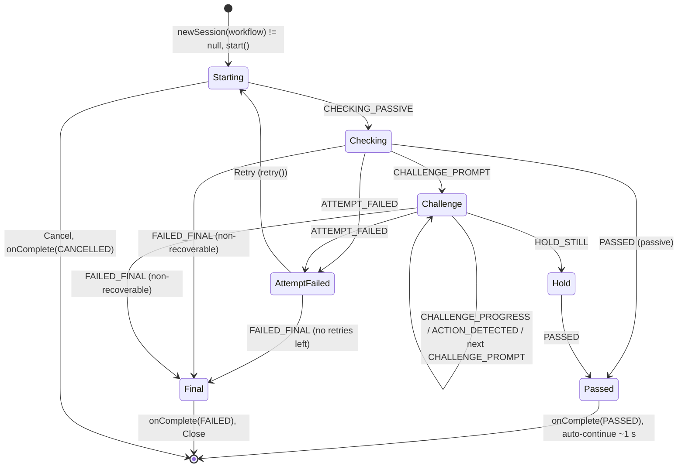

# Face liveness UI specification (Desktop and Android)

For **Person 4** (Desktop, JavaFX) and **Person 5** (Android, Flutter). Both clients render the same states with the same
texts and message keys, so a resident, operator or supervisor sees the same face-liveness experience everywhere.

The source of truth is the `liveness-api` contract: `LivenessEvent`, `LivenessResult`, `ErrorCode.UserMessage`,
`ChallengeType`, `WorkflowType` and `LivenessService.policy(workflow)`. The texts come from the problem statement
(§10, UI/UX requirements) word for word where it gives one.

## 1. Principles

1. **The UI is a renderer.** It only maps `LivenessEvent`s to the screen and acts on the final `LivenessResult`.
   - It never computes liveness itself.
   - It never shows a score, model name, PAD detail, threshold or challenge timing. Problem statement §10.1: "avoid
     exposing technical liveness model information".
2. **PAD failures look like any other verification failure.** `ErrorCode.PAD_FAILURE` maps to
   `UserMessage.VERIFICATION_NOT_COMPLETED`, the generic message. The UI must never distinguish it from an engine
   error.
3. **Online and offline behave identically.** The engine and models run on the device, and nothing on screen
   depends on connectivity.
4. **Mirror the preview, never the frames.** The front-camera preview is mirrored like a selfie. The frames given
   to the engine are never mirrored; the engine's left/right conventions are defined in the subject's frame.
5. **Events arrive on an engine thread.** Marshal them to the UI thread first: `Platform.runLater` on JavaFX; on
   Android, the native bridge posts to the main looper, then an EventChannel delivers to the main isolate.
6. **Accept or reject a face only on `onComplete(result)`.** Use `result.passed()`, and use `result.bestFrame` where
   the flow needs an image. Events are for display only.

## 2. Screen layout

```
+------------------------------------------------------------+
|  <Title per workflow>                              [Cancel] |
+------------------------------------------------------------+
|                                                            |
|                 +------------------------+                 |
|                 |   live camera preview  |                 |
|                 |      ( face oval )     |  <- oval colour |
|                 |   mirrored, oval guide |     + icon      |
|                 +------------------------+                 |
|                                                            |
|   [icon]  STATUS LINE (large, e.g. "Please blink")         |
|           hint line (guidance, e.g. "Please move closer")  |
|                                                            |
|   Step 1 of 2   [=========-----------]   Attempt 1 of 4    |
|                                                            |
|   (failure only) tips list                                 |
|                                                            |
|            [ Retry ]    [ Cancel ]    [ Close ]            |
+------------------------------------------------------------+
```

- **Title:** `liveness.title.<workflow>`.
- **Preview:** the full camera preview with a face-oval guide. The oval outline takes the state colour, always
  together with an icon. Colour is never the only signal.
- **Status line:** the main message, large (at least 24 sp/pt). The challenge prompt goes here.
- **Hint line:** positioning guidance, smaller. It is empty when there is nothing to say.
- **Step "i of n"** and the **progress bar:** only during challenges.
- **"Attempt a of m":** `a` = `event.attemptNumber`, `m` = `policy(workflow).maxRetries + 1`.
- **Buttons:**
  - **Retry** only after ATTEMPT_FAILED, or after a DEVICE_ERROR with `recoverable = true`.
  - **Cancel** always, except after PASSED and FAILED_FINAL.
  - **Close** only after FAILED_FINAL.
  - **Open settings** (Android) only when the camera permission is permanently refused (Android no longer asks):
    it opens the app's system settings. Close stays next to it.
- **On PASSED:** show the success state, then continue automatically after about **1 s**. There is no button.

## 3. State table

| Event / outcome | Status line (key) | Hint line | Oval colour + icon | Progress | Buttons |
|---|---|---|---|---|---|
| `STARTED` | `liveness.status.starting` | cleared | neutral grey + camera icon | hidden; show "Attempt a of m" | Cancel |
| `CHECKING_PASSIVE` | `liveness.status.checking` | **cleared** (means "hint no longer applies") | blue + scanning icon | indeterminate | Cancel |
| `GUIDANCE` | unchanged | `liveness.guidance.<guidance>` (500 ms debounce, see §4.3) | unchanged + warning icon beside the hint | unchanged | Cancel |
| `CHALLENGE_PROMPT` | `liveness.challenge.<challenge>` | cleared | amber + challenge icon (eye, smile, arrow) | determinate 0; show `liveness.progress.step` (i of n) | Cancel |
| `CHALLENGE_PROGRESS` | unchanged (the prompt stays) | `liveness.feedback.continue`; **clears guidance** | amber | `progress` (0..1) | Cancel |
| `ACTION_DETECTED` | `liveness.feedback.action_detected` | cleared | amber turning green briefly + check icon | 100% | Cancel |
| `HOLD_STILL` | `liveness.feedback.hold_still` | cleared, unless a GUIDANCE follows (e.g. LOOK_AT_CAMERA) | blue + scanning icon | indeterminate | Cancel |
| `ATTEMPT_FAILED` | `liveness.error.<error.userMessage()>` | `liveness.retry.attempts_left` with n = `retriesLeft` | red + cross icon | hidden | **Retry**, Cancel |
| `PASSED` | `liveness.status.passed` | cleared | green + check icon | full | none; auto-continue after about 1 s |
| `FAILED_FINAL` | `liveness.error.max_attempts_reached`, or `liveness.error.device_problem` when `error.userMessage()` is DEVICE_PROBLEM | `liveness.recovery.<workflow>` | red + cross icon | hidden | **Close** |
| `DEVICE_ERROR` | `liveness.error.device_problem` | cleared | red + camera-off icon | hidden | `recoverable = true`: **Retry**, Cancel. `recoverable = false`: Cancel, until FAILED_FINAL follows. |
| `onComplete(CANCELLED)` | none | none | none | none | close the screen and return to the previous one. No message (`UserMessage.NONE`); log only. |

**Notes on the table:**
- **Tips.** With ATTEMPT_FAILED and `userMessage() == LIVENESS_NOT_VERIFIED`, also show the tips list
  (`liveness.tips.*`, §4.2). With VERIFICATION_NOT_COMPLETED (which covers PAD failures), show no tips. With
  DEVICE_PROBLEM, show no tips.
- **Why FAILED_FINAL doesn't use the "Please try again" texts.** The flow cannot try again from that screen.
  `MAX_RETRIES_EXCEEDED`, a cooldown refusal (sent as `FAILED_FINAL(MAX_RETRIES_EXCEEDED, recoverable = false)`) and
  final engine or PAD errors therefore all get `liveness.error.max_attempts_reached` plus the workflow's recovery
  guidance. A final device failure gets the device text plus the recovery guidance.
- **LOOK_AT_CAMERA after turns and looks.** Since 2026-10-24 the engine detects TURN_* and LOOK_* when the user
  holds the pose, then sends `GUIDANCE(LOOK_AT_CAMERA)` so the user faces the camera again. Show it like any other
  hint, including during HOLD_STILL.
- **Use the event's data, not cached state.** Use `challengeIndex` / `challengeCount` (1-based) from the event. Do
  not show `timeoutMs` as a countdown in seconds; an optional subtle shrinking ring is fine.

## 4. Texts (English)

### 4.1 From the problem statement (exact)

| Key | Text | Source |
|---|---|---|
| `liveness.status.checking` | Checking face liveness… | §10.2 |
| `liveness.challenge.blink` | Please blink | §10.3 |
| `liveness.challenge.smile` | Please smile | §10.3 |
| `liveness.challenge.turn_left` | Please turn your head to the left | §10.3 |
| `liveness.challenge.turn_right` | Please turn your head to the right | same pattern |
| `liveness.challenge.look_up` | Please look up | same pattern |
| `liveness.challenge.look_down` | Please look down | same pattern |
| `liveness.feedback.continue` | Please continue | §10.4 |
| `liveness.feedback.action_detected` | Action detected | §10.4 |
| `liveness.feedback.hold_still` | Hold still | §10.4 |
| `liveness.status.passed` | Good, face captured successfully | §10.4 |
| `liveness.error.liveness_not_verified` | We could not verify face liveness. Please try again. | §10.5 |
| `liveness.error.verification_not_completed` | Face verification could not be completed. Please try again. | §10.6 |

### 4.2 Tips (§10.5 "Additional guidance"), shown under LIVENESS_NOT_VERIFIED

| Key | Text |
|---|---|
| `liveness.tips.title` | Tips: |
| `liveness.tips.look_at_camera` | Look directly at the camera. |
| `liveness.tips.face_visible` | Ensure your face is clearly visible. |
| `liveness.tips.lighting` | Improve lighting. |
| `liveness.tips.capture_area` | Keep your face within the capture area. |
| `liveness.tips.follow_prompt` | Follow the prompted action. |

### 4.3 Guidance (one per `LivenessEvent.Guidance` value)

| Key | Text |
|---|---|
| `liveness.guidance.no_face` | No face detected. Please look at the camera. |
| `liveness.guidance.multiple_faces` | Only one person should be in view. |
| `liveness.guidance.move_closer` | Please move closer. |
| `liveness.guidance.move_back` | Please move back. |
| `liveness.guidance.center_face` | Please center your face in the oval. |
| `liveness.guidance.improve_lighting` | Please improve the lighting. |
| `liveness.guidance.hold_steady` | Please hold steady. |
| `liveness.guidance.look_at_camera` | Please look at the camera. |

**Debounce and clearing:**
- Show a new hint only if it differs from the current one and at least **500 ms** have passed since the last
  change. The engine already filters hints, so the UI debounce is a second line of defence.
- **Clear** the hint on the next `CHECKING_PASSIVE` or `CHALLENGE_PROGRESS`. This is the contract's convention for
  "hint no longer applies" (Part 3's workaround for proposal P3). Also clear it on `CHALLENGE_PROMPT`, `PASSED` and
  any failure.

### 4.4 Status, retry, errors, recovery, titles, buttons

| Key | Text | Used for |
|---|---|---|
| `liveness.status.starting` | Starting face liveness check… | STARTED |
| `liveness.status.cancelled` | Face liveness check cancelled. | logs only (not shown) |
| `liveness.progress.step` | Step {i} of {n} | challenges |
| `liveness.progress.attempt` | Attempt {a} of {m} | every attempt |
| `liveness.retry.attempts_left` | {n} attempt(s) left | ATTEMPT_FAILED |
| `liveness.error.max_attempts_reached` | Face verification could not be completed. | FAILED_FINAL (§10.7) |
| `liveness.error.device_problem` | Camera/device not available. Check the connection and try again. | DEVICE_ERROR, final device failure |
| `liveness.recovery.resident` | Please contact the supervisor. The resident can be registered using the biometric exception process. | FAILED_FINAL, resident |
| `liveness.recovery.operator` | Please contact your administrator or try again later. | FAILED_FINAL, operator |
| `liveness.recovery.supervisor` | Please contact your administrator. | FAILED_FINAL, supervisor |
| `liveness.title.resident` | Face liveness check | title |
| `liveness.title.operator` | Operator face verification | title |
| `liveness.title.supervisor` | Supervisor face verification | title |
| `liveness.button.retry` | Retry | button |
| `liveness.button.cancel` | Cancel | button |
| `liveness.button.close` | Close | button |
| `liveness.button.open_settings` | Open settings | button: camera permission permanently refused (Android) |

**Error mapping.** Always go through `event.error.userMessage()` and never switch on the raw `ErrorCode` in the UI:
`NONE` shows nothing, and the other four values map to `liveness.error.<value in lower case>`.

## 5. Message keys and ready-to-paste catalogues

- **Canonical keys** are dotted lower case, as above. `liveness.challenge.<name lower>` is already fixed by the
  `ChallengeType` javadoc.
- **Desktop:** `.properties` uses Java `MessageFormat` placeholders: `{0}`, `{1}`.
- **Flutter ARB:** keys must be Dart identifiers, so dots become underscores (`liveness_challenge_blink`), matching
  the client's snake_case style. Placeholders are named.

Placeholder mapping:

| Canonical text | Desktop `.properties` | Flutter ARB |
|---|---|---|
| Step {i} of {n} | `Step {0} of {1}` | `Step {i} of {n}` |
| Attempt {a} of {m} | `Attempt {0} of {1}` | `Attempt {a} of {m}` |
| {n} attempt(s) left | `{0} attempt(s) left` | `{n} attempt(s) left` |

**Desktop, `messages_en.properties`** (Person 4):

```properties
# Face liveness (docs/ui-liveness-spec.md)
liveness.title.resident=Face liveness check
liveness.title.operator=Operator face verification
liveness.title.supervisor=Supervisor face verification
liveness.status.starting=Starting face liveness check…
liveness.status.checking=Checking face liveness…
liveness.status.passed=Good, face captured successfully
liveness.status.cancelled=Face liveness check cancelled.
liveness.challenge.blink=Please blink
liveness.challenge.smile=Please smile
liveness.challenge.turn_left=Please turn your head to the left
liveness.challenge.turn_right=Please turn your head to the right
liveness.challenge.look_up=Please look up
liveness.challenge.look_down=Please look down
liveness.feedback.continue=Please continue
liveness.feedback.action_detected=Action detected
liveness.feedback.hold_still=Hold still
liveness.guidance.no_face=No face detected. Please look at the camera.
liveness.guidance.multiple_faces=Only one person should be in view.
liveness.guidance.move_closer=Please move closer.
liveness.guidance.move_back=Please move back.
liveness.guidance.center_face=Please center your face in the oval.
liveness.guidance.improve_lighting=Please improve the lighting.
liveness.guidance.hold_steady=Please hold steady.
liveness.guidance.look_at_camera=Please look at the camera.
liveness.error.liveness_not_verified=We could not verify face liveness. Please try again.
liveness.error.verification_not_completed=Face verification could not be completed. Please try again.
liveness.error.max_attempts_reached=Face verification could not be completed.
liveness.error.device_problem=Camera/device not available. Check the connection and try again.
liveness.tips.title=Tips:
liveness.tips.look_at_camera=Look directly at the camera.
liveness.tips.face_visible=Ensure your face is clearly visible.
liveness.tips.lighting=Improve lighting.
liveness.tips.capture_area=Keep your face within the capture area.
liveness.tips.follow_prompt=Follow the prompted action.
liveness.retry.attempts_left={0} attempt(s) left
liveness.progress.step=Step {0} of {1}
liveness.progress.attempt=Attempt {0} of {1}
liveness.recovery.resident=Please contact the supervisor. The resident can be registered using the biometric exception process.
liveness.recovery.operator=Please contact your administrator or try again later.
liveness.recovery.supervisor=Please contact your administrator.
liveness.button.retry=Retry
liveness.button.cancel=Cancel
liveness.button.close=Close
liveness.button.open_settings=Open settings
```

**Android, `assets/l10n/app_en.arb`** (Person 5; merge into the existing JSON object):

```json
"liveness_title_resident": "Face liveness check",
"liveness_title_operator": "Operator face verification",
"liveness_title_supervisor": "Supervisor face verification",
"liveness_status_starting": "Starting face liveness check…",
"liveness_status_checking": "Checking face liveness…",
"liveness_status_passed": "Good, face captured successfully",
"liveness_status_cancelled": "Face liveness check cancelled.",
"liveness_challenge_blink": "Please blink",
"liveness_challenge_smile": "Please smile",
"liveness_challenge_turn_left": "Please turn your head to the left",
"liveness_challenge_turn_right": "Please turn your head to the right",
"liveness_challenge_look_up": "Please look up",
"liveness_challenge_look_down": "Please look down",
"liveness_feedback_continue": "Please continue",
"liveness_feedback_action_detected": "Action detected",
"liveness_feedback_hold_still": "Hold still",
"liveness_guidance_no_face": "No face detected. Please look at the camera.",
"liveness_guidance_multiple_faces": "Only one person should be in view.",
"liveness_guidance_move_closer": "Please move closer.",
"liveness_guidance_move_back": "Please move back.",
"liveness_guidance_center_face": "Please center your face in the oval.",
"liveness_guidance_improve_lighting": "Please improve the lighting.",
"liveness_guidance_hold_steady": "Please hold steady.",
"liveness_guidance_look_at_camera": "Please look at the camera.",
"liveness_error_liveness_not_verified": "We could not verify face liveness. Please try again.",
"liveness_error_verification_not_completed": "Face verification could not be completed. Please try again.",
"liveness_error_max_attempts_reached": "Face verification could not be completed.",
"liveness_error_device_problem": "Camera/device not available. Check the connection and try again.",
"liveness_tips_title": "Tips:",
"liveness_tips_look_at_camera": "Look directly at the camera.",
"liveness_tips_face_visible": "Ensure your face is clearly visible.",
"liveness_tips_lighting": "Improve lighting.",
"liveness_tips_capture_area": "Keep your face within the capture area.",
"liveness_tips_follow_prompt": "Follow the prompted action.",
"liveness_retry_attempts_left": "{n} attempt(s) left",
"@liveness_retry_attempts_left": {"placeholders": {"n": {"type": "int"}}},
"liveness_progress_step": "Step {i} of {n}",
"@liveness_progress_step": {"placeholders": {"i": {"type": "int"}, "n": {"type": "int"}}},
"liveness_progress_attempt": "Attempt {a} of {m}",
"@liveness_progress_attempt": {"placeholders": {"a": {"type": "int"}, "m": {"type": "int"}}},
"liveness_recovery_resident": "Please contact the supervisor. The resident can be registered using the biometric exception process.",
"liveness_recovery_operator": "Please contact your administrator or try again later.",
"liveness_recovery_supervisor": "Please contact your administrator.",
"liveness_button_retry": "Retry",
"liveness_button_cancel": "Cancel",
"liveness_button_close": "Close",
"liveness_button_open_settings": "Open settings"
```

**Other languages.** Add the same keys with translations. Until a language has them, each client falls back to
English: Desktop through the ResourceBundle parent, Android through gen-l10n's handling of missing keys (Person 5
checks this, see the P5-1 report).

**Key lookup from events:**

| From | Key |
|---|---|
| `event.challenge` | `liveness.challenge.` + `name().toLowerCase()` |
| `event.guidance` | `liveness.guidance.` + `name().toLowerCase()` |
| `event.error.userMessage()` | `liveness.error.` + `name().toLowerCase()`, skipping `NONE` |
| workflow | `liveness.title.` / `liveness.recovery.` + `name().toLowerCase()` |

## 6. Flow



GUIDANCE and DEVICE_ERROR can arrive in any non-final state. A recoverable DEVICE_ERROR enables Retry, and
`retry()` restarts the source.

**Entry and exit per workflow:**

| Workflow | Where the liveness step runs | On PASSED | On FAILED_FINAL | Liveness disabled (`newSession` returns null) |
|---|---|---|---|---|
| RESIDENT | in biometric capture, **before** the existing SBI face capture | continue to the SBI face capture | block the face capture; show `liveness.recovery.resident` (biometric exception process) | the legacy flow, unchanged |
| OPERATOR | after a successful **password** at login (scope S1); on the face tile of operator biometric onboarding; at end-of-registration packet authentication | continue (home, save the onboarding face, or authenticate the packet) | stay on the screen; show `liveness.recovery.operator`; no login, save or packet approval | the legacy flow, unchanged |
| SUPERVISOR | after the **password** in the approve-packet authentication dialog | approval proceeds | the approval is not authorised; show `liveness.recovery.supervisor` | the legacy flow, unchanged |

Cancel always returns to the screen that started the step, as if the user had backed out, with no state change.
The engine's cooldown (`onRepeatedFailure = COOLDOWN`) arrives as an immediate FAILED_FINAL and is rendered the same
way as reaching the maximum attempts.

**Android hooks (as built in P5-4).** Every screen calls one function, `LivenessGate.run(context, workflow)`
(`lib/ui/liveness/liveness_gate.dart`), and branches on its result: **proceed** (passed, or liveness disabled for the
workflow, in which case no liveness screen opens), **cancelled** (Cancel or back) or **blocked** (failed; the liveness
screen already showed the recovery text). The gate opens the liveness screen full screen on the root navigator, so it
also works from a dialog. It uses the workflow's camera, `mosip.registration.liveness.face.android.<workflow>.camera`
(front or back, default front). It never throws: any error is **blocked** (fail closed) with the generic text.

| Hook (file) | Workflow | Proceed | Cancelled | Blocked |
|---|---|---|---|---|
| Resident face capture, Scan of the **Face** tile (`biometric_capture_scan_block_portrait.dart`; the landscape layout `biometric_scan_middle_block.dart`, Scan and Rescan) | RESIDENT | the SBI face capture, then face binding (below): stored only on MATCH | no capture, no capture attempt counted | the same as cancelled; the screen showed `liveness.recovery.resident` |
| Operator login, after a successful password (`login_page.dart`) | OPERATOR | sync or home as before | log out again, stay on the login page | log out again, stay on the login page, snackbar with the failure text |
| Operator onboarding, Scan of the **Face** tile (`operator_biometric_capture_scan_block_view.dart`) | OPERATOR | the SBI face capture, then face binding (below): stored only on MATCH | no capture | no capture |
| Packet authentication, between the password check and the packet submission (`generic_process.dart`) | OPERATOR: the officer signs the packet | the packet is submitted | nothing submitted, stay on the authentication step | nothing submitted, stay on the authentication step, snackbar |
| Supervisor approval, between the password check and the approval (`authenticate_dialogbox.dart`) | SUPERVISOR | the approval is submitted and the dialog closes | nothing approved, the dialog stays | nothing approved, the dialog stays with the failure text |

- **The exception photo is not gated.** It is taken in the biometric exception process, which is the recovery path
  the resident recovery text points to when liveness fails; gating it would close that path.
- **Packet authentication uses OPERATOR**: the registration officer authenticates the packet with their own password.
- **Camera permission refused** (Android): the screen shows `liveness.error.device_problem` plus the recovery text and
  Close, and the gate returns blocked. When Android will no longer ask (refused for good), `liveness.button.open_settings`
  also opens the app's settings. No session is started without the permission.
- **Config after a sync**: the client re-reads the liveness config after every global-param refresh (sync). New
  sessions use it; a running session keeps its policy and analyzer.
- **Fake engine** (debug builds only): it never opens the camera; the screen shows a placeholder instead of a preview,
  and there is no best frame.

### Face binding (F1): the stored face must be the person who passed

Liveness runs on the camera, but the face that is stored comes from the SBI capture. Without a check, a live person
could pass liveness while a photo, or someone else, is captured. After a PASSED gate and the SBI face capture, the
captured face is compared with the gate's best frame (`FaceMatcher`, SFace). **Only MATCH stores the capture.**
Anything else (another person, no face, several faces, an undecodable image, an error) rejects it:
- nothing is stored and no capture attempt is counted;
- the screen shows the generic `liveness.error.verification_not_completed`;
- the next Scan runs liveness again.

Binding is not presentation attack detection (a photo of the same person matches), so it never replaces the liveness
step. Both images stay in memory; neither is logged.

| key | default | meaning |
|---|---|---|
| `mosip.registration.liveness.face.binding.enabled` | true | false: captures are stored as before, and each one is audited SKIPPED |
| `mosip.registration.liveness.face.binding.cosineThreshold` | 0.45 | MATCH at or above this cosine (read by `AnalyzerConfig.fromConfig`) |

Audit: `LIVENESS_FACE_BINDING` (REG-EVT-018) with the outcome, the similarity rounded to 2 decimals, the threshold and
the session id.

**Desktop (Person 4).** After a PASSED gate and the device `/capture`, compare before accepting the capture:

```java
// At start-up: preload() verifies all five files; the matcher session is built on first use, or here.
analyzers.preload();
background.execute(() -> {
    try { analyzers.warmUpMatcher(); } catch (LivenessEngineException e) { /* the first comparison builds it */ }
});

// result: the PASSED LivenessResult; captured: the SBI face (ISO 19794-5, usually JPEG 2000) decoded to RGB888.
boolean bound;
try (FaceMatcher matcher = analyzers.createMatcher()) {   // cheap; shares the factory's verified sessions
    MatchResult m = matcher.compare(result.bestFrame, captured);
    bound = m.matched();                                   // MATCH only
    audit("LIVENESS_FACE_BINDING", m.outcome, m.similarity, m.threshold, result.sessionId);
} catch (LivenessEngineException | RuntimeException e) {
    bound = false;                                         // fail closed
}
if (!bound) {
    // Do not store the capture; show liveness.error.verification_not_completed; the next Scan runs liveness again.
}
```

**Android (as built in fix round 2).** Each face hook calls `FaceBinding.captureFace` (`lib/ui/liveness/face_binding.dart`):
1. `LivenessGate.run`. Cancelled or blocked: stop, as before.
2. `armBinding(sessionId)`: the native side holds the PASSED session's best frame (one at most, 5 minutes at most). It
   returns ARMED, DISABLED (binding off) or REJECTED (an unknown or expired session; the hook then blocks with the
   generic text).
3. `invokeDiscoverSbi`. The native capture handler (`BiometricsDetailsApi.parseRCaptureResponse`) consumes the arming.
   An armed capture is decoded (JPEG 2000 from the ISO 19794-5 record) and compared on a background thread, and stored
   only after a MATCH. Otherwise nothing is stored, and `invokeDiscoverSbi` returns `LIVENESS_BINDING_FAILED`; the hook
   then shows the generic text and stops before counting an attempt or opening the scan dialog.

The best frame is dropped after the comparison, when a new session starts, when the app goes to the background
(unless an armed SBI capture is under way: the SBI app itself pauses the client) and after 5 minutes. An armed capture
whose best frame was dropped meanwhile fails closed.

## 7. Accessibility

- **Screen readers.** Announce every status-line change: the prompt, the result and the failure text. Use
  TalkBack/`SemanticsService.announce` on Android and `accessibleText` with a live-region notification on JavaFX.
  Do not announce progress ticks; announce the hint at most once per change.
- **Large text.** The status line is at least 24 sp/pt and the hint at least 18. Respect the system font scale,
  and let the layout grow rather than truncate.
- **Never rely on colour alone.** Every oval colour is paired with an icon, and every state has a text. The
  red/green states are also distinguishable by shape (cross or check).
- **Touch targets** are at least 48 dp. Cancel stays reachable with one hand on phones.
- **Motion.** Challenge icons may animate, but keep the animation off when the system "reduce motion" setting is on.

## 8. Diagnostics

`policy.diagnosticMode = true` adds detail to logs and the audit trail only (scores, model version, timings). It
**never** changes what is on screen. Production screens look identical whatever the setting. Developer overlays such
as frame times or scores are allowed only on separate debug-only screens that are not reachable in release builds.
